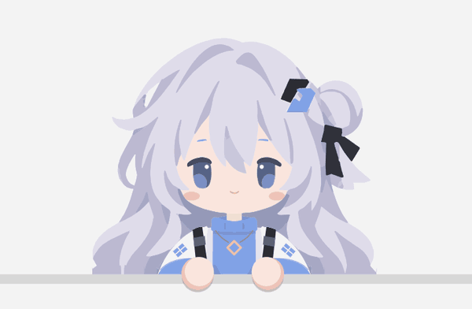
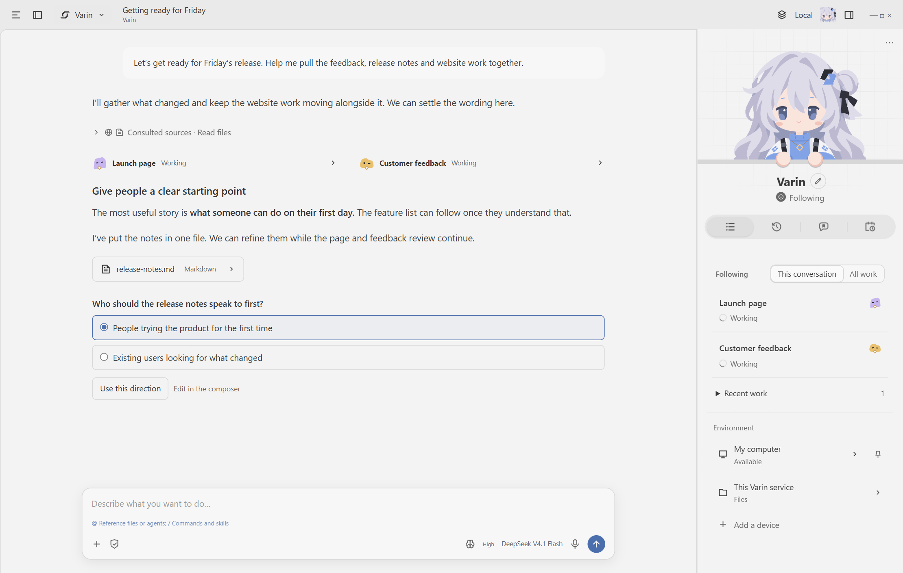
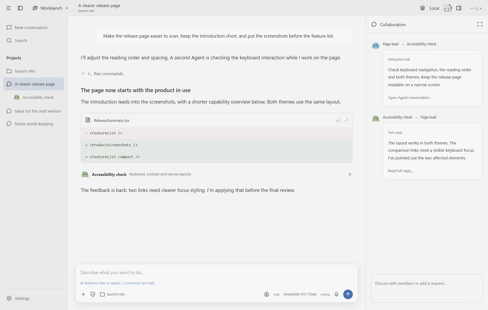
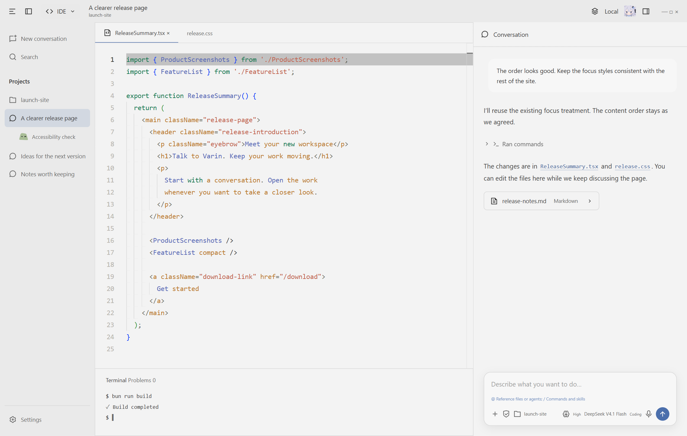
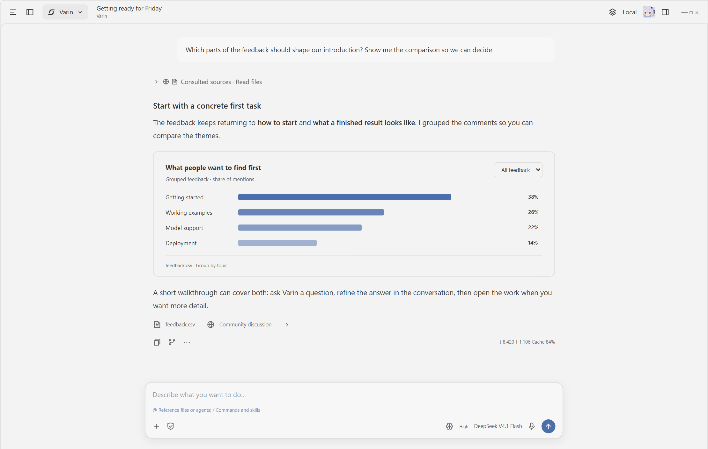
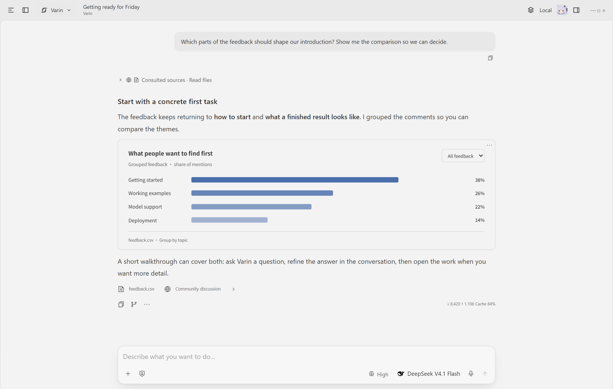
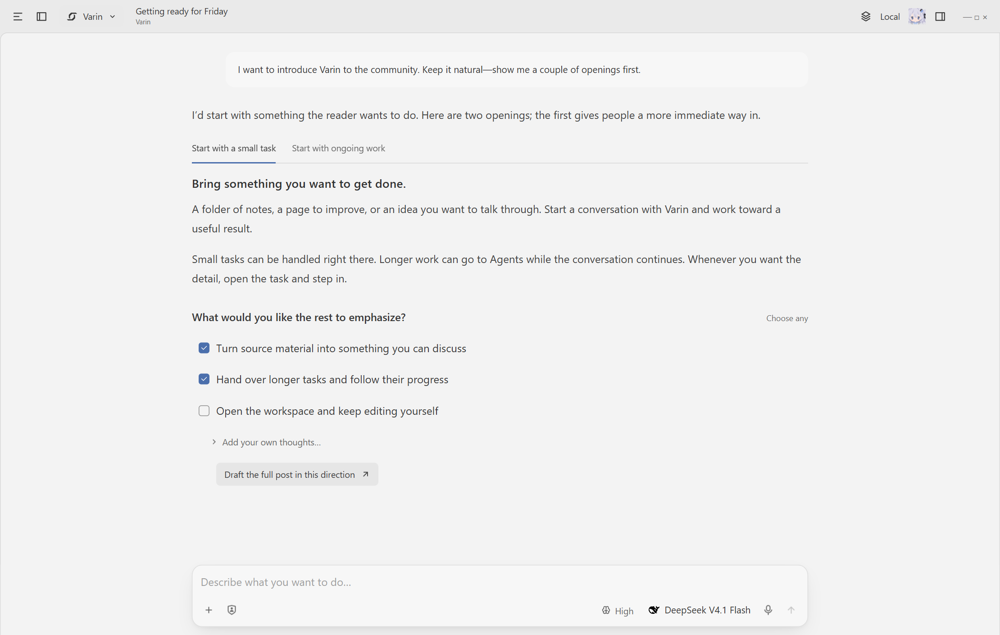
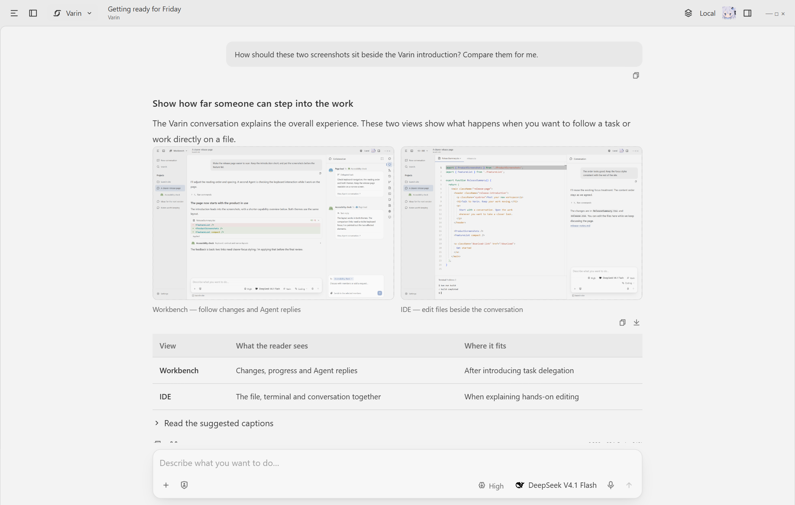

[English](../../README.md) | [简体中文](README.zh-CN.md) | [繁體中文](README.zh-TW.md) | Français | [日本語](README.ja.md)

<p align="center">
  
</p>

<p align="center"><strong>Un assistant IA pour le travail au long cours, avec un espace où intervenir.</strong></p>

<p align="center">Discutez avec Varin, faites avancer le travail et ouvrez les détails à votre rythme.<br />Open source. Vos modèles, vos clés, votre ordinateur ou serveur.</p>

<p align="center">
  <a href="https://varin.dev/fr/">Site web</a> ·
  <a href="https://github.com/Youzini-afk/Varin/releases/latest">Télécharger</a> ·
  <a href="../../packages/docs/content/docs/fr/index.mdx">Guides</a> ·
  <a href="../../docs/ops/varin-extension-authoring.md">Créer une extension</a> ·
  <a href="https://github.com/Youzini-afk/Varin/discussions">Discussions</a>
</p>

<p align="center">
  <a href="https://github.com/Youzini-afk/Varin/releases"></a>
  <a href="https://github.com/Youzini-afk/Varin/actions/workflows/ci.yml"></a>
  <a href="../../LICENSE"></a>
</p>

<p align="center">
  
</p>

## Faites connaissance avec Varin

Varin est un assistant personnel pour le travail au long cours. Discutez d'une idée, posez une question rapide ou confiez-lui un travail qui prendra du temps. Il peut traiter les petites demandes lui-même, faire appel à des Agents pour les tâches plus importantes et reprendre un travail existant avec son contexte.

- **Continuez à parler pendant le travail.** Un message peut orienter le travail en cours ; mettez-le en file d'attente si vous préférez qu'il soit traité ensuite.
- **Voyez ce qui avance.** Le panneau latéral rassemble travaux, réponses, demandes à traiter, mémoire et calendrier. Ouvrez les détails à côté de la conversation ou entrez dans le workbench de la tâche.
- **Retrouvez le fil.** Varin peut retrouver et organiser les souvenirs pertinents de ses conversations. Vous pouvez les consulter, les modifier et les oublier.
- **Gardez les ressources à portée de main.** Ouvrez fichiers et ordinateurs connectés à côté du chat. Transmettez une pièce jointe originale à un Agent, discutez du résultat et poursuivez le travail.

<p align="center">
  
</p>

[L'assistant](../../docs/bot.md) · [Collaboration et reprise des tâches](../../docs/collaboration.md)

## Choisissez votre niveau de participation

Restez dans la discussion d'ensemble, travaillez directement avec un Agent ou ouvrez les fichiers vous-même. Chaque vue met une autre information au premier plan.

| Vue | Au premier plan | À ouvrir selon vos besoins |
| --- | --- | --- |
| **Varin** | La conversation, les travaux en cours et les résultats | Tâches, questions, mémoire, fichiers et ordinateurs |
| **Workbench** | Une tâche précise et l'Agent qui l'exécute | Outils, coéquipiers, plans, contexte et restauration |
| **IDE** | Les fichiers et le code que vous souhaitez manipuler | Éditeurs, différences, terminaux, Git et conversation |

### Workbench : travaillez directement avec les Agents

Confiez une tâche et suivez son exécution au niveau de détail souhaité. L'activité des outils se replie en résumés entre les messages ; les tâches déléguées restent accessibles. Ouvrez la conversation d'un coéquipier, envoyez un message ou un fichier, vérifiez une modification ou créez une branche de conversation.

La délégation peut choisir librement une tâche, un modèle et un niveau de réflexion, ou utiliser vos Agents prédéfinis. Un assistant facultatif peut sélectionner le modèle parmi vos modèles de conversation activés, à partir de leurs descriptions.

<p align="center">
  
</p>

### IDE : gardez la main sur les fichiers

Éditez avec Monaco, parcourez le projet, inspectez les différences et utilisez terminaux et Git à côté de la conversation. Passez de la discussion à l'édition du fichier : éditeurs et Agents partagent les mêmes services de documents et d'espace de travail.

<p align="center">
  
</p>

Général, Programmation, Recherche et Bureautique sont des **orientations de tâche** distinctes : elles déterminent les outils et coéquipiers disponibles, indépendamment de ces vues. [Architecture du workbench](../../docs/workbench.md)

## Une conversation dans laquelle travailler

- **Une progression lisible.** Le texte reste au premier plan ; développez activités, réflexion, résultats d'outils et réponses des Agents selon vos besoins.
- **Des contrôles près de l'explication.** Choix simples ou multiples, champs et formulaires peuvent apparaître entre les paragraphes. Une sélection peut préparer un message modifiable.
- **Des résultats expressifs.** Images, tableaux, formules et diagrammes s'intègrent au texte. Le HTML permet des graphiques interactifs, comparaisons et petits outils, avec consultation du code et export.
- **Des liens avec le travail.** Les références aux tâches, fichiers, plans et sources ouvrent la vue correspondante. Les pièces jointes conservent leurs originaux entre Agents.
- **La possibilité de changer de direction.** Branches de conversation et restauration de fichiers gardent le travail précédent accessible. Le composeur propose références, commandes et suggestions de message modifiables.

<p align="center">
  
</p>

**Comparer les résultats au fil de l'explication.** Les graphiques font ressortir les tendances des documents, avec la discussion et les références dans la même conversation.

<p align="center">
  
</p>

**Choisir et préciser au fil de l'explication.** Lisez les propositions dans des onglets discrets, sélectionnez les points à développer et ajoutez vos remarques. Préparez le prochain message pour poursuivre la discussion.

<p align="center">
  
</p>

**Lire les images avec le texte.** Les aperçus conservent leurs proportions et s'ouvrent pour un examen détaillé. Les tableaux facilitent la comparaison ; les précisions peuvent rester repliées près de l'explication.

<p align="center">
  
</p>

[Conversation et contenu interactif](../../docs/interactive-content.md)

## Des outils pour toute la tâche

Varin relie le modèle aux informations, fichiers, programmes et interfaces nécessaires au travail.

| Capacité | Outils accessibles aux Agents |
| --- | --- |
| **Fichiers et code** | Parcourir, rechercher, lire et modifier ; extraire la structure du code ; enquêter en arrière-plan ; consulter différences et points de restauration. |
| **Commandes et calcul** | Shells, terminaux interactifs, processus en arrière-plan et environnement JavaScript persistant, avec état, sorties et arrêt. |
| **Web et recherche** | Recherche web configurable, lecture de pages, citations, recherche académique et lecture des documents originaux. |
| **Documents et données** | Lire des PDF et fichiers Office ; créer et modifier Word, Excel et PowerPoint ; rendre et exporter les formats pris en charge. |
| **Navigateur et ordinateur** | Interagir avec les pages, gérer les téléchargements, observer les applications et utiliser un bureau connecté. |
| **Images et résultats interactifs** | Consulter des images, appeler les modèles de génération et d'édition configurés et produire du HTML/JavaScript dans le chat. |
| **Coordination et continuité** | Déléguer, envoyer des messages et reprendre les tâches ; gérer plans, mémoire, calendrier et suivis. |
| **Vos propres capacités** | Connecter des serveurs MCP, utiliser des Skills et installer des extensions. |

Les outils courants sont disponibles directement ; les autres se découvrent au besoin. Les fonctions liées à un fournisseur utilisent vos services configurés, et les opérations distantes utilisent les capacités de l'appareil connecté.

## Vos modèles, vos machines et votre espace

**Choisissez les modèles.** Connectez des fournisseurs ou services locaux compatibles, réglez la réflexion et attribuez différents modèles aux tâches et travaux auxiliaires. L'usage et les coûts estimés sont suivis par canal et modèle.

**Intégrez d'autres Agents.** Codex, Claude Code, Pi et les programmes compatibles ACP peuvent fonctionner en sessions ou recevoir des tâches en conservant leurs comptes, modèles et outils. [Agents externes](../../docs/external-agents.md)

**Placez le travail au bon endroit.** Exécutez Varin localement, sur votre serveur, ou connectez-vous depuis un navigateur ou un téléphone. L'interface, le service Agent, les fichiers et l'appareil de contrôle peuvent résider sur des machines différentes. [Déploiement](../../docs/ops/cloud-deployment.md) · [Ressources](../../docs/resources.md)

**Un compagnon de bureau facultatif.** Il suit l'activité du Bot sélectionné. Téléchargez son apparence dans les Paramètres et choisissez de le réveiller ou de le mettre en veille.

<a id="how-the-harness-works"></a>

## Pour le travail qui se poursuit

Le harness gère le contexte et l'exécution autour du modèle :

- Préparation du contexte en arrière-plan avant son remplacement, avec résumés et extraits originaux conservés.
- Historique durable des exécutions et résultats pour reprendre les travaux récupérables après un redémarrage.
- État propre aux questions, permissions, messages en attente et rapports pendant que d'autres travaux continuent.
- Historique de restauration des fichiers et vérification des conflits lorsque leur contenu a changé.
- Recherche, révision et entretien de la mémoire du Bot en arrière-plan, avec gestion directe par l'utilisateur.

Le runtime central est écrit en Rust. Les interfaces bureau, web et mobile partagent les mêmes services applicatifs. [Runtime](../../docs/runtime.md) · [Architecture](../../docs/architecture.md)

## Commencer

1. Installez Varin.

   | Où | Comment |
   | --- | --- |
   | Windows, macOS ou Linux | [Téléchargez le programme d'installation](https://github.com/Youzini-afk/Varin/releases/latest) adapté à votre système et à votre architecture CPU. |
   | Votre propre serveur, utilisé depuis un navigateur | [Auto-héberger avec Docker](../../docs/ops/cloud-deployment.md), avec stockage persistant, mots de passe et accès distant. |
   | Votre téléphone | Sur Android, installez l'APK de la [dernière version](https://github.com/Youzini-afk/Varin/releases/latest) ; sur iPhone, installez l'application web (PWA). Associez-le ensuite à votre Host depuis les Paramètres. [Guide mobile](../../packages/docs/content/docs/fr/mobile.mdx) |
   | Depuis les sources | Voir [Exécuter depuis les sources](#exécuter-depuis-les-sources). |

2. Ouvrez les Paramètres et ajoutez une clé d'API pour un fournisseur de modèles, ou connectez un service local. [Canaux de modèles](../../packages/docs/content/docs/fr/providers.mdx)
3. Commencez une conversation avec Varin. Ouvrez le Workbench pour collaborer directement avec un Agent, ou l'IDE pour travailler dans les fichiers.

Varin est en développement actif avant la version 1.0. Cette page décrit les sources actuelles ; les [notes de version](https://github.com/Youzini-afk/Varin/releases) décrivent chaque build publié. Sauvegardez les données importantes de l'application avant une mise à niveau.

## Exécuter depuis les sources

Utilisez **Node.js 24**, **Bun 1.3.14**, Git et la chaîne d'outils Rust indiquée dans [rust-toolchain.toml](../../kernel/rust-toolchain.toml). Les dépendances natives nécessitent aussi une chaîne d'outils C/C++ et CMake. Le [guide de développement](../../docs/development.md) détaille l'installation et les commandes.

```sh
git clone https://github.com/Youzini-afk/Varin.git
cd Varin
bun install --frozen-lockfile
bun run dev
```

Ouvrez l'URL de l'interface affichée dans le terminal. Cette commande lance l'interface web et l'Application Host.

Pour l'application de bureau, exécutez `bun run electron:dev` dans le même dépôt. La commande prépare le noyau natif et lance Electron avec l'interface de développement. [Développement et packaging de l'application de bureau](../../packages/electron/README.md#development)

## Étendre Varin

Les vues Varin, Workbench et IDE, ainsi que le navigateur, Office, le contrôle de l'ordinateur et les serveurs de langage, sont eux-mêmes des extensions et utilisent les mêmes contrats que les extensions tierces. Chacun peut être désactivé, et un espace de travail peut être remplacé entièrement. Les extensions peuvent ajouter des outils, des protocoles de modèle, des algorithmes de contexte, des panneaux et des espaces de travail complets. Commencez par le [guide de création](../../docs/ops/varin-extension-authoring.md), le [SDK](../../packages/extension-sdk/README.md) ou les [exemples fonctionnels](../../examples/extensions/README.md).

Pour comprendre comment les éléments s'articulent, consultez l'[architecture](../../docs/architecture.md), le [runtime](../../docs/runtime.md) et l'[index de la documentation](../../docs/README.md).

## Communauté et contributions

- Posez vos questions dans [Q&A](https://github.com/Youzini-afk/Varin/discussions/categories/q-a), partagez vos créations et proposez des idées dans [Discussions](https://github.com/Youzini-afk/Varin/discussions). La page [Obtenir de l'aide](../translations/SUPPORT.fr.md) indique où adresser chaque type de demande.
- Les contributions sont les bienvenues : outils et gestion du contexte, fournisseurs de modèles, extensions, documentation et traductions, ou comptes rendus de tests sur votre plateforme. Le [guide de contribution](../translations/CONTRIBUTING.fr.md) explique la préparation de l'environnement et l'envoi d'une pull request.
- [Signaler un bug](https://github.com/Youzini-afk/Varin/issues/new?template=bug.yml) · [Proposer une fonctionnalité](https://github.com/Youzini-afk/Varin/issues/new?template=feature.yml) · [Signaler une vulnérabilité en privé](../SECURITY.md)
- Contact : [varin@astrmira.com](mailto:varin@astrmira.com).

Merci à la communauté [LinuxDO](https://linux.do) pour son soutien.

## Licence

Le projet est distribué sous la [GNU Affero General Public License v3.0](../../LICENSE) (`AGPL-3.0-only`). Les versions modifiées accessibles par le réseau doivent fournir leur code source correspondant selon la licence. Les mentions de droits d'auteur et de tiers sont conservées dans [THIRD_PARTY_NOTICES](../../THIRD_PARTY_NOTICES.md).
