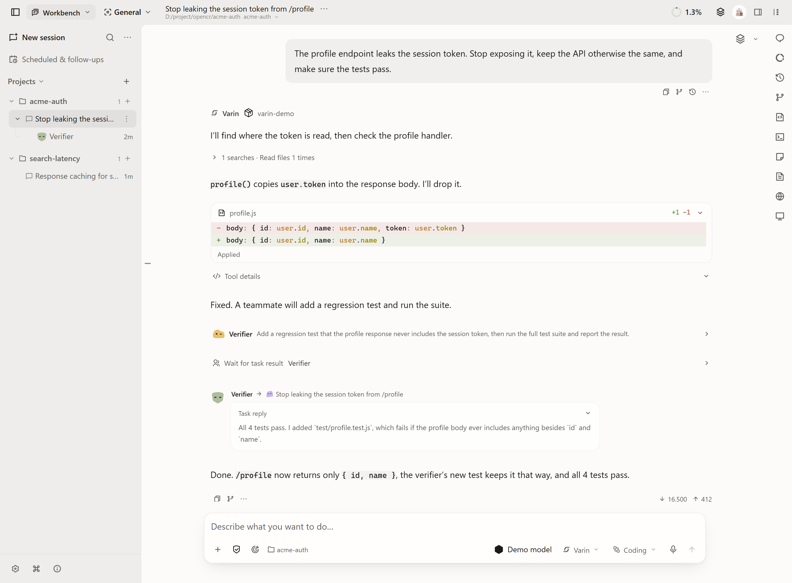
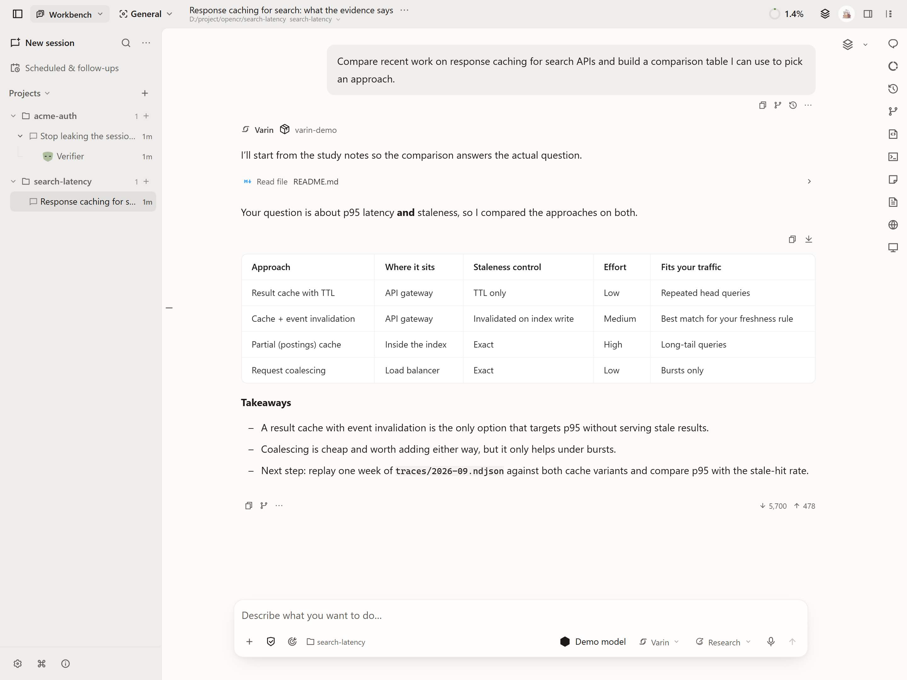
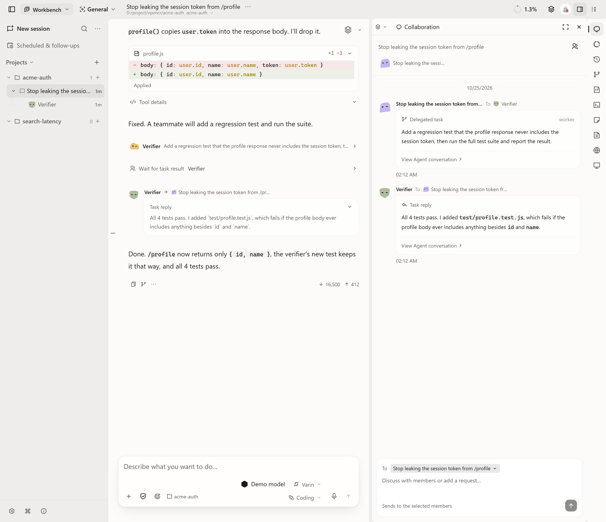

[English](../../README.md) | [简体中文](README.zh-CN.md) | [繁體中文](README.zh-TW.md) | Français | [日本語](README.ja.md)

<p align="center">
  
</p>

<p align="center"><strong>Le harness d'agents open source, prêt à l'emploi.</strong></p>

<p align="center">Tout ce qui entoure le modèle, prêt à l'emploi et personnalisable en profondeur.</p>

<p align="center">
  <a href="https://varin.dev/fr/">Site web</a> ·
  <a href="https://github.com/Youzini-afk/Varin/releases/latest">Télécharger</a> ·
  <a href="../../packages/docs/content/docs/fr/index.mdx">Guides</a> ·
  <a href="../../docs/ops/varin-extension-authoring.md">Créer une extension</a> ·
  <a href="https://github.com/Youzini-afk/Varin/discussions">Discussions</a>
</p>

<p align="center">
  <a href="https://github.com/Youzini-afk/Varin/releases"></a>
  <a href="https://github.com/Youzini-afk/Varin/actions/workflows/ci.yml"></a>
  <a href="../../LICENSE"></a>
</p>

<p align="center">
  
</p>

Le modèle réfléchit. Le harness, c'est tout ce qui l'entoure : outils, contexte, exécution, permissions, collaboration et reprise. Varin prépare tout cela, et le même modèle mène à bien des tâches plus longues et plus complexes. Installez-le, ajoutez votre propre clé d'API, et commencez.

## Pourquoi Varin

**Le même modèle va plus loin.**

- Contexte autogéré : rangé à l'avance en arrière-plan, résumé en gardant les extraits clés, et compté avec des tokenizers locaux calés sur l'usage réel.
- Exécution durable : chaque étape est notée et l'exécution reprend après un redémarrage. Une action au résultat incertain s'arrête pour vérification au lieu d'être rejouée.
- Questions sans blocage : le reste avance pendant que l'agent attend votre réponse, et les objectifs budgétés reprennent quand leurs conditions sont remplies.
- Outils à la demande : les outils courants restent sous la main, les autres se chargent au besoin. Les serveurs MCP peuvent être exposés directement ou découverts à la demande.

**Prêt à l'emploi.** Environ 80 outils natifs, 4 modes de travail, 4 espaces de travail officiels, 6 serveurs de langage intégrés et 8 protocoles de modèle natifs, avec une interface en 10 langues.

**Personnalisation en profondeur, sans écrire de code.** Changez le modèle, les instructions ou les outils de n'importe quel agent prédéfini, ou créez le vôtre. Choisissez des modèles distincts pour les titres, le contexte, la planification, les images et les embeddings. Modifiez les instructions système et la mémoire, utilisez les Skills des dossiers `.claude` et `.agents` ou installez-les depuis un dépôt Git, et choisissez, outil par outil, d'autoriser, de demander ou de refuser.

**Vos clés, vos données.** Les clés restent sur votre propre Host, et les requêtes partent directement vers les fournisseurs que vous configurez : OpenAI, Anthropic, Gemini, Vertex AI, Azure OpenAI, Bedrock, Mistral, Alibaba Model Studio, Zhipu et StepFun, ou Ollama, LM Studio et tout endpoint compatible. L'usage est enregistré par canal et par modèle, tour après tour.

## Quatre façons de travailler

Le mode détermine les outils dont l'agent dispose d'emblée et les coéquipiers qui l'aident.

| Mode | Ce qu'il fait | Par exemple |
| --- | --- | --- |
| Programmation | Lire et modifier le code, lancer des commandes, ouvrir des terminaux. Chaque fichier modifié est sauvegardé à chaque tour. | « Refactorise le module de connexion et préviens-moi quand tous les tests passent. » |
| Recherche | Interroger OpenAlex et Semantic Scholar, lire articles et PDF, et faire avancer une expérience pas à pas. | « Trouve les articles des deux dernières années sur ce sujet et fais-en un tableau comparatif filtrable. » |
| Bureautique | Travailler directement avec Word, Excel et PowerPoint, ainsi qu'avec le navigateur et les applications de votre ordinateur. | « Exporte les commandes du mois dernier dans un fichier Excel avec des graphiques. » |
| Général | Chercher une information, rédiger, créer un petit outil interactif. | « Compare ces trois appareils photo et fais-moi un graphique réglable. » |

<p align="center">
  
</p>

## Équipes, bots et modifications réversibles

- **Équipes.** L'agent principal découpe la tâche et en confie les parties à ses coéquipiers : un Worker écrit l'implémentation, l'agent de recherche rassemble le contexte, le vérificateur lance les tests. Les coéquipiers avancent en parallèle, s'écrivent directement, se transmettent du code avec son diff fichier par fichier, et rendent compte une fois le travail terminé. Suivez leurs échanges dans le panneau de collaboration et intervenez quand vous voulez.
- **Bots.** Un bot a son propre nom, ses instructions, son modèle et son dossier de travail, et mène plusieurs tâches de front. Vous voyez tout ce dont il se souvient, vous pouvez le corriger ou le lui faire oublier. Mettez-le en veille et son travail est suspendu ; réveillez-le et il reprend là où il s'était arrêté.
- **Historique des fichiers.** Chaque fichier modifié s'aligne sur une frise, tour par tour. Revenez en arrière en un geste, et annulez ce retour si besoin. Les fichiers que vous avez modifiés vous-même ne sont jamais écrasés.

<p align="center">
  
</p>

## Commencer

1. Installez Varin.

   | Où | Comment |
   | --- | --- |
   | Windows, macOS ou Linux | [Téléchargez le programme d'installation](https://github.com/Youzini-afk/Varin/releases/latest) adapté à votre système et à votre architecture CPU. |
   | Votre propre serveur, utilisé depuis un navigateur | [Auto-héberger avec Docker](../../docs/ops/cloud-deployment.md), avec stockage persistant, mots de passe et accès distant. |
   | Votre téléphone | Associez-le à votre Host depuis les Paramètres. En attendant la publication des applications natives, installez l'application web (PWA). [Guide mobile](../../packages/docs/content/docs/fr/mobile.mdx) |
   | Depuis les sources | Voir [Exécuter depuis les sources](#exécuter-depuis-les-sources). |

2. Ouvrez les Paramètres et ajoutez une clé d'API pour un fournisseur de modèles, ou connectez un service local. [Fournisseurs et modèles](../../packages/docs/content/docs/fr/providers.mdx)
3. Choisissez un mode de travail, sélectionnez un dossier de projet si la tâche en a besoin, puis lancez votre première tâche.

Varin est en développement actif avant la version 1.0. Cette page décrit les sources actuelles ; les [notes de version](https://github.com/Youzini-afk/Varin/releases) décrivent chaque build publié. Sauvegardez les données importantes de l'application avant une mise à niveau.

## Exécuter depuis les sources

Utilisez **Node.js 24**, **Bun 1.3.14**, Git et la chaîne d'outils Rust indiquée dans [rust-toolchain.toml](../../kernel/rust-toolchain.toml). Les dépendances natives nécessitent aussi une chaîne d'outils C/C++ et CMake. Le [guide de développement](../../docs/development.md) détaille l'installation et les commandes.

```sh
git clone https://github.com/Youzini-afk/Varin.git
cd Varin
bun install --frozen-lockfile
bun run dev
```

Ouvrez l'URL de l'interface affichée dans le terminal. Cette commande lance l'interface web et l'Application Host.

Pour l'application de bureau, exécutez `bun run electron:dev` dans le même dépôt. La commande prépare le noyau natif et lance Electron avec l'interface de développement. [Développement et packaging de l'application de bureau](../../packages/electron/README.md#development)

## Étendre Varin

Les espaces Agent, IDE, Recherche et Bot, ainsi que le navigateur, Office, le contrôle de l'ordinateur et les serveurs de langage, sont eux-mêmes des extensions et utilisent les mêmes contrats que les extensions tierces. Chacun peut être désactivé, et un espace de travail peut être remplacé entièrement. Les extensions peuvent ajouter des outils, des protocoles de modèle, des algorithmes de contexte, des panneaux et des espaces de travail complets. Commencez par le [guide de création](../../docs/ops/varin-extension-authoring.md), le [SDK](../../packages/extension-sdk/README.md) ou les [exemples fonctionnels](../../examples/extensions/README.md).

Pour comprendre comment les éléments s'articulent, consultez l'[architecture](../../docs/architecture.md), le [runtime](../../docs/runtime.md) et l'[index de la documentation](../../docs/README.md).

## Communauté et contributions

- Posez vos questions dans [Q&A](https://github.com/Youzini-afk/Varin/discussions/categories/q-a), partagez vos créations et proposez des idées dans [Discussions](https://github.com/Youzini-afk/Varin/discussions). La page [Obtenir de l'aide](../translations/SUPPORT.fr.md) indique où adresser chaque type de demande.
- Les contributions sont les bienvenues : outils et gestion du contexte, fournisseurs de modèles, extensions, documentation et traductions, ou comptes rendus de tests sur votre plateforme. Le [guide de contribution](../translations/CONTRIBUTING.fr.md) explique la préparation de l'environnement et l'envoi d'une pull request.
- [Signaler un bug](https://github.com/Youzini-afk/Varin/issues/new?template=bug.yml) · [Proposer une fonctionnalité](https://github.com/Youzini-afk/Varin/issues/new?template=feature.yml) · [Signaler une vulnérabilité en privé](../SECURITY.md)

Merci à la communauté [LinuxDO](https://linux.do) pour son soutien.

## Licence

Le projet est distribué sous la [GNU Affero General Public License v3.0](../../LICENSE) (`AGPL-3.0-only`). Les versions modifiées accessibles par le réseau doivent fournir leur code source correspondant selon la licence. Les mentions de droits d'auteur et de tiers sont conservées dans [THIRD_PARTY_NOTICES](../../THIRD_PARTY_NOTICES.md).
