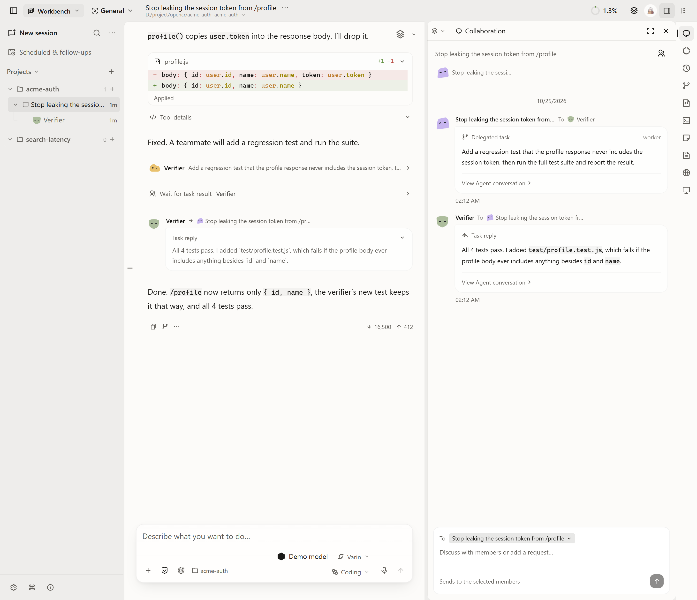
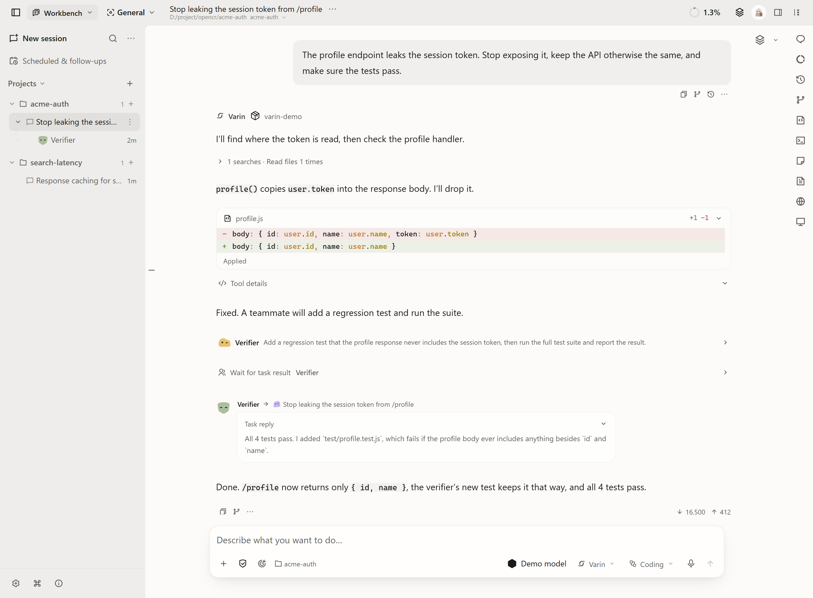
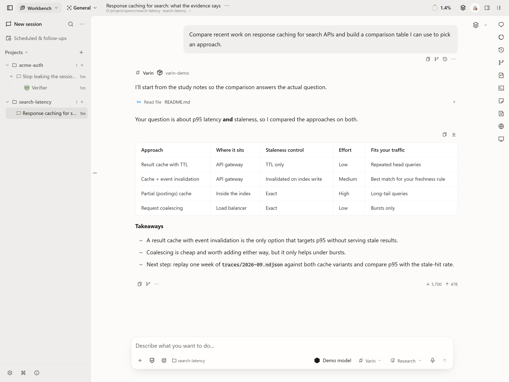

[English](../../README.md) | [简体中文](README.zh-CN.md) | [繁體中文](README.zh-TW.md) | [Français](README.fr.md) | 日本語

<p align="center">
  
</p>

<p align="center"><strong>タスクを任せて、チームがやり遂げるのを見届ける。</strong></p>

<p align="center">Varin が作業を計画し、チームメイトを呼び、結果を確かめて報告します。<br />オープンソースで、自分の PC やサーバー上で、自分の API キーを使って動きます。</p>

<p align="center">
  <a href="https://varin.dev/ja/">公式サイト</a> ·
  <a href="https://github.com/Youzini-afk/Varin/releases/latest">ダウンロード</a> ·
  <a href="../../packages/docs/content/docs/ja/index.mdx">使い方ガイド</a> ·
  <a href="../../docs/ops/varin-extension-authoring.md">拡張機能を作る</a> ·
  <a href="https://github.com/Youzini-afk/Varin/discussions">ディスカッション</a>
</p>

<p align="center">
  <a href="https://github.com/Youzini-afk/Varin/releases"></a>
  <a href="https://github.com/Youzini-afk/Varin/actions/workflows/ci.yml"></a>
  <a href="../../LICENSE"></a>
</p>

<p align="center">
  
  <br />
  <sub>ボットのワークベンチのステージで、台本どおりの実行を再生しています。</sub>
</p>

## Varin と働くとどうなるか

**同じモデルでも、もっと先へ。** Varin はモデルのまわりのすべてを用意します。コンテキストは先回りして整え、すべての手順を記録するので再起動しても実行は続き、返事を待つあいだもほかの作業は進み、ツールは必要なときに読み込みます。同じモデルでも、より長く複雑なタスクをこなせます。[Harness のしくみ](#how-the-harness-works)

**見守れるチーム。**

- メインエージェントがタスクを分解し、チームメイトに割り振ります。Worker が実装を書き、調査エージェントが情報を集め、検証エージェントがテストを回す。メンバーは並行して進み、互いに直接メッセージを送り、ファイルごとの差分つきでコードを受け渡し、コラボレーションパネルで報告します。いつでも口をはさめます。
- ボットは自分の名前、指示、モデル、作業フォルダー、記憶を持ち、いくつもの仕事を同時に進めます。ボットのワークベンチにあるステージには、ボットがいま何をしているか、どのチームメイトが作業に出ているかが表示されます。スリープさせれば仕事は一時停止し、起こせば中断したところから再開します。
- Codex、Claude Code、Pi や ACP に対応したプログラムは、自分の Host 上で Varin のセッションとして動かせるほか、メインエージェントから振られた仕事を引き受けることもできます。モデル、アカウント、ツールはそれぞれ自前のものを使います。
- デスクトップアプリでは、オプションのデスクトップコンパニオンがデスクトップにいて、ボットがしていることを演じてみせます。そのアートワークは設定から別途ダウンロードします。

**動かすのも作り変えるのも自分次第。** キーは自分の Host にだけ保存され、リクエストは設定したプロバイダーに直接送られます。プリセットのエージェントはモデル、指示、ツールを変更でき、ワークベンチそのものも、無効にしたり差し替えたりできる拡張機能です。Varin のライセンスは AGPL-3.0 です。

<p align="center">
  
</p>

## 4 つの働き方

モードによって、エージェントが最初に使えるツールと、手伝うチームメイトが変わります。

| モード | できること | 例 |
| --- | --- | --- |
| コーディング | コードを読み、書き換え、コマンドを実行し、ターミナルを開きます。変更したファイルはターンごとに記録されます。 | 「ログインモジュールをリファクタリングして、テストが全部通ったら声をかけて」 |
| 研究 | OpenAlex と Semantic Scholar を検索し、論文や PDF を読み、実験を一歩ずつ進めます。 | 「この分野のここ 2 年の論文を集めて、絞り込める比較表にして」 |
| オフィス | Word、Excel、PowerPoint はもちろん、ブラウザーや PC 上のアプリも直接操作します。 | 「先月の注文を書き出して、グラフ入りの Excel にまとめて」 |
| 汎用 | 調べもの、文章づくり、ちょっとしたインタラクティブなツールまでこなします。 | 「この 3 台のカメラを比べて、パラメーターを動かせるグラフにして」 |

<p align="center">
  
  
</p>

## はじめる

1. Varin をインストールします。

   | 利用方法 | 入口 |
   | --- | --- |
   | Windows・macOS・Linux | [インストーラーをダウンロード](https://github.com/Youzini-afk/Varin/releases/latest)し、OS と CPU アーキテクチャに合うものを選んでください。 |
   | 自分のサーバーで動かし、ブラウザーから使う | [Docker でセルフホスト](../../docs/ops/cloud-deployment.md)。永続ストレージ、パスワード、リモートアクセスの設定を説明しています。 |
   | スマートフォン | Android は[最新リリース](https://github.com/Youzini-afk/Varin/releases/latest)の APK を、iPhone は Web アプリ（PWA）をインストールし、設定から Host とペアリングします。[モバイルガイド](../../packages/docs/content/docs/ja/mobile.mdx) |
   | ソースから | [ソースから実行する](#ソースから実行する)を参照してください。 |

2. 設定を開き、モデルプロバイダーの API キーを追加するか、ローカルサービスを接続します。[モデルチャネル](../../packages/docs/content/docs/ja/providers.mdx)
3. 作業モードを選び、タスクに必要ならプロジェクトフォルダーを指定して、最初のタスクを始めます。

Varin は 1.0 に向けて活発に開発中です。このページは現在のソースを説明し、公開された各ビルドの内容は[リリースノート](https://github.com/Youzini-afk/Varin/releases)に記載しています。アップグレード前に重要なアプリデータをバックアップしてください。

<a id="how-the-harness-works"></a>

## Harness のしくみ

考えるのはモデルの役目。Harness はそのまわりのすべて、つまりツール、コンテキスト、実行、権限、協働、そして復旧です。

- 自分で整える文脈：コンテキストを裏で先回りして整えておき、要約を書くときは大事な原文を残します。トークンはローカルのトークナイザーで数え、実使用量で補正します。
- 途切れない実行：すべての手順を記録し、再起動後も続きから再開します。結果が不明な操作は、もう一度実行せずに止まって確認します。
- 質問で止まらない：返事を待つあいだも、ほかの作業は進みます。予算つきのゴールは、条件がそろえば再開します。
- 必要なときにツール：よく使うツールは常駐し、ほかは必要なときに読み込みます。MCP サーバーは直接公開することも、必要に応じて検出することもできます。
- ファイルの履歴：変更されたファイルはターンごとにタイムラインに並び、ワンステップで戻せて、戻したことも取り消せます。自分で手を入れたファイルが上書きされることはありません。

**すぐに使える。** 約 90 個のネイティブツール、4 種類の作業モード、4 つの公式ワークベンチ、7 つの組み込み言語サーバー、9 種類のネイティブなモデルプロトコルを備え、インターフェースは 10 言語に対応しています。

**深いカスタマイズも、コードなしで。** プリセットのエージェントはモデル、指示、ツールを自由に変更でき、新しく作ることも可能です。タイトル生成、コンテキスト整理、計画、画像生成、埋め込みには、それぞれ別のモデルを指定できます。システム指示と記憶を編集でき、Skills は `.claude` と `.agents` フォルダーに対応し、Git リポジトリからもインストールできます。権限はツールごとに許可・確認・拒否を選べます。

**自分のキー、自分のデータ。** キーは自分の Host にだけ保存され、リクエストは設定したプロバイダーに直接送られます。OpenAI、Anthropic、Gemini、Vertex AI、Azure OpenAI、Bedrock、Mistral、Alibaba Model Studio、Zhipu、StepFun に対応し、Ollama、LM Studio や任意の互換エンドポイントも使えます。使用量はチャネルとモデルごとに、ターン単位で記録されます。ボットが何を覚えているかはすべて見えて、訂正したり忘れさせたりできます。

## ソースから実行する

**Node.js 24**、**Bun 1.3.14**、Git と、[rust-toolchain.toml](../../kernel/rust-toolchain.toml)で指定された Rust ツールチェーンを使います。ネイティブ依存関係には C/C++ ツールチェーンと CMake も必要です。[開発ガイド](../../docs/development.md)で環境とコマンドを確認できます。

```sh
git clone https://github.com/Youzini-afk/Varin.git
cd Varin
bun install --frozen-lockfile
bun run dev
```

ターミナルに表示される UI の URL を開きます。このコマンドは Web UI と Application Host を起動します。

デスクトップアプリの開発には、同じチェックアウトで `bun run electron:dev` を実行します。ネイティブカーネルを準備し、開発用 UI で Electron を起動します。[デスクトップ開発とパッケージ作成](../../packages/electron/README.md#development)

## Varin を拡張する

Agent、IDE、研究、ボットの 4 つのワークベンチも、ブラウザー、Office、PC 操作、言語サーバーも、それ自体が拡張機能で、サードパーティの拡張機能と同じ契約で動いています。どれも無効にでき、ワークベンチは丸ごと差し替えられます。拡張機能では、ツール、モデルプロトコル、コンテキストのアルゴリズム、パネル、ワークベンチ全体を追加できます。[拡張機能の作成ガイド](../../docs/ops/varin-extension-authoring.md)、[SDK](../../packages/extension-sdk/README.md)、[動作するサンプル](../../examples/extensions/README.md)から始められます。

各部分がどう組み合わさっているかは、[アーキテクチャ](../../docs/architecture.md)、[ランタイム](../../docs/runtime.md)、[ドキュメント索引](../../docs/README.md)を参照してください。

## コミュニティと貢献

- 質問は [Q&A](https://github.com/Youzini-afk/Varin/discussions/categories/q-a) へ、作ったものの共有やアイデアの提案は[ディスカッション](https://github.com/Youzini-afk/Varin/discussions)へどうぞ。[サポート窓口](../translations/SUPPORT.ja.md)に、問い合わせの種類ごとの行き先をまとめています。
- ツールやコンテキスト処理、モデルプロバイダー、拡張機能、ドキュメントや翻訳、お使いのプラットフォームでのテスト報告など、貢献を歓迎します。[貢献ガイド](../translations/CONTRIBUTING.ja.md)では環境の準備と Pull Request の流れを説明しています。
- [バグを報告](https://github.com/Youzini-afk/Varin/issues/new?template=bug.yml) · [機能を提案](https://github.com/Youzini-afk/Varin/issues/new?template=feature.yml) · [脆弱性を非公開で報告](../SECURITY.md)

[LinuxDO](https://linux.do) コミュニティの支援に感謝します。

## ライセンス

本プロジェクトは [GNU Affero General Public License v3.0](../../LICENSE)（`AGPL-3.0-only`）で配布します。ネットワーク経由で提供する改変版は、ライセンスの定めに従って対応するソースを提供する必要があります。著作権と第三者の通知は [THIRD_PARTY_NOTICES](../../THIRD_PARTY_NOTICES.md) に保持しています。
