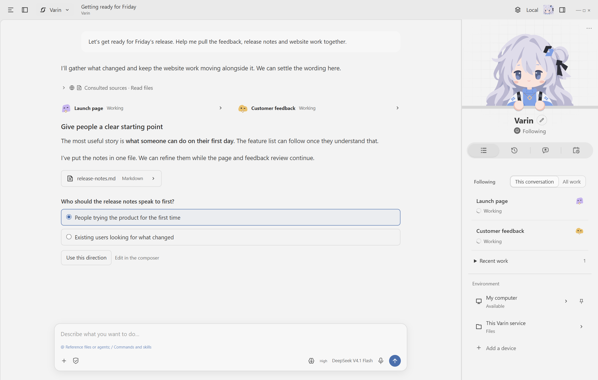
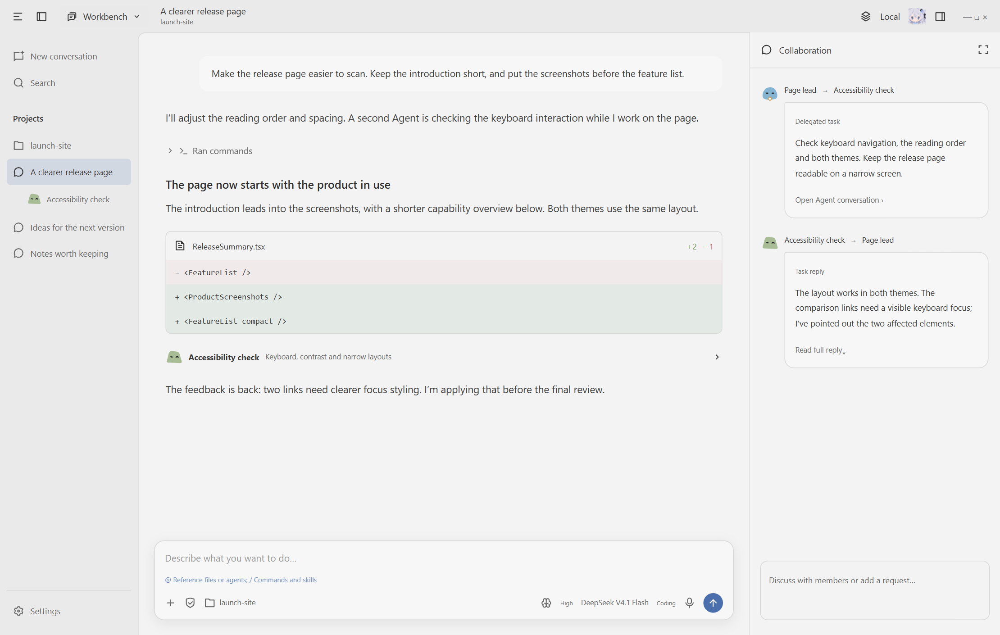
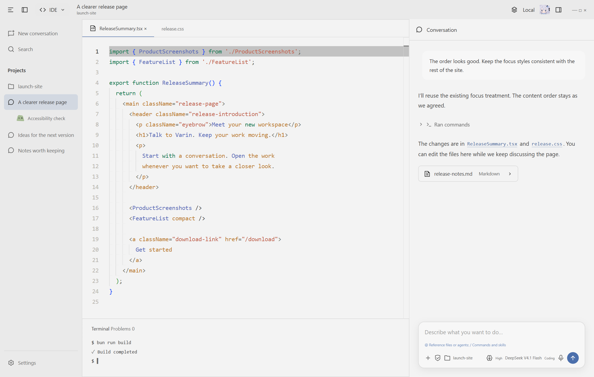
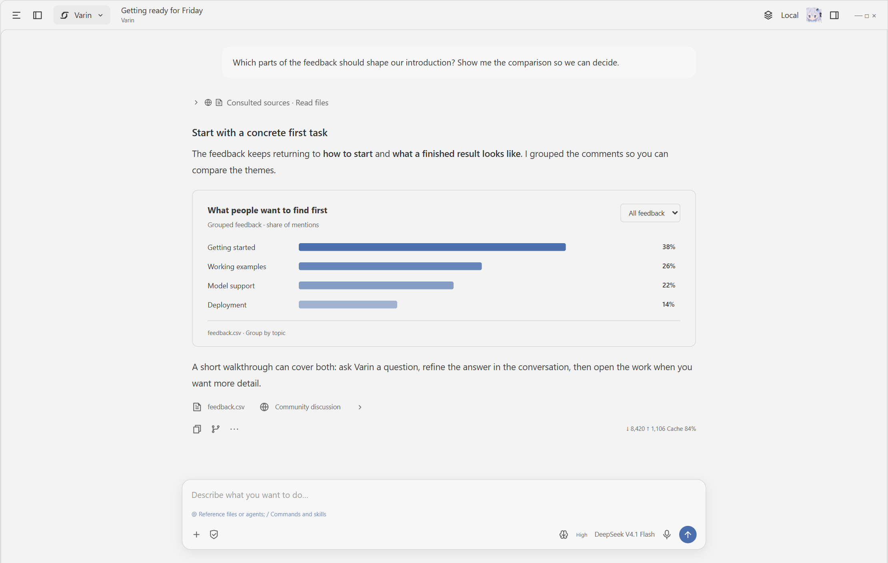
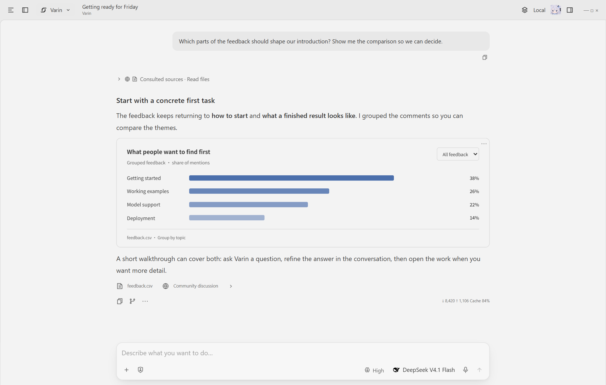
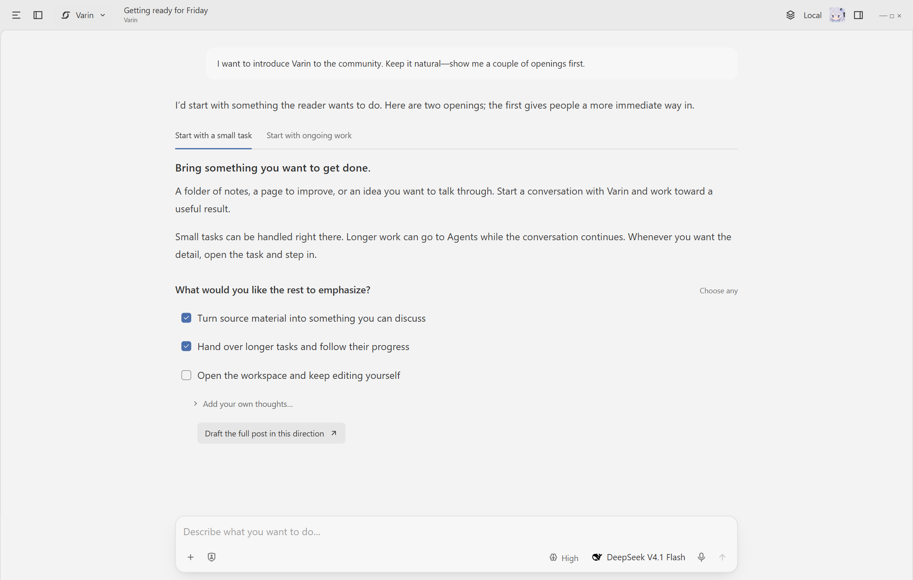
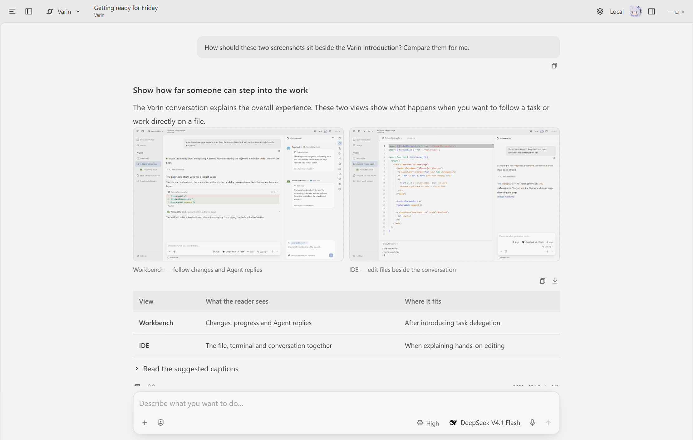

[English](../../README.md) | [简体中文](README.zh-CN.md) | [繁體中文](README.zh-TW.md) | [Français](README.fr.md) | 日本語

<p align="center">
  
</p>

<p align="center"><strong>あなたのパーソナル・スーパーエージェント。</strong></p>

<p align="center">日々の用事から複雑なタスクまで。Varin が自ら取り組み、必要に応じて他のエージェントと協力します。<br />オープンソースでセルフホスト可能。モデルは自由に選べます。</p>

<p align="center">
  <a href="https://varin.dev/ja/">公式サイト</a> ·
  <a href="https://github.com/Astrmira/Varin/releases/latest">ダウンロード</a> ·
  <a href="../../packages/docs/content/docs/ja/index.mdx">使い方ガイド</a> ·
  <a href="../../docs/ops/varin-extension-authoring.md">拡張機能を作る</a> ·
  <a href="https://github.com/Astrmira/Varin/discussions">ディスカッション</a>
</p>

<p align="center">
  <a href="https://github.com/Astrmira/Varin/releases"></a>
  <a href="https://github.com/Astrmira/Varin/actions/workflows/ci.yml"></a>
  <a href="../../LICENSE"></a>
</p>

<p align="center">
  <picture>
    <source media="(prefers-color-scheme: dark)" srcset="assets/varin-cast-dark.webp" />
    <source media="(prefers-color-scheme: light)" srcset="assets/varin-cast-light.webp" />
    
  </picture>
</p>

## Varin と話すところから

Varin は、ファイルやブラウザー、接続したコンピューターを使って仕事を進める、オープンソースのパーソナル AI エージェントです。アイデアの相談やタスクの実行を任せたり、大きな仕事では他の Agent との連携を頼んだりできます。作業中に指示を追加し、進行状況を確認し、後からタスクを続けることもできます。自分の PC やサーバーで、好きなモデルを選んで使えます。

- **仕事の途中でも話せる。** 新しいメッセージで進行中の仕事に補足できます。後で扱ってほしい内容はキューに入れられます。
- **何をしているか分かる。** サイドパネルに仕事、返答、対応が必要な質問、記憶、予定をまとめます。必要なときにタスクの詳細を横に開き、さらにワークベンチへ入れます。
- **前の会話を活かせる。** Varin は自分の会話をまたいで関連する記憶を検索・整理できます。記憶は自分で確認、修正、削除できます。
- **ファイルや PC に手が届く。** チャットの横でファイルや接続した PC を開き、元の添付ファイルを Agent に渡して、結果を話し合いながら作業を続けられます。

<p align="center">
  
</p>

### 複数の Bot とグループチャット

指示、モデル、思考レベル、記憶、予定、外観をそれぞれ持つ複数の Bot を作成できます。Varin を含む 16 体のアニメーション付きキャラクターから選べるほか、作成時にランダムで決めることも、独自の画像やアニメーションパックを読み込むこともできます。

Bot サイドバーからグループチャットを始めると、複数の Bot が同じタイムライン上で協力できます。メンションや返信で特定のメンバーに呼びかけたり、宛先なしの投稿に対する受信設定をメンバーごとに切り替えたりでき、ファイル共有、履歴検索、予定やフォローアップもそのまま利用できます。

<p align="center">
  
</p>

[アシスタントについて](../../docs/bot.md) · [外観とキャラクター](../../docs/bot-appearances.md) · [協働とタスクの再利用](../../docs/collaboration.md)

## どこまで関わるかを選ぶ

全体の相談を Varin と続ける、Agent と直接作業する、自分でファイルを開く。それぞれの画面が、必要な情報を前に出します。

| 画面 | 主に見るもの | 必要なときに開くもの |
| --- | --- | --- |
| **Varin** | 個別チャットやグループチャット、進行中の仕事と結果 | タスク詳細、質問、記憶、ファイル、PC |
| **ワークベンチ** | 個別のタスクと実行する Agent | ツールの動き、チーム、計画、コンテキスト、復元 |
| **IDE** | 自分で扱いたいコードとファイル | エディター、差分、ターミナル、Git、Agent との会話 |

### ワークベンチ：実行する Agent と直接協働する

タスクを渡し、必要な細かさで進行を追います。通常のツール操作はメッセージ間の短い要約に折りたたまれ、委派したタスクは個別に開けます。チームメイトの会話を読む、メッセージやファイルを送る、変更を確認する、会話を分岐して別案を試すことができます。

委派時にタスク、モデル、思考レベルを選ぶことも、設定済みの Agent を使うこともできます。任意のモデル選択アシスタントは、説明文をもとに有効なチャットモデルから担当を選べます。

<p align="center">
  
</p>

### IDE：コードとファイルに直接触れる

Monaco で編集し、プロジェクトや差分を調べ、会話の横でターミナルと Git を使います。変更の相談から自分での編集へ自然に移れます。エディターと Agent は同じドキュメント・ワークスペースサービスを利用します。

<p align="center">
  
</p>

汎用・コーディング・研究・オフィスは、これとは別の**タスクの重点**です。Agent が利用するツールやチームメイトに関わり、画面の選択とは独立しています。[ワークベンチの構造](../../docs/workbench.md)

## 会話の中で読み、選び、結果を仕上げる

- **読みやすい進行。** 本文を中心に、操作の要約、思考、ツール結果や Agent の返答を必要に応じて展開できます。
- **説明のそばで操作。** 単一・複数選択、入力欄やフォームを段落の間に置けます。選択結果から編集可能なメッセージを用意できます。
- **内容に合った表現。** 画像、表、数式や図を本文に組み込み、HTML でインタラクティブなグラフ、比較、小さなツールを作れます。ソース表示とエクスポートにも対応します。
- **作業につながる参照。** タスク、ファイル、計画や資料への参照から対応する画面を開けます。Agent 間で渡す添付ファイルは元の内容を保持します。
- **途中で方向を変えられる。** 会話の分岐とファイル復元で前の作業に戻れます。入力欄は参照、コマンド、編集可能な次のメッセージ候補に対応します。

<p align="center">
  
</p>

**説明とグラフを一緒に読む。** 資料の傾向をグラフで比較し、同じ会話にある説明や参照元を見ながら、気づいたことを話し合えます。

<p align="center">
  
</p>

**説明を読みながら選び、補足する。** 控えめなタブで文章案を読み比べ、続けて説明したい点を複数選び、必要に応じて自分の考えを補足できます。次のメッセージを用意して会話を続けられます。

<p align="center">
  
</p>

**画像と文章を一緒に読む。** 画像は縦横比を保って並び、クリックで拡大できます。表で違いを比較し、補足の説明は必要なときに展開できます。

<p align="center">
  
</p>

[会話とインタラクティブなコンテンツ](../../docs/interactive-content.md)

## 仕事全体を進めるツール

情報を集め、ファイルを扱い、プログラムを実行し、実際の画面を操作するための能力をモデルにつなぎます。

| 能力 | Agent が使えるもの |
| --- | --- |
| **ファイルとコード** | 一覧、検索、読み書き、コード構造の抽出、バックグラウンド調査、差分と復元ポイント。 |
| **コマンドと計算** | Shell、対話型ターミナル、バックグラウンドプロセス、継続する JavaScript 実行環境。状態確認、出力読み取り、停止にも対応。 |
| **Web と調査** | 設定可能な検索サービス、ページ読み取り、出典、学術検索とドキュメント読解。原資料までたどれます。 |
| **文書とデータ** | PDF・Office の読み取り、Word・Excel・PowerPoint の作成と編集、対応形式の表示と書き出し。 |
| **ブラウザーと PC** | ページ操作、ダウンロード、アプリの観察、接続したデスクトップの操作。 |
| **画像と対話型の成果物** | 画像表示、設定済みの画像生成・編集モデル、チャット内の HTML／JavaScript。 |
| **協働と継続** | 委派、メッセージ、タスク再開、計画と記憶、予定とフォローアップ。 |
| **独自の能力** | MCP サーバー、Skills、追加のツールやサービスを提供する拡張機能。 |

よく使うツールは直接利用でき、その他の能力は必要に応じて発見します。モデルや検索に依存する機能は設定したサービスを使い、デスクトップやリモート操作は接続先が提供する能力を使います。

## 自分のモデル、機器、作業場所で

**モデルを選ぶ。** プロバイダーや互換ローカルサービスを接続し、思考レベルを設定して、タスクや補助作業ごとにモデルを割り当てられます。使用量と推定費用はチャネル・モデルごとに記録します。

**他の Agent も使う。** Codex、Claude Code、Pi、ACP 対応プログラムを会話や委派先として使い、それぞれのアカウント、モデル、ツールを維持できます。[外部 Agent](../../docs/external-agents.md)

**仕事に合った場所で動かす。** ローカル、自分のサーバー、ブラウザーやスマートフォンから利用できます。画面、Agent サービス、ファイルのワークスペース、PC 操作の対象は別々の機器に配置でき、1 つの会話の中で接続済みの複数機器をまたいでファイル操作やコマンド実行を進められます。ファイルへのリンクと復元記録も、変更が行われた機器とフォルダーに紐づきます。[デプロイ](../../docs/ops/cloud-deployment.md) · [リソース](../../docs/resources.md)

**デスクトップにも仲間を。** 任意のデスクトップコンパニオンが、選択した Bot の活動に反応します。設定から外観をダウンロードし、起こしたり眠らせたりできます。

<a id="how-the-harness-works"></a>

## 続いていく仕事を支える Harness

Harness はモデルのまわりのコンテキストと実行を管理します。

- 置き換えが必要になる前に、要約と選んだ原資料でコンテキストをバックグラウンド準備。
- 実行と結果を記録し、復旧可能な仕事を再起動後に継続。
- 質問、権限、待機メッセージや報告の状態を保ちながら、別の仕事を進行。
- ファイルの復元記録を残し、その後の変更がある場合は競合を確認。
- Bot の記憶を検索、更新、バックグラウンド整理し、ユーザー自身でも管理。

中心となるランタイムは Rust 製です。デスクトップ、Web、モバイルは同じアプリケーションサービスを共有します。[ランタイム](../../docs/runtime.md) · [構造](../../docs/architecture.md)

## はじめる

1. Varin をインストールします。

   | 利用方法 | 入口 |
   | --- | --- |
   | Windows・macOS・Linux | ローカル実行には[フル版のインストーラーをダウンロード](https://github.com/Astrmira/Varin/releases/latest)し、既存の Varin サービスへ接続するだけなら **Varin Light** を選べます。 |
   | 自分のサーバーで動かし、ブラウザーから使う | [Docker でセルフホスト](../../docs/ops/cloud-deployment.md)（`varin` / `varin-toolbelt`）。別マシンのファイルやコマンドを接続するための独立した **Resource Node**（`varin-node`）も用意しています。 |
   | スマートフォン | Android は[最新リリース](https://github.com/Astrmira/Varin/releases/latest)の APK を、iPhone は Web アプリ（PWA）をインストールし、設定から Host とペアリングします。[モバイルガイド](../../packages/docs/content/docs/ja/mobile.mdx) |
   | ソースから | [ソースから実行する](#ソースから実行する)を参照してください。 |

2. 設定を開き、モデルプロバイダーの API キーを追加するか、ローカルサービスを接続します。[モデルチャネル](../../packages/docs/content/docs/ja/providers.mdx)
3. Varin と会話を始めます。Agent と直接協働するときはワークベンチへ、ファイルを自分で扱うときは IDE へ移れます。

Varin は 1.0 に向けて活発に開発中です。このページは現在のソースを説明し、公開された各ビルドの内容は[リリースノート](https://github.com/Astrmira/Varin/releases)に記載しています。アップグレード前に重要なアプリデータをバックアップしてください。

## ソースから実行する

**Node.js 24**、**Bun 1.3.14**、Git と、[rust-toolchain.toml](../../kernel/rust-toolchain.toml)で指定された Rust ツールチェーンを使います。ネイティブ依存関係には C/C++ ツールチェーンと CMake も必要です。[開発ガイド](../../docs/development.md)で環境とコマンドを確認できます。

```sh
git clone https://github.com/Astrmira/Varin.git
cd Varin
bun install --frozen-lockfile
bun run dev
```

ターミナルに表示される UI の URL を開きます。このコマンドは Web UI と Application Host を起動します。

デスクトップアプリの開発には、同じチェックアウトで `bun run electron:dev` を実行します。ネイティブカーネルを準備し、開発用 UI で Electron を起動します。[デスクトップ開発とパッケージ作成](../../packages/electron/README.md#development)

## Varin を拡張する

Varin、ワークベンチ、IDE の画面も、ブラウザー、Office、PC 操作、言語サーバーも、それ自体が拡張機能で、サードパーティの拡張機能と同じ契約で動いています。どれも無効にでき、ワークベンチは丸ごと差し替えられます。拡張機能では、ツール、モデルプロトコル、コンテキストのアルゴリズム、パネル、ワークベンチ全体を追加できます。[拡張機能の作成ガイド](../../docs/ops/varin-extension-authoring.md)、[SDK](../../packages/extension-sdk/README.md)、[動作するサンプル](../../examples/extensions/README.md)から始められます。

各部分がどう組み合わさっているかは、[アーキテクチャ](../../docs/architecture.md)、[ランタイム](../../docs/runtime.md)、[ドキュメント索引](../../docs/README.md)を参照してください。

## コミュニティと貢献

- 質問は [Q&A](https://github.com/Astrmira/Varin/discussions/categories/q-a) へ、作ったものの共有やアイデアの提案は[ディスカッション](https://github.com/Astrmira/Varin/discussions)へどうぞ。[サポート窓口](../translations/SUPPORT.ja.md)に、問い合わせの種類ごとの行き先をまとめています。
- ツールやコンテキスト処理、モデルプロバイダー、拡張機能、ドキュメントや翻訳、お使いのプラットフォームでのテスト報告など、貢献を歓迎します。[貢献ガイド](../translations/CONTRIBUTING.ja.md)では環境の準備と Pull Request の流れを説明しています。
- [バグを報告](https://github.com/Astrmira/Varin/issues/new?template=bug.yml) · [機能を提案](https://github.com/Astrmira/Varin/issues/new?template=feature.yml) · [脆弱性を非公開で報告](../SECURITY.md)
- 連絡先：[varin@astrmira.com](mailto:varin@astrmira.com)。

[LinuxDO](https://linux.do) コミュニティの支援に感謝します。

## ライセンス

本プロジェクトは [GNU Affero General Public License v3.0](../../LICENSE)（`AGPL-3.0-only`）で配布します。ネットワーク経由で提供する改変版は、ライセンスの定めに従って対応するソースを提供する必要があります。著作権と第三者の通知は [THIRD_PARTY_NOTICES](../../THIRD_PARTY_NOTICES.md) に保持しています。
