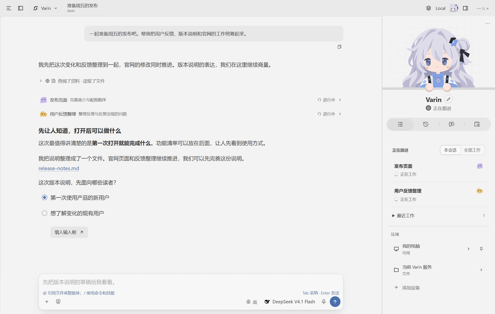
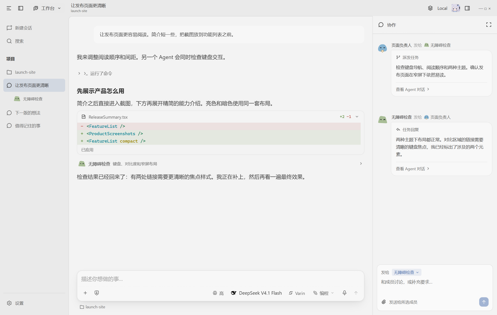
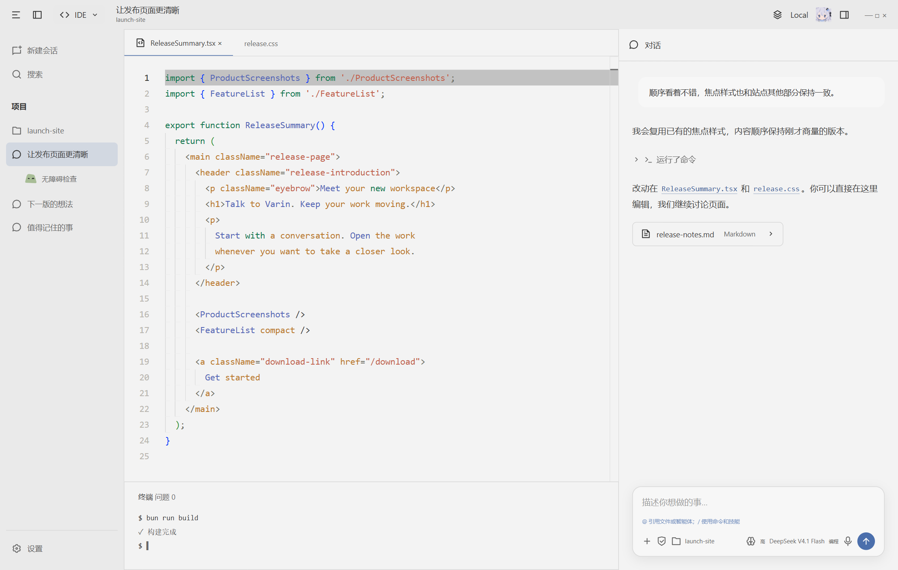
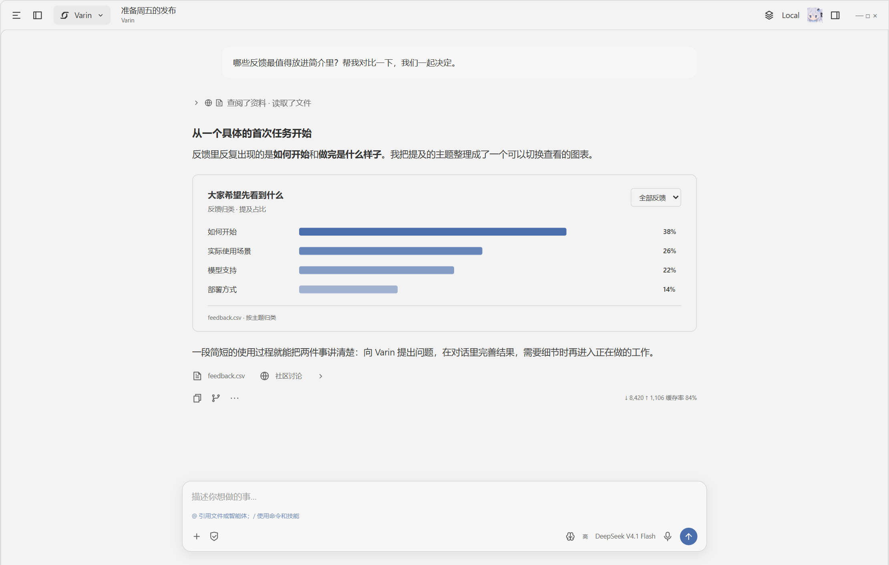
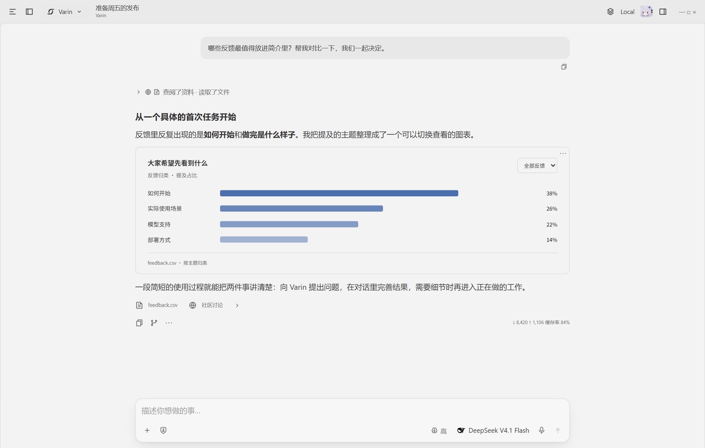
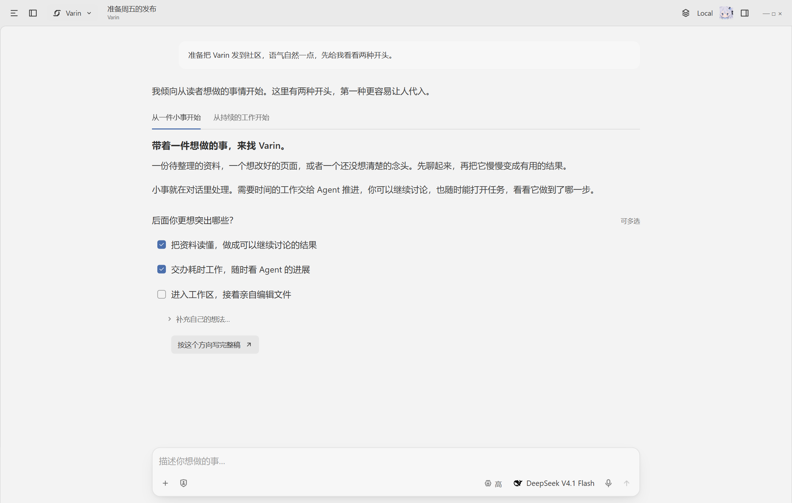
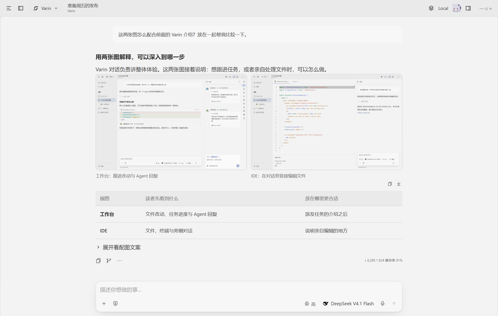

[English](../../README.md) | 简体中文 | [繁體中文](README.zh-TW.md) | [Français](README.fr.md) | [日本語](README.ja.md)

<p align="center">
  
</p>

<p align="center"><strong>你的长期 AI 助手，也是随时可进入的工作空间。</strong></p>

<p align="center">和 Varin 交流，让工作持续推进，需要时再进入细节。<br />开源，使用自己的模型与密钥，在自己的电脑或服务器上运行。</p>

<p align="center">
  <a href="https://varin.dev/zh-cn/">官网</a> ·
  <a href="https://github.com/Youzini-afk/Varin/releases/latest">下载</a> ·
  <a href="../../packages/docs/README.zh-CN.md">使用指南</a> ·
  <a href="../../docs/ops/varin-extension-authoring.md">开发扩展</a> ·
  <a href="https://github.com/Youzini-afk/Varin/discussions">讨论区</a>
</p>

<p align="center">
  <a href="https://github.com/Youzini-afk/Varin/releases"></a>
  <a href="https://github.com/Youzini-afk/Varin/actions/workflows/ci.yml"></a>
  <a href="../../LICENSE"></a>
</p>

<p align="center">
  
</p>

## 从和 Varin 交流开始

Varin 是陪你持续工作的个人 AI 助手。可以一起讨论想法、快速查一件事，也可以交给它需要长期推进的工作。小事它能直接处理，大一些的工作可以安排 Agent 协作，后续还可以带着已有上下文继续交办。

- **工作继续，你也可以继续说。** 新消息可以补充正在进行的工作；希望稍后处理的内容，也能单独排队。
- **知道它正在做什么。** 旁侧汇集当前工作、回复、待处理问题、记忆和日程。点击任务就能在聊天旁边查看详情，也可以进入完整工作台。
- **把之前的交流接起来。** Varin 可以跨自己的会话检索和整理相关记忆。记住的内容由你查看、修改和遗忘。
- **文件和电脑就在旁边。** 在聊天旁打开文件空间或连接的电脑，把原始附件交给 Agent，讨论结果，再接着做。

<p align="center">
  
</p>

[了解总助手](../../docs/bot.md) · [协作与任务复用](../../docs/collaboration.md)

## 按需要选择参与的深度

你可以围绕整体目标和 Varin 交流，也可以直接和执行任务的 Agent 合作，或者亲自打开文件。三种界面把不同层次的信息放在你面前。

| 界面 | 主要关注什么 | 需要时可以进入什么 |
| --- | --- | --- |
| **Varin** | 持续交流、正在推进的事和结果 | 任务详情、问题、记忆、文件和电脑 |
| **工作台** | 一个具体任务及执行它的 Agent | 工具过程、队友、计划、上下文和恢复记录 |
| **IDE** | 希望亲自处理的代码和文件 | 编辑组、差异、终端、Git 和 Agent 对话 |

### 工作台：直接和执行者合作

交给 Agent 一个任务，按需要查看执行过程。普通工具活动收成消息之间的简短摘要，派发的任务保留独立入口。你可以进入队友的聊天、发消息或文件、检查改动，也可以创建会话分支探索另一种做法。

派发可以自由指定任务、模型和思考等级，也能使用你配置的 Agent 预设。可选的模型选择助手会依据模型简介，从已启用的对话模型中选择执行者。

<p align="center">
  
</p>

### IDE：亲自进入代码和文件

使用 Monaco 编辑文件，浏览项目、检查差异，配合终端、Git 和旁侧的 Agent 对话。讨论修改与亲自编辑之间可以自然衔接，编辑器和 Agent 共用原有的文档与工作区服务。

<p align="center">
  
</p>

通用、编程、科研和办公则是另一层的**任务侧重**，决定 Agent 如何获得工具及有哪些队友可用，与这三种界面分别选择。[工作台架构](../../docs/workbench.md)

## 在对话里阅读、选择和完善结果

- **看得清主次。** 正文保持连贯；过程摘要、思考、工具结果和 Agent 回复可以按需展开。
- **解释旁边就能操作。** 单选、多选、输入和表单可以穿插在段落之间，选择结果能填入输入框，继续编辑后再发送。
- **结果有合适的表现形式。** 图片、表格、公式和图示融入正文；自定义 HTML 可以呈现交互图表、对比和小工具，也支持查看源码与导出。
- **交流和实际工作相连。** 任务、文件、计划和资料引用可以打开对应视图；Agent 之间传递附件时保留原文件。
- **随时调整方向。** 会话分支和文件恢复保留回看入口；输入框支持引用、命令和可编辑的下一条消息建议。

<p align="center">
  
</p>

**结合图表读懂资料。** 将反馈整理成可以比较的图表，说明和来源放在旁边，接着讨论其中的发现。

<p align="center">
  
</p>

**边讨论，边选择和补充。** 用轻标签切换完整文案，多选希望继续展开的重点，需要时补充自己的想法。准备好后形成下一条消息，继续编辑和交流。

<p align="center">
  
</p>

**图文放在一起读。** 图片按自身比例排列，点击放大；表格帮助对比，补充细节可以折叠在相关说明旁边，保持正文连贯。

<p align="center">
  
</p>

[聊天与交互内容](../../docs/interactive-content.md)

## 完成一件事所需的工具

从获取信息、处理文件、运行程序，到操作实际界面，Varin 把这些能力接到同一套任务执行中。

| 能力 | Agent 可以使用什么 |
| --- | --- |
| **文件与代码** | 列举、搜索、读取和编辑文件；提取代码结构；后台检索；查看改动和恢复点。 |
| **命令与计算** | Shell、交互终端、后台进程和持续 JavaScript 运行环境，支持查看状态、读取输出和停止。 |
| **联网与研究** | 可配置的搜索渠道、网页读取、来源引用、学术检索和文档阅读，继续追溯原始资料。 |
| **文档与数据** | 阅读 PDF 和 Office 文件，创建、编辑 Word、Excel、PowerPoint，并渲染和导出支持的格式。 |
| **浏览器与电脑** | 浏览和操作网页、处理下载、观察应用，以及操作连接的桌面。 |
| **图像与交互作品** | 查看图片，调用配置好的生图和编辑模型，在聊天中制作 HTML／JavaScript 内容。 |
| **协作与长期工作** | 派发、发消息、续接任务，维护计划和记忆，安排日程与接续工作。 |
| **自己的能力** | 连接 MCP、使用 Skills，通过扩展加入更多工具和服务。 |

常用工具直接可用，其他能力按需发现。依赖模型或搜索服务的功能使用你的配置；桌面及远程操作使用连接设备实际提供的能力。

## 使用自己的模型、设备和工作空间

**模型由你选择。** 连接模型提供商或兼容的本地服务，配置思考等级，为不同任务及辅助工作分配模型。用量和估算费用按渠道、模型记录。

**已有的 Agent 也能接入。** Codex、Claude Code、Pi 及兼容 ACP 的程序可以作为会话运行或接收派发，同时保留各自的账号、模型和工具。[外部 Agent](../../docs/external-agents.md)

**工作放在合适的设备上。** 本地运行、服务器自托管，或者用浏览器和手机连接。前端、Agent 服务、文件工作区和 Computer Use 设备可以分开部署。[部署](../../docs/ops/cloud-deployment.md) · [资源](../../docs/resources.md)

**也可以有桌面上的陪伴。** 可选桌宠跟随所选 Bot 的活动，在设置中按需下载形象，并控制唤醒和沉睡。

<a id="how-the-harness-works"></a>

## 支撑持续工作的 Harness

Harness 负责模型周围的上下文和执行机制：

- 在需要替换前，后台准备上下文，结合摘要与选留的原始材料。
- 持久记录执行过程与结果，让可恢复的工作在重启后继续。
- 提问、权限、排队消息和任务回报各自保留状态，其他工作可以继续推进。
- 文件改动留下恢复记录，文件随后有变化时检查冲突。
- Bot 记忆可以检索、修订和后台维护，也能由你直接管理。

核心运行时由 Rust 编写，桌面、Web 和移动端共用同一套应用服务。[运行时](../../docs/runtime.md) · [架构](../../docs/architecture.md)

## 开始使用

1. 安装 Varin。

   | 使用方式 | 入口 |
   | --- | --- |
   | Windows、macOS 或 Linux | [下载安装包](https://github.com/Youzini-afk/Varin/releases/latest)，选择与系统和 CPU 架构对应的版本。 |
   | 在自己的服务器上运行，用浏览器访问 | [Docker 自托管](../../docs/ops/cloud-deployment.md)，包含持久化目录、密码和远程访问配置。 |
   | 手机 | Android 从[最新版本](https://github.com/Youzini-afk/Varin/releases/latest)下载 APK 安装，iPhone 安装网页应用（PWA），然后在设置中与 Host 配对。[移动端指南](../../packages/docs/content/docs/zh-cn/mobile.mdx) |
   | 从源码运行 | 见[从源码运行](#从源码运行)。 |

2. 打开设置，填入模型服务商的 API Key，或连接本地服务。[模型渠道](../../packages/docs/content/docs/zh-cn/providers.mdx)
3. 从和 Varin 对话开始。希望直接与执行者合作时进入工作台，想亲自处理文件时进入 IDE。

Varin 处于 1.0 之前的活跃开发阶段。本页介绍当前源码，[发布说明](https://github.com/Youzini-afk/Varin/releases)记录各发行版的内容。升级前请备份重要的应用数据。

## 从源码运行

使用 **Node.js 24**、**Bun 1.3.14**、Git，以及 [rust-toolchain.toml](../../kernel/rust-toolchain.toml) 指定的 Rust 工具链。原生依赖还需要 C/C++ 工具链与 CMake。环境与命令说明见[开发指南](../../docs/development.md)。

```sh
git clone https://github.com/Youzini-afk/Varin.git
cd Varin
bun install --frozen-lockfile
bun run dev
```

打开终端打印的 UI 地址。该命令会启动网页界面和 Application Host。

开发桌面端时，在同一份源码中运行 `bun run electron:dev`。它会准备原生内核，并启动带开发界面的 Electron 应用。[桌面开发与打包](../../packages/electron/README.md#development)

## 扩展 Varin

官方的 Varin、工作台和 IDE 界面，以及浏览器、Office、电脑操作、语言服务器，本身都是扩展，和第三方扩展用同一套契约。每一个都能停用，工作台也能整个替换。扩展可以添加工具、模型协议、上下文算法、面板，乃至整套工作台。从[扩展作者指南](../../docs/ops/varin-extension-authoring.md)、[SDK](../../packages/extension-sdk/README.md)或[示例](../../examples/extensions/README.md)开始。

想了解各部分如何配合，见[架构](../../docs/architecture.md)、[运行时](../../docs/runtime.md)和[文档索引](../../docs/README.md)。

## 交流与参与

- 使用问题到 [Q&A](https://github.com/Youzini-afk/Varin/discussions/categories/q-a) 提问，作品分享和想法建议在[讨论区](https://github.com/Youzini-afk/Varin/discussions)交流。[获取帮助](../translations/SUPPORT.zh-CN.md)列出了各类问题该去哪里。
- 欢迎贡献：工具与上下文处理、模型服务商适配、扩展、文档与翻译，以及各平台的实测报告。[贡献指南](../translations/CONTRIBUTING.zh-CN.md)介绍了开发准备和 Pull Request 流程。
- [报告问题](https://github.com/Youzini-afk/Varin/issues/new?template=bug.yml) · [提出建议](https://github.com/Youzini-afk/Varin/issues/new?template=feature.yml) · [私下报告安全漏洞](../translations/SECURITY.zh-CN.md)
- 联系邮箱：[varin@astrmira.com](mailto:varin@astrmira.com)。

感谢 [LinuxDO](https://linux.do) 社区的支持。

## 许可证

项目按 [GNU Affero General Public License v3.0](../../LICENSE)（`AGPL-3.0-only`）分发。通过网络提供修改版本时，应按许可证要求提供对应源码。版权与第三方声明保留在 [THIRD_PARTY_NOTICES](../../THIRD_PARTY_NOTICES.md) 中。
