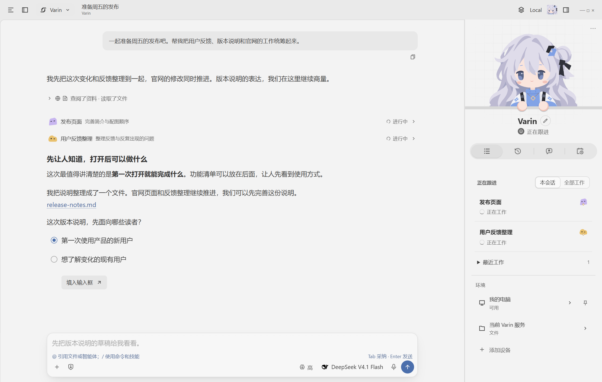
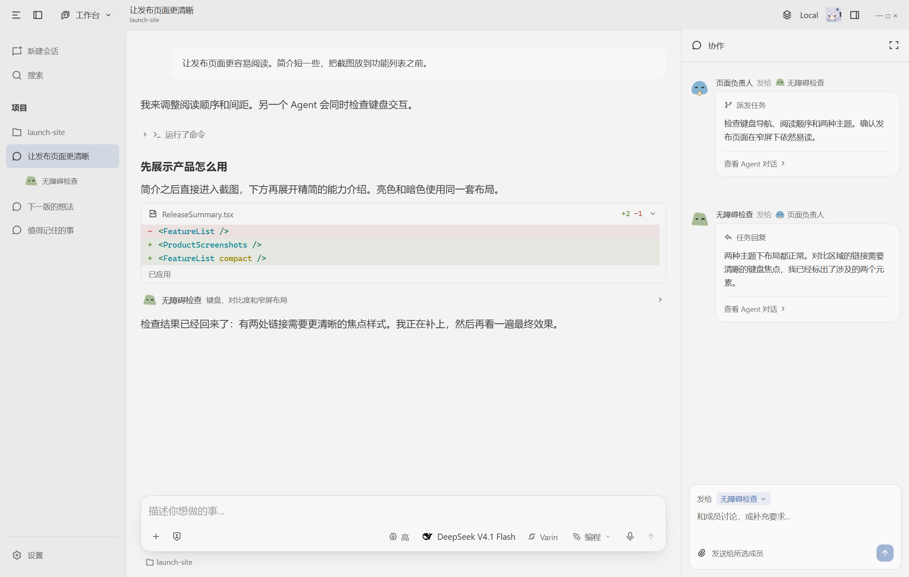
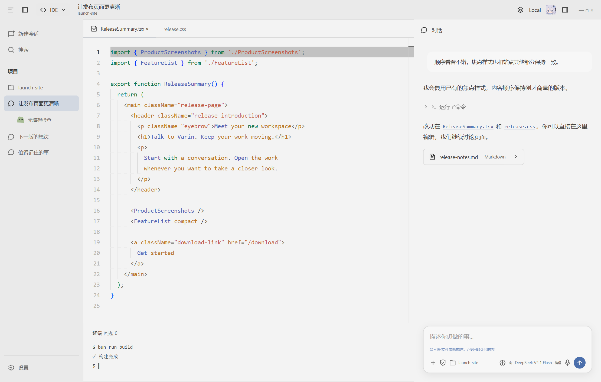
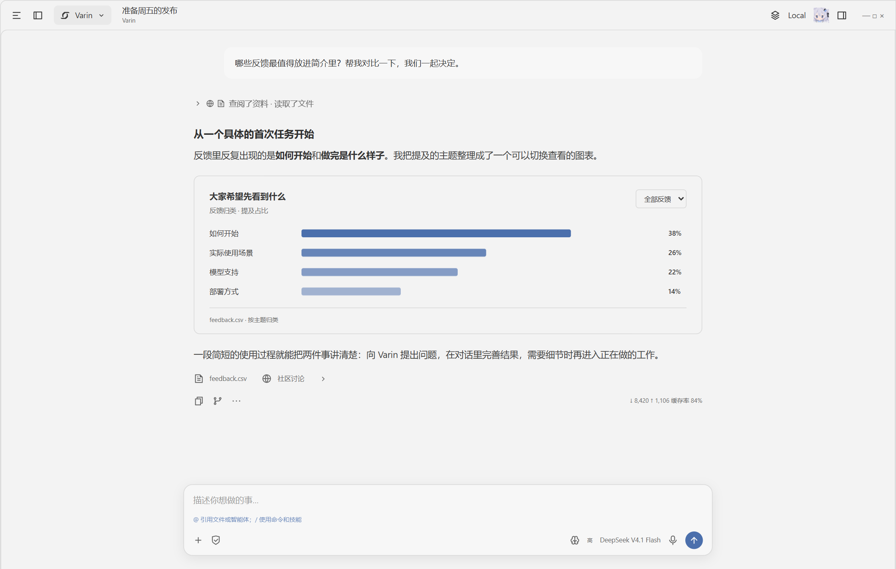
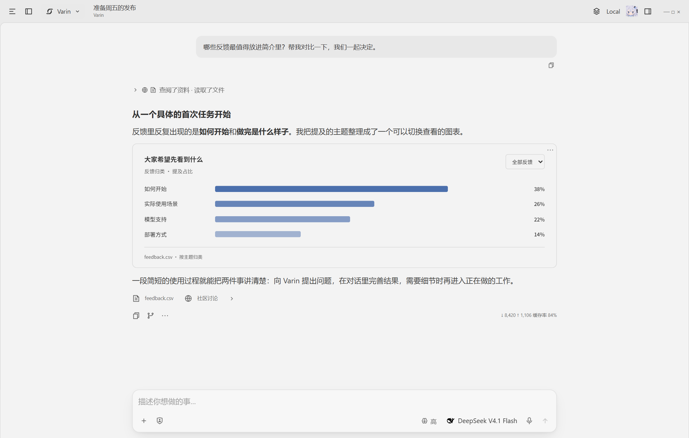
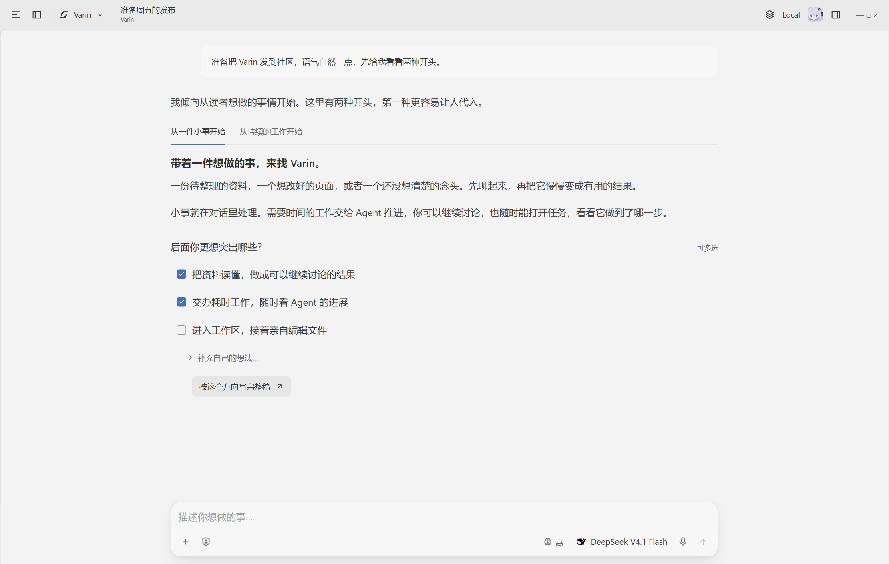
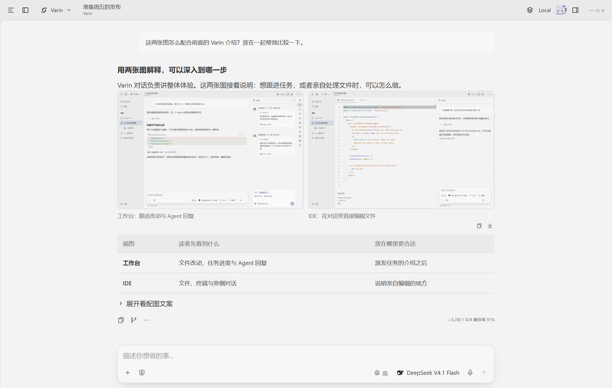

[English](../../README.md) | [简体中文](README.zh-CN.md) | 繁體中文 | [Français](README.fr.md) | [日本語](README.ja.md)

<p align="center">
  
</p>

<p align="center"><strong>你的長期 AI 助手，也是隨時可進入的工作空間。</strong></p>

<p align="center">和 Varin 交流，讓工作持續推進，需要時再進入細節。<br />開源，使用自己的模型與金鑰，在自己的電腦或伺服器上執行。</p>

<p align="center">
  <a href="https://varin.dev/zh-tw/">官網</a> ·
  <a href="https://github.com/Youzini-afk/Varin/releases/latest">下載</a> ·
  <a href="../../packages/docs/README.zh-CN.md">使用指南</a> ·
  <a href="../../docs/ops/varin-extension-authoring.md">開發擴充功能</a> ·
  <a href="https://github.com/Youzini-afk/Varin/discussions">討論區</a>
</p>

<p align="center">
  <a href="https://github.com/Youzini-afk/Varin/releases"></a>
  <a href="https://github.com/Youzini-afk/Varin/actions/workflows/ci.yml"></a>
  <a href="../../LICENSE"></a>
</p>

<p align="center">
  
</p>

## 從和 Varin 交流開始

Varin 是陪你持續工作的個人 AI 助手。可以一起討論想法、快速查一件事，也可以交給它需要長期推進的工作。小事它能直接處理，大一些的工作可以安排 Agent 協作，後續還能帶著已有脈絡繼續交辦。

- **工作繼續，你也可以繼續說。** 新訊息可以補充正在進行的工作；希望稍後處理的內容，也能單獨排隊。
- **知道它正在做什麼。** 旁側面板匯集當前工作、回覆、待處理問題、記憶和日程。需要時在聊天旁開啟任務詳情，也能進入完整工作台。
- **把之前的交流接起來。** Varin 可以跨自己的會話檢索和整理相關記憶。記住的內容由你查看、修改和遺忘。
- **檔案和電腦就在旁邊。** 在聊天旁開啟檔案空間或連線的電腦，把原始附件交給 Agent，討論結果，再接著做。

<p align="center">
  
</p>

[瞭解總助手](../../docs/bot.md) · [協作與任務複用](../../docs/collaboration.md)

## 按需要選擇參與的深度

你可以圍繞整體目標和 Varin 交流，也可以直接和執行任務的 Agent 合作，或親自開啟檔案。三種介面把不同層次的資訊放在你面前。

| 介面 | 主要關注什麼 | 需要時可以進入什麼 |
| --- | --- | --- |
| **Varin** | 持續交流、正在推進的事和結果 | 任務詳情、問題、記憶、檔案和電腦 |
| **工作台** | 一個具體任務及執行它的 Agent | 工具過程、隊友、計畫、上下文和復原紀錄 |
| **IDE** | 希望親自處理的程式碼和檔案 | 編輯群組、差異、終端機、Git 和 Agent 對話 |

### 工作台：直接和執行者合作

交給 Agent 一個任務，按需要查看執行過程。一般工具活動收成訊息之間的簡短摘要，派發的任務保留獨立入口。你可以進入隊友的聊天、傳訊息或檔案、檢查改動，也可以建立會話分支探索另一種做法。

派發可以自由指定任務、模型和思考等級，也能使用你設定的 Agent 預設。可選的模型選擇助手會依據模型簡介，從已啟用的對話模型中選擇執行者。

<p align="center">
  
</p>

### IDE：親自進入程式碼和檔案

使用 Monaco 編輯檔案，瀏覽專案、檢查差異，配合終端機、Git 和旁側的 Agent 對話。討論修改與親自編輯之間可以自然銜接，編輯器和 Agent 共用原有的文件與工作區服務。

<p align="center">
  
</p>

通用、程式開發、科研和辦公則是另一層的**任務側重**，決定 Agent 如何取得工具及有哪些隊友可用，與這三種介面分別選擇。[工作台架構](../../docs/workbench.md)

## 在對話裡閱讀、選擇和完善結果

- **看得清主次。** 正文保持連貫；過程摘要、思考、工具結果和 Agent 回覆可以按需展開。
- **解釋旁邊就能操作。** 單選、多選、輸入和表單可以穿插在段落之間，選擇結果能填入輸入框，繼續編輯後再傳送。
- **結果有合適的表現形式。** 圖片、表格、公式和圖示融入正文；自訂 HTML 可以呈現互動圖表、比較和小工具，也支援查看原始碼與匯出。
- **交流和實際工作相連。** 任務、檔案、計畫和資料引用可以開啟對應檢視；Agent 之間傳遞附件時保留原檔案。
- **隨時調整方向。** 會話分支和檔案復原保留回看入口；輸入框支援引用、命令和可編輯的下一則訊息建議。

<p align="center">
  
</p>

**結合圖表讀懂資料。** 將回饋整理成可以比較的圖表，說明和來源放在旁邊，接著討論其中的發現。

<p align="center">
  
</p>

**邊討論，邊選擇和補充。** 用輕量分頁切換完整文案，多選希望繼續展開的重點，需要時補充自己的想法。準備好後形成下一則訊息，繼續編輯和交流。

<p align="center">
  
</p>

**圖文放在一起讀。** 圖片依自身比例排列，點擊放大；表格協助比較，補充細節可以收合在相關說明旁，保持正文連貫。

<p align="center">
  
</p>

[聊天與互動內容](../../docs/interactive-content.md)

## 完成一件事所需的工具

從取得資訊、處理檔案、執行程式，到操作實際介面，Varin 把這些能力接到同一套任務執行中。

| 能力 | Agent 可以使用什麼 |
| --- | --- |
| **檔案與程式碼** | 列出、搜尋、讀取和編輯檔案；擷取程式碼結構；背景檢索；查看改動和復原點。 |
| **命令與計算** | Shell、互動終端機、背景程序和持續 JavaScript 執行環境，支援查看狀態、讀取輸出和停止。 |
| **聯網與研究** | 可設定的搜尋管道、網頁讀取、來源引用、學術檢索和文件閱讀，繼續追溯原始資料。 |
| **文件與資料** | 閱讀 PDF 和 Office 檔案，建立、編輯 Word、Excel、PowerPoint，並呈現和匯出支援的格式。 |
| **瀏覽器與電腦** | 瀏覽和操作網頁、處理下載、觀察應用程式，以及操作連線的桌面。 |
| **圖像與互動作品** | 查看圖片，呼叫已設定的生圖和編輯模型，在聊天中製作 HTML／JavaScript 內容。 |
| **協作與長期工作** | 派發、傳訊息、續接任務，維護計畫和記憶，安排日程與接續工作。 |
| **自己的能力** | 連接 MCP、使用 Skills，透過擴充功能加入更多工具和服務。 |

常用工具直接可用，其他能力按需發現。依賴模型或搜尋服務的功能使用你的設定；桌面及遠端操作使用連線裝置實際提供的能力。

## 使用自己的模型、裝置和工作空間

**模型由你選擇。** 連接模型提供商或相容的本機服務，設定思考等級，為不同任務及輔助工作分配模型。用量和估算費用按管道、模型記錄。

**已有的 Agent 也能接入。** Codex、Claude Code、Pi 及相容 ACP 的程式可以作為會話執行或接收派發，同時保留各自的帳號、模型和工具。[外部 Agent](../../docs/external-agents.md)

**工作放在合適的裝置上。** 本機執行、伺服器自託管，或用瀏覽器和手機連線。前端、Agent 服務、檔案工作區和 Computer Use 裝置可以分開部署。[部署](../../docs/ops/cloud-deployment.md) · [資源](../../docs/resources.md)

**也可以有桌面上的陪伴。** 可選桌寵跟隨所選 Bot 的活動，在設定中按需下載形象，並控制喚醒和沉睡。

<a id="how-the-harness-works"></a>

## 支撐持續工作的 Harness

Harness 負責模型周圍的上下文和執行機制：

- 在需要替換前，背景準備上下文，結合摘要與選留的原始材料。
- 持久記錄執行過程與結果，讓可恢復的工作在重啟後繼續。
- 提問、權限、排隊訊息和任務回報各自保留狀態，其他工作可以繼續推進。
- 檔案改動留下復原紀錄，檔案隨後有變化時檢查衝突。
- Bot 記憶可以檢索、修訂和背景維護，也能由你直接管理。

核心執行環境由 Rust 編寫，桌面、Web 和行動端共用同一套應用服務。[執行環境](../../docs/runtime.md) · [架構](../../docs/architecture.md)

## 開始使用

1. 安裝 Varin。

   | 使用方式 | 入口 |
   | --- | --- |
   | Windows、macOS 或 Linux | [下載安裝檔](https://github.com/Youzini-afk/Varin/releases/latest)，選擇與系統和 CPU 架構對應的版本。 |
   | 在自己的伺服器上執行，用瀏覽器存取 | [Docker 自行託管](../../docs/ops/cloud-deployment.md)，包含持久化目錄、密碼和遠端存取設定。 |
   | 手機 | Android 從[最新版本](https://github.com/Youzini-afk/Varin/releases/latest)下載 APK 安裝，iPhone 安裝網頁應用程式（PWA），然後在設定中與 Host 配對。[行動裝置指南](../../packages/docs/content/docs/zh-cn/mobile.mdx) |
   | 從原始碼執行 | 見[從原始碼執行](#從原始碼執行)。 |

2. 開啟設定，填入模型服務商的 API Key，或連接本機服務。[模型渠道](../../packages/docs/content/docs/zh-cn/providers.mdx)
3. 從和 Varin 對話開始。希望直接與執行者合作時進入工作台，想親自處理檔案時進入 IDE。

Varin 正處於 1.0 之前的活躍開發階段。本頁介紹目前原始碼，[發行說明](https://github.com/Youzini-afk/Varin/releases)記錄各發行版的內容。升級前請備份重要的應用程式資料。

## 從原始碼執行

使用 **Node.js 24**、**Bun 1.3.14**、Git，以及 [rust-toolchain.toml](../../kernel/rust-toolchain.toml) 指定的 Rust 工具鏈。原生相依套件還需要 C/C++ 工具鏈與 CMake。環境與指令說明見[開發指南](../../docs/development.md)。

```sh
git clone https://github.com/Youzini-afk/Varin.git
cd Varin
bun install --frozen-lockfile
bun run dev
```

開啟終端機印出的 UI 網址。此指令會啟動網頁介面和 Application Host。

開發桌面版時，在同一份原始碼中執行 `bun run electron:dev`。它會準備原生核心，並啟動帶有開發介面的 Electron 應用程式。[桌面開發與打包](../../packages/electron/README.md#development)

## 擴充 Varin

官方的 Varin、工作台和 IDE 介面，以及瀏覽器、Office、電腦操作、語言伺服器，本身都是擴充功能，和第三方擴充功能用的是同一套契約。每一個都能停用，工作台也能整個替換。擴充功能可以加入工具、模型協定、上下文演算法、面板，乃至整套工作台。從[擴充功能開發指南](../../docs/ops/varin-extension-authoring.md)、[SDK](../../packages/extension-sdk/README.md)或[範例](../../examples/extensions/README.md)開始。

想了解各部分如何配合，見[架構](../../docs/architecture.md)、[執行環境](../../docs/runtime.md)和[文件索引](../../docs/README.md)。

## 交流與參與

- 使用問題到 [Q&A](https://github.com/Youzini-afk/Varin/discussions/categories/q-a) 提問，作品分享和想法建議在[討論區](https://github.com/Youzini-afk/Varin/discussions)交流。[取得協助](../translations/SUPPORT.zh-TW.md)列出了各類問題該去哪裡。
- 歡迎貢獻：工具與上下文處理、模型服務商串接、擴充功能、文件與翻譯，以及各平台的實測報告。[貢獻指南](../translations/CONTRIBUTING.zh-TW.md)介紹了開發準備和 Pull Request 流程。
- [回報問題](https://github.com/Youzini-afk/Varin/issues/new?template=bug.yml) · [提出建議](https://github.com/Youzini-afk/Varin/issues/new?template=feature.yml) · [私下回報安全漏洞](../SECURITY.md)
- 聯絡信箱：[varin@astrmira.com](mailto:varin@astrmira.com)。

感謝 [LinuxDO](https://linux.do) 社群的支持。

## 授權

專案依 [GNU Affero General Public License v3.0](../../LICENSE)（`AGPL-3.0-only`）散布。透過網路提供修改版本時，應依授權條款提供對應原始碼。著作權與第三方聲明保留在 [THIRD_PARTY_NOTICES](../../THIRD_PARTY_NOTICES.md) 中。
