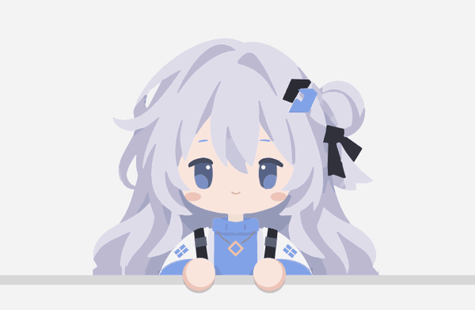
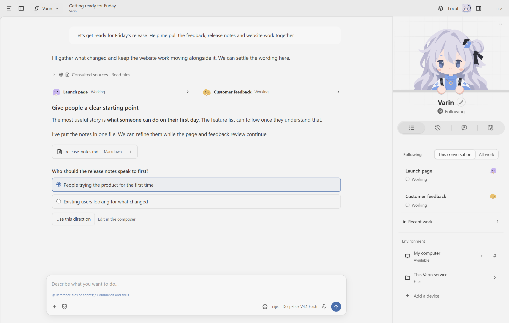
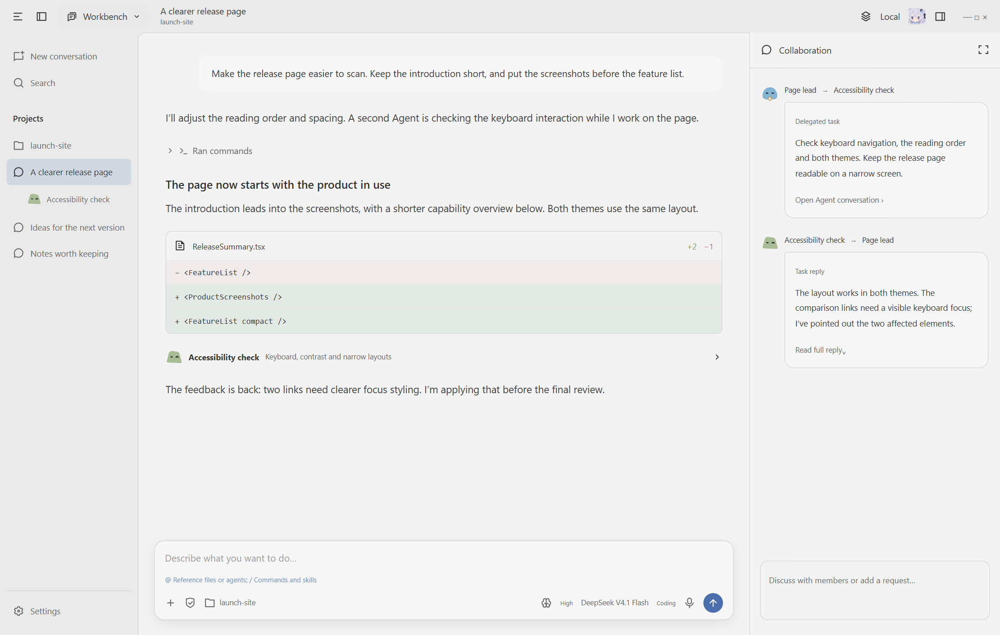
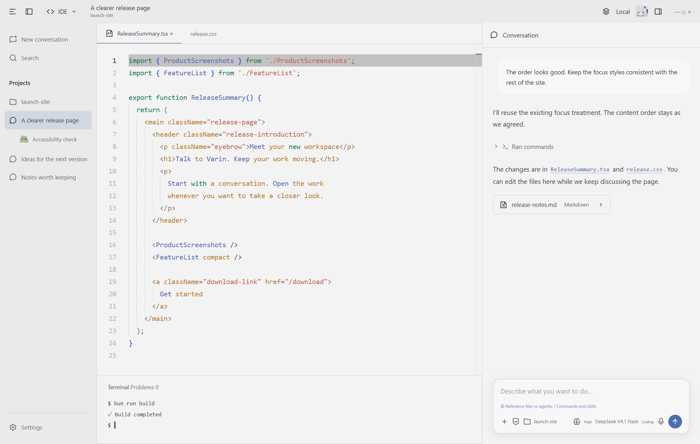
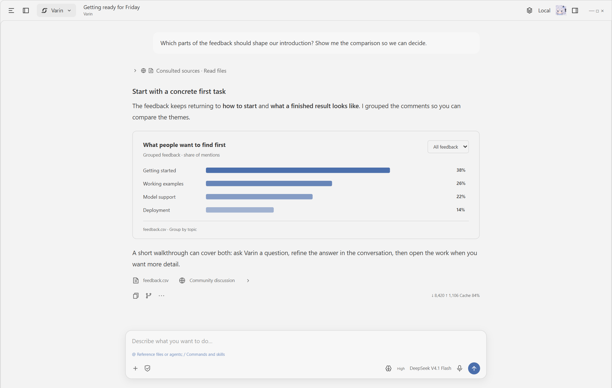
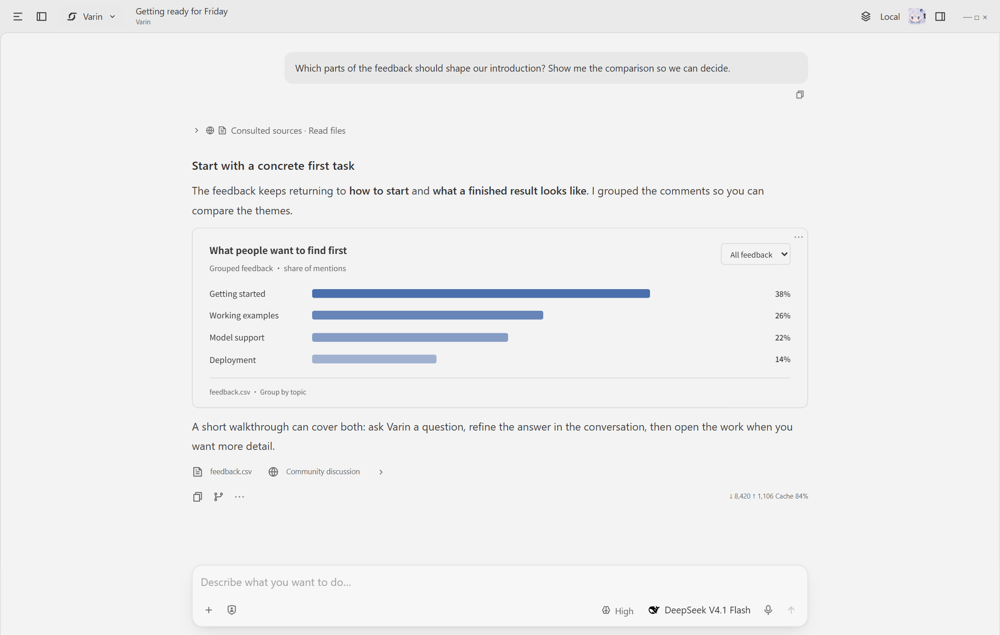
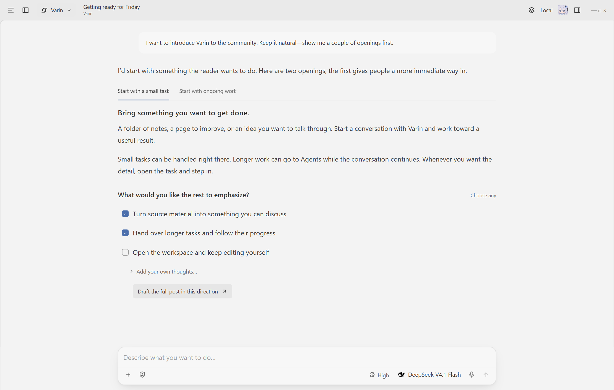
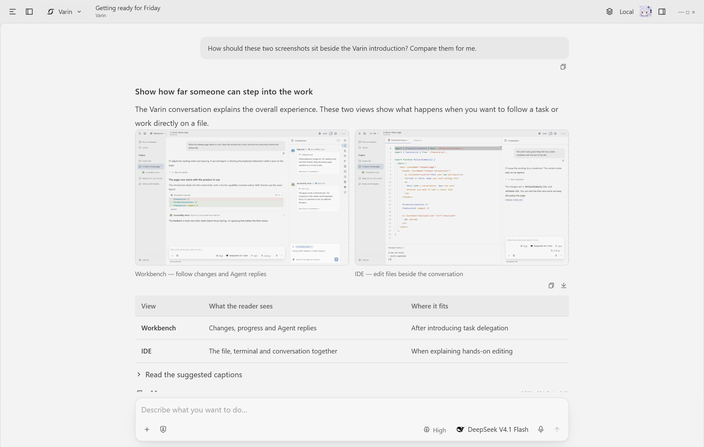

English | [简体中文](.github/readme/README.zh-CN.md) | [繁體中文](.github/readme/README.zh-TW.md) | [Français](.github/readme/README.fr.md) | [日本語](.github/readme/README.ja.md)

<p align="center">
  
</p>

<p align="center"><strong>An AI assistant for ongoing work, with a workspace you can step into.</strong></p>

<p align="center">Talk with Varin, keep work moving, and open the details whenever you want.<br />Open source. Your models, your keys, your computer or server.</p>

<p align="center">
  <a href="https://varin.dev">Website</a> ·
  <a href="https://github.com/Youzini-afk/Varin/releases/latest">Download</a> ·
  <a href="packages/docs/README.md">User guides</a> ·
  <a href="docs/ops/varin-extension-authoring.md">Build extensions</a> ·
  <a href="https://github.com/Youzini-afk/Varin/discussions">Discussions</a>
</p>

<p align="center">
  <a href="https://github.com/Youzini-afk/Varin/releases"></a>
  <a href="https://github.com/Youzini-afk/Varin/actions/workflows/ci.yml"></a>
  <a href="LICENSE"></a>
</p>

<p align="center">
  
</p>

## Meet Varin

Varin is a personal AI assistant for ongoing work. Talk through an idea, ask a quick question, or hand over something that will take time. It can do small jobs itself, bring in Agents for larger ones, and return to an existing task with its context intact.

- **Keep talking while work continues.** Follow-up messages can guide the current work; queue a message when you want it handled afterward.
- **See what is happening.** The side panel brings together current work, replies, things that need your input, memory and schedules. Open a task beside the conversation, or enter its full workbench.
- **Build on previous conversations.** Varin can recall and organize relevant memories across its conversations. You can inspect, edit and forget what it keeps.
- **Keep the work within reach.** Open files and connected computers alongside your chat. Send an original attachment to an Agent, discuss its result, and continue the task.

<p align="center">
  
</p>

[About the assistant](docs/bot.md) · [Collaboration and task reuse](docs/collaboration.md)

## Choose how closely you want to work

You can stay with the overall conversation, work directly with an Agent, or open the files yourself. Each view puts a different kind of information in front of you.

| View | What stays in focus | What you can open when needed |
| --- | --- | --- |
| **Varin** | Your conversation, ongoing work and results | Task details, questions, memory, files and computers |
| **Workbench** | A specific task and the Agent doing it | Tool activity, teammates, plans, context and recovery |
| **IDE** | Files and code you want to work on directly | Editor groups, diffs, terminals, Git and the Agent conversation |

### Workbench — work directly with the Agents

Give an Agent a task and follow its progress at the level you need. Ordinary tool activity folds into a short summary between messages; delegated tasks remain easy to open. Inspect a teammate's conversation, send a message or file, check a change, or branch the conversation to explore another approach.

Tasks can be delegated freely, with a model and thinking level, or use your configured Agent presets. An optional model-selection assistant can choose among your enabled chat models using their descriptions.

<p align="center">
  
</p>

### IDE — keep the files in your hands

Edit with Monaco, navigate the project, inspect diffs and use terminals and Git alongside the conversation. Move between discussing a change and working on the file itself; editors and Agents use the same document and workspace services.

<p align="center">
  
</p>

General, Coding, Research and Office are separate **task focuses**: they shape the tools and teammates available to an Agent. They sit underneath these views. [Workbench architecture](docs/workbench.md)

## A conversation you can work in

Read, compare, choose and refine a result in the conversation itself.

- **Readable progress.** Text stays in the foreground. Expand activity summaries, thinking, tool results and Agent replies when you want the detail.
- **Controls beside the explanation.** Choices, multiple selections, inputs and forms can sit between paragraphs. A selection can prepare an editable message in the composer.
- **Rich results.** Images, tables, math and diagrams fit into the conversation. Custom HTML can provide interactive charts, comparisons and small tools, with source viewing and export.
- **Connected to the work.** Task, file, plan and source references open the relevant view. Attachments keep their originals when passed between Agents.
- **Room to change direction.** Conversation branches and file recovery keep earlier work accessible. The composer supports references, commands and editable next-message suggestions.

<p align="center">
  
</p>

**Compare findings alongside the explanation.** Charts bring patterns in the source material into view, with the discussion and references in the same conversation.

<p align="center">
  
</p>

**Choose and refine without leaving the explanation.** Read alternative drafts in lightweight tabs, select the points to develop and add your own thoughts. Prepare the next message when you are ready to continue.

<p align="center">
  
</p>

**Read images and text together.** Image previews keep their proportions and open for a closer look. Tables make comparisons scannable; supporting details can stay folded beside the explanation.

<p align="center">
  
</p>

[Conversation and interactive content](docs/interactive-content.md)

## Tools for the whole task

Varin connects the model to information, files, programs and the interface where work happens.

| Capability | What Agents can use |
| --- | --- |
| **Files and code** | List, search, read and edit files; extract code structure; investigate in the background; inspect changes and recovery points. |
| **Commands and computation** | Shells, interactive terminals, background processes and a persistent JavaScript runtime, with status, output and cancellation. |
| **Web and research** | Configurable web search, page reading, source citations, academic search and document reading. Follow results back to their source. |
| **Documents and data** | Read PDFs and Office files; create and edit Word, Excel and PowerPoint documents; render and export supported formats. |
| **Browser and computer use** | Browse and interact with pages, handle downloads, observe applications and operate a connected desktop. |
| **Images and interactive results** | View images, use configured image-generation and editing models, and build HTML/JavaScript content inside chat. |
| **Coordination and continuity** | Delegate, message and resume tasks; maintain plans and memory; schedule work and follow-ups. |
| **Your own capabilities** | Connect MCP servers, use Skills and install extensions for additional tools and services. |

Common tools are available directly; other capabilities are discovered as needed. Provider-backed features use your configured services; desktop and remote operations use the capabilities available on the connected device.

## Your models, machines and workspace

**Choose the models.** Connect providers or compatible local services, configure thinking levels, and assign different models to tasks and supporting jobs. Usage and estimated costs are recorded by channel and model.

**Bring other Agents.** Codex, Claude Code, Pi and ACP-compatible programs can run as sessions or take delegated tasks while retaining their own accounts, models and tools. [External Agents](docs/external-agents.md)

**Place the work where it belongs.** Run locally, self-host on a server, or connect from a browser or phone. The interface, Agent service, file workspace and computer-use device can be on different machines. [Deployment](docs/ops/cloud-deployment.md) · [Resources](docs/resources.md)

**Keep an optional companion nearby.** The desktop companion follows the selected Bot's activity. Download its artwork and wake or put it to sleep from Settings.

<a id="how-the-harness-works"></a>

## Built for work that continues

The harness handles the context and execution around the model:

- Context is prepared in the background before it needs replacing, with summaries and selected original material.
- Durable history records execution and results so recoverable work can continue after a restart.
- Questions, permissions, queued messages and task reports keep their own state while other work proceeds.
- File changes have recovery records, with conflict checks when files have changed since.
- Bot memory can be recalled, revised and maintained in the background, and managed directly by you.

The core runtime is written in Rust. The desktop, web and mobile interfaces share the same application services. [Runtime](docs/runtime.md) · [Architecture](docs/architecture.md)

## Get started

1. Install Varin.

   | Where | How |
   | --- | --- |
   | Windows, macOS or Linux | [Download the installer](https://github.com/Youzini-afk/Varin/releases/latest) for your system and CPU architecture. |
   | Your own server, used from a browser | [Self-host with Docker](docs/ops/cloud-deployment.md), with persistent storage, passwords and remote access. |
   | Your phone | On Android, install the APK from the [latest release](https://github.com/Youzini-afk/Varin/releases/latest); on iPhone, install the web app (PWA). Then pair it with your Host from Settings. [Mobile guide](packages/docs/content/docs/mobile.mdx) |
   | From source | See [Run from source](#run-from-source). |

2. Open Settings and add an API key for a model provider, or connect a local service. [Model channels](packages/docs/content/docs/providers.mdx)
3. Start a conversation with Varin. Open the Workbench for direct Agent collaboration, or the IDE when you want to work in the files.

Varin is in active development before 1.0. This README describes the current source; [release notes](https://github.com/Youzini-afk/Varin/releases) describe each published build. Back up important application data before upgrading.

## Run from source

Use **Node.js 24**, **Bun 1.3.14**, Git, and the Rust toolchain in [rust-toolchain.toml](kernel/rust-toolchain.toml). Native dependencies also need a C/C++ toolchain and CMake. See the [development guide](docs/development.md) for setup and commands.

```sh
git clone https://github.com/Youzini-afk/Varin.git
cd Varin
bun install --frozen-lockfile
bun run dev
```

Open the UI URL printed in the terminal. The command starts the web interface and Application Host.

For the desktop app, run `bun run electron:dev` from the same checkout. It prepares the native kernel and launches Electron with the development UI. [Desktop development and packaging](packages/electron/README.md#development)

## Extend Varin

The Varin, Workbench and IDE views, along with the browser, Office, computer use and language servers, are extensions themselves. They use the same contracts as third-party extensions, any of them can be turned off, and a workbench can be replaced entirely. Extensions can add tools, model protocols, context algorithms, panels and whole workbenches. Start with the [authoring guide](docs/ops/varin-extension-authoring.md), the [SDK](packages/extension-sdk/README.md) or the [working examples](examples/extensions/README.md).

For how the pieces fit together, read the [architecture](docs/architecture.md), [runtime](docs/runtime.md) and [documentation index](docs/README.md).

## Community and contributing

- Ask questions in [Q&A](https://github.com/Youzini-afk/Varin/discussions/categories/q-a), share what you built, and suggest ideas in [Discussions](https://github.com/Youzini-afk/Varin/discussions). [Getting help](.github/SUPPORT.md) lists where each kind of request goes.
- Contributions are welcome: tools and context handling, model providers, extensions, documentation and translations, and test reports from your platform. The [contribution guide](.github/CONTRIBUTING.md) covers setup and pull requests.
- [Report a bug](https://github.com/Youzini-afk/Varin/issues/new?template=bug.yml) · [Suggest a feature](https://github.com/Youzini-afk/Varin/issues/new?template=feature.yml) · [Report a vulnerability privately](.github/SECURITY.md)
- Contact: [varin@astrmira.com](mailto:varin@astrmira.com).

Thanks to the [LinuxDO](https://linux.do) community for its support.

## License

The project is distributed under the [GNU Affero General Public License v3.0](LICENSE) (`AGPL-3.0-only`). Modified versions offered over a network must provide their corresponding source as required by the license. Copyright and third-party notices are preserved in [THIRD_PARTY_NOTICES](THIRD_PARTY_NOTICES.md).
