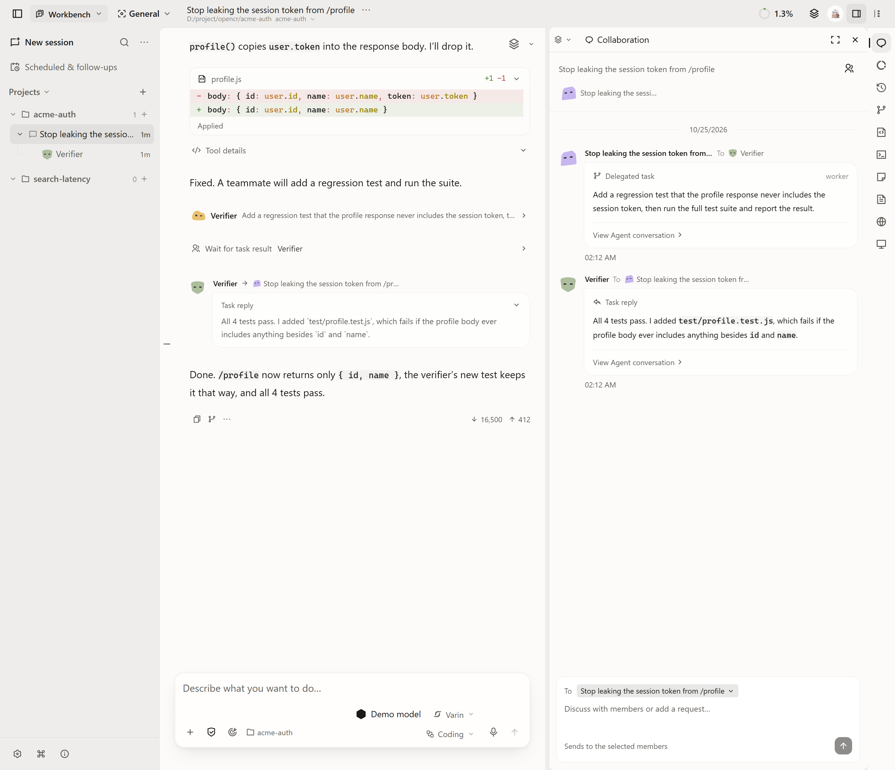
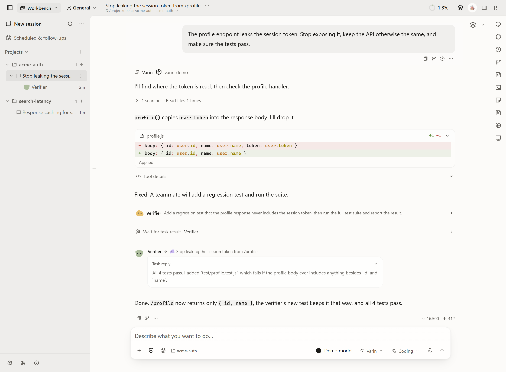
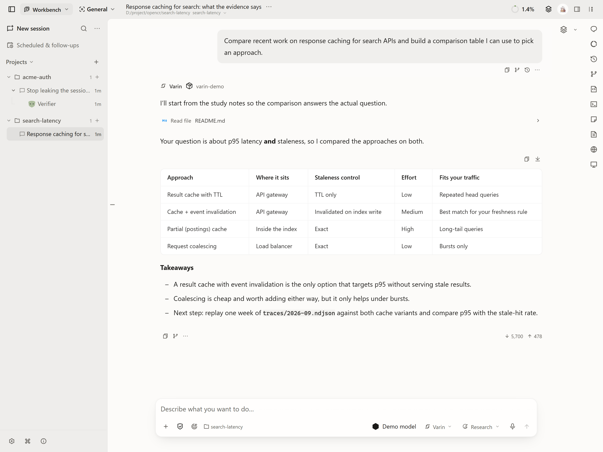

English | [简体中文](.github/readme/README.zh-CN.md) | [繁體中文](.github/readme/README.zh-TW.md) | [Français](.github/readme/README.fr.md) | [日本語](.github/readme/README.ja.md)

<p align="center">
  
</p>

<p align="center"><strong>Hand over the task, then watch the team get it done.</strong></p>

<p align="center">Varin plans the work, brings in teammates, checks the results and reports back.<br />Open source, running on your own computer or server, with your own API keys.</p>

<p align="center">
  <a href="https://varin.dev">Website</a> ·
  <a href="https://github.com/Youzini-afk/Varin/releases/latest">Download</a> ·
  <a href="packages/docs/README.md">User guides</a> ·
  <a href="docs/ops/varin-extension-authoring.md">Build extensions</a> ·
  <a href="https://github.com/Youzini-afk/Varin/discussions">Discussions</a>
</p>

<p align="center">
  <a href="https://github.com/Youzini-afk/Varin/releases"></a>
  <a href="https://github.com/Youzini-afk/Varin/actions/workflows/ci.yml"></a>
  <a href="LICENSE"></a>
</p>

<p align="center">
  
  <br />
  <sub>The Bot workbench stage, replaying a scripted run.</sub>
</p>

## What working with Varin looks like

**The same model goes further.** Varin prepares everything around the model: context tidied ahead of time, every step recorded so a run survives a restart, other work moving while it waits for you, tools loaded when they are needed. The same model can finish longer, more complex tasks. [How the harness works](#how-the-harness-works)

**A team you can watch.**

- The lead agent splits a task and assigns the parts: a Worker writes the implementation, a research agent gathers context, a verifier runs the tests. Teammates work in parallel, message each other, hand over code with file-by-file diffs, and report back in the collaboration panel. Step in whenever you like.
- A bot has its own name, instructions, model, working directory and memory, and keeps several pieces of work moving. Its stage in the Bot workbench shows what it is doing and which teammates are out on the job. Put it to sleep and its work is suspended; wake it and it picks up where it left off.
- Codex, Claude Code, Pi and programs that speak ACP can run on your Host as sessions in Varin, or take work dispatched by the lead agent. They keep their own models, accounts and tools.
- In the desktop app, an optional desktop companion sits on your desktop and acts out what the bot is doing. Its artwork is a separate download in Settings.

**Yours to run and shape.** Keys stay on your own Host and requests go straight to the providers you configure. Any preset agent can get a new model, instructions or tools, and the workbenches themselves are extensions you can turn off or replace. Varin is licensed under AGPL-3.0.

<p align="center">
  
</p>

## Four ways to work

The mode decides which tools the agent starts with and which teammates help out.

| Mode | What it does | For example |
| --- | --- | --- |
| Code | Reads and changes code, runs commands and terminals. Every edited file is checkpointed by turn. | "Refactor the login module and ping me when all the tests pass." |
| Research | Searches OpenAlex and Semantic Scholar, reads papers and PDFs, and moves an experiment forward step by step. | "Find the last two years of papers on this and build a filterable comparison table." |
| Office | Works with Word, Excel and PowerPoint, plus the browser and the apps on your computer. | "Export last month's orders into an Excel sheet with charts." |
| General | Looks things up, writes, or builds a small interactive tool. | "Compare these three cameras and make a chart I can tweak." |

<p align="center">
  
  
</p>

## Get started

1. Install Varin.

   | Where | How |
   | --- | --- |
   | Windows, macOS or Linux | [Download the installer](https://github.com/Youzini-afk/Varin/releases/latest) for your system and CPU architecture. |
   | Your own server, used from a browser | [Self-host with Docker](docs/ops/cloud-deployment.md), with persistent storage, passwords and remote access. |
   | Your phone | On Android, install the APK from the [latest release](https://github.com/Youzini-afk/Varin/releases/latest); on iPhone, install the web app (PWA). Then pair it with your Host from Settings. [Mobile guide](packages/docs/content/docs/mobile.mdx) |
   | From source | See [Run from source](#run-from-source). |

2. Open Settings and add an API key for a model provider, or connect a local service. [Model channels](packages/docs/content/docs/providers.mdx)
3. Pick a work mode, choose a project folder if the task needs one, and start your first task.

Varin is in active development before 1.0. This README describes the current source; [release notes](https://github.com/Youzini-afk/Varin/releases) describe each published build. Back up important application data before upgrading.

## How the harness works

The model does the thinking. The harness is everything around it: tools, context, execution, permissions, collaboration and recovery.

- Self-curated context: tidied in the background ahead of time, summarized with the key originals kept, and counted with local tokenizers calibrated against real usage.
- Durable runs: every step is recorded and resumes after a restart. An action with an unclear outcome stops for a check instead of running again.
- Questions don't block: other work goes on while the agent waits for you, and budgeted goals resume when their conditions are met.
- Tools on demand: common tools are always at hand and the rest load when needed. MCP servers can be exposed directly or discovered on demand.
- File timeline: every edited file lines up by turn. Roll back in one step, and undo the rollback too. Files you changed by hand are never overwritten.

**Ready out of the box.** About 90 native tools, 4 work modes, 4 official workbenches, 7 bundled language servers and 9 native model protocols, with the interface in 10 languages.

**Deep customization, no code required.** Give any preset agent a new model, instructions or tools, or create your own. Choose separate models for titles, context curation, planning, images and embeddings. Edit system instructions and memory, use Skills from `.claude` and `.agents` folders or install them from a Git repository, and allow, ask or deny each tool.

**Your keys, your data.** Keys stay on your own Host, and requests go straight to the providers you configure: OpenAI, Anthropic, Gemini, Vertex AI, Azure OpenAI, Bedrock, Mistral, Alibaba Model Studio, Zhipu and StepFun, or Ollama, LM Studio and any compatible endpoint. Usage is recorded per channel and model, turn by turn. You can see, correct or erase what a bot remembers.

## Run from source

Use **Node.js 24**, **Bun 1.3.14**, Git, and the Rust toolchain in [rust-toolchain.toml](kernel/rust-toolchain.toml). Native dependencies also need a C/C++ toolchain and CMake. See the [development guide](docs/development.md) for setup and commands.

```sh
git clone https://github.com/Youzini-afk/Varin.git
cd Varin
bun install --frozen-lockfile
bun run dev
```

Open the UI URL printed in the terminal. The command starts the web interface and Application Host.

For the desktop app, run `bun run electron:dev` from the same checkout. It prepares the native kernel and launches Electron with the development UI. [Desktop development and packaging](packages/electron/README.md#development)

## Extend Varin

The Agent, IDE, Research and Bot workbenches, along with the browser, Office, computer use and language servers, are extensions themselves. They use the same contracts as third-party extensions, any of them can be turned off, and a workbench can be replaced entirely. Extensions can add tools, model protocols, context algorithms, panels and whole workbenches. Start with the [authoring guide](docs/ops/varin-extension-authoring.md), the [SDK](packages/extension-sdk/README.md) or the [working examples](examples/extensions/README.md).

For how the pieces fit together, read the [architecture](docs/architecture.md), [runtime](docs/runtime.md) and [documentation index](docs/README.md).

## Community and contributing

- Ask questions in [Q&A](https://github.com/Youzini-afk/Varin/discussions/categories/q-a), share what you built, and suggest ideas in [Discussions](https://github.com/Youzini-afk/Varin/discussions). [Getting help](.github/SUPPORT.md) lists where each kind of request goes.
- Contributions are welcome: tools and context handling, model providers, extensions, documentation and translations, and test reports from your platform. The [contribution guide](.github/CONTRIBUTING.md) covers setup and pull requests.
- [Report a bug](https://github.com/Youzini-afk/Varin/issues/new?template=bug.yml) · [Suggest a feature](https://github.com/Youzini-afk/Varin/issues/new?template=feature.yml) · [Report a vulnerability privately](.github/SECURITY.md)

Thanks to the [LinuxDO](https://linux.do) community for its support.

## License

The project is distributed under the [GNU Affero General Public License v3.0](LICENSE) (`AGPL-3.0-only`). Modified versions offered over a network must provide their corresponding source as required by the license. Copyright and third-party notices are preserved in [THIRD_PARTY_NOTICES](THIRD_PARTY_NOTICES.md).
