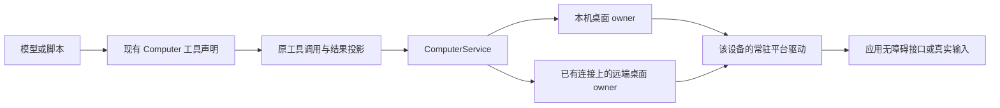

# Computer Use：语义查询、局部观察与条件等待

状态：工具、Host、界面以及 Windows UIA、macOS AX、Linux X11 AT-SPI 的主要调用链已实现。
当前范围与用法见 [Computer Use 模块说明](../../packages/web/application-host/lib/computer/DOCUMENTATION.md) 和
[驱动合同](../../packages/computer-driver/README.md)。本稿保留尚未交付的原生事件订阅、Wayland 语义接入和实机验收设计。
当前等待由目标 Host 分段采样，不宣称具备事件覆盖；Wayland 仍保留原 portal 输入/画面能力。

基于 Varin `a264fe0c6`（0.9.46），参考 agent-desktop `2f650705`。本文确定后续实现的目标与边界；当前行为仍以源码和 [Computer Use 模块说明](../../packages/web/application-host/lib/computer/DOCUMENTATION.md)为准。

## 1. 设计判断

在现有 ComputerService、常驻平台驱动和设备控制机制上，补齐模型按目的查询、操作和等待界面的能力。主要收益应体现为：模型更容易找到正确目标，少读取无关内容，少为确认一个状态重复调用工具，用户能理解正在操作什么。

保留截图、真实键鼠、应用专用协议和语义控件操作，让模型根据任务选择。无障碍结构良好的表单、菜单和列表适合语义操作；画布、视觉判断、拖动和缺少可靠控件信息的界面继续使用视觉与真实输入。网页和 Office 的应用协议继续由现有 browser/office owner 提供。

这次设计不引入另一个桌面服务、账号、权限系统、会话目录、持久队列或 Agent 循环。也不将 agent-desktop 的 CLI、MCP 工具全集与沙箱管理整体接入产品。它提供的查询、状态动作和等待设计，以及原生适配中已经验证的经验，是主要参考。

目标交互可以很短：找到“自动保存”复选框，将它设为开启，读取其状态。复杂任务也可以先看窗口结构、展开相关区域，再决定下一步。工具说明表达能力和边界，模型自主安排顺序。

## 2. 当前基础与真实缺口

| 现有实现 | 设计需要推进的部分 |
| --- | --- |
| `computer_observe` 默认不截图，支持树分页、深度和节点数参数 | 增加按控件条件查询、精确属性读取、区域展开；分页和输出裁剪不能冒充原生读取优化 |
| `observationId + elementIndex` 绑定原窗口，原生驱动重新定位 | 让局部观察与属性读取协同工作，避免读取一个区域就无意义地废弃另一区域的语义引用 |
| Windows 以 RuntimeId、AutomationId、名称等定位；macOS 保留 AX 对象；Linux 读取 AT-SPI | 复用平台身份，保留层级与状态信息，避免所有定向操作都扫描整个窗口 |
| `act` 支持点击、键鼠、拖动、设值和平台 secondary action | 加入表达目标状态的动作，明确每种机制的适用条件和操作结果 |
| Windows/Linux 的 `auto` 点击主要走真实输入 | 对普通元素主操作优先选择可靠的语义调用，保留明确的真实点击选择 |
| `computer_wait` 等待子任务的桌面分配决定 | 新增界面条件等待，避免改变原有协作语义 |
| 观察和输入经过原桌面有序通道，取消与查看器有独立路径 | 等待期间让出通道，只在实际读取或动作时进入原通道 |
| `observationOutput` 拆出图片后返回其余观察字段 | 使用已有 `model_data` 和短引用，只向模型提供做下一步决定需要的信息 |

关键入口：

- [工具声明](../../packages/extension-builtins/src/computer-tools.ts)、[Host 工具处理与结果投影](../../packages/web/application-host/lib/kernel/computer-runtime.ts)。
- [共享 DTO](../../packages/protocol/src/harness-computer.ts)、[ComputerService](../../packages/web/application-host/lib/computer/computer-service.ts)、[远端 HTTP 路由](../../packages/web/application-host/lib/computer/computer-routes.ts)。
- [驱动入口与生命周期](../../packages/web/application-host/lib/computer/desktop-drivers.ts)、[Windows helper](../../kernel/crates/varin-computer-windows/README.md)、[平台驱动合同](../../packages/computer-driver/README.md)。
- [模型引用 owner](../../kernel/crates/varin-runtime/src/catalog_model_references.rs)、[Host 引用接口](../../packages/web/application-host/lib/kernel/model-references.ts)、[聊天工具视图](../../packages/ui/src/components/conversation/ChatComputerTools.tsx)。

## 3. 所有权与调用链



ComputerService 继续拥有设备选择、观察记录、执行通道和远端路由。computer-automation 继续拥有分配、接管与取消。原生驱动拥有控件身份、实际查询、输入及其直接反馈。Catalog 继续拥有任务、Operation、历史结果和模型短引用。

前端、Harness、文件工作区和桌面可以在不同设备。查询和等待都在桌面所在 Host 执行；客户端不拿收到的窗口句柄去操作本机，也不通过自己的系统路径解析远端应用。原始引用始终携带原桌面与执行归属。

语义输入仍是修改应用的动作，使用现有 control 分配。查询和条件等待使用 observe 分配。能后台点击不意味着多个 Agent 可以并发修改同一应用；此次维持现有每桌面控制 owner，避免另建按控件抢占的调度系统。

新增检查只放在实际边界：工具入口解析模型参数，远端入口确认真实调用来源，平台动作前确认原目标及所需能力。生成类型之后的内部传递不再各层递归校验一遍相同结构。

## 4. 工具组织

保留 `computer_observe`、`computer_act` 和已有应用协议入口；新增两个目的明确的工具：`computer_query` 与 `computer_await`。读、写、等待沿用原工具执行机制，不按每个按钮动作增加一批新工具。

| 工具 | 用途 | 返回重点 |
| --- | --- | --- |
| `computer_observe` | 查看窗口轮廓、区域内容或截图 | 可读结构、控件引用、可继续展开的位置 |
| `computer_query` | 查找匹配控件，或读取一个控件的指定属性 | 匹配项或属性；匹配范围与完整性 |
| `computer_act` | 执行原输入动作或把控件设为明确状态 | 实际动作、所用机制、已取得的直接反馈 |
| `computer_await` | 等待窗口、控件或属性满足条件 | 满足的条件及证据，或未满足原因与最后观察 |

以下字段与示例是拟议合同，当前版本尚不支持。最终 schema 应从现有 Computer 声明生成并在同一修改中更新消费者。

### 4.1 共享定位

沿用 `{ observationId, elementIndex }` 表示一个已观察元素。`observationId` 在模型输入里可以是已有引用机制产生的 `obs:…` 短引用；Host 解析后继续使用原内部 ID。

- 窗口级发现使用现有 `desktopId/app/window` 选择。
- `target` 指一个精确的观察元素，用于读属性或动作。
- `within` 指查询区域，使用同一种元素引用；区域内的匹配才进入结果。
- 已有引用确定目标 Host、窗口和原执行；不要求模型重复填设备、窗口、epoch。显式提供的定位发生冲突时报告冲突。

查询条件支持角色、名称、值和已知状态。名称默认精确匹配，可明确选择包含匹配。角色采用跨平台的常用控件语义，并保留无法归一化的平台角色说明；不做隐式翻译、模糊相似度排序或“取最像的一个”。不引入脚本表达式或一套新的 selector DSL。

### 4.2 查询与属性读取

```js
computer_query({
  app: "目标应用",
  match: { role: "checkbox", name: "自动保存" }
})

computer_query({
  target: { observationId: "obs:示例", elementIndex: 12 },
  properties: ["checked", "enabled"]
})
```

查找返回匹配集合，不在后台替模型选择第一个。多个同名结果附带必要的行名、分组名或祖先标签，以便继续缩小范围。模型选定元素后再交给 `act`；动作入口不重复解释开放式查询。

属性读取覆盖名称、值、角色、enabled、selected、checked、expanded、可用动作等实际平台事实。读不到的属性为 unknown/unavailable，不能当作 false。混合勾选状态独立表达，不能压成布尔值。读取整段文本与读取短值明确区分，长文本继续复用分页材料能力。

查询在目标 Host 完成筛选和投影，避免把整窗树先传回协调 Host 再筛选。结果页可以限制展示量并继续读取；未遍历完整范围时，不能宣称只有这些结果或不存在目标。虚拟列表的范围是当前暴露的控件，未加载的行不算已经搜索。

### 4.3 轮廓与局部观察

`observe` 增加 `view: "outline" | "tree"` 与可选 `within`。新模型入口默认使用轮廓；完整树、指定深度和截图仍可直接选择。默认轮廓是可调展示策略，不是读取能力的硬上限。

轮廓优先保留窗口标题、主要区域、焦点、重要静态标签及可交互控件；透明布局包装可以折叠，但不能丢掉“这一行属于谁”这类定位上下文。容器如果还有未展开内容，明确标记，可使用其引用继续读取。不为轮廓生成额外 LLM 摘要。

`within` 在当前界面重新定位原区域并读取其内容，返回新的观察结果。读取已有 `observationId` 的分页则继续读当时固定的结果，不偷偷混入最新界面。页面顺序与元素编号在同一观察内保持稳定。

原生读取增加父子关系、标准状态和裁剪信息，Host 不从缩进文本反向猜树。`treeLines` 继续作为展示投影，原生记录只保留一份事实来源。

## 5. 观察引用与模型输入

### 5.1 复用现有短引用

使用 Catalog 已有的 `ReferenceKind::Observation` 和 Host model-references 接口。每份对模型公开的观察注册一次原观察身份，元素沿用其中的编号；不为每个控件创建独立持久记录。

短引用映射只指向原 Computer owner、观察 ID 和原结果身份，不持久化 COM/AX 对象或创建第二份桌面状态。引用解析仍需原分配；记录能从历史中读到，不代表它在当前桌面还可操作。驱动或 Host 重启后失效的引用返回明确过期结果，模型重新观察。

### 5.2 局部读取不制造全窗失效

将“元素的语义引用”与“截图坐标的有效条件”分开处理：

- 语义引用只要原观察仍被保留、原执行与窗口实例有效，且驱动能重新确认唯一目标，就可以使用。后续读取其他区域本身不使它失效。
- 属性查询和等待中的采样不更新当前可操作观察，也不清掉其他控件引用。只有返回新的可操作结果时才发布观察。
- 坐标仍依赖对应的原始图片、几何、DPI 和当前输入条件。旧截图不能因为一个语义查询成功就被标成新画面。
- 窗口关闭重开、进程实例更换、人工接管交还、执行身份变化继续使相关引用失效。不能用同名新窗口替代原窗口。

这需要调整当前 `rememberObservation` 的整窗替换和 latest-only 检查，以及 macOS 每窗口只保留最近一组元素的实现。继续使用原 `observations/observationOwners`；为仍有效的观察保留最小定位证据，共享同一原生目标的句柄与身份。重复读取不复制整窗树。观察回收跟随原执行和引用持有者的生命周期；原始结果正文留在已有工具历史中。

平台重新定位优先使用原进程和窗口内的真实元素身份，再在必要时进行有限范围的唯一匹配。坐标、数组下标和可变控件值都不独立充当身份。完整性不足时不宣布唯一匹配；需要扩大读取时由原 owner 完成一次，而不是每个属性分别全窗扫描。

### 5.3 模型投影

原结果通过 `data` 保留产品显示和执行所需的事实，`model_data` 提供简洁视图，图片继续使用已有 media parts。两者在同一调用结算时产生，不能后续改写历史里的观察正文。

示意内容：

```text
设置窗口 · 偏好设置区域
观察：obs:示例
12 复选框「自动保存」 未勾选，可用；可设为勾选
13 按钮「保存」 可用；可点击
18 分组「高级选项」 尚未展开，可继续读取
```

默认只保留任务需要的窗口名称、元素引用、名称/角色/值、已知状态、可用动作、范围与继续读取方式。bounds 在视觉操作需要时提供。内部 UUID、原生句柄、AutomationId、COM 路径、epoch、重复树与完整回执不直接拼入模型正文。

页面和应用中的文字属于待处理内容，不成为工具使用指令。工具说明与能力目录保持稳定，动态控件内容进入对应工具结果；不每轮重建一个全桌面概览塞进提示词前缀。

## 6. 明确动作意图与执行机制

`computer_act` 保留当前键鼠、拖动、输入和 secondary 能力，增加 `set_checked`、`set_expanded`、`select`、`scroll_into_view`。这些是同一动作接口的变体，不创建独立服务。

| 动作 | 明确语义 |
| --- | --- |
| `click` | 执行元素的主操作，或明确的物理点击 |
| `set_checked` | 将勾选状态设为 true/false；混合态需要真实平台支持 |
| `set_expanded` | 将容器展开或收起 |
| `select` | 选择一个已发现选项；多选修改明确区分替换、增加和移除 |
| `set_value` | 替换控件的完整值 |
| `type` | 在当前编辑位置插入文本，保留其选择区语义 |
| `scroll_into_view` | 使指定元素进入可见区域；不会将它自动设为选中项 |

```js
computer_act({
  action: {
    kind: "set_checked",
    observationId: "obs:示例",
    elementIndex: 12,
    checked: true
  }
})
```

新动作使用原生接口可直接表达的目标状态。平台只有 toggle 时，先读取实际状态，已满足就结束，需要变化才触发一次；读不到当前状态时不能假装 toggle 等价于 set_checked。选项通过已观察元素确定，不凭同名字符串静默选中多个候选中的一个。

### 6.1 自动选择机制

普通单次左键、元素主操作的 `auto` 路径优先使用平台确认支持的语义调用；明确坐标、右键、双击/多击和拖动保留各自物理语义。现有 `clickMethod: accessibility/global/app_post` 继续提供明确选择，`auto` 的行为变化写入版本说明。

`type` 不自动改成 `set_value`，否则会覆盖未选中的内容。目标状态动作在平台缺少直接语义实现时，可以采用能够证明等价的物理机制，例如在已读取的复选框状态基础上单击一次；动作仍需满足当前输入条件，并在回执中注明机制。模型也可明确使用现有真实输入动作完成工作。

机制切换只发生在确认前一机制未发送输入时，例如目标未提供该 pattern。调用已经返回成功但效果尚未观察到，或发生超时、未知错误、部分输入时，不再追加另一种点击来“确保成功”。这对应重复提交、重复删除或开关翻转的真实风险。

### 6.2 减少不必要的前置工作

语义动作仍核对原进程、窗口、控件身份、control 分配和实际可用状态；不把窗口坐标完全相同、鼠标位置和前台焦点作为所有语义操作的统一前提。窗口移动后，能够重新确认的同一语义目标仍可操作。

物理动作继续校验其截图/控件坐标、DPI、焦点与点击位置归属。需要激活或恢复窗口的步骤记录实际变化。显式的 app_post 保留现有适用范围，不作为无声兜底。

动作和后置读取使用同一已解析目标；不在每层重复取树。可以直接读取目标属性验证的动作，只读相关属性。普通点击不自动截全屏或查询全窗来证明业务完成；有依赖的后续工作可使用 `query`、`await` 或截图判断。

### 6.3 回执

沿用 `ComputerActionReceipt.effect` 和 `inputWriterStopped`，在原结果里补充实际机制与直接观察到的状态。平台调用被接受、目标属性已变化、整个业务任务完成分别表达。

- 已满足目标状态：`effect: none`，附当前状态；无需发送输入。
- 原生调用已发送：`dispatched`；有明确目标属性回读一致时为 `verified`。
- 中途取消、响应丢失和执行失败继续保留 `partial/unknown` 与真实 writer 状态。
- 点击成功后等待“已保存”超时：保留点击回执，等待单独报告未满足；不能把它改成“点击未发送”。

`verified` 的证据必须说明验证了什么，例如“checked=true”，不能扩大为“设置已持久化”或“文件已保存”。没有必要再加一套与现有 effect 并行的成功等级。

## 7. 条件等待

### 7.1 对外语义

`computer_await` 是只读等待，支持窗口出现/关闭、范围内元素出现/消失、控件属性达到目标值。沿用查询条件和元素引用，不创建另一套匹配规则。

```js
computer_await({
  within: { observationId: "obs:示例", elementIndex: 18 },
  match: { role: "text", name: "已保存" },
  condition: "present",
  timeoutMs: 10000
})
```

示例中的 10 秒由调用者选择，不是平台固定上限。可省略时间参数并沿用外层调用的 deadline/cancellation。`computer_await` 固定采用现有 `read/result` 工具合同：调用异步等待到条件满足、到期或取消，期间不阻塞 Host 事件循环和桌面输入通道。窗口条件依赖当前原生会话，本次不把它变成需要跨重启恢复的持久 Job。

条件默认描述“当前是否满足”。如果调用者需要“从现在开始发生一次变化”，提供明确的变化条件并在开始时建立基线。看到原先就存在的“已保存”不能证明刚才的新保存完成。模型可选择更有区分力的业务状态、指定基线或读取应用协议结果。

结果区分 `satisfied`、`timed_out`、`cancelled`、`target_lost` 和不可读取/不支持。超时附最后实际读取的状态和经过时间；缺失属性不是 false，断线不是目标消失，未完成的树遍历也不能满足“元素不存在”。

窗口关闭条件针对原窗口实例；普通窗口内元素等待遇到原窗口关闭则返回目标失效，不能到同名新窗口接着等。虚拟列表中元素移出已加载区域，只能说明当前范围未暴露，不能当作业务对象已删除。

### 7.2 在桌面 owner 上运行

等待协调逻辑放在目标 Host 的 ComputerService 下，与原调用共享生命周期。远端只发送一次等待请求和最终结果，采样不在客户端和远端之间来回往返。

实施原则是“建立监听或安排采样，完成一次短读取，然后让出执行通道”：

1. 固定原执行、分配、窗口和条件，连接原取消信号。
2. 平台支持相关事件时先订阅，再读取当前状态，覆盖订阅与读取之间的变化。
3. 事件只作为重新读取的信号；真正的目标属性由原 owner 读取后判断。相同范围的事件合并唤醒，避免一次 UI 更新触发大量全窗观察。
4. 没有完整事件支持时，使用原通道执行小范围定时读取。间隔可配置，根据实际 provider 成本和响应需求确定，不预设统一高频轮询常量。
5. sleep、事件等待和网络等待在输入队列之外；每次真实读取才进入原有序通道。结束时释放原监听/定时器和回调。

事件遗漏风险由该平台的实际事件覆盖决定：支持完整事件时依赖事件；覆盖不完整时配合有限频率的状态复查。必须在 driver capabilities 中诚实表达，不把“注册回调成功”当成完整覆盖。

一次原生读可能阻塞，仍需要驱动自己的取消检查和已有控制旁路。不能只在 Host 解除 Promise 就报告原生资源已释放；也不在本次设计中新增一个通用线程池来掩盖所有 provider 的阻塞。

### 7.3 等待与接管

取消这一次等待只释放它的观察资源，不调用全桌面的 cancel/release，不取消刚才已经提交的保存或后台任务。当前 `requestWithAbort` 有中断原驱动的路径，新增等待必须显式使用按请求的只读取消；不能直接套一个长 `observe` 循环进去。

任务结束、授权撤回、人工接管或原窗口失效会终止受影响的等待，并通过已有任务状态说明原因。查看器仍可独立刷新；另一个观察者的请求不替换本等待的目标。手动交还控制后的新工作重新取得观察，不让旧等待自动取得新控制权。

Host 重启后原生监听结束，原调用按已有 owner 丢失/恢复语义结算。若需要继续等待，由原任务对当前界面重新发起只读等待；不自动重放此前的输入动作。

## 8. 平台实现

统一公开的查询、状态和动作含义，平台自己实现原生访问。不为统一语言重写现有 Swift/Python 驱动，也不把 Windows 能力当成所有设备的默认能力。

| 平台 | 复用基础 | 主要改动与依据 |
| --- | --- | --- |
| Windows | Rust helper、MTA UIA worker、CacheRequest、独立控制 pipe | 用 UIA 条件和属性缓存做定向查找/读取，保留层级；使用 Invoke、Selection、Toggle、ExpandCollapse、ScrollItem 等实际 pattern；事件回调交回原 owner，不能跨线程共享 COM 对象 |
| macOS | Swift 常驻 helper、AX 对象、独立输入/捕获队列、ScreenCaptureKit | 用保留的原 AX 目标读取子树/属性，减少对 child-index path 的单独依赖；使用 AXObserver 唤醒短读取；平台未提供可设置属性时保留实际不可用状态 |
| Linux X11 / Wayland | AT-SPI、原 D-Bus 会话、X11 输入或原 portal 会话 | 使用原 accessible 对象与总线身份查询；状态/事件走 AT-SPI；物理输入仍走对应会话，不能为了语义查询重新申请 portal 授权或切换桌面 |

Windows 当前 `Uia::relocate` 会完整读取子树身份，Host 的 `textLimit` 只裁剪已读取结果。实施时先让“精确属性读取”和“已知区域读取”减少实际原生读取，再处理宽范围查找。不能把全树读完后在 TS 截断，计作性能优化。

macOS 的引用必须指向原对象和窗口；子节点重新排序可以通过仍有效的原生对象确认，不能仅按新数组下标操作。Linux 同样不能把某次观察里的窗口索引当作长期窗口实例身份。原生身份不足时保留明确歧义，而不是将标题相同当作足够证明。

能力信息分两层：

- 设备层说明驱动实现了哪些查询、状态动作、事件等待和物理输入方式。
- 元素层说明当前控件实际暴露哪些动作和属性。设备支持 Toggle，不代表每个控件都支持 Toggle。

新增能力进入原 `ComputerCapabilities` 和元素记录，不增加一套平台注册表。未知远端能力保持 unknown，向原 Host 查询或让实际请求返回原因；不能猜为 false 并隐藏整类功能。无障碍树未准备好、权限缺失、界面没有相应控件分别报告。

Chromium/Electron 的无障碍树可能需要平台启用与等待。只依据实际暴露的接口和 renderer 能力处理，不写应用名称或窗口标题特判。已有网页 CDP 路径与 Office 协议继续可独立选择；不会自动启动一个新浏览器、重开用户文档或安装额外服务来完成语义请求。

## 9. 用户可见的过程

沿用 `ChatComputerTools`、工具折叠区、桌面查看器、输入反馈和人工接管入口。一次操作对应一条有动作对象的过程信息，不为查询、定位、重定位和回执分别铺一排卡片。

典型呈现：

- 查询完成：“在「偏好设置」找到 2 个匹配项”，展开查看控件和必要上下文。
- 状态设置：“开启「自动保存」”；有回读时显示“已勾选”，已满足时显示“原本已开启”。
- 等待：“等待「保存完成」提示”；完成后更新为已出现，超时后保留最后观察状态。
- 目标失效：“原窗口已关闭，需要重新观察”；动作可能发生时保留“结果待确认”，不能变成可直接重试的成功/失败按钮。

默认显示应用/窗口和人能理解的控件名称。机制信息如“通过控件操作”“使用鼠标”放在次级详情；只有发生焦点切换、需要用户接管或平台不支持时提升信息权重。原生标识、Run/Operation 身份和诊断代码不挤进主行。

查询结果沿用紧凑列表，展开区域使用真实层级。截图作为任务需要的图像证据展示，语义动作不强制插入一张空截图。可以使用新近读取的真实 bounds 在查看器中短暂标示目标；没有可靠 bounds 就只展示文字，不能根据名称猜一个框。

进行中、完成、失败和折叠之间使用现有连续动效，快速更新可被后续状态打断。浅色/深色均沿用主题中性色与克制的局部强调；不新增整块高饱和底色。宽度不足时让操作对象和状态自然换行，长控件名称展开可读，避免遮住控制按钮。

人工接管保持一个明确入口。后台语义动作仍显示所属任务及活动状态；不能因为没有鼠标动画就让用户不知道应用正在被修改。

## 10. 性能目标与可用性判断

性能目标围绕完成工作所付出的实际代价，不承诺未经测量的倍率。需要分别观察：模型工具往返、实际发送的文本/图片量、原生读取范围、操作耗时、误定位/拒绝和用户被打断的次数。

选择现有可控应用/fixture 完成三类代表任务即可形成第一轮证据：

| 场景 | 对比重点 | 正确性证据 |
| --- | --- | --- |
| 表单与重复选项：定位一行、改值、开启开关 | 查询是否减少全文读取与模型调用；目标态动作是否省掉重复点击 | 正确对象已变，邻近对象未变；重复 set 不翻转 |
| 稠密 Electron/IDE 界面：找区域、展开、进入控件 | 实际 UIA/AX/AT-SPI 读取量与结果大小；完整树和局部读取分别计时 | 找到的对象仍属于原窗口/区域，重复名称不选错 |
| 异步保存/加载：操作后等指定状态 | 等待是否减少模型轮询、让出输入通道和及时响应接管 | 条件来自新鲜状态；超时/断线未被误判为完成 |

在相同应用、数据、模型设置和桌面状态下比较已有路径与新路径。查询耗时、模型响应耗时和原生初始化耗时分开记；缩短返回 JSON 与减少实际遍历分别记。后台操作的收益包括是否抢焦点，不能只看延迟。

复用已有测试和临时测量脚本，不建新的在线评测服务或常驻采样系统。诊断只按需开启；默认用户输出不附遍历计数、完整执行链或额外日志。

## 11. 接口演进与交付

此次变更涉及模型工具 schema、Host DTO、远端路由、原生协议及 UI 投影，应按真实公开合同的变化更新版本。历史工具调用、观察正文和旧回执保留原样；不重放历史输入来适配新定义。

Computer 工具的新版声明进入现有工具目录与准备流程。修改声明版本时同步 builtin manifest、Host decoder 和能力投影，不另写固定旧目录恢复路径。保留现有基础观察/真实输入入口，新增语义能力按目标驱动实际支持情况提供。

Host 与随包 helper 按现有构建身份一起交付；已独立部署的远端 Host 可以暂时缺少新能力。此时明确返回哪个目标缺少该操作，其他已有能力照常可用。不能把查询失败静默变成全窗截图、把等待失败变成 sleep 后假成功，也不要求所有设备同时升级才允许聊天。

无新账号、凭据和网络监听端口。模型短引用复用已有表结构，具体类型范围已包含 Observation；动作结果扩展复用现有 OutputBody 的 `model_data`。若实现中发现必须改变实际持久结构，应按原 Catalog 原子升级机制处理并说明原因，不能为了新界面复制整份桌面状态。

## 12. 实施顺序与落点

### 第一步：观察数据与模型投影

从 shared DTO、driver 原始记录、Host 结果投影到 `ChatComputerTools` 打通同一份层级、状态与完整性信息。接入现有短引用，移除模型结果中重复的树/元素正文与内部身份展开；保持应用界面和诊断消费者取得原事实。

先完成这一条链可以独立改善现有观察输出，并为后续查询和语义动作提供数据依据。不要先建设一个空的“通用语义桌面平台”。

### 第二步：定向查询与区域读取

增加 `computer_query` 和 `observe.within/view`；首先实现已知元素属性读取、已知区域展开，再实现窗口内角色/名称/状态查找。同步修改观察保留规则，覆盖新查询不会误伤另一区域引用的行为。

Windows 路径先取得完整实现与实机证据；macOS、Linux 使用同一公开合同在原驱动接入。功能缺项按平台报告，不添加统一假实现。跨平台支持是交付内容，阶段性的 Windows 完成不能标为整个设计完成。

### 第三步：状态动作与机制选择

实现目标状态动作，并更新普通元素 `auto` 点击的机制选择。将纯语义动作与坐标/焦点前置条件拆开，保留真实输入原有释放和取消能力。动作结果与 UI 一起表达“已发送”和“已观察到目标状态”。

### 第四步：条件等待与远端闭环

在原 ComputerService 内增加等待协调，平台暴露短属性读取及必要事件通知。沿用原只读调用和取消链路；接通远端目标 Host 执行，确认等待不会持有输入队列或停止无关请求。随后在现有聊天过程与查看器呈现等待状态。

各步骤按责任拆分现有大文件中新增的纯查询、观察投影或等待实现，ComputerService 仍是统一入口。避免为拆文件再引入服务容器、泛型 dispatch 框架或第二套配置 owner。

| 责任 | 修改位置 |
| --- | --- |
| 工具与公开类型 | `packages/extension-builtins/src/computer-tools.ts`、`packages/protocol/src/harness-computer.ts` |
| 调用、短引用和模型结果 | `packages/web/application-host/lib/kernel/computer-runtime.ts`、`model-references.ts` |
| 查询、观察生命周期、等待与远端 | `packages/web/application-host/lib/computer/computer-service.ts`、`computer-routes.ts`、原 automation/context |
| 驱动生命周期与通知 | `packages/web/application-host/lib/computer/driver-host.ts`、`desktop-drivers.ts` |
| Windows | `kernel/crates/varin-computer-windows/src/targeting.rs`、`src/windows/uia.rs`、`src/windows/operations.rs` |
| macOS / Linux | `packages/computer-driver/macos/Driver.swift`、`Native.swift`；`packages/computer-driver/linux/runtime.py`、原 session/portal owner |
| 用户过程与查看器 | `packages/ui/src/components/conversation/ChatComputerTools.tsx`、原 Computer viewer/feedback 消费者及多语言文案 |

## 13. 验收重点

优先扩展现有 ComputerService、automation、driver 和原生 targeting 用例；只为新合同补少量能发现真实错误的稳定测试。

- **查询**：同名控件、原区域外的同名目标、未知属性、混合态、虚拟列表及裁剪；属性读取不取整窗正文。
- **引用**：窗口移动仍能语义定位；窗口重开/进程更换拒绝旧目标；局部观察、另一观察者和查看器不会改写原引用。
- **动作**：目标态重复执行不反转；只有未发送才能换机制；未知或部分效果不重复点击；type 和 set_value 保持各自文本语义。
- **等待**：先注册后读取覆盖竞态；原状态已满足与等待新变化区分；超时、断线、窗口丢失、读取不完整都有对应结果；等待不阻塞输入与取消。
- **分布式**：查询/等待在真实目标 Host 执行；重连不误用本机或新窗口；取消等待不释放他人控制权。
- **用户界面**：由真实结果生成摘要与折叠详情，浅深主题和窄宽布局可读；未知结果不呈现为可放心重复的成功或失败。

实机验证使用可控窗口和测试文档。跨平台编译、mock 测试、原生 fixture 和真实应用结果分别说明；按变更覆盖关键行为，不为每个动作排列全部组合。到源实现、针对性检查和必要平台证据充分时停止扩测。

实施完成后，将实际合同合入 Computer 模块文档、driver README、资源说明和工具声明，删除本提案中的已完成计划，避免形成多份并行真相。

## 14. 参考项目的使用范围

agent-desktop 的 [固定版本源码](https://github.com/vercel-labs/agent-desktop/tree/2f650705)采用 Apache-2.0。主要参考：

- [查询与匹配入口](https://github.com/vercel-labs/agent-desktop/blob/2f650705/crates/core/src/commands/find.rs)：角色、名称、状态等结构化条件。
- [局部观察实现](https://github.com/vercel-labs/agent-desktop/blob/2f650705/crates/core/src/refs/ref_root_read.rs)：区分真实子树读取与整窗读取后投影。
- [等待实现](https://github.com/vercel-labs/agent-desktop/blob/2f650705/crates/core/src/commands/wait_element.rs)：明确条件与最后观察状态；具体轮询常量不直接照搬。
- [Windows 语义动作](https://github.com/vercel-labs/agent-desktop/blob/2f650705/crates/windows/src/actions/dispatch.rs)：根据原生 pattern 表达操作意图。
- [定位基准](https://github.com/vercel-labs/agent-desktop/blob/2f650705/benchmarks/locator-resolution/README.md)：其数据比较自身定位路径，不能直接代替 Varin 场景的收益测量。

优先在 Varin 原 owner 中实现所需合同。复用具体源码时保留其许可和出处，按已有第三方声明流程处理。暂不增加 agent-desktop 运行依赖；后续只有某个平台的实际任务对比显示明显收益、且能接入原生命周期时，再评估复用对应适配器。
