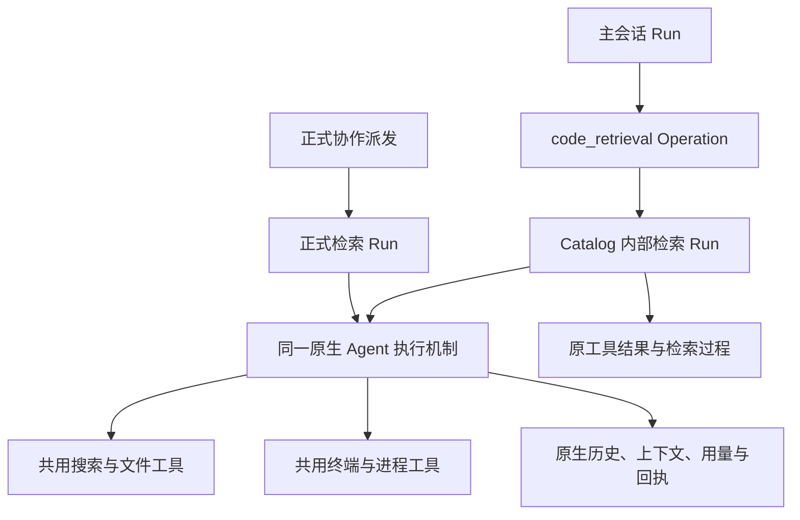

# 快速检索、检索 Agent 与共用工具设计

状态：待实现的目标设计。日期：2026-10-22。现状依据：源码 `61779ea13` 及本轮本机只读盘点。

本文汇总本轮产品与工程讨论，作为后续实现依据。当前实现仍以 [检索与上下文](../retrieval.md)、[运行时](../runtime.md)和源码为准；本文只定义目标，没有切换功能或清理数据。实现完成后，将稳定契约合入对应领域文档，过程设计由 Git 保留。

## 1. 设计决定

快速检索采用普通模型驱动的 Agent 工具循环。它是一次工具调用内部的调查工作，使用原生运行时、通用工具和自己的探索历史。正式检索 Agent 使用相同基础能力，以协作任务的方式持续工作。

| 方面 | 本轮决定 |
| --- | --- |
| 主 Agent 输入 | 问题本身足以启动；已有线索可以自然附在问题中，不要求填写调查计划或证据清单 |
| 循环 | 复用普通 Agent 的模型请求、工具执行和历史追加，不另造检索规划、选材、动作竞赛循环 |
| 上下文 | 由 Agent 的探索自然形成；复用通用容量管理，不由 Host 每轮重新编排候选材料 |
| 工具 | 改进共用搜索、读取和终端，主 Agent、两种检索 Agent 与 Bot 均可受益 |
| 终端 | 两种检索 Agent 都具备命令执行、读取、输入、等待和停止能力，沿用实际会话授权 |
| 向量 | 退出代码快速检索及其后台维护路径；本轮不换一个向量库继续承担同样的职责 |
| LSP | 退出快速检索和通用 Agent/Bot 的基础依赖，不因检索、符号扫描或选中项目自动预热 |
| 决策模型 | 不再是快速检索的配置前提；默认使用普通支持工具调用的模型 |
| IDE | 将完整 IDE 能力与 Agent 核心分离；是否拆出独立产品、何时提供 VSIX，另行决定 |

质量目标是获得足以继续工作的事实和原文，减少重复探索、格式处理和无收益往返。输入小、输出小、工具调用少都不是独立目标。

## 2. 为什么需要改变构成

### 2.1 当前查询已承担 Agent 的工作

现有 Explore 同时维护候选来源、片段、选集、可选动作、补查和交付判断。快速决策会分批判断材料，再比较下一步动作；动作较多时还要分组比较赢家。新材料和关系又会触发新一轮判断。生成模型也可能参与搜索表达扩展。

当前 LLM 路径同样有规划、选材与补查循环，但通过多次单独的文本生成，重建材料目录和选集。模型上下文容量得到满足，并不自动减少串行请求、重复上下文或候选扩张。

新的实现直接采用普通工具调用历史，使模型沿自己发现的事实推进。Host 负责来源、执行和材料真实性，退出相关性判断与下一步行动编排。

### 2.2 当前维护成本有具体来源

本轮现场盘点的一个代码语义索引已发布 48,933 个文档，登记根为 `D:\project\opencr`，该目录包含多个仓库和构建目录。实际纳入的文件仍受索引与忽略规则影响。

| 现场文件集合 | 大小 |
| --- | ---: |
| writer 原库 | 5,487,876,975 bytes，约 5.111 GiB |
| 一个存活的 immutable publication | 5,487,876,969 bytes，约 5.111 GiB |
| 两者合计 | 约 10.222 GiB |
| 原库中的 payload 文件 | 约 2.944 GiB |
| 原库中的 vector 文件 | 约 1.887 GiB |

当时只观察到一个空间、一个 generation 和一个 publication，没有旧 publication 积压。payload 文件大小包含存储布局开销，不能直接当成有效源码体积。此记录只描述这个实例，不是所有项目的容量基准。

现有发布在实际持久 checkpoint 时复制完整 manifest 成员，更新会经 quiet period / deadline 聚合。即使旧副本正常回收，完整副本与整库复制仍有显著成本。chunk payload 同时保存正文、嵌入文本与元数据，也是需要退出的维护内容。

此外，内置默认查询方案是关键词加结构，语义方案另行选择；项目符号与语义扫描却有独立生命周期。查询是否消费索引与后台是否维护索引需要一起收敛。

### 2.3 LSP 成本不限于打开编辑器

Monaco 已使用语言服务的补全、定义、引用、重命名和诊断。当前项目预热同时准备 Agent 与编辑器两种视图，后台符号扫描也存在 LSP fallback；普通 Explore 虽使用 warm-only 结构路径，显式结构准备仍可能冷启动服务。

因此，退出依赖要覆盖启动装配、后台任务、模型工具目录、设置和打包资源，不能只在检索函数中关闭一个选项。

以上是现状调查。本轮没有重新请求模型测量延迟，旧体检报告也不作为当前构建的性能结果。

## 3. 产品边界

### 3.1 Agent 核心与编辑器宿主

| 部分 | 职责 |
| --- | --- |
| Varin 核心 | Agent/Bot、模型渠道、工具执行、权限、任务、历史、材料与恢复 |
| 独立应用 | 对话、任务与协作、产物预览、文件与差异审阅、终端观察和电脑操作 |
| 可选 IDE 集成 | 编辑器选区、未保存内容、跳转、编辑及宿主语言能力接入 |

独立应用应能在没有 IDE、语言服务器或向量服务时完整运行基础检索。文件预览、差异审阅和基础文本编辑可以独立于完整 IDE 保留。

VSIX 是未来可选接入方式：利用 VS Code 已有编辑器和语言扩展，通过现有 Host/客户端边界连接 Varin。核心服务仍可独立运行。远程工作区、未保存缓冲和执行位置必须显式映射，不能按同名本地目录推断来源。

当前完整 IDE 的移除不属于本文直接执行范围。实现检索时应先消除它对 LSP 的依赖，再把仍有实际消费者的语言/调试能力留在明确的 IDE 组件边界内。构建产物和启动加载也要分离，不能以隐藏设置页代替依赖拆分。

### 3.2 检索的两种产品入口

| 方面 | 快速检索 | 正式检索 Agent |
| --- | --- | --- |
| 入口 | `code_retrieval` 工具调用 | 现有协作派发 |
| 常见任务 | 当前工作中的一个定位或确认问题 | 可持续追问、扩展和协调的调查任务 |
| 执行 | 普通原生 Agent 循环 | 同一原生 Agent 循环 |
| 上下文 | 问题及本次探索历史 | 原协作历史及后续任务 |
| 能力基础 | 共用搜索、读取、终端与适用的已授权能力 | 复用相同工具与角色基础 |
| 呈现 | 线程内检索过程与结果 | 协作成员、消息和报告 |
| 生命周期 | 归属于原检索 Operation | 归属于正式协作任务 |

快速检索也能多轮调用工具。其定位来自任务聚焦、启动轻和交付直接，不以固定轮数或小上下文定义。复杂任务需要持续调查时，由主 Agent 决定是否派发正式成员；不在后台偷偷转为另一种任务。

## 4. 调用、角色与模型

### 4.1 简单输入

保留 `code_retrieval` 作为入口。`question` 是唯一必需的任务信息；`paths` 可作为调用方明确要求的搜索范围。来源、Host、授权与所属任务由运行时绑定。

```json
{
  "question": "查一下会话删除到资源回收的实现，确认两者在哪里衔接。"
}
```

主 Agent 可以在问题中附报错、文件、符号或已有发现，无须分别填写这些字段，也无须先生成关键词、期望证据组或关系图。工具说明应让调用者知道适用问题，不将质量责任转移到复杂提示模板上。

明确的 `paths` 是范围约束；自然语言中的“可能在某模块”是调查线索，不能自动变成排除其他模块的硬过滤。

现有 `limit` 如在过渡期间保留，继续只表达最终预览条数；它不限制探索或删除已有证据。提示必须说明此含义，完整结果沿原历史续读。新入口不增加猜测性的轮数、候选数和文件数硬上限。

### 4.2 角色提示

共用检索角色表达调查职责：理解问题，使用工具取得事实，沿相关线索继续，提供准确位置及足够上下文，区分事实、推断与未知。它可以通过终端进行计算、分析或必要的行为验证。

快速入口仅增加当前调用的交付语义；正式入口增加已有协作与续接语义。不强制“先规划、再搜索、再评分”，不要求每轮汇报选集，也不预设必须查到多少层调用链。

原文、命令输出、其他 Agent 的报告仍作为材料进入上下文，不转换成更高优先级指令。任务中的具体权限和限制沿原会话继承。

### 4.3 普通模型为默认

快速检索复用 `models.explore` 配置入口，产品名称改为“快速检索模型”；正式检索继续使用 `models.retrievalAgent`。两者共享解析与执行基础，允许独立选模型和推理设置。

新配置的默认选择为明确的“沿用当前会话模型”，界面显示这一来源。它只继承模型选择和相应受理配置，不复制主会话所有消息、私有记忆或完整工具集合。用户可选更适合检索的普通模型，服务需实际支持当前工具调用协议。

已有显式模型、禁用状态和凭据选择保持明确。旧配置若仅选择快速决策/重排且没有有效的普通模型，设置中应说明需要选模型或选择继承；配置错误不自动改用另一家付费服务。不得在同次执行中因为慢或失败切换模型。

快速决策与重排退出代码检索的默认编排和必要设置。其他产品功能仍使用这些能力时，保留其独立用途；未来引入局部优化应先有真实收益证据，不保留一套无人消费的检索实现待命。

## 5. 执行与上下文

### 5.1 复用原生执行，增加内部归属

现有 `inference.generate` 明确是单次无工具文本推理，不能在 Host 中套循环冒充原生 Agent。普通执行需要已受理的 Run、真实 Thread/HistoryBranch、冻结绑定和上下文准备。

本设计推荐在同一 Catalog 中为快速检索受理内部用途的 Thread/branch/Run，以原 `code_retrieval` Operation 为拥有者，再使用现有 Supervisor、ExecutionEngine、provider 和 ToolExecutor。内部用途是一种原生执行归属；无需建立第二个数据库、第二个会话 owner 或第二套模型调用框架。



必须新增的是内部受理及归属契约，而不是一段伪造 `dispatch` 工具调用。现有 child 的模型冻结、来源准备、取消和结果机制可以复用，但当前公开 child 接口不等同于这个内部入口。

内部记录不进入普通会话列表、协作成员表、未读计数、自动命名或用户任务调度。隐藏在产品目录中不影响 owner 在恢复、审计和回收时找到它。查看检索详情和读取证据沿父 Operation 的真实授权，知道内部 ID 不授予访问。

同一个原检索调用重连或恢复，定位同一内部执行，不能再创建一份。父操作等待使用现有持久 Wait，不在 Catalog 锁、控制通道或某个 Host 回调中阻塞等待模型完成。内部工具受理后保存真实操作身份，并沿父子归属汇总状态。

受理固定所选模型、凭据、来源、角色配置与真实工具目录。内部能力是角色所需能力与原可委派授权的交集，不继承父方未授权的能力；后续撤权仍沿原 owner 生效。某项能力未获准时可见其状态，不能通过换用终端绕过路径或来源准入。

外层检索 Operation 保留执行归属和 Source 引用，不在整个模型探索期间持有阻挡内部进程或文件操作的宽范围租约。具体读取、执行与写入在各自操作边界申请资源，避免父工具等待子工具、子工具又等待父工具释放文件的互锁。

### 5.2 上下文由探索形成

初始上下文包括检索角色、问题、可用工具和必要的来源/执行环境事实。项目指令和资源使用通用上下文机制；Agent 可自行读取相关说明。主 Agent 无须先替它概括仓库或整理材料。

后续按普通模型/工具交换追加：搜索结果、文件内容、终端输出、模型下一步及最终回答。缓存缺失时仍能开始工作，不先扫描全仓构建导航材料。

不设置独立的候选池评分、逐轮摘要、选集替换或上下文重排阶段。通用长输出、续读、容量测量和压缩仍适用；需要完整函数、关联配置或多文件原文时允许充分读取。压缩由原运行时处理，保留原始历史，不把旧内容默默替换成未经引用的摘要。

通用执行可以复用不可变历史和稳定请求前缀。实际输入计费、缓存使用及请求耗时仍取提供商回执，不将本地缓存命中解释为免费模型输入。

### 5.3 交付、失败与使用已有材料

默认交付为自然语言事实说明、准确来源及必要的原文。避免为返回结果再次调用“报告整理模型”。原生完成结果可以附已读材料引用，由宿主提取原文，减少模型重复生成代码；这是完成时的可选表达，不是每轮强制选材协议。

材料引用绑定实际读取的来源、版本和范围。最终说明提到但未读过的文件不能被自动认证为证据；终端文本提到一个行号也不等于文件读取回执。引用当前文件与查看当时原文分开处理。

“使用已有材料”停止新增探索，返回已形成的回答与可用原始材料。若模型还没有形成答复，展示已有证据和未完成状态，不额外等待一次总结请求，也不伪造结论。普通完成、用户提前交付、取消和执行失败分别记录。

模型或个别工具失败保留已有历史与证据，错误说明具体阶段。重试复用已有通用请求重试机制，未知执行结果按原 owner 对账，不自动重放命令或重开整个检索。

父请求取消时，内部检索停止新受理并向其实际拥有的模型/工具工作传递取消。已经启动的进程按原归属请求停止、等待真实退出；打开详情、关闭观察或取消一次等待，不等于停止进程。迟到回执、费用和清理责任仍归原操作。

普通完成与提前交付也要处理本次检索启动的剩余进程。已完成工作按原回执释放；仍需持续的工作只有在显式交给既有后台 owner 或用户接管后才转移归属，否则原检索继续承担停止与排空责任。不能按 cwd 批量停止父任务或其他调用者的进程，也不能因界面已显示结果就遗失后台资源。

## 6. 终端、角色和来源

### 6.1 两种检索都能执行命令

默认检索能力包括文件发现/搜索/读取、命令执行、进程输出、输入、状态、等待与停止。其他扩展和 MCP 能力按实际角色配置和已授权目录提供，不因为称为“检索”就获得额外权限。

可以使用 Git、搜索命令、脚本处理日志和数据，以及项目已有的检查命令。一般调查不以修改产品代码为目标，但终端可能产生临时文件、缓存和其他效果；工具效果按实际执行记账，不能标成绝对只读。

外层 `code_retrieval` 的能力说明、效果合同与授权准备也要随终端接入更新。它不能继续以“保证只读”的标签获得准入，再在内部运行任意进程。原生运行时分别保留检索交付结果和内部操作效果，进程是否停止由实际回执决定。

不建设检索专属命令白名单来模拟只读终端。命令执行沿用已有会话权限、资源准入和用户要求；任意进程写入仍受当前恢复能力的实际边界约束，不承诺完整写前回滚。

所有可直接调用的工具必须注册在该模型请求的声明中；已启用但未声明的能力仍经 `tool_describe` / `tool_invoke`。内部 Agent 也不能通过工具名绕过同一目录与授权。

### 6.2 解开当前工作模式耦合

当前 `read_only` child 拒绝要求物理来源的工具，终端因此通常被推向 `isolated_write`。新设计要分别表达角色职责、能力授权和文件环境，不能只在 preset 数组里增加 `process_spawn`。

| 当前来源 | 检索和终端的目标行为 |
| --- | --- |
| LiveRoot | 搜索、读取和命令使用原准入根；复用执行位置，无需每次创建 worktree；文件变化按实际观察记录 |
| 已物化工作副本 | 复用原所属环境和资源 owner；不得因新内部 Run 释放仍属于父任务的目录或进程 |
| FixedBranch | 原文读取保持固定来源；需要终端时由 Source/Storage 从该版本按需准备派生物理视图，不能改读今天的 live 根 |
| Managed Host | 在实际资源 Host 搜索和运行；协调端只持有授权引用、状态与回执 |
| 无文件来源 | 保留可用的无来源能力；需要工作目录的命令明确报告缺少执行环境，不借用应用启动目录 |

固定来源的派生目录可以承载命令产生的文件；若后续调查使用修改后的内容，文件读取和搜索也必须绑定同一执行视图。原固定版本仍作为 baseline 保留，先前证据保留自己的版本。

这个转变需要 Source owner 显式受理，并在合法请求边界发布新的执行绑定和环境事实；已经准备的模型请求及文件回执不被重写。首次终端受理、后续视图切换和取消是需要实现的公共来源能力，不靠临时改 `cwd` 绕开当前 FixedBranch 合同。

物化只在确实需要时发生。若环境需要依赖或运行时，缺失事实直接返回；不为了检索自动安装整套项目工具链。服务启动和文件可写性不能由角色名推导。

共享目录的实时变化与隔离调查是不同选择。保留现有租约、writer 生命周期与用户显式隔离选择，不把所有终端调用强制变成完整仓库复制。

## 7. 共用工具的改进

工具改进落在原公共 owner 和 schema，所有获准调用者使用同一实现。输入参数决定查询与结果行为，不根据调用者是主 Agent、Bot 或检索 Agent 暗中改变语义。

批量能力以真实减少扫描、读取或模型往返为依据。多个本就独立的操作仍可用现有并行调用或脚本组合，不增加一个能执行所有事情的巨大工具。

### 7.1 搜索与文件发现

保留 `file_list` / `file_search` 的明确用途，复用原生 compute 和来源准入。批量搜索是现有搜索能力的扩展：简单查询继续只填一个表达式；批量查询可提供调用方标识、表达式及匹配方式，共享路径范围与文件过滤条件。

同范围、同匹配规则的表达式合并扫描，结果保留表达式归属。不能简单拼接正则而改变字面含义、捕获组或匹配归属。某个表达式无效时标明对应项，其余已完成项保留；整个请求的来源准入失败仍是请求失败。

结果按调用需要提供三种投影：文件路径、匹配行、带前后文的命中窗口。按文件组织并合并同版本的重叠窗口，匹配依据仍保留。工具不额外调用模型排序，也不根据问题自动扩大授权或排除看似不相关的文件。

搜索返回须能分辨：

| 事实 | 表达要求 |
| --- | --- |
| 查询有效、范围检查完成、无匹配 | 明确空结果 |
| 只展示部分已取得结果 | 保留续读位置和已展示范围 |
| 扫描尚未完成或主动停止 | 标明尚有未搜索范围，不将已发现条数写成总数 |
| 某些文件不可读或变化 | 保留可用命中及路径级原因 |
| 整个来源不可用 | 返回来源错误，不能转换为空结果 |

`maxResults` / `maxBytes` 应清楚表达页面或展示目标。底层确有计算截断时单独报告，不能与页面末尾共用一个含糊的 `truncated`。默认值沿用并检查已有行为，不为了“快速”另造更小硬上限，也不为精确计数强制完成全部扫描。

搜索需要可继续读取，当前仅 `file_list` 具备游标这一差异应补齐。续读绑定查询、匹配规则、范围、实际来源及扫描位置；它不能被用来改条件后沿旧结果继续。固定来源保持对应版本；live 来源允许变化，但记录受影响文件，不能把两次观察宣称为整仓快照。

续读复用原生计算/结果读取机制，按需保留已取得页面和扫描进度，使用背压控制生产。不能把每次查询全部持久化成新索引，也不能让第一页返回后整仓扫描在后台无限继续。页面大小可调整，失效游标给出明确重新查询指引。

路径范围和 ignore 行为应可见，尤其是用户明确指定的依赖或隐藏目录。区分不存在的路径、没有符合过滤条件的文件和没有匹配文本；不让调用者靠重复搜索猜测范围是否生效。

### 7.2 文件读取与结构读取

扩展通用读取的批量能力，逐项返回路径、实际范围、状态、正文、版本及续读信息。相同来源和版本的重叠请求共用一次读取；某项缺失或失败不抹掉其他项。简单单文件调用保持简单。

保留字节范围与行范围的现有语义。读取范围完整返回，用户显式请求的页面不能再被模型输入投影二次静默裁剪；协议帧或模型容量不足时沿通用机制明确处理。跨页内容变化要求重新建立版本关系。

增加可选的结构单元读取：依据命中行或明确符号，取得所在函数、方法或其他代码单元。使用现有按需 Tree-sitter 能力，不启动 LSP、不预建全仓图。返回选中单元的名字、签名、范围和正文；重名时展示定位候选，不擅自选择一个。

小单元可完整返回；大单元通过原页面语义继续读取，提供可理解的结构位置。嵌套结构选择与请求相符的单元，避免命中小函数却自动读出整个巨大类。解析不支持或失败时保留可用原文与原因，转为普通窗口读取。

工具不自动追读调用者、依赖闭包或所有配置。原文需要哪些配套上下文由 Agent 决定。批量读取可以减少重复完整哈希，复用必须基于同一次可信观察；不能为加速而仅凭文件名或 mtime 复用过期正文。

模型展示可以附行号，原始正文仍保留准确换行和字节。`readVersion` 等后续操作必需标识不能因“精简展示”被删除，展示用行号也不能混入待编辑原文。

### 7.3 命令执行入口

在现有进程执行入口扩展等待与首段输出组合，复用原生 `process_spawn` 的身份、回执和恢复，不为两个检索角色各建终端后端。最终公开 schema 应只有一个主要命令执行入口，避免与原工具形成两种含义近似却状态不同的接口。

保留直接程序加参数列表的执行方式，并提供明确的 shell 文本执行方式，用于管道、重定向和多行脚本。二者在 schema 中互斥；shell 解释由实际执行 Host 完成，返回所用环境和 cwd。不要让 Agent 猜 shell，也不要将普通参数列表再次拼成一段未经正确引用的命令。

等待是观察行为：短命令可以在同次调用内返回退出状态和首段输出，持续任务返回原进程句柄、当前输出与读取位置。调用方可选择立即返回或等待相应事件。短等待窗口是可配置的交互参数，数值根据现有终端体验与实际延迟选择，不作为杀进程期限。

必须覆盖以下事实：

- 启动是否成功；失败发生在环境准备、程序启动还是后续执行。
- 原进程身份、实际执行位置和当前运行状态。
- 已确认的退出码或信号；未知退出不能填成成功。
- 本页输出、通道和精确下一游标。
- 是否有已产生但尚未读取的输出，以及输出生产是否结束。
- 后续读取、输入、等待和停止所需的真实句柄。

进程退出与输出读完分开表达。`wait_process`、输出观察和停止继续保留清晰职责；仅观察状态不需要启动新命令。PTY 的控制字符、尺寸和输入确认沿用现有合同，不把发送文本当成已经执行成功。

正常文本在模型投影中只出现一次。底层 spool 保留原字节与通道，不把每个可读块的文本和 Base64 同时重复送入模型。跨块 UTF-8 字符、非文本或其他编码需要明确呈现；文本显示可以保留解码状态，原始游标仍指向精确字节。样式控制序列的显示处理不能改写可供脚本读取的原始输出。

### 7.4 结果呈现与错误

同一事实结果供模型、脚本和 UI 消费，不要求三者使用同一种序列化排版：

| 消费者 | 需要 |
| --- | --- |
| 模型 | 易读内容、位置、状态、必要标识及可执行的续读方式 |
| 脚本 | 稳定结构、逐项结果、精确原文/字节与完整状态 |
| UI | 查询/文件/命令摘要、实际进展、结果预览及展开详情 |

投影只能改变呈现，不能增加未经证实的成功、删除关键失败或隐藏截断。无需给每个工具套十几个相同的空字段；搜索、读取和进程保留各自需要的状态合同。

错误优先给出具体对象、阶段和原因，有确定修正方式时给短指引。例如无效正则指出表达式；目录读取指向列表能力；文件变化要求重读；程序不存在区别于 cwd 无效；授权失败区别于未注册工具。服务端原始错误经过现有安全投影，不泄露凭据或任意响应正文。

“重试可恢复”必须有实际依据。连接中断时区分尚未受理、已执行和结果未知；不为取得更漂亮的错误而隐藏已经产生的结果。

## 8. 存储、缓存与资源释放

基础检索不要求嵌入服务、本地 embedding 模型、代码向量库、持久化全仓符号图或仓库摘要库。目录读取、原生文本搜索和按需结构分析足以启动调查。

保留可复用的公共派生缓存：文件清单、已解析文件的结构和同次执行中的读取观察。缓存键包含实际来源及内容/recipe 身份，失效后重新读取；缓存为空、损坏或被清理不阻止基础搜索。缓存按已有 owner 与真实字节占用回收，不为每个查询建立完整正文副本。

调查历史、已交付结果和原文引用继续由 Catalog / ContentStore / Storage 管理。内部检索历史不全部灌入主模型上下文，但沿父操作可查看；选中证据尽量引用原材料，避免在多个库中保存相同正文。

会话删除和数据回收必须包含内部执行、原始工具输出、引用、进程 spool 及准备目录。原执行未停止或仍被其他合法引用使用时保留；依赖释放后进入现有回收，不建立永久的“内部检索缓存”例外。费用与执行回执按原保留规则处理。

快速检索用量按内部请求原回执计入所属检索操作及父会话聚合，界面可以展开明细；不能同时按内部 Run 和父 Operation 重复相加。正式子 Agent 继续使用既有归属规则。

## 9. LSP、向量与旧编排退出

### 9.1 代码检索消费者

新入口切换后，移除代码 Explore 对 semantic 搜索、query embedding、rerank、快速决策循环及专用选材计划的依赖。停止代码语义索引的自动登记、扫描、watch、重建和模型准备；项目选择与快速检索均不能再唤醒它们。

代码符号导航改用实际搜索与按需结构；取消为了检索维护全仓符号图的任务，以及其 LSP fallback。共享 KnowledgeStore 的其他用途保持原 owner，不能随符号图一起删除整库。

退休的代码路径应删除或归入实际存在的独立消费者，避免留下默认关闭但仍打包、启动或维护的第二套检索系统。旧内部协议不做长期兼容双写；保存的历史回执作为历史材料仍能阅读。

### 9.2 与其他产品能力分开处理

代码 semantic、Bot knowledge-vector、普通 Agent 记忆、计划和用户材料是不同数据域。本文决定退出代码检索向量；Bot 知识是否继续使用向量需要其独立产品决定，不能因同用 embedding 服务而误删知识或撤掉其他消费者。

同理，快速决策用于其他产品功能时可以保留服务与配置；它退出的是快速代码检索编排。

语言服务的实际 IDE 消费者先明确归属。移除 Agent/Bot 的自动预热、后台扫描触发和默认工具暴露；可选 IDE 组件只在真实编辑或显式语言功能需求下准备对应服务。未来 VSIX 通过宿主语言能力接入核心，不重新捆绑一套全局预热逻辑。

### 9.3 已有数据与安装资源

旧索引退出时先关闭新工作准入，排空或停止实际 writer/reader，再通过原缓存维护 owner 清理可重建的代码索引及其 publications、索引专用回执和临时资源。清理失败保留路径、阶段和可重试事实，UI 不无限显示“正在”。

清理目标根据已登记空间、数据类型和目录身份确定，不能按模糊目录名递归删除。用户源码、会话历史、笔记、计划和仍被其他用途使用的模型/数据库都不属于代码缓存清理范围。

无需为可重建缓存额外制作全量备份。当前设计文档不执行本机清理；实际升级中的清理入口要向用户说明回收内容和空间。以后移除本地模型或语言服务器时，先核对其他消费者，不能把磁盘上存在该资源当作独占所有权。

设置页不再引导用户为基础快速检索配置向量、重排、快速决策和语言服务器。过渡期间已存在的数据可在存储管理中显示为旧代码索引并提供清理，退役项不继续自动维护。

## 10. 界面与交互

快速检索沿用线程内已有专用呈现，标题显示问题和实际动作摘要，不增加正式协作头像、团队计数或大块通用任务面板。

展开后显示真实搜索、读取和终端操作，可以查看参数、结果和错误。过程名称来自实际工作，不预设必须依次经过“规划—选材—补查”。有准确数量才显示计数，不把已读文件数换算为虚假的完成百分比。

正式检索继续使用协作成员界面；共用工具卡片与终端视图，不复制第二套状态组件。两个入口的搜索命中、文件点击和进程控制使用同一事实和授权。

现有标题摘要继续用于全部共用工具：搜索展示表达式和范围，读取展示文件/范围，命令展示用途或命令，后续进程操作可关联原命令。完成状态与结果摘要结合，失败保留具体原因。

“使用已有材料”与“取消检索”分别表达交付与取消意图，已取得内容仍可查看。界面及时反馈请求已受理；真实退出和后台资源清理继续按事实推进。折叠详情不取消工作，关闭视图不释放进程。

流式更新保持阅读位置，连续输出合并渲染；展开收起使用现有动效与 reduced-motion 约定。原文和当前文件的跳转含义清楚，避免点击历史证据却误以为正在查看原版本。

## 11. 性能判断与适度验证

不预设“用了小 Agent 就一定几秒完成”。端到端耗时由模型响应、串行依赖、工具执行和来源准备共同构成。优化应减少重复工作，同时保持回答所需的证据。

比较同一来源和模型配置下的三条路径：主 Agent 直接使用工具、新快速检索、正式检索 Agent。已有旧构建可以作为历史参考，记录真实版本与条件，不把旧体检耗时当成本次基线。

选取少量代表性真实问题：精确符号/报错定位、缺少代码关键词的自然语言问题、跨文件调用与配置追踪、需要终端分析的问题、无匹配问题和大文件读取。比较获得可用证据的时间、最终交付时间、主 Agent 后续补查、遗漏或错误，以及模型回执、实际存储和冷启动工作。

不为了节省 token 把最终结果变成只有文件名；质量检查要确认关键代码关系能否被理解。也不单纯用“返回更多片段”证明召回更好。

实现验收复用原生执行、资源和现有工具测试，只对改变的关键行为补证据：

| 场景 | 需要成立的行为 |
| --- | --- |
| 只传自然语言问题 | 能自行搜索、读取和调查，不依赖主 Agent 预整理 |
| 空缓存、无向量、无 LSP | 两种检索的基础工具与终端正常工作 |
| 批量搜索/读取部分失败 | 结果归属准确，其余结果保留；错误不冒充空结果 |
| 分页与文件变化 | 续读不混淆查询或版本；未知总数不伪装完整覆盖 |
| 短命令与持续进程 | 正确返回输出、退出事实及续读句柄，输入和停止可用 |
| 固定/实时/远端来源 | 终端与文件工具面对同一明确视图，无隐式本地 fallback |
| 模型返回未声明工具 | 沿现有注册/通用入口规则拒绝并给出可修正错误 |
| 提前交付、取消、重启 | 不重复创建内部执行，不重放未知副作用，保留证据与清理责任 |
| 会话删除与旧索引清理 | 内部记录和缓存可回收，合法存活引用及用户资产保留 |
| 所有消费者 | 主 Agent、两种检索、Bot、脚本与 UI 对同一工具状态理解一致 |

首次实现不新增独立评测平台、常驻监控或固定吞吐配额。只有实测暴露的瓶颈和失败才扩大优化与验证范围。

## 12. 实现顺序与完成边界

按可核验的工程阶段推进，但交付目标是这份完整设计，不把关掉旧功能后的能力缺口当成完成。

1. **公共来源与执行合同。** 拆开调查角色、终端授权和物理环境；实现内部执行受理、父操作绑定、取消、恢复、用量和回收。固定来源的按需执行视图必须同时落地，不能先用错误 cwd 跑通。
2. **共用工具。** 完成批量搜索/续读、批量与结构单元读取、命令等待和输出组合、准确状态与投影。保留已有简单调用方式，同步实际 schema、披露说明、脚本消费者和 UI。
3. **两种检索接入。** 快速入口运行普通原生 Agent，正式检索预设获得相同终端能力。配置与提示简化，最终证据、进度和提前交付接入原工具呈现。
4. **退出旧维护链。** 切断代码向量、旧选材循环和 LSP 自动启动链，删除无消费者的实现与资源依赖；提供可追踪的旧代码缓存回收。其他知识和 IDE 消费者单独处理。
5. **实际使用验证与文档收口。** 用代表性问题检查质量和总成本；更新当前领域文档与用户设置说明。完整 IDE 拆分及 VSIX 另立产品任务。

内部新执行路径可以在开发期间并存验证，正式切换后不得自动回退到旧向量/决策流水线。准备失败清楚报错；用户仍可直接搜索和使用正式检索，不以另一条隐式实现掩盖失败。

## 13. 实现入口与需要核实的细节

| 责任 | 当前入口 |
| --- | --- |
| 快速检索工具与来源复核 | [tools_retrieval.rs](../../kernel/crates/varin-kernel/src/tools_retrieval.rs)、[retrieval-owner.ts](../../packages/web/application-host/lib/kernel/retrieval-owner.ts) |
| 原 Explore 与专用模型循环 | [explore.ts](../../packages/web/application-host/lib/harness/explore.ts)、[explore-fast-decision.ts](../../packages/web/application-host/lib/harness/explore-fast-decision.ts)、[explore-model-loop.ts](../../packages/protocol/src/explore-model-loop.ts) |
| 单次辅助推理边界 | [catalog_inference_generation.rs](../../kernel/crates/varin-runtime/src/catalog_inference_generation.rs)、[retrieval-model.ts](../../packages/web/application-host/lib/kernel/retrieval-model.ts) |
| 普通执行与协作受理 | [execution.rs](../../kernel/crates/varin-runtime/src/execution.rs)、[supervisor.rs](../../kernel/crates/varin-runtime/src/supervisor.rs)、[catalog_dispatch.rs](../../kernel/crates/varin-runtime/src/catalog_dispatch.rs) |
| 角色和冻结配置 | [harness-presets.ts](../../packages/protocol/src/harness-presets.ts)、[child-profiles.ts](../../packages/web/application-host/lib/kernel/child-profiles.ts) |
| 搜索与文件读取 | [tools_discovery.rs](../../kernel/crates/varin-kernel/src/tools_discovery.rs)、[tools.rs](../../kernel/crates/varin-kernel/src/tools.rs)、[file_reads.rs](../../kernel/crates/varin-kernel/src/storage/file_reads.rs) |
| 进程与等待 | [process](../../kernel/crates/varin-kernel/src/process)、[process_resources.rs](../../kernel/crates/varin-kernel/src/storage/process_resources.rs)、[process_wait.rs](../../kernel/crates/varin-kernel/src/process_wait.rs) |
| 输出投影与历史续读 | [output_preview.rs](../../kernel/crates/varin-runtime/src/providers/output_preview.rs)、[运行时](../runtime.md) |
| 结构与后台图扫描 | [structure](../../packages/web/application-host/lib/structure)、[symbol-runtime.ts](../../packages/web/application-host/lib/knowledge/symbol-runtime.ts) |
| LSP 及 IDE 消费者 | [prewarm.ts](../../packages/web/application-host/lib/lsp/prewarm.ts)、[supervisor.ts](../../packages/web/application-host/lib/lsp/supervisor.ts)、[language-bridge.ts](../../packages/ui/src/lib/monaco/language-bridge.ts) |
| 索引发布与回收 | [published-readers.ts](../../packages/web/application-host/lib/knowledge/semantic/published-readers.ts)、[store-engine.ts](../../packages/web/application-host/lib/knowledge/semantic/store-engine.ts)、[index-directories.ts](../../packages/web/application-host/lib/knowledge/index-directories.ts) |
| 内部记录回收 | [catalog_retention.rs](../../kernel/crates/varin-runtime/src/catalog_retention.rs)、[ContentStore](../../kernel/crates/varin-runtime/src/content.rs) |

方向已经确定；实现前需要沿这些 owner 解决的细节主要是：内部用途身份如何进入现有 Catalog schema、固定来源执行视图在哪个受理边界发布、搜索续读如何复用计算进度、命令短等待采用哪个现有交互设置。它们需要代码级核验，不通过新增任意超时或复制一套运行时回避。

最终模型选择和推理强度依据实际服务效果比较，不在设计中锁定某个商业模型。完整 IDE 的拆出形式、VSIX 的发布时间和 Bot 知识向量去留是独立产品取舍，不阻塞基础检索脱离 LSP 与代码向量。

## 14. 外部参考

- [VS Code Commands](https://code.visualstudio.com/api/extension-guides/command)：宿主提供调用定义等语言功能的命令接口，供未来 IDE 适配参考。
- [VS Code 远程扩展](https://code.visualstudio.com/api/advanced-topics/remote-extensions)：扩展运行位置与工作区位置需要明确匹配。
- [Aider Repository map](https://aider.chat/docs/repomap.html)：源码结构可以用于导航；本设计只按需取得结构，不引入必建全仓地图。
- [TypeSafe System One 模型说明](https://typesafe.ai/blog/introducing-system-one-models-and-jev)：并行输出决策与应用层串行调用是不同层次；专用决策服务不作为本设计前提。

这些参考用于解释可选机制，不引入新产品依赖，也不作为 Varin 检索质量或延迟的测量证据。
