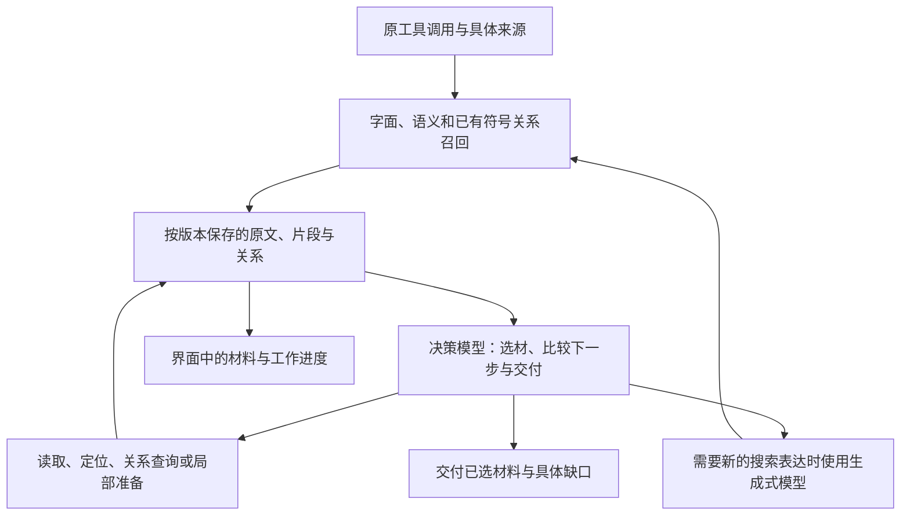

# 快速检索设计

状态：设计方案，待实现。基于 2026-10-21 的讨论及 `f5e322fa2` 源码核查。

本文定义 `code_retrieval` 的目标行为、决策与上下文契约、执行边界和实现顺序。
当前已实现机制仍见[检索与上下文](../retrieval.md)。实现完成后，将稳定内容合入当前机制文档，删除这份阶段设计。

## 1. 定位与目标

快速检索位于主 Agent 直接搜索、读取代码与派发独立检索 Agent 之间。
它根据问题取得相关代码，并沿有价值的线索补齐上下文，使一次调用能够替代多次 grep、定位和 read。
交付物是主 Agent 可以直接使用的代码证据，包括准确位置、必要原文和影响理解的关系。

| 能力 | 适合的任务 | 交付 |
| --- | --- | --- |
| 精确搜索与读取 | 已知路径、符号、关键词，检查具体内容 | 命中、范围和原文 |
| 快速检索 | 知道想找的行为，需要定位实现并补齐相关上下文 | 精选代码材料、来源和实际覆盖缺口 |
| 独立检索 Agent | 开放调查、跨模块解释、比较实现、持续追问 | 综合结论、证据和未解决问题 |

三种能力由主 Agent 按需选择。快速检索保留多轮补查，执行归属于原工具 Operation；
独立检索 Agent 沿用现有 Thread、交流和续接机制。调用快速检索无需创建新的协作成员、worktree 或聊天历史。

本设计同时追求：

- 材料能帮助主 Agent 回答或继续工作，减少拿到结果后重新搜索和读取。
- 把时间用于取得有价值的新证据，减少重复扫描、读取、核验、上下文处理和长文本生成。
- 在索引不完整、部分能力尚未就绪时继续使用当前可用来源。
- 用户能看到实际取得的材料、正在进行的工作，并能结束当前检索取得已有结果。

**上下文充分是前提。优化目标是复用材料和计算，而非尽量缩小每次输入或输出。**
需要联合判断的代码应共同出现；有用的完整上下文可以占用较大输入。
速度改进同时接受检索效果检验，不以减少 token、轮数或返回片段数单独判定成功。

## 2. 当前实现与需要改变的地方

以下是源码事实及对应设计调整，尚未表示已完成修改。

| 当前行为 | 影响 | 本方案调整 |
| --- | --- | --- |
| `models.explore` 控制工具内部规划与选材；`models.retrievalAgent` 控制独立检索 Agent | 两种用途容易混淆，独立 Agent 还可能再次调用内部选材模型 | 保留任务形态差别，明确配置用途；工具内部由一个决策过程维护材料选择 |
| 同时启用 LLM 和决策模型时，LLM 选材料，决策模型选补查动作，收尾等待 LLM | 快速判断仍受生成式选材循环的等待影响 | 决策模型承担选材和补查判断；生成式能力提供必要的查询扩展 |
| 每个动作独立判断“可能改善答案”，达到 `0.5` 就执行 | 大量相关但收益很低的动作也会扩展搜索 | 比较增量价值，包含交付选项；只提交当前决定执行的一批动作 |
| 模型结束后仍等待剩余来源和结构增强完成 | 已有足够材料仍无法交付 | 交付决定关闭前台扩展，独立回收剩余查询工作 |
| 固定、物化及 managed 来源可能在前台扫描范围并补算缺失向量 | 一次查询承担了大范围索引建设 | 使用已有索引与当前文本；补索引独立推进，局部计算作为具体可选工作 |
| 一组表达式分别扫描相同范围；材料核验在多层重复读取文件 | 成本随候选和轮数增长 | 同轮兼容查询合并，正文按版本复用，检查归并到实际边界 |
| `contextWindowTokens` 用作 `inputBytes`；决策模型容量未按实际绑定传入分批逻辑 | 输入预算单位错误，分批与真实模型能力脱节 | 接入现有 tokenizer 与实际模型容量，按判断需要组织上下文 |
| 每轮重发已选正文，最终又按默认 20 片段、24 KiB 裁剪，部分材料组整组丢弃 | 前期投入与最终交付不匹配 | 统一上下文容量、工作量与结果展示的不同语义；完整材料通过已有结果续读机制保留 |
| 原生入口未向 Explore 接入 `graph` | 调用者、导入和引用等候选能力没有按算法设计提供 | 按来源接入实际可用关系，保留文本定位路径 |
| 阶段异常、覆盖不足、预算裁剪可被折叠为 `omissions.unavailable` | 模型难以判断原因及下一步 | 将证据、覆盖缺口和展示省略分别返回 |

旧报告中的 40—62 秒是特定调用的观测值；具体耗时归因需要读取同次请求的阶段记录。
源码检查已经确认上述等待和重复工作，不能直接把全部延迟归到某个模型或索引。

## 3. 总体结构与责任

图中循环表达可用依赖关系。每次查询按实际问题和材料推进，无需固定经过全部阶段。

| 责任 | 所有者 |
| --- | --- |
| 原调用身份、推理受理、usage、回执、最终工具历史与恢复 | Rust Catalog / 原生 inference |
| 文件遍历、读取、版本事实、结构计算 | 原来源 owner、Documents 与 Rust Storage / compute |
| 候选合并、上下文组织、判断结果应用、动作调度 | 当前 Host 检索查询 |
| 材料价值、动作价值、是否交付的判断 | 当前查询选定的决策实现 |
| 新搜索表达、概念与仓库用语的转换 | 可选生成式模型 |
| 索引建设、发布、复用和后台刷新 | 既有 semantic / symbol owner |
| 临时进度与结果展示 | 原观察通道和 UI |

查询复用现有 `ExploreQueryRun` 的材料和任务事实，不另建 Agent 调度器、文件数据库或检索专用持久化库。
Host 维护执行中的派生状态，已发推理及已交付结果沿原生记录保存。

速度取决于来源工作、模型输入处理、输出生成和依赖往返。决策模型减少长文本生成，
批量独立问题减少往返；多轮仍可保留。较大的必要上下文可能比多次缺少背景的判断更有效。
因此优化重点是减少重复工作和无收益扩展，同时让有数据依赖的步骤按实际需要继续推进。

## 4. 输入与查询状态

### 4.1 调用入口

保留 `code_retrieval(question, paths?, limit?)` 的主要入口。

- `question` 表达需要定位的行为、对象或关系，直接作为检索目标。
- `paths` 选择当前来源中的文件或目录。省略时使用原授权范围。
- 调用方已经提供的路径、符号和术语直接作为线索，不要求主 Agent 额外编写搜索计划或填完整性检查表。
- `limit` 的推荐目标语义为直接展开的片段数量；完整选中材料仍可续读。实现时须同步 schema、工具说明和消费者，见第 10 节。

来源始终是调用所属的具体工作区、worktree、固定版本或远端来源。相同项目名称或相同相对路径不合并来源。

### 4.2 查询内保存什么

状态尽量由已有事实推导，集中保存在一个查询对象中：

| 内容 | 用途 |
| --- | --- |
| 原问题、范围、来源及冻结的模型选择 | 决定本次任务和实际可用能力 |
| 按版本保存的文件快照、结构和关系 | 多轮复用原文，生成可核验位置 |
| 已取得、已读、待读和已选材料 | 避免重复工作，组织模型输入与交付 |
| 已尝试的搜索和动作及其结果 | 区分新方向与原样重复 |
| 当前可执行动作及其依据 | 供决策比较下一步 |
| 具体覆盖缺口、失败和正在运行的来源 | 支持交付判断和用户观察 |

一个材料保留来源、路径、版本、范围与原文。一个候选动作保留目标、所依赖的材料、操作类型和提出依据。
关系说明区分已观察的符号/导入事实与从文本得到的线索，避免将搜索假设当成已确认调用关系。

模型对价值、相关性和交付的判断是这次决策结果；文件位置、读取结果与执行状态仍由原 owner 提供。

## 5. 上下文设计

### 5.1 按判断需要组织

每份上下文由原问题、相关已有证据、本次候选以及影响当前判断的检索状态构成。
组织器选择内容时保留代码结构、证据关系和必要原文。

| 判断 | 应具备的上下文 |
| --- | --- |
| 材料是否有用 | 原问题、材料所在结构、理解行为所需的局部定义及上下文 |
| 材料是否重复或互补 | 被比较材料、各自来源与作用、已有选择 |
| 下一步是否值得执行 | 当前证据、候选动作依据、已尝试方向及实际待解决位置 |
| 是否交付 | 已选证据的整体关系、关键原文、已知缺口、仍有价值的可执行工作 |

例如接口约定、实现函数和调用方的组合决定行为时，应一起判断。大文件可以按结构读取；
函数中的关键分支、变量定义或相关配置不能仅因体积被切出当前判断。
“已读”不意味着“本次请求已提供”：无状态决策请求仍需带上这次判断依赖的材料。

### 5.2 去重、分批与整体比较

同一版本的重叠正文可以合并，保留它参与的各个关系和命中依据。
删除重复正文不删除“为什么找到它”“它关联哪个动作”等信息。

分批遵循判断依赖：

- 相互独立的候选可以分批判读，也可以在同一请求中提出多个独立问题。
- 需要相互比较的材料共同进入一次判断；容量不足时按证据关系拆分，并保留共同背景。
- 分批产生的候选仍进入整体选材与交付判断。某段材料在局部得分较低，也可能在跨文件关系中补上关键证据。
- 同一请求内的多个问题共享同一个事实快照。某个问题需要另一答案作为前提时，在该答案应用后再判断。

分批判读不永久丢弃候选。保留原文引用、局部判断所依据的背景和关系；
新的调用或配置关系出现时，可以重新取出相关材料比较，无需重新遍历文件或重新寻找旧命中。
整体比较可按相关证据组逐步进行，交付判断看到各组与原问题的联系及影响结论的原文。

默认复用原文和结构事实，不增加一个每轮生成摘要的模型步骤。
可以用路径、签名、引用关系和代表性原文组织较紧凑的视图；需要细节时展开对应原文。
模型生成的解释若被保留，应标为假设或判断，并关联原材料，不能替代原文来源。

### 5.3 token 与实际容量

接入现有模型 tokenizer 解析与租约机制，使用具体模型的 tokenizer 和输入容量。
计数包含实际序列化的状态、问题、选项、协议说明以及生成式请求所需的输出空间。
tokenizer 不可用时沿用统一能力解析和计数质量标记，检索模块不再自建字符换算或模型词表。

token 数用于判断能否放入当前请求、如何完整分批，以及比较实际工作量。
模型窗口是容量边界，不是默认填满目标；小输入也不是效率目标。
较大输入若能保留关键联系、减少后续往返，属于合理选择。

分批大小应结合真实输入容量、任务依赖和已观测的后端行为确定。本方案不新增固定字符截断、轮数上限或检索并发上限。
需要给出的产品默认应在代表性查询上验证，明确其是可调整工作预算还是协议硬边界。

### 5.4 复用与失效

分别处理三种复用：

1. **来源复用**：同一查询内，按来源和版本复用读取、切片与结构计算。
2. **判断复用**：原问题、材料、比较背景和问题说明相同时复用判断。交付判断及相对价值判断在证据集合变化后重新考虑。
3. **提供商计算复用**：后端支持时保持稳定公共前缀或使用其原生缓存；普通本地引用不会使远端模型自动获得材料。

稳定材料 ID 与内容版本分开，新增命中依据不制造同文的新副本。变更只使依赖它的视图、动作和判断失效。
Host 的缓存命中、提供商的缓存使用和真实 usage 分别记录，沿用原计费事实。

## 6. 决策模型与动作执行

### 6.1 一个选材与行动过程

每次查询只由一个决策过程应用材料选择和下一步判断。决策模型可同时参与选材与补查。
生成式扩展、重排和检索算法提供候选或评分，不并行维护另一份权威选择集合。

决策结果可表达保留、补充、替换、移除或暂缓材料。继续搜索而没有新的选材意见时保留已有证据；
空选择只有明确表达删除或结束时才改变已有集合。结果数量不作为完成配额。

材料选择按证据需要建立关联。例如一段实现与其配置读取共同解释问题，可作为一组比较和展示；
不默认把全部选中范围绑成一个“一项不可交付就全丢”的整体。

### 6.2 问题与答案的表达

使用已有 `judge`、`choose`、`score` 能力。以下是目标语义，具体 wire 由协议适配器组织：

| 判断 | 推荐表达 | 如何使用 |
| --- | --- | --- |
| 材料贡献 | 对候选或证据组的贡献评分 | 区分直接证据、补充上下文和重复信息 |
| 增量价值 | 结合已有材料评价动作可能带来的新信息 | 排序下一批工作，减少重复扩展 |
| 材料取舍 | 在相关候选、保留组合与当前选择间比较 | 支持替换和互补，不只累加 |
| 下一步 | 在具体动作、等待特定来源、当前交付中选择 | 决定是否继续投入及实际执行方向 |

相关性、概率和增量价值是不同含义。移除“所有 yes 概率达到 0.5 的动作全部执行”的策略，
也不简单替换成更高阈值。候选动作在已有证据背景下进行比较，交付作为正常选项参与判断。
评分用于相对排序；具体阈值如确有必要，应根据判断任务和真实效果确定。
动作的工作量来自已知操作类型、数据依赖和可用的实际耗时记录，例如读取已缓存片段与调用远端模型的区别；
无耗时证据时保留这一差异即可，不要求模型猜测毫秒数或构造一个未经验证的成本公式。

一次请求可以包含多个独立判断。涉及相同代码关系的材料共用充分上下文，
避免将同一批代码拆成大量重复请求，也避免要求每次请求都包含整个检索历史。
决策输出保留工作所需的结构、选择和分数，无需为短而丢失必要维度。

### 6.3 动作候选

候选来自当前查询能解析和执行的工作：

- 搜索命中的未读实现、相关文件范围与已有符号位置。
- 展开当前结构、补充理解某段实现所需的定义或上下文。
- 已有导入、调用、引用、配置使用等关系。
- 字面搜索、语义召回及生成式查询扩展产生的新搜索方向。
- 获取某项明确相关的局部结构或索引材料。

动作使用真实目标与来源，保存所依据的材料。前后文读取和文本符号匹配继续可用，
但不因每个窗口、每个函数名都能生成一个动作，就自动执行全部动作。
缺少图能力时使用已有文本定位，不为这次查询创建整库关系图。

内容相同、目标相同且结果仍适用的动作复用结果；同一动作因来源变化或新的有效定位条件而改变时才重新执行。
已完成动作从待选集合移除，已运行工作在上下文中可见，避免重复提交。

### 6.4 调度与交付选择

调度以材料到达和工作完成驱动：

1. 当前可用来源开始产生候选和材料，决策可使用已经准备好的证据。
2. 本轮判断比较选材、候选动作与交付，应用到其对应的证据版本。
3. 继续时提交当前最有价值的一批独立动作，使用已有资源调度容量。其余保持为候选，等待新证据后重新比较。
4. 选择等待时指向仍在执行的具体来源或动作；选择交付时关闭本次查询的新增工作。

这里规定的是状态与依赖关系，不要求每个查询经历相同轮次。
动作间有数据依赖时顺序推进；互补且独立的读取可并行。批次来自实际可用执行资源和判断结果，
不通过预先排入大量“可能有用”的动作来扩大后台工作。

当材料在模型请求期间到达，先保留其来源事实。判断只作用于所依据的版本；
新材料随后参与相关判断，无关变化不使整轮工作作废。
交付时收集已经完成的可用材料，不重新打开已经决定结束的探索。

决策模型不可用或选定的判断调用失败时，保留已有材料及来源排序，并返回具体影响。
调用内不切换到另一个付费提供商重做判断。新调用可以按已更新的设置选择能力。

## 7. 生成式模型、后端差异与提示

### 7.1 生成式能力的位置

生成式模型主要提供新的搜索表达和搜索假设：例如把问题中的概念关联到仓库用语，
或根据已见代码提出尚未覆盖的搜索方向。它获得完成这项任务所需的问题、词汇和代码上下文。
某次扩展需要较多代码时允许提供，输入仍遵循第 5 节。

它作为可选检索能力被调用，不成为每轮默认的长文选材、总结或计划步骤。
输出是可执行的搜索表达与所依据的线索；执行范围由原查询保持。
相同输入下的已完成扩展复用，新的表达仍通过已有查询去重和来源处理。

主 Agent 已提供的明确术语直接使用；语义召回能够找到入口时无需另做概念改写。
当候选不足且改写有价值时，可以选择扩展。判断是否需要扩展属于当前检索决策。

### 7.2 实际后端能力

能力描述与后端的实际执行分开处理：

- System One 路径能在一次请求内提交同一状态上的多个问题，适合批量判断。
- 当前 llama.cpp 适配按问题构造请求并读取标签概率，还涉及 tokenize 与 template 请求。
  它的串行工作与前缀复用特征需要独立优化，不能由“同一 classifier 接口”推定相同耗时。
- 生成式兼容路径保留其实际输入、输出与往返成本。

模型输入容量、题型和选项能力从具体绑定取得，协议名不提供统一假定容量。
模型获取、请求、回执、错误与 usage 继续使用现有 inference owner。

### 7.3 提示词草案

实际系统文案保持英文，用户自定义指令保留原文。提示表达职责和判断目标，
请求的数据与 schema 表达当次候选、可用动作、来源及容量，不把执行实现细节堆进稳定提示。

工具说明：

> Retrieve source excerpts relevant to the question, following useful code relationships to provide the context needed for further work. Results include source locations and any gaps that affect their use.

中文含义：检索与问题相关的源码片段，沿有用的代码关系补齐后续工作需要的上下文，返回来源位置和影响使用的缺口。

材料贡献问题：

> How does this material contribute to the question, considering the evidence already available and its relationships to that evidence?

中文含义：结合已有证据及其关系，判断这份材料对当前问题有什么贡献。

动作价值问题：

> What useful information is this action likely to add beyond the available evidence? Consider the question, the action's dependencies, and the work it requires.

中文含义：结合当前问题、动作依赖和所需工作，判断它可能在已有证据之外增加什么有用信息。

下一步选择问题：

> Which available next step is most useful now? Choose among the supplied actions, waiting for a relevant pending result, and delivering the current material.

中文含义：从可执行动作、等待相关在途结果和交付当前材料中，选择现在最有价值的下一步。

生成式查询扩展：

> Develop search expressions that connect the question with the supplied repository evidence and vocabulary. Follow promising gaps and preserve the intended scope. Return the expressions and the evidence or hypothesis behind each.

中文含义：把问题与提供的仓库证据、用语联系起来，沿有价值的缺口提出搜索表达，保持原范围，并说明表达所依据的证据或假设。

结构化答案通过现有协议指定。题型按当次判断选择，不强制每轮询问全部问题。
材料正文作为来源数据传入；查询扩展形成的假设在后续上下文中保持其假设身份。

## 8. 搜索、索引与语言服务

### 8.1 共享查询工作

同轮、同来源、相同匹配规则的表达式尽量合并扫描，保留每条命中的表达式归属。
固定字符串与正则、不同范围或其他不同语义分别执行，不能为合并改变匹配行为。

文件正文按版本读取一次后复用；排序前优先使用已有命中、路径、符号和索引元数据，
需要理解实现或形成最终证据时读取相应原文。结构解析、范围展开和重复片段合并共享这些快照。

排除规则区分常规发现和显式范围。默认的仓库发现可沿用 ignore 规则；显式查询依赖目录、隐藏目录或某个 worktree 时，
应按所选来源与实际权限进入该范围，不能因默认发现剪枝使文件失去可读、可搜能力。

### 8.2 已有索引与变更覆盖

前台查询使用已经可用的索引、字面检索和当前文本，不等待整库扫描、后台 watcher 启动或新 generation 全部完成。
语义覆盖只描述该来源的实际索引情况。

worktree、固定版本与远端来源复用内容一致的派生材料时，核对内容身份、模型向量空间、结构 recipe 与原来源授权。
向量或结构缓存可以复用；结果路径和行号仍绑定这次来源。源文件相同路径不同内容时只使用对应版本。

未索引或变更文件继续参与当前文本检索，后台维护补齐向量。前台需要某个明确相关文件的局部计算时，
把它作为具体动作处理，复用其结果；不把整个查询范围的补索引隐含在第一次 semantic search 中。

已有后台扫描由其 owner 管理。本次查询提前交付或取消，只停止本次查询发起的工作。
等待某项语义工作应对应一个当前问题有用的结果，不等于等待整个索引完成。

### 8.3 结构与 LSP

tree-sitter、已有符号图和已就绪语言服务提供结构及关系候选。
索引或图给出线索后，从当前来源取得真实文本形成证据，保留已知陈旧或不完整的关系状态。

快速检索的通常路径不等待冷语言服务器完成项目初始化。某个具体问题确需更精确关系时，
可选择已有的局部准备能力，并显示正在等待的工作。准备失败保留已有代码材料。
IDE 的补全、诊断和导航继续由原语言服务生命周期管理。

## 9. 生命周期、检查与失败

### 9.1 检查归属

检查放在实际发生权限、来源或模型发送变化的位置：

| 边界 | 工作 |
| --- | --- |
| 查询受理 | 绑定原 Run/Operation、来源、范围和模型选择 |
| 新读取或新来源计算 | 原 owner 检查实际访问与版本，返回可复用快照 |
| 模型请求发送 | 检查当前授权、凭据和本次实际发送材料的有效性 |
| 应用决策 | 核对决策依赖的材料版本与动作是否仍适用 |
| 最终交付 | 检查所选来源及引用有效性，报告实际变化 |

合并同一边界的重复检查。授权有效性与正文版本核验分开，避免每次检查权限都重读整个候选集合。
原 owner 有可信版本或变化通知时按依赖失效；需要重读时只重读实际相关材料。
无可靠变化通知的来源使用原有有效性机制，不以 Host 缓存充当新的权限或版本权威。

固定来源继续使用其固定内容；实时来源按各文件的实际读取版本工作，交付前处理已知变化。
变化文件的受影响片段和判断更新，其他文件的材料保留。

### 9.2 交付与清理

交付包括冻结已选结果、关闭新增工作、结束前台等待，并向本次查询剩余工作发出取消。
独立后台索引继续运行。已经发出的模型请求、物理读取或计算由原 owner 保留并完成回执与清理。

实现需要拆开“主调用结果已经可交付”与“原执行资源完成排空”的等待。
不能在 `done` 后通过一个全体任务的 `await` 又把可选工作加入前台关键路径，也不能通过提前释放 owner 掩盖未完成工作。
原 usage、已打印/已取得内容和取消事实仍按既有回执处理。

“结束检索并使用已有材料”沿单个工具 Operation 控制路径执行；
用户停止整轮对话仍沿原 Run 取消语义。前者保留可交付材料，后者保留已发生工作的事实和已保存材料，
不再要求已停止的主 Agent 消费一个新结果。
实现时为原 Operation 增加明确的结束取材控制语义，由原查询 owner 接收并进入交付；
不能直接套用会抑制结果交付的取消标志。控制在来源准备、模型判断和材料读取期间均可到达。
工具结果完成后，仍在排空的推理保留原父操作身份、资源引用和 usage 责任，
由现有 inference owner 接收晚到回执，继续遵守原 Goal 和计费规则。

### 9.3 结果状态

将以下情况分别保留：

- 当前实际搜索范围内没有匹配材料。
- 找到了有用材料，某个相关来源或索引范围尚未覆盖。
- 某个已选服务或具体读取失败，已有其他材料可用。
- 检索提前交付，部分候选尚未继续探索。
- 用户取消、权限撤销或来源变化。

普通“未继续探索”不自动视为错误；某个可选索引未覆盖全部仓库，也不自动表示当前问题缺少关键证据。
覆盖报告描述实际事实，选择是否继续由主 Agent 或用户结合结果判断。

## 10. 结果契约与 UI

### 10.1 交付内容

最终结果保留三类信息：

1. **证据**：路径、版本、行范围、原文及有助理解的分组或关系。
2. **影响使用的缺口**：具体范围、来源或动作及原因，例如某文件已变更、某关系服务不可用、某范围尚未建立语义索引。
3. **结束与续读信息**：本次交付、来源耗尽、用户结束等实际原因，以及完整材料的既有读取引用。

继续使用 `status` 与 `snippets` 作为主要入口；扩展字段在 protocol 中定义并由 Host、Rust 和 UI 同时消费。
将 `coverage`、诊断与 `outputPreview` 分开；接口中的具体字段以实现时的统一 schema 为准。
删除以一个 `unavailable` 数字代替不同失败事实的逻辑，用户与模型应能看到影响判断的原因。

默认交付可以包含说明用途的简短标签、关系与缺口，无需增加一轮生成最终报告的模型调用。
调查结论和完整解释继续由主 Agent 或独立检索 Agent 完成。

### 10.2 材料容量与续读

完整选中材料通过现有工具结果存储和 `read_thread` 续读机制保存。
模型可见正文采用统一输出预算及明确的省略引用，传输仍遵守原协议边界。
移除检索内部独立的默认 24 KiB 丢弃逻辑；默认片段数也不能替代实际交付预算。

若调用方设置 `limit`，按新的明确文案约束直接展开片段数，剩余选中材料通过同一结果引用读取。
关系紧密的材料优先共同展开；展示容纳不下时保留整组的完整引用及其组成位置。
展示省略不增加来源失败计数，也不把“已经选中但未展开”写成“没找到”。

结果预览、完整结果、后续读取必须指向同一次实际保存的材料。旧快照与打开当前文件属于不同操作，UI 分别标明。

### 10.3 界面呈现

复用当前快速检索卡片和原 Operation 的进度通道：

- 开始后显示问题、范围和当前实际工作；有材料到达后逐步出现文件及范围。
- 已读候选与已选交付材料有明确区别，数量文案描述其真实含义。
- 展开后可查看关键原文与相关位置，必要时从原 owner 按需读取；常规进度事件只携带展示元数据。
- 阶段变化、相关来源等待与具体失败可以查看，默认视图不铺满内部校验和调度事件。
- 提供针对这次检索的结束操作，使用已经取得的材料；仍保留整轮停止入口的原含义。
- 完成后收敛成所选材料和有影响的缺口，保留可展开的实际过程。

UI 的已读片段预览不反复注入主模型上下文。主模型收到最终工具结果，界面观察使用既有临时事件和材料引用。
消费较慢时沿用进度快照合并，正文按需读取，避免每次片段到达都广播整个候选集。

## 11. 设置与能力组合

快速检索与独立检索 Agent 保留独立用途：

- `models.retrievalAgent` 沿用独立任务的模型、提示与工具设置。
- `fastDecision` 的 explore 用途负责快速检索的判断，可复用当前默认绑定及用途覆盖。
- `models.explore` 在决策模型路径中承担查询扩展；显式生成式模式中作为替代判断实现。
- embedding 与 rerank 保留各自的召回和排序职责。

推荐继续复用现有 `codeRetrieval.decision` 的模式入口，调整并写清执行含义：

| 模式 | 本次查询的选材与动作判断 | 其他能力 |
| --- | --- | --- |
| `auto` | 优先可用的决策模型；未配置时依次考虑已配置的生成式判断、重排、来源排序 | 有决策模型时，已配置的生成式能力可提供查询扩展 |
| `fast-decision` | 指定的决策模型 | 生成式扩展按已配置能力和实际需要调用 |
| `llm` | 显式选择的生成式判断实现，使用同一材料/动作契约 | 不并行运行第二套选材控制循环 |
| `rerank` | 对检索候选进行重排 | 多轮自主动作判断未启用，直接交付整理后的材料 |
| `source` | 来源排序及确定性材料整理 | 使用已启用的字面、语义和结构能力 |

自动模式在受理时解析实际可用配置。明确禁用、配置无效、服务失败与未配置分别处理；
失败时保留可用材料并说明所选能力的问题，不在同次调用中静默换模型。
`auto` 的决策模型优先级及 `models.explore` 的用途变化应同步更新设置文案，避免沿用旧的“LLM 选材优先”说明。

界面先说明决策、查询扩展和索引各做什么，配置项按已有设置组织，不要求用户为每个检索阶段选一套模型。
普通使用无需指定轮数、阶段顺序、材料分组或动作预算。

## 12. 实现顺序与验收

### 12.1 可独立交付的改动

| 阶段 | 实现重点 | 完成证据 |
| --- | --- | --- |
| 上下文与材料 | 修正容量单位；按版本复用正文；建立依赖明确的上下文和增量选择；补具体缺口 | 相关代码关系保留，重复正文及读取减少，分批后仍能组合关键证据 |
| 决策与动作 | 决策模型同时选材和选择补查；提供交付选项；调整动作候选和事件驱动执行 | 能补查必要上下文，同时不把全部正向动作预先排入执行 |
| 等待与来源 | 交付与清理拆开；前台移出大范围补索引；按来源接入已有关系 | 已有结果可及时交付，原回执完整，worktree 和远端读取准确 |
| 结果与界面 | 统一预览和续读；显式缺口；逐步显示材料；单次检索结束操作；设置与提示同步 | 模型可使用结果，用户能理解过程、查看原文并结束当前检索 |

阶段是工程落地顺序，不作为每次查询的固定工作流。改动尽量在已有 owner 中替换原逻辑，删除被取代的重复状态和等待，
避免在旧循环外再包一层协调器。

### 12.2 验证重点

优先复用现有测试和真实查询，覆盖实际失败模式：

- 两段代码分开看都不完整，联合后能解释问题；分批与整体比较保留这种证据。
- 新一轮仅补查时保留旧材料，替换或移除选择时精确更新相关材料。
- 多个动作都相关，但新增价值不同；已有材料充分时能够选择交付。
- 一个可选来源很慢，已有材料交付与其回执清理分别完成。
- 模型请求期间有新材料或文件变化，只使依赖变化内容的判断失效。
- 无索引、部分索引、warm 索引和变化 worktree 均能取得对应来源的实际文本。
- 决策模型不可用、部分答案缺失和查询扩展失败保留已有有效材料及可用判断，返回可理解的原因。
- 超过展示预算时原文可续读，材料组不因展示边界消失。
- UI 已读、已选、完成及单次结束的行为与原 Operation 一致。

性能比较使用相同源码、问题、来源、模型与配置，分别记录 cold/warm 情况。
覆盖精确符号、概念定位、跨文件关系和未完整索引的实际问题，核对关键证据及主 Agent 后续补查需要。

从现有请求与回执提取：首次可用材料时间、最终交付时间、来源工作、模型输入处理与生成、等待、实际推理次数、
读取量、重复处理量及 usage。真实样本足够时再比较延迟分布；少量样本报告各次结果。
不为这次设计建设一套额外常驻评测或监控系统。

性能验收同时看“等待时间是否减少”和“是否仍减少主 Agent 的搜索与读取”。
吞吐或 token 降低若伴随关键证据缺失，不算完成优化。
后端批次大小、哪些查询值得生成式扩展、增量价值问题的表达，需要用实际材料选择效果校准；
不预先拍定一个固定秒数或轮数代替这些判断。

## 13. 实现入口与依据

| 领域 | 入口 |
| --- | --- |
| 原生工具与最终结果 | [tools_retrieval.rs](../../kernel/crates/varin-kernel/src/tools_retrieval.rs)、[retrieval.rs](../../kernel/crates/varin-kernel/src/retrieval.rs) |
| 查询装配与材料验证 | [retrieval-owner.ts](../../packages/web/application-host/lib/kernel/retrieval-owner.ts)、[retrieval-composition.ts](../../packages/web/application-host/lib/kernel/retrieval-composition.ts) |
| 候选、动作与当前选择 | [explore.ts](../../packages/web/application-host/lib/harness/explore.ts)、[explore-query.ts](../../packages/web/application-host/lib/harness/explore-query.ts) |
| 决策与生成式路径 | [explore-fast-decision.ts](../../packages/web/application-host/lib/harness/explore-fast-decision.ts)、[retrieval-model.ts](../../packages/web/application-host/lib/kernel/retrieval-model.ts)、[explore-model-loop.ts](../../packages/protocol/src/explore-model-loop.ts) |
| 判断协议与实际请求 | [harness-fast-decision.ts](../../packages/protocol/src/harness-fast-decision.ts)、[classifier-protocol.ts](../../packages/web/application-host/lib/models/classifier-protocol.ts)、[decision-inference.ts](../../packages/web/application-host/lib/knowledge/semantic/decision-inference.ts) |
| 来源与派生索引 | [retrieval-source.ts](../../packages/web/application-host/lib/kernel/retrieval-source.ts)、[source-query.ts](../../packages/web/application-host/lib/knowledge/semantic/source-query.ts)、[workspace-runtime.ts](../../packages/web/application-host/lib/knowledge/semantic/workspace-runtime.ts) |
| tokenizer 与结果续读 | [tokenizers.ts](../../packages/web/application-host/lib/models/tokenizers.ts)、[catalog_tokenizers.rs](../../kernel/crates/varin-runtime/src/catalog_tokenizers.rs)、[output_preview.rs](../../kernel/crates/varin-runtime/src/providers/output_preview.rs) |
| 展示 | [ChatExploreCard.tsx](../../packages/ui/src/components/conversation/ChatExploreCard.tsx)、[explorePresentation.ts](../../packages/ui/src/components/conversation/explorePresentation.ts) |
| 独立检索 Agent | [harness-presets.ts](../../packages/protocol/src/harness-presets.ts)、[child-profiles.ts](../../packages/web/application-host/lib/kernel/child-profiles.ts) |

TypeSafe 的[状态说明](https://docs.typesafe.ai/concepts/state)说明同一状态上的多个问题独立判断，
[System One 说明](https://docs.typesafe.ai/concepts/system-one)定义结构化选择、评分和概率的用途。
本方案复用这些接口能力；代码检索的效果与速度按本仓库的实际查询验证。
