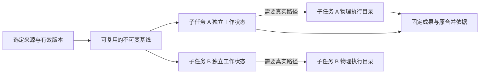

# 快速检索、按需隔离与工具可靠性设计

状态：2026-10-24 设计提案，尚未实施。以 `1a29e76aa` 的现有能力为基础，覆盖本轮体检及随后关于按需隔离、基线成本的讨论。

本文给出本轮的产品行为、实现边界与交付要求。当前运行机制仍见[Agent 协作](../collaboration.md)、[资源](../resources.md)、[检索](../retrieval.md)和[交互内容](../interactive-content.md)；实现完成后将稳定契约折入对应文档。

## 1. 目标与决定

普通派发直接开始工作；需要隔离时，由本次派发明确选择。快速检索必须真正启动所选模型、后台推进并交回回答。工具返回的信息要足以让模型继续行动，且与实际文件、进程和页面状态相符。

| 议题 | 本轮决定 |
| --- | --- |
| 快速检索失败 | 定位并修复启动失败本身，贯通模型资源保留、原生受理和后台执行；同时修正错误丢失及失败被错误标为未知的问题 |
| 子 Agent 默认工作方式 | 省略 `workMode` 使用 `shared`；不再由角色预设或终端能力自动决定隔离 |
| 按需隔离 | 复用 `dispatch.workMode: "isolated_write"`，不新增第二个含义相同的开关 |
| 显式只读 | 保留 `read_only` 的现有能力约束；读取当前来源与复制整个来源不再隐式绑定 |
| 派发来源范围 | 增加可选 `sourcePath`，选取来源内的一个子目录；默认沿当前完整来源，路径转换与结果合并由原资源 owner 管理 |
| 基线成本 | 复用不可变基线、合并同版本准备，按变化增量捕获；首次捕获的范围和代价如实呈现 |
| 独立副本 | 先建立独立工作状态，需要真实路径时再物化；物化包含该子任务已经产生的修改 |
| 存储回收 | 基线对象按原引用生命周期保留，临时准备和闲置物理目录及时释放；取消须跟到真实 worker 停止 |
| Office 与下载写入 | 修正公共二进制写入的原生租约参数，并验证真实文件读写链 |
| 共享来源代码交换 | 返回“同一共享来源，无需交换”的正常结果；没有合并依据时明确报告缺失的依据 |
| 脚本求值 | 修复以代码块开头的异步单元解析，保留持久顶层变量和顶层 `await` |
| 进程输出 | 保留退出与输出收尾的独立事实，改善一致性和解释，不提前宣称输出完整 |
| 搜索过滤 | 解释实际搜索范围和过滤，零结果不暗示整个目录没有目标；不为精确统计强制遍历被忽略的树 |
| HTML 自我观察 | 修通已连接视图的实时读取；明确内容、活视图和历史快照的差别，提供可用的后续读取入口 |

上述行为作用于实际使用这些能力的所有模式。提示词只补必要的工具语义与环境事实，不增加固定检索流程、角色分工流程或强制检查步骤。模型、渠道、权限、文件恢复和原生执行身份继续由已有 owner 管理。

## 2. 已核实的现状

| 问题 | 证据与判断 |
| --- | --- |
| Office 创建失败 | `writeSourceBinary` 将含 `operationId` 的公共对象展开进 `file.lease.acquire`；原生参数拒绝这个额外字段。公共入口还用于 Office 修改、导出及浏览器下载落盘 |
| 快速检索返回统一准备失败 | `CollaborationTools.execute` 返回 `content.data.error`，`admit_internal_retrieval` 却读取顶层 `message`，丢失具体原因 |
| 检索失败正文与外层 unknown 矛盾 | 本轮 4 个检索 Operation 均无对应子任务；原生调用的非只读契约没有匹配的无副作用回执，通用完成投影把 `None` 转成了 `Unknown` |
| 快速检索真实启动失败 | 前两次调用已有成功的 Storage `source.handoff`，但没有 Catalog 子任务。失败范围位于后续模型/工具资源保留和子任务受理；当前记录没有保留确切原因，根因仍须定位 |
| 隔离任务长期 inventory | 两次任务来源均为 `D:\project\opencr`，这个外层目录不是 Git 仓库。普通目录基线枚举只跳过 `.git`、`.varin`，会纳入里面的多个项目、依赖和产物。`inventory` 标签还涵盖多个等待步骤，尚未定位具体停顿点 |
| 角色和物理工具触发隔离 | 预设采用配置中的 `worktree`；自由派发根据是否带物理工具自动选 `isolated_write`，已有 `workMode` 可以覆盖 |
| 异步代码块失败 | 通过当前脚本运行时最小复现：普通同步块成功；以 `{` 开头且内部含 `await` 的块报 `Unexpected identifier`；前置分号及异步 IIFE 可执行 |
| Shared 代码交换报错 | 当前直接进入依赖独立基线的合并路径，错误没有解释共享文件已经就地改变 |
| exited 与输出未完成 | 控制回执先确认进程树停止，独立输出管道随后完成落盘。该组合本身合法，不能据此将 `outputComplete` 置为 true |
| 忽略规则造成零命中 | 递归查询默认应用过滤，当前结果已有 scope，部分目录查询还带 inventory 信息；缺少对过滤后零结果的清楚解释 |
| HTML 实时读取失败 | 活视图由客户端实际挂载并连接后提供。内容引用可以独立读源码，实时 state/screen 还需要视图连接；screen 另需实际捕获能力 |

这些判断分别来自源码、原生执行记录和脚本最小复现。尤其是检索启动和隔离准备，不能将目前缩小的排查范围写成已经确定的根因。

## 3. 快速检索：恢复真正的后台执行

### 3.1 交付路径

沿用现有链路：`code_retrieval` 原 Operation → 内部 Thread/branch/Run → 原生 Agent 引擎 → 原回答进入父分支输入队列。内部调查继续具有文件检索、原文读取和终端能力，不引入向量代码索引、决策模型或新的检索循环。

唯一必需的任务参数仍为 `question`。`paths` 保持现有调查范围语义，不成为新的隔离范围，也不要求主 Agent 预先编排关键词、计划或证据。内部工作默认共享原来源；原来源已经固定或隔离时，沿它的实际执行视图工作。

成功受理立即返回原任务身份，主 Agent 可继续其他工具。继续使用 `retrieval_control` 的三个动作：

| 动作 | 对主 Agent 的意义 |
| --- | --- |
| `status` | 获取实际状态、最近一条公开助手消息和最近实际动作，用来判断继续工作、等待或停止 |
| `wait` | 等待原调查；取消等待本身不取消调查 |
| `stop` | 请求原调查停止，保留已有正文和实际工具效果，等待原 owner 确认资源释放 |

最近消息和动作来自自然产生的执行历史，不额外请求模型生成进度摘要。最终回答由既有交付机制自动送达；状态读取不重复投递回答，也不默认展开完整工具证据。内部检索继续不进入协作成员、子 Agent 消息气泡和完成通知。

### 3.2 启动失败的定位与修复

先恢复原错误的阶段、code、message 与 cause，再在实际链路上定位。本轮必须完成以下因果核对，而不是只让错误文案更详细：

1. 检索模型与工具配置是否已按本次请求冻结；独立检索模型和继承主模型两种选择都能进入后续步骤。
2. 来源交接完成后，Host 能否在父 Run 的原凭据 owner 依赖中保留确切子模型、扩展及 MCP 资源；保留动作是否早于准备者释放其引用。
3. Catalog 的 launch、profile、operation 与模型绑定是否沿同一份冻结选择受理，明确到底是哪项校验拒绝。
4. 受理后是否实际创建 Run、发送模型请求、执行检索工具并保存回答。

排查使用当前调用的原身份和受限诊断字段。原始凭据、完整配置密钥、模型请求正文不写进日志。需要复现时使用明确的新诊断调用；不自动重放现场已终结或效果未知的调用。

准备阶段名称和错误原因写回已有 Operation/准备失败记录，不新建长期诊断账本。修复必须落在真实失败的责任模块；不能用切换模型、强制改为继承、取消必要授权校验来绕开问题。

### 3.3 原始受理事实决定结果

| 事实 | 应有结果 |
| --- | --- |
| 明确在子执行受理前失败，未产生模型、进程等外部执行 | 带具体原因的未派发/准备失败；确认释放本次准备资源后形成对应停止回执 |
| 已受理内部任务，稍后模型或上下文准备失败 | 同一任务进入失败，原句柄可查，终结信息沿原交付路径返回 |
| 已受理，工具观察响应丢失 | 返回或恢复原 Operation 身份，通过原记录继续观察，不新开第二个调查 |
| 已有模型、进程或文件效果而停止尚未确认 | 保留未知效果及停止状态，沿原 owner 协调 |

`child_tasks` 查不到一行不是独立的无副作用证明。还要核对来源交接、Host 资源保留以及原受理事务是否结束；中间准备资源由各自的原 owner 负责释放。已知没有外部执行的准备失败应形成可信回执，让通用完成投影保持正确结果，而不是删除通用未知效果保护。

任务的耐久受理边界一旦跨过，响应、状态读取、停止与结果投递始终指向同一个任务。修复后既要验证“配置有效时能够成功运行”，也要验证实际失败时能够终结和回收。

## 4. 工作方式由本次派发选择

### 4.1 参数与默认值

复用现有 `dispatch`，不新增工具或 `isolate` 别名：

| `workMode` | 行为 |
| --- | --- |
| 省略 / `shared` | 复用选定来源的实际工作状态，不为派发建立独立副本；有写权限的修改立即在该来源生效 |
| `isolated_write` | 从选定来源建立固定基线与独立工作状态；本次修改通过已有代码交换入口交接 |
| `read_only` | 沿现有工具能力规则执行明确只读的派发；不因为只读就默认复制整棵目录 |

`shared` 指复用选定来源，不是强制使用用户当前导航目录。主 Agent 已在独立副本中时，Shared 子任务复用该副本；来源只有不可变树时，沿原按需执行视图处理，不能退回别的实时目录。

这里的隔离针对文件工作状态。终端和扩展仍沿实际 Host 的原执行权限运行；`workMode` 与 `sourcePath` 不新增操作系统沙箱。

有终端、浏览器或其他需要物理环境的工具，不再自动选隔离。需要隔离时在本次调用明确选择。角色、模型、工具子集、命名和 `inheritContext` 与工作方式分别解析。

### 4.2 设置与已有任务

Agent 设置移除“预设角色默认隔离方式”这一生效配置及编辑控件。内置 Worker、验证、调研、快速检索和自定义预设使用同样的按次选择规则，不在系统提示词里继续写角色必须使用独立副本。

已有配置中的旧 `worktree` 偏好通过设置入口的一处字段归一化退出新派发的决策，其他用户模型、工具和指令配置保留；保存该 Agent 时不再写回退休字段。不构建通用迁移框架，也不改写历史 launch/profile。

已经受理的任务保留当时的工作方式。向同一子 Agent 续接工作时延续其实际来源；要改变工作环境，用新派发或既有显式来源切换能力，不在续聊中偷偷将隔离改成共享。

### 4.3 简洁的模型披露

参数说明直接描述结果：省略使用共享来源；独立修改传 `isolated_write`；明确只读可传 `read_only`。无需增加“先检查风险再选择”的流程提示，也不要求模型解释每次模式选择。

受理结果与现有任务详情显示实际工作方式及来源。只有独立来源尚在准备时显示准备进度；普通 Shared 派发不展示不存在的复制阶段。

## 5. 选取合适的来源范围

新增可选 `sourcePath`，表示在已选来源中使用的目录，相对路径由原 Source owner 解析。它先作用于 `sourceAgent` 选出的来源；没有 `sourceAgent` 时作用于当前来源。

```json
{
  "task": "尝试另一种工具分发实现，并报告改动",
  "preset": "worker",
  "workMode": "isolated_write",
  "sourcePath": "Varin"
}
```

规则如下：

- 省略或 `.` 使用完整选定来源；不根据任务文字或遇到的第一个 `.git` 自动缩小目录。
- 参数选择一个目录，不增加文件白名单、glob 语言或新的项目对象。只有在任务确实适合较小来源时才需要填写。
- 子 Agent 文件路径和默认 cwd 以选定目录为根。对于 `D:\project\opencr` 下的 `Varin`，子任务看到的 `packages/ui` 对应原来源的 `Varin/packages/ui`。
- 原 owning workspace、资源 Host、来源版本和权限保持可追踪；保存原根到子根的路径映射，代码交换和恢复沿该映射定位。
- 现有授权边界仍由实际 owner 检查。路径不存在、不是目录或解析后超出来源时给出明确参数错误，不退回整个根。
- 子目录所属仓库的 Git 元数据可以由原 Git 适配器用于版本识别；捕获和交付仍只覆盖选定来源，不顺带包含兄弟目录。

`sourcePath` 和快速检索的 `paths` 分工明确：前者选择本次 Agent 的工作来源；后者是调查输入，不改变工作副本身份。

## 6. 隔离来源的三层结构

沿用 Rust Storage 的内容对象、不可变树、branch、pin 和物化 journal：



不可变基线承担共同起点，子任务工作状态承担各自修改，物理目录承担真实文件系统访问。共享基线不共享可写目录。已发布的基线不会随父 Agent 后续写入变化。

来源准备仍由可信 Host 调度、Documents 协调，Rust Storage 拥有内容、发布与引用。复用信息放进原 source-preparation/WorkingState 元数据，不新增 TypeScript 持久 writer、独立副本数据库或第二套引用账本。

## 7. 基线准备与复用

### 7.1 先区分三种起点

| 起点 | 准备方式 |
| --- | --- |
| 已有固定 branch/revision 或固定成果 | 直接保留原 pin 并创建独立分支；子目录选择取对应子树，不重新扫描原物理目录 |
| 实时来源，存在已核实可复用的捕获 | 复用未变化的内容和树节点，只捕获发生变化的范围，发布新基线 |
| 实时来源，首次捕获或有效观察丢失 | 对选定范围建立目录清单与内容基线，完成稳定性核对后发布 |

本轮不承诺大型普通目录首次隔离可以零扫描。真正减少这笔成本的方式是默认 Shared、可选较小来源，以及后续复用已经完成的有效捕获。

### 7.2 复用身份与并发准备

可复用捕获必须属于相同资源 owner、真实来源根/固定版本、选定子目录、内容模式和捕获覆盖规则；涉及草稿、配置依赖或显式附加范围时，将其已有身份一并纳入。来源路径字符串相同不能证明它仍是同一份内容。

每次派发仍独立验证自己的权限。基线 pin 是内容引用，不替代目录准入；另一个 Host 或不同权限范围不能借用已有缓存绕过准入。

同一有效来源观察代、同一准备区间内的并发请求，共用一个原生捕获工作，每个子任务保留自己的受理身份和结果引用。发生来源写入后到来的派发使用新的观察代，不加入旧版本准备。已知固定版本可以直接共用原根。

Host 可以维护活动请求的合并与订阅关系；耐久候选、发布、引用和恢复仍进入 Storage 原 journal。一个订阅者取消只撤回自己的需求；最后一个需求撤回时，停止实际捕获并等待原 worker 清理。失败候选不替代上一次有效基线。

复用不是永久缓存承诺。优先复用已有任务、成果和恢复记录仍保留的根；没有使用者的准备引用进入原 GC，不为了“也许以后再用”留下完整来源副本。

### 7.3 Git 来源

Git 用于识别版本、索引和工作区变化；文件正文仍由原文件 owner 捕获。

- 已有对应基线时，复用未变树和内容对象，捕获暂存、未暂存、新增、删除、重命名、文件类型和必要 mode 变化。
- 捕获结果对应当前选定的已保存文件。文件同时有暂存和未暂存修改时，使用工作区实际内容；不能只 checkout HEAD 或只应用暂存补丁。
- 首次没有可复用根时完成必要的内容获取；后续不要每次重新对全部文件做 `hash-object`、正文捕获和正文校验。
- Git 元数据改变、来源身份改变或文件变化观察失效时，重新确认受影响范围。Git 的无变化结果与原生文件身份、Documents 观察共同使用，不能仅凭 HEAD 没变就忽略未提交修改。
- 保留现有 Git 来源的覆盖语义：版本化文件、正常未跟踪文件，以及指令/配置等已明确纳入的依赖。被忽略的安装目录不因派发而默认变成另一套完整环境镜像。

独立环境需要的额外文件沿既有捕获范围机制纳入，执行工具如实报告缺失的依赖。安装和准备依赖继续属于普通执行能力，不在后台自动安装，也不增加一套依赖管理服务。希望直接复用当前物理环境时可以选择 Shared。

Git 子模块、嵌套仓库和路径映射保持现有显式支持边界；不在性能优化中悄悄截断它们。嵌套仓库本身不是证明整片目录可以忽略的依据。

### 7.4 普通目录

普通目录首次捕获完整覆盖所选来源，沿原资源元数据排除 Varin 自己管理且不属于来源的存储。不会仅因文件位于某个常见目录名就省略用户资料。

后续复用目录清单和内容对象，以受控写入、目录观察及文件身份变化定位受影响范围。没有变化的固定对象不重复写入；新增、删除、重命名和目录变动更新对应树节点。来源中不同位置内容相同，仍复用原内容寻址对象。

仅凭路径、大小、mtime 相同不作为完整内容未变的证明。文件观察丢失、Host 重启后没有连续依据、目录被替换或出现不能解释的变化时，重新核对相应范围；只有无法缩小范围时才回到整个选定来源。核对期间保留上一份有效根。

Documents 的协调能约束本平台写入；普通文件系统上的外部编辑还需实际观察与稳定性验证。新基线只在捕获、验证和原发布事务均完成后成为可用来源，不将混合读取的文件称为同一时刻快照。

### 7.5 减少正文 I/O 与重复等待

当前路径存在目录枚举、内容获取、稳定性复核、物化前校验和复制等多个阶段。优化按实际重复工作处理：

| 成本 | 改进 |
| --- | --- |
| 同时派发分别枚举相同来源 | 同一有效捕获由多个任务订阅 |
| 每次从头计算已有内容身份 | 复用有效版本与未变范围；变更集中核对 |
| 每次将相同正文再次写入对象库 | 使用原内容寻址对象及引用，不按子任务建完整正文集合 |
| 捕获后无区别再读所有正文 | 原生捕获携带文件身份和稳定性依据；能证明未变的条目复用，证据不足的条目实际复核 |
| 元数据和正文逐文件跨进程往返 | 复用已有批量捕获与流式 inventory，进度随原批次发布 |
| 捕获期间持有长控制锁 | 目录遍历和内容读写留在原 worker，控制/提交段只操作必要元数据 |

不能为了减少读盘直接删除校验。改变验证方式必须仍能发现捕获期间的修改、删除、路径替换和取消。并发度使用原 worker/IO 调度能力，不额外创建检索专属线程池或无限并发文件读取。

## 8. 独立工作状态与延迟物化

### 8.1 何时产生物理目录

固定基线发布后，子任务可以在独立工作分支使用已有文件读、搜索、写和编辑能力。新增/修改内容写入自己的树，基线 pin 保留作为交接依据。

首次出现真实路径需求时准备物理执行视图，例如启动终端、调用依赖本地 cwd 的扩展或 workspace MCP。入口依据已注册工具的实际 source/process requirements 判断；不等待工具先失败一次，也不只对 `process_spawn` 单独接线。

物化采用此刻子任务的工作 revision，包含它此前通过文件工具产生的修改。完成后，文件工具、终端和相关扩展使用同一个执行视图；来源切换在原准备/发布边界完成。已产生的历史证据继续保留原 revision。

若现有固定来源文件写入路径尚不能独立提交，则需补齐这条原生工作分支路径，或在第一次实际写入时物化。不能在仅完成“延迟到第一次工具调用”的情况下，声称已经实现完整的按真实路径需求物化。

### 8.2 物化本身的成本

继续使用已有物化 journal、staging、验证和 promotion。单个子执行的并发物理需求汇合到同一准备，重连查原回执，不重复创建目录。

支持文件克隆的实际平台沿原能力使用克隆，不支持时复制。Windows 当前走复制，本轮的主要收益首先来自减少需要物化的任务、缩小来源及复用基线；文件系统能力优化只按实际支持接入，不承诺所有 Windows 磁盘都能零拷贝。

复制过程中可合并内容校验与字节搬运，减少对同一不可变对象的重复通读；仍验证原对象身份和目标完整性。可写执行文件不能直接硬链接到内容对象库或父工作目录，否则普通终端原地写入会破坏基线或父文件。

恢复同一次中断物化时，依据原 journal 复用已经确认的条目，继续未完成部分。新任务不接管另一任务有私有修改的物理目录。若曾发布的执行目录丢失，按原恢复机制明确处理，不静默重建并假称之前的进程和文件效果仍然存在。

### 8.3 成果与路径对应

基线 B、子任务结果 S、目标当前状态 T 继续走现有三方合并。选择了 `sourcePath` 时，B/S 的相对路径通过受理时保存的映射对应到 T；不能把子任务的 `packages/ui` 合并到父来源根的错误位置。

父来源在子任务运行期间变化，走原冲突处理；子任务重命名、移动文件和重复提交仍沿原 acknowledge/Integration 记录处理。正文聊天完成与实际进程停止分别观察，最后的文件结果只能在原结果发布边界形成。

## 9. 准备进度、取消和回收

### 9.1 真实且轻量的进度

复用现有准备进度结构，按实际工作区分来源确认/等待、枚举、捕获、校验、物化和启动。新增阶段只对应真实等待点；Shared 已有可用来源时直接继续执行。

枚举未知总数时显示已发现目录/文件数，捕获和物化可显示已处理条目/字节；已知总量后再计算比例。每个更新表示原 worker 的推进，不由定时器伪造百分比或剩余时间。按现有进度合并机制降低频繁写入，不另建性能监控系统。

等待受控写入、来源变更重查、客户端未响应等状态保留具体原因。仅凭经历了若干秒不判定任务失败，不新增无依据的准备超时或目录大小上限。

### 9.2 生命周期

| 阶段 | 保留对象 | 释放时机 |
| --- | --- | --- |
| 准备中 | 原捕获 candidate、临时内容引用、必要读者/租约 | 失败或最后一个需求取消，且原 worker 实际停止后 |
| 基线可用 | 子任务各自持有的原根引用 | 子任务、成果或恢复记录不再需要时 |
| 独立执行 | 独立工作分支；有真实路径需求才有物理目录 | 原 writer/进程停止，成果发布及仍活动的使用者处理完毕后 |
| 已结束 | 回答、原成果、合并依据及必要恢复对象 | 沿现有历史/会话删除与 GC 规则处理 |

取消一个任务不释放其他任务共用的基线，也不停止其他订阅者仍需要的捕获。取消物化或进程时，先请求原 owner 停止，确认停止后清理临时目录及引用；HTTP 请求结束不是清理确认。

可从固定成果重新准备执行环境的已结束任务，不因聊天历史仍在就永久保留完整可写目录。尚有后台进程、用户显式保留的环境或未完成发布时，原引用说明其保留原因。目录存在用户后来写入的内容时沿原清理规则保留并说明，不把失败清理掩盖成成功。

准备时使用的临时备份、staging 和 capture 引用一并进入原清理责任。会话删除释放该会话拥有的引用；其他会话、成果和恢复记录仍引用的对象由 Storage 正常保留，不手工按目录猜测谁还在使用。

## 10. Office、文件写入与共享代码交换

### 10.1 公共二进制写入

`file.lease.acquire` 使用它自身的精确参数，`operationId` 只进入需要操作身份的 reconcile/capture/apply。构造各请求时区分来源地址、租约身份和写入身份，避免继续把一个“大 base 对象”展开到不同协议中。保持原生接口对未知字段的拒绝。

沿原链路完成：检查原操作回执 → 获取文件租约 → 捕获当前状态 → 比较预期版本 → 保存内容 → 原子应用与恢复 journal → 释放准备引用及租约。新建、替换、冲突和响应丢失仍保留不同结果。

验证覆盖实际格式引擎生成的文档以及 native 写入；文件名叫 `.docx` 但正文只是普通字符串的 fixture 只能验证底层字节写入，不能替代 Office 验收。优先覆盖报告失败的 DOCX/XLSX，复用同一公共入口确认导出和下载调用，避免每个格式重复搭建一套存储测试。

### 10.2 同一共享来源的交换结果

在确认为同一个实际可写来源后，`submit_code`/`update` 返回正常的 `shared_source` 结果、`effect: none`，说明文件已在共享来源生效，无需额外交换。身份判断包含资源 Host、来源根/实际执行视图和路径映射，不只比较字符串路径或 profile 名称。

该结果不生成一次虚假的合并、恢复点或“已合并若干文件”的消息，也不因共享而绕过两端来源准入。明确选择文件时保留原参数校验；如果涉及不同子根，先通过原路径映射判断实际覆盖，不能把所有同 workspace 的操作都当成同一来源。

真正需要交换但缺少可追溯基线时，返回 `baseline_unavailable`，说明双方来源及缺少的合并依据。错误不能声称“只有 isolated_write 才可能拥有基线”：固定成果、阶段来源等同样可能具有合法合并依据。已有基线时沿原 Integration 和冲突处理执行。

## 11. 脚本：让披露的写法实际可执行

`script_run.script` 是完整 JavaScript 单元，保留当前 Node REPL 的顶层 `await`、持久词法绑定、异步输出归属及嵌套工具回执。修复目标包括下面这种自然写法：

```js
{
  const temporary = await tools.invoke({
    callId: "inspect-files",
    name: "file_list",
    arguments: {}
  });
  print(temporary.completion.content);
}
```

求值入口需要把以语句块开始的单元按语句处理，消除 Node 交互式对象字面量探测对异步代码块的误判。使用最小必要的源码归一化；识别前导空白、注释等正常输入，保留错误位置对应关系。显式对象表达式使用 `({ ... })`，照常获得表达式结果。

不把所有单元包进函数，这会改变跨调用变量与顶层语义；不在捕获 SyntaxError 后自动重跑另一种正文，避免含副作用的脚本出现二次执行。已有绑定重声明继续返回具体错误，并在工具说明、参数描述和提示中给出已经验证可用的块作用域及变量复用写法。

定向验证自然代码块里的顶层 `await`、跨单元绑定、显式对象表达式和原嵌套调用归属。脚本错误后环境仍可继续使用；取消仍沿原运行时关闭和回收机制。

## 12. 进程：准确表达退出与输出收尾

继续使用 `status`、`writerActive`、`outputComplete`、`outputError` 和输出游标，不增加一套重复的进程状态机。

| 观察 | 含义与呈现 |
| --- | --- |
| `running` | 目标仍在运行 |
| `exited` 且输出未完成、无输出错误 | 进程已退出，输出正在收尾；原输出观察仍可继续 |
| `exited` 且输出完整 | 后续不会再追加输出，可结束输出等待 |
| 输出错误 | 明确指出日志不完整或无法读取，不伪造完整输出 |

`nextCursor == endCursor` 只说明读到了当前已保留的末尾，只有输出完成事实才能证明没有后续字节。同一个工具结果内的顶层输出字段与嵌套 process 状态采用一致的原生观察，避免混用不同时间点的完成标志。

进程树已经停止时，原文件 writer 可以按其真实生命周期释放；日志读者仍由输出 owner 保留到管道结束和落盘完成。收尾状态通过现有订阅/读取通知更新，不能靠把退出字段重写为 running 或增加固定睡眠来掩盖。

本轮核对 spawn 的首次回执、后续 read/wait 和 UI 摘要的解释一致性。已有覆盖尾部输出、PTY 退出和日志错误的测试优先复用；只补实际缺失的组合。

## 13. 搜索：让过滤后的零结果可理解

保持 `file_list`/`file_search` 当前的路径、递归和 ignore 默认，不因一次零命中自动关闭过滤或启动第二轮全目录扫描。

模型主要需要知道搜索在哪里进行、应用了哪些过滤、是否完整覆盖了该范围，以及如何调整：

- 结果继续返回实际 `scope`，明确 `respectGitignore`、默认排除目录、隐藏项与递归行为。
- 零结果描述为“当前搜索范围和过滤条件下没有匹配”。`scanComplete` 的完整性限定到这份 scope。
- 已明确观察到选定根被忽略、目录被排除或匹配路径被过滤时，返回对应原因。已有 Git inventory 信息直接参与解释，不再只作为难发现的原始记录。
- 若需要扩大范围，给出同一工具的参数调整，例如 `respectGitignore: false` 或显式选择具体目录。调整仍由调用者决定。
- 可以返回扫描过程中实际获得的跳过数量，区分文件和被剪枝的目录。没有遍历子树时不声称知道其中被忽略的文件数，也不为了计数重新遍历。

显式指定目录与目录内部过滤保持现有语义。发现零命中的来源其实只有依赖缓存时，应如实说明文件位置；不因匹配到第三方缓存就把它归为项目自有实现。

## 14. HTML：区分内容、实时实例和已有观察

### 14.1 可读能力

| 引用/状态 | 可读取内容 |
| --- | --- |
| 已保存的 `ui:` 修订 | 元数据、文件目录、源码；不依赖聊天卡片当前可见 |
| 已连接的 `ui-view:` | 实际当前 state/context/structure；客户端具备捕获能力时提供 screen |
| 保存的 `ui-snapshot:` / `ui-selection:` | 对应时刻的状态、结构及实际保存的图像，不冒充当前页面 |
| 已卸载或断开的实例 | 具体不可用原因；有原保存状态/快照时提供其明确引用及时间，供后续读取 |

先修复已显示、已连接的页面仍然读不到 state 的实际链路：实例注册、观察队列、客户端响应、断连重接和错误投影逐段核对。`render_ui` 保存成功不要求等待客户端截图，因此不要把客户端渲染变成每次保存的阻塞条件。

### 14.2 引用选择与错误

作品引用请求实时数据时，保留 `view_required` 与可用实例及完整续读参数；多个客户端/实例存在时不擅自选择其中一个。实例列表说明实际连接情况，过期引用返回 `view_disconnected` 等具体原因。

实时请求失败时不得悄悄把历史状态当作实时结果。若已有保存状态，沿原 view-state/快照存储发布或提供明确的历史读取入口，并标明保存时间与修订；从未观察过时返回尚无观察。原结构没有可靠捕获时间时不能补造时间。

screen 失败保留未挂载、未连接、当前客户端不支持捕获或实际捕获失败的区别。已知领域错误穿过 `resource_read` 和通用工具包装后保留 code、可公开原因与下一步读取引用，避免统一成 `The selected resource read could not complete`。

本轮不为读取 state/screen 自动重开全部历史 iframe，也不自动启动另一个页面副本。重开会执行脚本、网络请求并产生不同交互状态，不能代替用户原实例。独立渲染验收若以后需要，可作为明确的另一项能力设计。

### 14.3 生命周期

虚拟列表卸载时沿现有机制保存可恢复状态，释放连接；重新挂载恢复原实例状态并重建观察连接。连接重建不重复执行同一已运行页面的脚本。正在读取的实例断开时结束该次观察并保留具体失败，不留永远等待的 Promise。

HTML 自我观察只读取，不点击、滚动或替用户改变参数。截图方法、裁切区域与实际时间继续来自客户端的原观察。

## 15. 实现归属

| 范围 | 主要入口与改动责任 |
| --- | --- |
| 快速检索启动和错误 | [原生检索执行](../../kernel/crates/varin-kernel/src/tools_retrieval.rs)、[协作受理](../../kernel/crates/varin-kernel/src/collaboration.rs)、[调用完成投影](../../kernel/crates/varin-runtime/src/invocation.rs)；修复真实失败和原回执 |
| 子模型与原资源寿命 | [子配置](../../packages/web/application-host/lib/kernel/child-profiles.ts)、[Host 工具桥](../../packages/web/application-host/lib/kernel/tool-bridge.ts)及现有模型凭据 owner；保留确切冻结选择 |
| 派发模式和来源选择 | [dispatch 契约与解析](../../kernel/crates/varin-runtime/src/catalog_dispatch.rs)、[协作协议](../../kernel/crates/varin-kernel/src/collaboration.rs)、[Agent 设置编辑器](../../packages/ui/src/components/sections/agents/AgentProfileEditor.tsx)及对应设置 schema |
| 基线准备和观察复用 | [来源捕获](../../packages/web/application-host/lib/harness/working-state/source-preparation.ts)、[子来源适配](../../packages/web/application-host/lib/kernel/child-source-store.ts)、[Git inventory](../../packages/web/application-host/lib/kernel/source-git-inventory.ts)、[Storage 适配](../../packages/web/application-host/lib/kernel/storage-adapter.ts) |
| 原生枚举与物化 | [来源扫描](../../kernel/crates/varin-kernel/src/compute/source.rs)、[物化](../../kernel/crates/varin-kernel/src/storage/materialization.rs)与原 WorkingState、pin、GC owner |
| 准备、结果和释放协调 | [Thread 协作适配](../../packages/web/application-host/lib/kernel/thread-collaboration.ts)及原 Catalog child 生命周期 |
| 二进制文件 | [公共文件 writer](../../packages/web/application-host/lib/kernel/binary-file-owner.ts)、[Office owner](../../packages/web/application-host/lib/kernel/office-runtime.ts)、[浏览器 owner](../../packages/web/application-host/lib/kernel/browser-runtime.ts) |
| 代码交换 | [Code exchange](../../packages/web/application-host/lib/kernel/code-exchange.ts)及原 Integration |
| 脚本 | [REPL core](../../packages/script-runtime/src/core/index.ts)、[工具声明](../../packages/extension-builtins/src/script-tools.ts) |
| 进程结果 | [原生进程 owner](../../kernel/crates/varin-kernel/src/process/mod.rs)、[进程工具](../../kernel/crates/varin-kernel/src/tools.rs)与已有前端摘要 |
| 文件查询 | [文件发现工具](../../kernel/crates/varin-kernel/src/tools_discovery.rs)、[Git inventory](../../kernel/crates/varin-kernel/src/compute/inventory.rs)及原 compute worker |
| HTML 观察 | [交互内容 runtime](../../packages/web/application-host/lib/interactive-ui/runtime.ts)、[资源 owner](../../packages/web/application-host/lib/kernel/resource-owner.ts)、[聊天卡片](../../packages/ui/src/components/interactive-ui/InteractiveUiCard.tsx) |

私有 DTO 或原生 wire 需要变化时，由原 schema 生成对应文件并构建匹配内核。产品版本号、打包和发布不是本文档任务的一部分。

## 16. 实施顺序与交付判断

### 16.1 实施顺序

1. **恢复真实能力。** 定位并修复快速检索启动失败，修复公共二进制 writer；使成功链、失败终结和原始原因都可用。
2. **调整派发决策。** 统一默认 Shared、移除角色隔离偏好，接入 `sourcePath` 和实际路径映射，贯通共享来源交换结果。
3. **降低隔离准备成本。** 固定来源直接复用、同版本捕获合并、增量核对、延迟物化及回收一并接线；补齐准备进度。
4. **完善其他工具契约。** 修复异步脚本块、进程输出说明与一致性、搜索过滤解释、HTML 实时/历史观察和具体错误。
5. **按真实失败边界验收并更新现行文档。** 已通过且未再次变化的路径不重复执行同一检查。

这些阶段是同一方案的组织顺序，不以“报错更清楚”替代能力修复，也不把“新增了参数”当作隔离成本已经解决。

### 16.2 必须证明的行为

| 场景 | 交付证据 |
| --- | --- |
| 有效独立检索模型、继承主模型 | 实际经过 Host 模型资源保留和原生受理，模型请求及至少一次检索工具调用成功，回答交回原父任务 |
| 检索后台推进 | 主 Agent 在调查运行时能继续工具调用；status 给自然消息/实际动作；wait 和自动交付不重复回答 |
| 检索受理前/后失败 | 原始原因保留，状态与实际执行一致；已受理句柄可恢复；未确认效果不重放，资源不泄漏 |
| 默认派发 | 带终端的预设和自由派发省略 workMode 均共享实际来源，不建立额外全量基线或独立物理目录 |
| 显式隔离 | 子文件修改与终端写入不改变父来源；固定基线、结果和冲突处理可用 |
| 选取子目录 | 只准备选定来源，子路径、cwd、代码交付与恢复回到正确的原路径 |
| 同版本多次/并发隔离 | 实际复用原根/内容与捕获工作；子任务相互独立，不各做一次完整正文捕获 |
| 来源变化 | 新增、删除、修改和来源替换进入新捕获；观察丢失后重新核对，不复用无依据的旧内容 |
| 延迟物化 | 先读写文件、再启动命令时看到同一份子任务修改；无物理需求的任务不产生完整目录 |
| 取消与回收 | 一个订阅者取消不破坏其他任务；最后需求取消停止 worker 并释放临时引用；成果保留不依赖闲置目录 |
| Office 文件 | 真实 DOCX/XLSX 创建、重新读取、条件修改和相应导出成功，冲突不覆盖，原租约得到释放 |
| Shared 代码交换 | 同一实际来源返回无需交换的正常结果；不同来源仍检查真实基线和映射 |
| REPL 异步块 | 自然代码块含 await 可执行，持久变量、对象表达式和嵌套调用语义保持正确 |
| 进程输出收尾 | 最后字节完整可读，退出与收尾状态解释一致，输出错误仍明确暴露 |
| 搜索零命中 | 当前过滤范围清楚；显式扩大范围能获得原先被过滤的结果，不自动追加全树扫描 |
| HTML 观察 | 活实例 state 可读，支持的客户端 screen 可读；未挂载、断连和历史快照分别给出真实结果与可用引用 |

验证优先复用已有 owner 和接线测试。少量新增用例保护本轮真实故障；mock 只能证明对应适配逻辑。独立检索模型的启动回归必须走实际凭据 owner 依赖与 Host/native 受理，不能只构造一个成功 Job DTO。性能检查在最终相关实现后做有代表性的对比，不每个小改动重跑整个工作区。

### 16.3 性能与空间如何判断

选择能区分瓶颈的来源：一个正常 Git 项目、一个包含多个项目/产物的普通目录，以及已有固定成果。记录首次与重复准备的真实耗时、枚举数量、正文读取/新增对象字节、物化字节和释放后的保留量。优先利用现有 worker 与 journal 事实，必要时使用局部诊断，不建设新的常驻监控平台。

预期改善应有因果证据：

- Shared 派发没有新增隔离基线和完整目录，而不只是等待提示消失。
- 固定版本重复派发复用原根；同时请求没有重复捕获；少量修改只更新必要范围。
- 没有物理需求的独立任务不产生完整可写目录；物化之后命令正确看到此前修改。
- 取消/失败后临时资源释放；任务结束保留量可以解释为原历史、成果或恢复仍引用的内容。

当前没有支持统一毫秒阈值、目录大小上限或固定百分比提速的数据，因此不先填这些数字。第一次大型普通目录捕获的剩余成本要实际报告；不能用预先暖好的基线冒充冷启动，也不能用缩小范围却不说明来比较。

## 17. 尚需落实的具体问题

以下是实现中需要用证据解决的事项，不改变上面的产品决定：

- 本次检索在来源交接之后被哪一步拒绝，以及对应模型/资源引用为何失配；保留原始错误只是取得证据的第一步。
- 两次 inventory 卡顿究竟落在 Git 识别、目录遍历、Documents 协调还是后续跨进程等待；修复具体阻塞并让进度可定位。
- 当前文件写入工具在哪些来源下会提前要求物理目录；延迟物化需要贯通这些真实消费者。
- 外部文件变化连续观察在各执行 Host 上能提供哪些有效依据；缺失时采用什么范围的重新核对，以及实测成本。

本轮完成条件是上述实际失败得到解释和修复，约定的成功行为可用，资源成本及回收得到对应证据。文档状态在完成后再更新为已实施。
