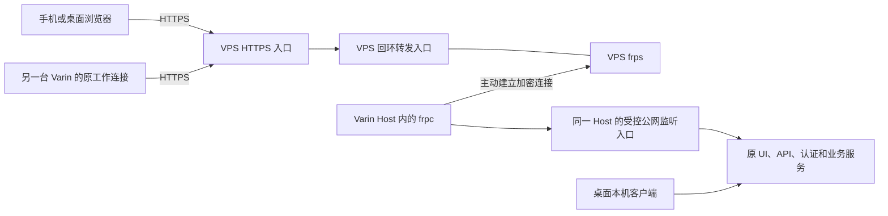
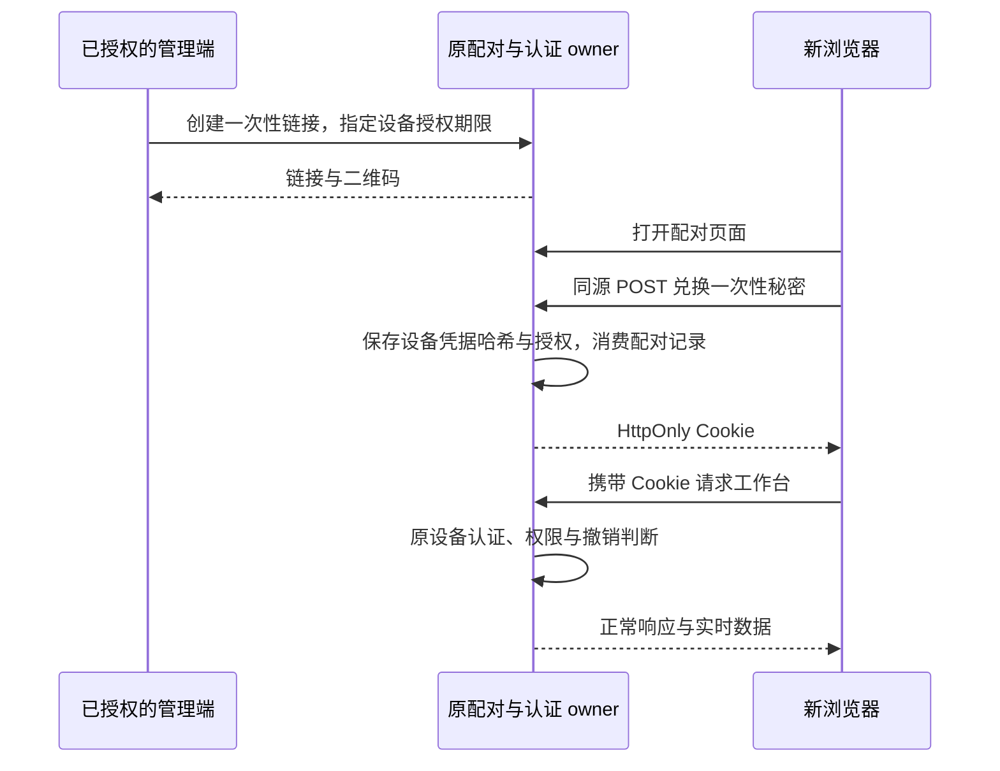

# 自建外部访问与节点接入

状态：主体已实施，完整 VPS 部署与跨设备链路仍待实测。日期：2026-11-17。下文现状表保留设计基线 `de3b4afd7`；当前接入方式见[反向代理指南](../ops/REVERSE_PROXY.md)及[部署配套](../../deploy/external-access/README.md)。

对应 [#376：远程访问支持自带服务器](https://github.com/Astrmira/Varin/issues/376)，实现见 [#381](https://github.com/Astrmira/Varin/pull/381)。本文保留设置交互、穿透适配、部署配套、连接恢复与持久授权的设计取舍：服务器由用户或 Agent 按环境部署，Varin 提供连接能力和部署材料。当前代码已接入自建入口、Windows/Linux/macOS 本端 FRP、持久浏览器配对和原工作节点；Cloudflare/ngrok 保留原路径，切换受控入口按迁移指南处理。域名/IP 证书的实际部署与续期由部署者负责，完整 VPS 验收仍待进行。

## 1. 产品目标与决定

用户可以把自己的 VPS 接入 Varin，得到一个可长期使用的 HTTPS 地址。Varin Host 主动连接 VPS；手机通过普通浏览器访问，另一台 Varin 也能通过原工作连接接入这个 Host。首次配对后，在地址不变、授权有效、浏览器保留站点数据的条件下，日常重启无需重新扫码。

本次确定以下方向：

- 将设置中的“外部隧道”调整为“外部访问”，容纳 Cloudflare、ngrok、自建 FRP 和已有反向代理。
- 设置提供“FRP 穿透”“已有反向代理”两种自建接入方式，以及“获取部署文件”的辅助入口。
- 开启、停用管理网络可达性；配对、过期、撤销管理设备访问权。停用入口保留设备授权。
- 浏览器配对进入现有持久设备凭据体系，隧道进程不再拥有另一套登录记录。
- 提供面向 Varin 的 FRP＋HTTPS 部署文件、已有服务配置片段和操作说明，由用户或 Agent 决定如何安装、修改、升级和清理服务器。VPS 承担转发与 HTTPS，实际工作仍在原 Varin Host、Harness 和资源设备上执行。
- 入口配置和启用意图属于当前 Host，脱离前端窗口运行。前端、Host、VPS 可以分别位于不同设备。
- 同一入口保留网页、API、实时通道和原节点能力的可达性；节点发现、配对及资源权限继续由现有工作连接和资源 owner 管理。

本轮交付覆盖穿透适配、部署配套、授权收敛和恢复体验。撤下程序化 SSH 部署、远程只读预检、部署计划、重复执行回执、续期巡检和服务器卸载流程。现有 SSH 工作连接不因本需求重构。Private Relay 保留原有的已配对客户端加密传输职责，本轮使用成熟转发组件完成自建入口。

## 2. 现状与改动依据

| 当前能力 | 已有实现 | 本次需要解决的问题 |
| --- | --- | --- |
| 外部隧道 | Cloudflare quick / managed-remote / managed-local；ngrok quick | 补自建 FRP 和已有反代，整理仍围绕 Cloudflare 模式组织的配置与 UI |
| 固定 HTTPS 地址 | Cloudflare managed 模式；用户自行部署 Nginx / Caddy | 把入口接入产品，提供易用的部署文件与接入参数 |
| 隧道登录 | 一次性 `/connect` 链接兑换 `varin_tunnel_session` | 登录记录保存在内存，停止或重启会失效 |
| 持久设备授权 | `remote-clients` 保存凭据哈希、权限、到期和撤销；Pairing v2 负责一次性兑换 | 将浏览器隧道登录接入同一 owner，补浏览器客户端表达与 Cookie 认证 |
| 工作连接 | Host 管理 HTTP/SSH 连接、节点能力和资源访问 | 公网地址沿原 HTTP 连接接入；SSH 工作连接保持原职责 |
| Private Relay | 两端实现已存在，`VARIN_RELAY_URL` 指定服务；无默认端点 | 该路径没有直接提供本需求中的公开网页入口 |

决定性源码与说明：

- [TunnelSettings](../../packages/ui/src/components/sections/varin/TunnelSettings.tsx)、[提供商类型](../../packages/web/application-host/lib/tunnels/types.ts)、[隧道 service](../../packages/web/application-host/lib/tunnels/index.ts)、[隧道路由](../../packages/web/application-host/lib/tunnels/routes.ts)。
- [tunnel-auth](../../packages/web/application-host/lib/platform/tunnel-auth.ts)：`createTunnelAuth` 内的 session Map、`clearActiveTunnel` 的撤销、`classifyRequestScope` 无活动隧道时的普通入口判断。
- [UI 认证说明](../../packages/web/application-host/lib/ui-auth/DOCUMENTATION.md)、[设备凭据](../../packages/web/application-host/lib/client-auth/remote-clients.ts)、[配对兑换](../../packages/web/application-host/lib/client-auth/pairing.ts)。Pairing v2 当前只接受 mobile / desktop；浏览器适配属于本次新增工作。
- [连接模块](../../packages/web/application-host/lib/connections/README.md)：原 Host 连接、配对和能力访问；穿透只提供可达地址。
- [Relay 说明](../../packages/web/application-host/lib/relay/DOCUMENTATION.md)、[服务地址来源](../../packages/web/application-host/lib/relay/endpoint.ts)。

“已有设备凭据可跨重启”与“当前隧道 Cookie 可跨重启”必须区分。现在两者尚未接通，单独增加 FRP 提供商无法完成 #376 的验收要求。

## 3. 部署拓扑与入口



现有反向代理的用户直接把代理指向受控公网监听入口；代理如何到达 Host 由其现有网络、VPN 或转发设施决定。仅配置反代不能替代内网穿透，配置页应明确展示需要转发到的实际地址。

“节点”沿用现有可连接 Host 及其能力表达。公网地址作为原 HTTP 连接地址使用，现有发现与授权决定能访问哪些 Harness、工作区、浏览器或 Computer Use 能力。网页 Cookie 与工作连接的客户端凭据各沿原携带方式，连接成功不自动授予全部能力，也不自动把前端机器上的资源归到远端 Host。

公网监听入口复用同一 Application Host 的 UI、业务路由、流式响应和 WebSocket。监听入口的来源由 Host 内部标记，外部请求不能通过伪造 `Host`、转发头或回环来源取得本机访问身份。公网 Origin 用于校验和生成地址，不充当授权凭据。

FRP 在同一 Host 上运行时，后端默认绑定回环。已有反代可以配置实际可达的监听地址；跨设备链路应使用用户的可信私网或加密传输。端口保存于入口配置，冲突时报告占用原因与可修改项，不悄悄换端口使 VPS 指向旧地址。

停用后，公网监听入口仍按公网规则处理：拒绝业务访问并结束入口上的现有实时连接，不退回本机免认证路径。若监听进程随 Host 退出，VPS 负责返回离线页。停止访问不会取消已经受理的 Agent 任务；任务继续遵循原执行与取消语义。

标准自建拓扑在 VPS 终止 HTTPS，再经加密 FRP 连接转发。VPS 会处理请求明文，因此属于用户选择并信任的代理。部署配套只保存服务配置和证书；配置关闭业务响应缓存、请求正文落盘缓冲，以及包含配对秘密的访问日志。端到端加密的 Private Relay 继续按原协议运行。

## 4. 设置中的交互

### 4.1 日常页面

```text
外部访问                              当前服务：家里的电脑

连接方式        自建服务器 ▾
配置            家用 VPS                         编辑

https://varin.example.com                     复制   打开
● 已连接                                         停用

添加访问设备                              管理已授权设备

连接详情 ▸
获取部署文件
```

“当前服务”沿用工作连接中的真实 Host 名称。端口、文件路径和 frpc 均在该 Host 上解析，配置不会随查看页面的浏览器切换设备。Host 切换时，原 Host 的连接继续按自身启用意图运行。

页面用现有 SettingsSection、设置行、Select、Dialog、折叠区域和主题 token 组织。固定地址是主要信息；状态与启停同排，窄屏自然换行，地址可复制和展开查看。浅深主题只在小状态点和必要反馈使用重点色。展开、收回和状态替换沿用可打断的现有动效。

当前页面顶部的“已兑换链接”彩色列表合入已有设备管理。二维码移入“添加访问设备”弹窗；连接参数和本地连接日志按需展开。服务器名称、提供商图标和地址已经足以标识入口，内部 ID 不显示在日常页面。

配置可以保存后再开启；编辑草稿不立即替换正在使用的入口。应用修改时，Host 按当前配置版本更新，避免另一客户端的修改被覆盖。切换入口可能断开当前远程页面，操作处提前说明，并给出目标地址。沿用现有活动隧道管理，本次不额外扩展多入口并行调度。

### 4.2 首次配置

| 路径 | 首先填写 | 后续交互 |
| --- | --- | --- |
| FRP 穿透 | frps 地址、控制端口、连接凭据、公网 HTTPS 地址 | 选择由 Varin 运行 frpc 或接入用户自行运行的转发，保存并连接 |
| 已有反向代理 | 公网 HTTPS 地址、Host 的后端监听地址 | 获取 Caddy / Nginx 配置片段，保存并启用入口 |

尚未部署服务器的用户点击“获取部署文件”，选择完整 Compose 配套或已有服务配置片段，交给自己或 Agent 部署。设置中不增加 SSH 登录、服务器扫描和部署进度。

普通表单只显示当前路径必需的字段。已有 FRP 的路由/映射参数和组件位置放在连接详情。接入已有服务使用用户现有凭据，保存后显示“已保存”和替换操作；新部署使用配套文件说明生成并配置连接凭据。

选择外部管理的转发时，只需登记公网地址和 Varin 后端入口；服务器控制端口、FRP 凭据及映射留在用户的外部配置中，设置不要求再填一份。由 Varin 运行 frpc 时才显示并保存这些字段。

已有反代路径提供可复制的完整代理片段，覆盖应用资源、API、流式响应、文件传输和 WebSocket；保留 Host、Origin、Cookie 与必要认证信息。片段沿[现有反代指南](../ops/REVERSE_PROXY.md)维护。页面显示实际绑定地址和错误，不把“配置已保存”显示成“公网已可用”。

### 4.3 添加与管理设备

“添加访问设备”打开现有配对交互的浏览器形态：二维码、复制链接、有效期和访问期限。链接默认有效期沿用现有外部连接设置；新安装沿用当前外部连接的 30 分钟默认，过期可重新生成。

默认用于“记住此设备”，也可选择临时访问并修改期限；临时访问默认沿用现有隧道登录的 8 小时。它们是可配置产品默认，不是新硬上限。持久授权允许保留到用户撤销；浏览器清除站点数据后仍需重新配对。

设备访问期限由创建链接的用户确定并由服务端保存，兑换方不能把临时链接改成长效授权。生成新配对链接只影响该链接的待兑换状态，已授权设备保持有效。设备名称可修改，默认取浏览器和平台信息。

设备列表复用现有设备记录和撤销操作，展示名称、最近访问与到期情况；“在线”只在有真实活动连接时显示。外部访问页提供入口及当前入口的访问关联，完整列表仍归原设备管理。撤销文案说明会撤销该设备对当前 Host 的授权，包括它保存的其他访问路径。

## 5. 便于用户和 Agent 部署的配套

### 5.1 交付形式

在本仓库提供一个可独立下载的部署目录，包含完整示例、配置说明和排障命令。最小部署采用成熟 frps 与 Caddy 组件，维护一套 Compose 配套；已有设施的用户直接取 FRP、Caddy 或 Nginx 配置片段。它们是可以阅读、修改和运行的普通文件。

计划目录形态如下，具体文件名由实现按上游配置能力落实：

```text
deploy/external-access/
  compose.yaml            frps 与 HTTPS 服务，明确端口、卷和重启行为
  .env.example            公网地址、控制端口等参数说明
  frps.toml               服务端配置示例
  Caddyfile               站点、转发与离线响应
  snippets/               已有 FRP / Nginx / Caddy 的接入片段
  offline/                轻量离线页
  README.md               配置、启动、接入 Varin、查看日志、更新与移除
```

文件使用明确的上游组件版本，说明参数对应哪一端、哪些需要保留、哪些是秘密。示例凭据使用显式占位符和生成方法；镜像、模板和下载包中不包含可共用的默认 token。配置文件可以被用户或 Agent 按现有端口、容器网络、反代和证书环境调整。

文档给出短的启动路径，例如填写参数、启动 Compose、把连接参数填入 Varin；同时列出服务日志、端口、证书和实际访问失败分别从哪里查。升级说明直接描述受影响的配置，清理说明区分移除服务与删除持久卷。服务器状态、升级与清理由实际操作它的用户或 Agent 负责。

### 5.2 为 Varin 适配的部分

配套重点打通 Varin 的完整访问链，而非只让首页能打开：

- 覆盖网页资源、普通 API、观察流、终端等 WebSocket、上传下载与已有工作节点 API。
- 配置正确的流式转发和代理头，避免缓冲导致回复成批出现、实时通道掉线或节点认证失败。
- 保持外部 Origin、固定后端地址和正常的设备认证；固定地址能同时用于浏览器与原工作连接。
- 提供只用于导航请求的离线页，API 和流式响应保留各自真实错误。
- 新建独立 frps 示例把应用转发入口放在 HTTPS 服务可达的内部网络；已有 frps 的片段说明所需映射，修改由部署者结合现有使用情况决定。

同一台 VPS 服务多个 Varin Host 时，部署示例说明如何区分代理名、公网域名或入口端口。各 Host 的凭据和能力沿自身 owner 管理，不在 VPS 再建账号或节点目录。

### 5.3 Varin 本端运行与外部管理

默认可由当前 Host 管理 frpc 的启动、停止和重连，配置使用当前入口的实际后端地址。优先使用已安装组件；缺少时用户可选择按平台下载相应组件，使用上游校验信息确认文件完整性。组件版本与位置在连接详情中可查看，避免把所有平台组件打进桌面安装包。

也允许用户或 Agent 自行用容器、系统服务或其他网络工具运行转发。此时 Varin 只管理自身的公网访问入口、授权和公开地址，不接管外部进程；设置准确显示“转发由外部管理”。已有反代和自管 frpc 均可采用这一方式。

停用 Varin 公网入口仍会切断该入口的业务访问。由 Varin 管理的 frpc 同步停止；外部服务继续由原管理者控制。Host 重启只恢复自己保存的入口意图和自己管理的连接。

### 5.4 证书与 Agent 使用

完整域名示例使用 Caddy 原生自动 HTTPS。已有证书、其他 CA 或 HTTPS 服务由用户沿其现有方式管理。公网 IP 入口另给适用的配置说明：Let's Encrypt 的 IP 证书有效期为 160 小时，需要选择支持它的 ACME 客户端并配置原生续期；Caddy 默认 IP 本地 CA 与公开受信证书要在说明中区分。Varin 不增加续期任务或巡检服务，正常连接的 TLS 错误按实际原因显示。

用户与 Agent 使用同一份部署说明。说明清楚给出文件用途、变量、依赖和常见命令，Agent 可按环境自主选择原生服务、Compose 或既有反代。面向 Varin 的配置、启停和状态查询复用现有 CLI/API，便于 Agent 完成最后接入；CLI 返回结构化状态，秘密仅在明确配置操作中传入。

可以复制当前 Host 的后端地址、公网地址与必要的非敏感连接信息，配合部署文档交给 Agent。默认复制内容不包含设备凭据和完整设置 JSON。无需在设置里增加“派发部署任务”、远程预检、计划执行器或部署回执模型。

## 6. 浏览器授权统一

### 6.1 同一设备凭据，增加浏览器携带方式

Pairing v2 和 `remote-clients` 继续分别拥有一次性配对与持久设备授权。为其增加浏览器客户端类型，以及由创建方指定的设备授权期限。现有 mobile/desktop 的协议与凭据保持有效；界面可以区分手机 App、桌面端和浏览器。

网页访问通过同源配对页兑换，服务端创建原设备记录并以 Cookie 交付同一设备凭据。选择独立的、仅当前主机有效的 Secure / HttpOnly / SameSite Cookie，不写入父域 Domain；服务端只保留凭据哈希。认证入口把 Cookie 解析后交给现有设备凭据 owner，得到相同的身份、权限、期限和撤销结果，不另发脱离设备记录的长期 JWT。

浏览器配对或“记住设备”成功后，当前浏览器使用这条设备授权；不同时遗留一条可以绕过设备撤销的独立长期 UI 会话。普通密码/passkey 登录的临时会话仍按原合同处理，升级时明确当前认证来源。Cookie 名称按稳定 Host 身份区分，避免同一主机名下不同端口的 Varin 实例互相覆盖凭据。

Cookie 的实际保存时长受浏览器约束，必要的续写不得延长服务端已有的临时授权期限。持久设备可保持授权直至撤销；浏览器清理数据、使用无痕模式或更换站点地址时，需要重新登录或配对。

现有设备权限模型继续生效。自用浏览器配对沿用原外部工作台应有的操作能力，不因被标记为 browser 而静默改成只读，也不因为转成 Cookie 而扩张原授权。当前 Host 身份与数据目录稳定时，授权不会因 provider、隧道进程或临时运行 ID 改变。

### 6.2 配对、普通认证与撤销



打开链接的 GET 只加载配对页面，兑换由同源 POST 完成，避免链接预览消耗配对机会。一次性秘密采用现有配对载荷，通过 URL fragment 交给页面后从地址栏清除；长期设备凭据不放入链接、二维码或可复制诊断。原生客户端仍使用原 Pairing v2 载荷和 bearer 携带方式。

新 Cookie 是浏览器自动携带的凭据，因此写操作沿原认证入口核对实际 Origin；WebSocket 保留原 Origin 与授权检查。浏览器拥有的文件/媒体 URL 和其他实时通道沿原 URL 授权机制完善 Cookie 来源，不新增可绕过权限的下载或流式路由。认证在同一请求内复用，持久设备索引常驻内存，不每次请求读盘。

原密码和 passkey 登录继续可用；入口可按已有认证配置提供相应登录方式。没有配置这些方式时显示配对入口，不在公网自动创建本机可信身份。FRP 凭据只用于连接转发服务，设备登录沿原授权体系。

撤销设备由原设备 owner 持久化，再通知当前 Host 的相关连接结束该设备的 SSE/观察通道/WebSocket；新请求也立即失去权限。前端显示授权已撤销并退出受保护界面。关闭这些观察连接不取消已受理的 Agent Run；临时上传或写请求中断后的实际结果仍由原业务 owner 判断。

退出当前浏览器应同时结束其设备会话并清理 Cookie，使退出结果真实可见。设备被撤销后，曾派生的 URL 授权也按原凭据关系失效。用户在列表中撤销设备、浏览器主动退出和入口停用分别走各自操作，不以一次全局清库代替。

## 7. 启停、重启与状态反馈

### 7.1 保存用户意图

入口配置保存稳定身份、公网地址、提供商配置和启用意图；进程、连接尝试和就绪状态属于运行态。点击开启会保存启用意图并启用入口，需要 Varin 管理 frpc 时开始连接；点击停用先保存停用意图，再关闭公网访问和自己管理的连接。Host 正常退出保留原意图，重新启动后由 Host 自行恢复。

意图与进程结果分开后，设置页关闭、前端崩溃或观察断线都不改变入口状态。启动失败也保留用户的开启意图，页面显示失败原因及“重试 / 停用”；不会暗中永久关闭配置。网络类暂时故障由连接 owner 退避重连，凭据被拒绝、配置错误和端口冲突则等待修改或明确重试，不无限重放相同失败。

| 事件 | 网络与页面 | 授权 |
| --- | --- | --- |
| 手动开启 | 开始连接，成功后固定地址可用 | 已授权设备恢复访问 |
| 手动停用 | 拒绝新业务访问，断开该入口现有连接，保留 VPS HTTPS 服务 | 设备记录保留，未兑换链接按自身期限处理 |
| Host 重启 | 启用状态下自动恢复；停用状态保持停用 | 同一数据目录下的有效凭据继续可用 |
| VPS 重启 | VPS 服务按部署者配置恢复，Host 管理的 frpc 重连 | 有效授权保留 |
| Varin 管理的 frpc 异常退出 / 网络中断 | 按启用意图恢复，显示正在重连或具体故障 | 有效授权保留 |
| 外部管理的转发中断 | 外部管理者负责恢复，Varin 展示自己能观察到的连接失败 | 有效授权保留 |
| 正常续期 HTTPS 证书 | 入口继续使用同一地址 | 原 Cookie 和设备授权保留 |
| 同一公网 Origin 更换提供商 | 配置切换期间暂时断开，成功后恢复 | 同一 Host 的设备授权保留 |
| 更换域名或其他 Origin 属性 | 新入口重新确认目标和来源配置；浏览器未携带有效凭据时重新登录/配对 | 原设备不会被批量撤销；不跨站自动转移秘密 |
| 撤销某设备 / 临时授权到期 | 该设备断开并显示认证界面 | 该设备授权失效，其他设备继续使用 |
| 删除入口配置 | 关闭并移除该入口；VPS 清理另行执行 | 保留可能还用于其他路径的 Host 设备授权 |

Cookie 以主机而非端口隔离。更换域名通常需要重新取得该站点凭据；同主机仅改变端口时，原 Cookie 可能继续适用，只要是同一 Host、设备授权仍有效且新 Origin 已正确配置，就不额外强制配对。HTTPS 降为 HTTP 时 Secure Cookie 不会发送。迁移到不同 Host 或新数据目录不自动继承旧 Host 的授权。

### 7.2 状态由实际工作驱动

常驻区域只显示一个主要状态：已停用、已启用、正在连接、已连接、正在重连、正在停用或连接失败。需要用户动作时直接显示观察到的原因，例如“FRP 凭据被拒绝”“无法连接服务器”“HTTPS 证书验证失败”。连接详情补充服务器、组件版本和当前阶段，原始日志默认收起。

由 Varin 管理的 FRP 根据实际进程与协议状态显示连接结果；仅启动进程不算连接成功。外部管理的反代或转发只显示 Varin 入口已启用，不猜测远端服务状态。正常访问中的 DNS、连接和 TLS 错误直接给出真实原因。

用户可按需点击“检查访问”测试公网地址；该结果作为诊断信息，不作为持续运行的前置条件。Host 无法回访公网地址时明确说明这次检查失败，已建立的转发继续运行。UI 通过现有 Host 观察机制接收状态，不定时登录 VPS 做巡检，关闭设置不停止恢复。

### 7.3 离线体验

部署配套中的 HTTPS 配置提供轻量离线页，使用真实 503 状态和“暂时无法连接到 Varin / 重试”。页面不包含会话标题、文件内容、内部地址或连接秘密。Host 可达但入口停用时也返回明确的不可用状态。

业务 API 保留结构化失败和真实 HTTP 状态，WebSocket 握手保留失败状态；不把 HTML 离线页替换进 JSON、文件或流式响应。已有工作台沿当前连接恢复界面保留输入和已显示内容，连接恢复后追平观察；不会自动重发结果未知的写入。

VPS 自身关机、DNS 失败或 TLS 握手失败时，请求无法取得离线页，浏览器会呈现相应网络错误。已有反代接入提供离线配置片段，由实际代理决定是否启用。

## 8. 模块归属与配置收敛

| 责任 | 现有 owner 与预期调整 |
| --- | --- |
| 入口配置、启停与恢复 | `tunnels`：保留 service/registry，增加 FRP 和用户管理反代的适配，保存入口配置与启用意图 |
| 公网监听与请求来源 | Host platform 装配：同一 app 的入口标记、绑定和生命周期；HTTP 与 WebSocket 使用同一判断 |
| 节点连接与能力访问 | 原 `connections` 与资源 owner：使用公网 HTTP 地址接入，保留原发现与授权流程 |
| 部署配套 | 本仓库的普通配置、Compose 与文档；服务器操作由用户或 Agent 执行 |
| 一次性配对、设备权限与撤销 | `client-auth/pairing`、`remote-clients`、`ui-auth`：增加 browser 与 Cookie 携带，使用原存储和认证索引 |
| 状态与设置 UI | `application-client` 提供类型化操作/状态；`ui` 复用设置与设备管理组件、现有观察机制 |

配置分为少量共同属性与提供商专属部分。共同属性包括名称、稳定配置标识、公网 Origin、后端绑定和启用意图；Cloudflare 的 token/config、FRP 的控制地址和映射、已有反代的声明分别归各自类型。避免继续把所有提供商强行套进 Cloudflare 的三种 mode。缺省选择有明确默认值，显式未知提供商或错误配置返回具体错误，不回退启动另一个提供商。

现有隧道配置和凭据由原模块升级管理，前端仅读取展示所需的脱敏投影；不另建通用凭据服务。配置更新遵循现有 settings owner 的写入与版本语义，运行中应用变更保留旧有效配置直到新候选可用；需要停机替换的端口冲突则提前说明短暂中断，失败结果保留可恢复的原配置。

动作 API 明确区分保存配置、开启/停用、生成配对链接和撤销设备。公网“停用”在代理仍然存活时也会真正切断业务访问；“生成新链接”不会复用启动动作而重启连接。现有 CLI 也使用这些相同操作，保持无桌面 Host 的可用性。服务器部署无需增加产品 API。

长期连接按入口和已认证设备关联到现有观察/连接生命周期，供停用和撤销时结束。这个关联只描述当前连接，不成为第二套设备授权记录；线程执行与任务状态继续属于原 Catalog。

## 9. 迁移与兼容行为

- Cloudflare、ngrok 的现有配置和凭据保留，移动到提供商专属配置的转换由原 writer 完成。设置命名和布局变化不改变用户已选择的网络服务。
- 新公共监听入口需要覆盖 provider origin、HTTP、SSE、WebSocket 和 CLI 的完整接线。尤其 Cloudflare managed-remote 的回源地址在外部控制台管理，迁移时必须给出真实目标地址与需要修改的配置，不能在旧回源尚未更新时声称就绪。
- 升级前仍在内存里的 `varin_tunnel_session` 记录无法在进程重启后恢复。首次升级需要重新配对一次，随后使用持久设备凭据。界面明确提示重新连接，不从失效 Cookie 伪造设备授权。
- 已有 Pairing v2 mobile/desktop 和 `remote-clients` 记录继续有效；浏览器接入不批量旋转设备 token，不迁移旧移动 API 为另一套新 owner。
- 用于新配对的链接期限保留用户配置；旧隧道 session 期限用于临时访问默认。记住设备的持久授权是新增的明确选择，旧临时凭据不会被自动延长。
- 待实施完成后，把当前行为折入反向代理指南、隧道/连接/认证模块说明及用户文档，按仓库约定收敛这份提案。未实施内容不能提前写成已支持功能。

## 10. 实现顺序与必要验证

实现先完成公共入口与原设备授权接合，让 Cookie 在 Host 重启后可用、停用和撤销各自生效；再完成 FRP/已有反代适配、节点 HTTP 接入及状态恢复，最后统一设置交互、CLI、部署配套和旧配置迁移。可交付范围包括 Varin 本端连接和可实际使用的部署文件，不以新增一个设置选项代替完整接入体验。

测试优先扩展原 tunnel、pairing/remote-clients、ui-auth 和 HTTP 连接行为测试，按风险选取以下证据：

| 要验证的行为 | 所需证据 |
| --- | --- |
| 凭据跨重启、临时到期、单设备撤销 | 真实持久存储重新加载与浏览器 Cookie 认证；撤销后已有连接断开 |
| 停用后不可通过公网访问 | 入口仍被反代、伪造 Host/转发头、HTTP 与 WS 均经过公网规则；本机客户端仍走原身份 |
| 启动/关闭期间恢复意图正确 | 真实 service 生命周期；手动停用不被自动恢复，关闭设置不取消 Host 工作 |
| 配对期限不可被兑换方延长 | 创建方指定授权期限，客户端修改请求不能扩张权限；GET 预览不消耗链接 |
| 部署配套可用 | 实际运行 Compose 示例或接入已有服务，确认文档中的参数、端口、卷和命令与文件一致 |
| 本端与外部管理可并存 | 自管转发不会被 Varin 启停或升级；停用 Varin 入口仍拒绝公网业务访问 |
| 公开入口完整可用 | 真实 FRP + HTTPS：普通页面、流式回复、WebSocket、文件传输、离线响应 |
| 跨设备使用与 UI | 至少一条前端、Host、VPS 分离的实际链路；浅深主题与窄屏使用真实设置组件 |
| 原工作节点可经公网接入 | 原 HTTP 连接与能力发现使用同一固定地址，保留实际节点身份和权限 |
| 原有路径继续可用 | Cloudflare/ngrok 相关用例、现有配对和密码/passkey 路径；不为文档改动运行这些测试 |

部署配套按声明支持的 HTTPS 方式做实际验证，覆盖固定地址、服务器重启和原生证书管理配置；首批支持平台及组件版本按实际验证结果记录。这是发布配套文件时的工程验证，不在用户环境中增加部署预检、定时巡检或操作回执系统。

## 11. 参考与实施前需落实的细节

- [dsh-mobile 自建 FRP](https://github.com/saya-ch/dsh-mobile/blob/main/docs/SELF_HOSTED_FRP.md)：参考 FRP/HTTPS 拓扑与已有服务接入；Varin 沿自身 Host 和设备授权实现。
- [Caddy 自动 HTTPS](https://caddyserver.com/docs/automatic-https)：域名自动证书和默认 IP 本地 CA 的区别。
- [Let's Encrypt IP / 短期证书](https://letsencrypt.org/2026/01/15/6day-and-ip-general-availability)：公开 IP 证书与 160 小时有效期。

产品方向已按本文收敛。落地前需要根据实际组件和环境落实：首批 frp/HTTPS 组件版本与各平台来源、Compose 配套的变量和网络连接、已有 Nginx/Caddy 的配置片段、公共监听端口与旧 Cloudflare 回源迁移提示。服务器安装与维护始终由用户或 Agent 根据实际环境处理。
