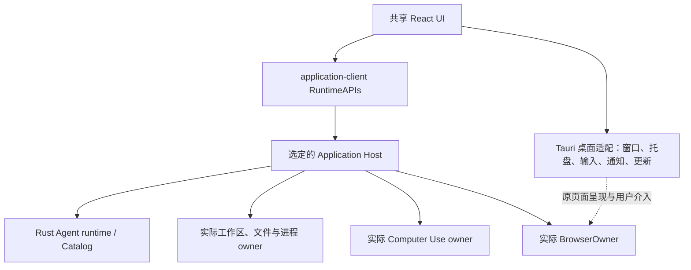

# Tauri 桌面迁移：完整体验、分布式能力与运行开销

状态：设计提案，2026-11-03。目标是以 Tauri 替换 Electron 桌面壳，保留完整产品体验，并改善运行资源与生命周期。本文未代表已完成迁移或已有性能对照结果。渲染组合的推荐和待确认事项见第 4 节。

## 1. 已确定的产品要求

Varin 是可跨设备组合的 Agent 平台。前端、Harness、工作区、Computer Use 和浏览器能力可以位于不同设备，桌面壳不应决定执行位置，也不应迫使纯远端客户端启动完整本地后端。

本次迁移保持以下要求：

1. **以 Tauri 为目标桌面壳。** 复用共享前端和原执行系统，最终完成替换；过渡期间的双壳用于迁移，不形成两套长期产品实现。
2. **完整保留功能与表现。** Chat、Bot、IDE、Mini Chat、桌宠、浏览器、Computer Use、设置、原生菜单、快捷键、托盘和更新等都在范围内。
3. **保留所有既定动效。** 布局、配色、动画曲线、持续时间、开合节奏、连续操作的反向衔接与可打断性均为产品合同。不能靠降低帧率、删除过场、静态替代或简化桌宠动作宣称性能改善。
4. **Browser Use 随安装包提供。** 浏览器运行环境、控制适配和必要资源一并交付；用户不需要额外安装 Chrome、配置可执行路径、开启调试端口或在第一次使用时下载缺失的浏览器组件。
5. **随包与常驻分开。** 安装时拥有完整能力，运行时只启动用户启用或任务实际需要的部分。
6. **使用更合适的实现。** 可以重做桌面适配、数据传输、缓存、合成和生命周期，保持用户可见效果。既有 Rust 执行权威与跨设备边界继续成立。
7. **不以本机为唯一目标。** Windows、macOS、Linux，以及 x64／ARM64 的现有交付范围都需要被具体处理。

由于完整 Chromium 浏览器随包保留，本次不以“移除 Chromium 后安装包只有几 MB”作为目标。重点是实际常驻成本、交互时延、资源回收和架构边界；安装包仍需避免重复运行时与无关产物。

## 2. 现有基础与 Electron 耦合

### 2.1 已经解耦的部分

当前核心会话、分支、Run、请求、队列、Operation 和执行事实由 Rust Catalog 管理；文件工作状态、对象、租约、进程回执和恢复由 Rust Storage 管理。共享 React UI 通过 application-client 的 RuntimeAPIs 访问可信 Host。

Application Host 仍包含 TypeScript 实现的模型账户、配置、资源准备、Documents、MCP、文档处理和 ComputerService 等协调能力。Knowledge 与部分原生库有自己的进程／运行时要求。因此“Agent runtime 已经 Rust 化”成立，但迁移桌面壳不会自动消除所有 JavaScript 服务。

现有 Electron 已允许关闭本地 Host，加载随包前端连接远端。Tauri 应沿用这一真实能力，把桌面生命周期进一步从本地 Host 启动中分离。

依据：[架构与状态归属](../architecture.md)、[本地 Host 模式](../../packages/electron/local-host-mode.ts)、[桌面合同](../../packages/application-client/src/desktop.ts)、[ComputerService](../../packages/web/application-host/lib/computer/DOCUMENTATION.md)。

### 2.2 需要迁移的实际耦合

| 当前使用 | 原实现 | 迁移责任 |
| --- | --- | --- |
| 本地 Host | Electron 主进程导入并运行 Web server | 将同一 Host 作为受管服务运行，保留注入接口和服务身份 |
| 桌面桥 | preload + IPC + 主进程校验 | 实现同一 `VarinDesktopBridge` 的 Tauri 适配 |
| 浏览器 | `WebContentsView`、持久 Session、Puppeteer/CDP、原生截图／下载 | 保留 BrowserOwner 合同，替换实际页面与呈现适配 |
| 网页渲染 | 每次请求创建隐藏 BrowserWindow | 使用统一受管浏览器基础，保留业务会话隔离 |
| 桌宠与反馈层 | 角色、场景、凳子、Computer Use 反馈等透明窗口 | 重建必要窗口关系、穿透、合成、DPI 和跨屏行为 |
| 子进程运行环境 | 部分工作进程复用 Electron 的 Node 模式 | 使用随包明确的 Node／原生可执行入口，不依赖用户系统安装 |
| 网络出口 | 注入 Electron Session 网络请求 | 补齐同等代理、证书、请求取消与流式网络行为 |
| 安装更新 | electron-builder、NSIS、自定义安装 UI、electron-updater | 保留用户体验与安装身份，重做产物和更新适配 |

入口：[Electron 桌面说明](../../packages/electron/README.md)、[启动与窗口](../../packages/electron/main.ts)、[BrowserOwner](../../packages/electron/browser-owner.ts)、[CDP 传输](../../packages/electron/browser-transport.ts)、[网络出口](../../packages/electron/harness-network-fetch.ts)。

现有主窗口、Mini Chat 和自动化浏览器使用 `backgroundThrottling: false`，浏览器页面可在隐藏宿主中继续存在。这是需要逐项核对的活动边界，不能据此直接全局开启节流：任务执行和可见动画有不同要求。

## 3. 目标职责与部署方式

Host 与各资源 owner 按原配置部署在本机或远端。图中的职责边界不要求每个方框各新增一个常驻进程，也不把 BrowserOwner 的逻辑独立等同于必须独立窗口或浏览器主进程。

| 场景 | 本机运行范围 |
| --- | --- |
| 纯前端连接远端 | 桌面壳、共享 UI、本机已启用的窗口／桌宠等呈现能力；不启动本地 Catalog、Knowledge、工作区或完整 Host |
| 本地执行 | 在前端之外运行原本地 Host、Rust 内核及实际需要的服务 |
| 远端执行、本机浏览器或电脑操作 | 按明确设备选择启用本机对应能力，通过原授权通道服务远端工作；不因此再起一个本地 Agent 执行 owner |
| 混合设备 | 各能力跟随其实际部署与配置，当前 UI 所在设备不成为默认资源替代者 |

浏览器客户端能力的远端登记与观察需要在现有 BrowserOwner 接口上补齐传输和呈现适配，不能把“Computer Use 已支持远端”当成浏览器跨设备链路也已完成。

桌面客户端离线时仍可打开连接管理、设置中属于本机的部分和启动恢复界面。远端执行中的工作不会因客户端断开而被误取消。远端不可用时保留其身份和错误，不静默创建本地替代会话。

## 4. 渲染组合：推荐与决策依据

### 4.1 当前平台事实

Tauri 的系统 WebView 路线在 Windows 使用 WebView2，在 macOS 使用 WKWebView，在 Linux 使用 WebKitGTK。不同平台的网页引擎和版本来源不同。WebView2 自身仍有浏览器、渲染和 GPU 等进程。[Tauri WebView 说明](https://v2.tauri.app/reference/webview-versions/) · [WebView2 进程模型](https://learn.microsoft.com/en-us/microsoft-edge/webview2/concepts/process-model)

截至本文核对日期，Tauri 官方的 CEF 集成位于 Tauri 3 alpha，提供 Chromium 和 CDP，但会随包带入完整浏览器及其运行成本；它不是 Tauri 2 的等价稳定配置开关。[Tauri CEF](https://v3.tauri.app/develop/cef/)

### 4.2 首选路线与备选

**首选设计方向是：系统 WebView 承载应用 UI，随包 Chromium 承载 Browser Use。** 它更符合纯前端和常驻总助手在未使用浏览器时减少活动组件的目标。Chromium 在本机确有浏览器工作时启动，二者不混用登录资料或权限。

**统一 Chromium 是保真与综合开销的对照路线。** Tauri 管理桌面生命周期，应用 UI 和浏览器使用统一 Chromium 技术基础，分别管理页面和会话。这避免两种引擎的兼容差异，也可能减少同时工作时的重复基础开销，但 UI 打开就需要 Chromium，且官方 Tauri 3 集成当前仍处于 alpha。

| 判断项 | 系统 WebView UI + 随包 Chromium | 统一 Chromium |
| --- | --- | --- |
| 普通聊天、远端客户端 | 浏览器服务可不启动，需测量真实 UI 成本 | Chromium 已用于 UI，优化集中在壳、页面和服务生命周期 |
| Browser Use 工作时 | 两种引擎可能同时运行，必须统计合计占用 | 可共用 Chromium 基础，实际进程共享由具体实现决定 |
| 视觉与 Web API | 需要逐平台适配现有表现 | 更接近当前 Electron 的统一渲染基础 |
| 页面嵌入与介入 | 需要落实 Chromium 页面与 Tauri 窗口的原生集成 | 使用 CEF 页面能力，同时核对其成熟度与平台实现 |
| 包体 | 仍含 Chromium，不能按轻量空壳估算 | 同样包含 Chromium |

在主界面、真实浏览器页面和桌宠完成代表性适配后，选择一个生产组合。只有首选路线保持完整体验且具有实际整体收益，才沿它完成迁移；若跨引擎适配或双引擎成本抵消收益，采用统一 Chromium。选型由实现证据决定，不自动降低功能。

这里尚未完成的决定是具体引擎组合与固定版本，而不是是否保留 Browser Use 或是否保留动效。最终生产包不会为了保留两条候选路线而打入多份 Browser Use Chromium；系统 WebView 的平台依赖和运行成本另行计入，也不把后端选择复杂度交给普通用户。

### 4.3 页面嵌入必须早于大规模替换

独立 Chromium 的远程调试连接只解决自动化，不能单独证明页面可原样嵌入 Tauri。选择系统 WebView 路线时，要先落实同机页面的原生子视图或完整浏览器合成接线，覆盖焦点、输入法、弹窗、上下文菜单、文件选择、拖放、缩放与截图坐标。

同机原生集成可以让浏览器呈现与 Tauri 位于同一宿主，执行控制仍沿 BrowserOwner 管理。不要先规定跨进程重挂一个独立 Chrome 窗口：跨平台的窗口组合能力并不相同。

如果使用离屏合成，必须提供同等交互与真实浏览器帧生命周期；静态截图刷新、丢失文字选择／输入法的远程画面不算等价交付。远端浏览器需要真实流与输入路由，不能伪装成本机原生页面。

## 5. Browser Use：随包、自动启动、完整可介入

### 5.1 交付与使用

安装包包含受支持架构的浏览器运行环境、必要资源和 Varin 自动化适配。包内资源与版本由发布清单固定。用户无需配置浏览器路径、端口或驱动，也不依赖其电脑是否安装某个浏览器。

浏览器无需在普通聊天启动时创建页面。首次用户打开浏览器或真实任务请求它时自动启动并准备，界面显示实际就绪状态；服务启动后复用原实例与会话。不可用时报告包内组件的具体问题，不退回要求用户安装 Chrome 的正常使用路径。

Browser Use、网页渲染等功能共用同一浏览器运行基础，但保留各自的 Session／Request Context。匿名抓取和第三方内容不能自动获得用户交互浏览器的登录状态，应用 UI 与任意网站也不共享特权桥。

### 5.2 保留的能力合同

- 原页面的创建、导航、标签管理、前进后退、frame、DOM／可访问性读取和脚本执行。
- 截图、坐标与视口身份的一致性，用户输入与 Agent 动作的串行关系及实际取消结果。
- 持久登录态、Cookie、页面弹窗、下载、上传、浏览器权限和文件选择。
- 用户在 Varin 内查看并操作 Agent 所用的同一页面；面板切换不重新打开一个相似页面替代它。
- 活动任务、用户明确保留页面、下载上传与执行中脚本的真实使用关系。
- 多窗口呈现和前后台转换，不错误销毁仍被任务或用户使用的页面。

复用现有 BrowserOwner 的逻辑身份与 Host 准入。Puppeteer/CDP 可以继续作为控制适配，只替换 Electron debugger transport；是否将部分控制移入 Rust，根据具体收益决定，不为语言统一重写所有已正确工作的逻辑。

如果继续使用 Node 自动化适配，在纯前端模式中仅为实际浏览器工作启动所需部分，不能为打开网页顺带启动另一套 Agent Catalog。

### 5.3 生命周期

页面存在与面板可见分别管理：面板关闭只解除呈现；原任务、用户保留或未完成传输仍持有页面。全部实际使用关系结束后关闭页面，浏览器不再有工作时释放可退出的服务。持久登录资料单独保存，不靠保留页面维持登录。

后台执行所需的页面继续获得正确的执行与观察机会；已无工作且不可见的呈现停止无用绘制。不得用统一后台节流或固定时间强杀，打断持续任务、下载或用户保留页面。

浏览器崩溃时保留明确失败和原会话关系，恢复读取状态；未知是否已经执行的点击、提交或付款等动作不能因重连而自动重放。

## 6. 本地 Host、Rust 内核与运行环境

本地 Host 从 Electron 主进程中移出，保持同一 Application Host 代码和服务身份。Tauri 只管理它的启动、观察、正常退出和更新交接，不成为第二个会话或存储 owner。

沿项目固定的 Node 运行时与已验证原生依赖构建随包服务。Tauri 支持携带外部服务可执行文件，用户无需安装 Node；无需为了换壳同时重写整个 Host。[Tauri sidecar](https://v2.tauri.app/develop/sidecar/) · [Node 服务集成](https://v2.tauri.app/learn/sidecar-nodejs/)

必须替换所有依赖 `process.execPath` 指向 Electron、或 `ELECTRON_RUN_AS_NODE` 的启动假设，包括 Knowledge 工作进程、扩展 broker、脚本执行与辅助进程。每种进程使用发布清单中的真实入口，正常跨平台发现环境与 PATH 逻辑保留。

Rust Agent runtime、Storage、Knowledge 各自保留原锁、数据库路径、协议与回收责任。即使 Rust 库可在 Tauri 中链接，也不能为了省一个进程把 Catalog 写入者、同步数据库工作或长任务塞入桌面事件循环。

本地 Host 可以随全功能包提供；纯前端模式不启动它。用户选择本地执行时自动准备，无需填写端口。切换远端不擅自停止本机已经受理的工作，关闭本地服务沿原明确操作与清理合同完成。

## 7. 桌面适配与通信

### 7.1 稳定前端合同

沿 `application-client/desktop` 实现 Tauri adapter，保留框架无关的命令、事件、窗口启动资料和能力判断。React 业务组件不直接调用散落的 Tauri API。

新增 `packages/tauri` 负责 Rust 桌面入口及平台适配。将 Electron 包中确实与壳无关的纯策略和类型放回已有共享模块；窗口对象、preload 和 Electron 事件留在旧 adapter，替换完成后删除。不要为迁移预先抽象所有小函数或制造第二套桌面状态库。

桌面原生层负责窗口、菜单、托盘、全局快捷键、系统剪贴板、对话框、文件关联、深链接、更新和必要呈现资源。工作区写入、任务、权限和工具执行继续经过原 Host／资源 owner。

### 7.2 按传输用途选择机制

跨设备业务调用继续使用现有 RuntimeAPIs、认证、HTTP／WebSocket 观察与背压。Tauri 本机 IPC 用于桌面能力，不绕过公开边界直接透传私有内核方法。

小规模通知使用定向事件；持续流使用有顺序、可取消的通道；二进制沿原始字节或受管对象路径传输。Tauri 的 Channel 面向流式传输，普通事件携带 JSON 字符串；原始调用也支持二进制 payload。[Tauri Channel](https://v2.tauri.app/develop/calling-frontend/#channels) · [原始二进制请求](https://v2.tauri.app/develop/calling-rust/#accessing-raw-request)

实现时减少重复序列化、Base64 转换、全窗口广播和重复订阅；不把所有 HTTP 调用再包一层本机 IPC。图片、页面帧和文件传输保持原数据 owner、取消及实际结束语义。

同一份消息历史不在壳中再保存副本。共享的桌面状态按明确目标发布；窗口只订阅自身需要的内容，销毁时释放订阅。浏览器网站、聊天 HTML 与受信主界面使用不同能力边界，任意加载页面不能获得桌面命令桥。

### 7.3 网络与系统集成

替换 Electron 网络注入时，保留系统代理／PAC、用户代理配置、证书验证、重定向、取消、流式响应和提供商错误语义；不能只用一个最小 HTTP 客户端替代后就宣称兼容。

WebView 的网络请求与模型／资源服务出口分别配置，避免 UI 能联网而 Host 请求绕过用户代理。Host 位于远端时使用远端自己的网络环境。

原生菜单、快捷键、窗口标题、系统通知、托盘和对话框继续跟随应用语言。浏览器原生权限、文件选择和操作系统自有界面保留平台行为。

## 8. 视觉、动画与渲染效率

### 8.1 保留体验，允许重做内部实现

共享 React 页面、设计 token、图标、字体配置、布局及动画资产继续复用。迁移的视觉基线包括亮暗主题、不同重点色、窗口缩放、DPI 和不同内容密度；不能只对齐空白聊天首页。

需要保留的行为包括开屏几何与相机过程、工作台／IDE／Bot 切换、浮层开合、长消息展开、流式文件预览、滚动跟随、输入框变高、桌宠演出及连续操作中断。

同一交互可以改用更适合的 CSS／WAAPI、Canvas、原生合成或 GPU 路径，但要保留可见结果和输入响应。遇到引擎差异就适配具体行为，不通过缩短动画、减少关键帧、禁用透明效果或统一降帧绕开。

### 8.2 资源与调度

- UI 切页提前准备真正需要的内容，沿既有提交边界切换，保留可反向的过渡状态，避免重复挂载触发整段过场重播。
- 活跃页面保有完整响应；隐藏页面保存必要状态并停止无用绘制，Agent 执行独立继续。
- 解析、布局测量和大数据变换离开动画热路径；先批量读取布局，再提交更新，避免每帧交错读写。
- 长聊天和列表沿实际可见范围呈现，保留阅读锚点、选择和展开状态，不用卸载整个会话制造“低占用”。
- 图像解码、图集、字体和合成资源按内容身份复用；已无使用者的资源退出缓存。不要为同一资源跨窗口反复下载和解码。
- 每个动画呈现层自己推进时间线；跨进程发送状态和动作边界，避免每帧重复推送完整 DOM／SVG 或场景对象。

性能优化应改变工作量、资源复用和执行位置。正常模式的观感保持完整，减少动效偏好继续使用用户已有设置。

## 9. 桌宠、多窗口与 Computer Use 呈现

桌宠目前有角色窗口、场景和临时装饰窗口。先按真实空间、遮挡、焦点和鼠标穿透需求确定窗口数量，不能为节省资源直接合并成一个破坏交互的大透明窗口。

无独立输入需求的装饰层，优先评估轻量原生／GPU 呈现；需要 Web UI 的部分保留 WebView。原生呈现是本项目需要实现的适配，不假定 Tauri 已提供完整的桌宠合成器。

角色动画、凳子位置、任务成员演出和临时道具沿现有身份与时间线协作。显示、隐藏、抓起、落下、跨屏、置顶／取消置顶和主题变化都保留原效果。纯装饰窗口不加载完整工作台、Host 客户端和业务 store。

Mini Chat 和附加聊天窗口持有各自真实会话启动资料；不能因共享桌面壳让后打开的窗口覆盖前一个窗口的 Host／凭据。关闭一个窗口只结束其观察，不自动停止其他窗口和远端工作。

Computer Use 的执行继续归原 ComputerService、driver、输入 lane 和远端分配。Tauri 仅替换本机控制条、反馈层、捕获呈现等桌面适配。截图对象选择、权限授权、用户接管和停止仍核对实际设备与执行身份。

## 10. 启动、退出与故障恢复

### 10.1 启动

先加载随包前端、基础主题和本机连接偏好，再连接用户选择的 Host。启动画面沿原设计展示，后端就绪只推进一次有效交接，不用重建窗口反复重播动画。

本地模式按原受管服务启动 Host；远端模式直接连接远端。本机浏览器、Computer Use 和桌宠按实际启用情况准备。普通窗口初始化不枚举或启动全部可选服务。

桌面进程不能同步等待长时间数据库、文件或网络工作。各项准备具备真实状态，错误作用于对应能力；连接失败保留恢复入口，不能启动一份空数据替代旧状态。

### 10.2 退出与更新

关闭窗口、隐藏到托盘、退出客户端、停止本地服务和安装更新分别定义。保持现有用户选择与任务风险提示，不新增处处确认的流程。

退出时先让前端结束编辑／观察并完成必要请求，再排空本机归本应用管理的服务，最后退出壳。保留正确的反向取消：窗口阻止关闭时不能已经杀死它依赖的 Host。

客户端关闭不会停止远端任务。由应用随进程启动的本地服务沿原退出语义处理；用户明确部署的独立 Host 不能被当作临时子进程杀掉。取消或断开连接仍不代表实际工具已经停止。

单实例、正常重启、更新重启和自启动各有明确触发者。不能因为后台子进程仍在就误判用户又启动了一次，也不能让更新失败进入自动反复拉起。窗口标题与进程展示名保持 Varin，不使用临时目录、随机标识或连接令牌。

## 11. 用户数据、登录与协议延续

### 11.1 数据位置与唯一 owner

保持现有用户数据目录、安装标识、Host 身份、会话 ID、工作区登记与配置资产。Tauri 默认目录不能直接替代现有路径而让用户看到“全新应用”。

Catalog、Storage 和 Knowledge 由各自 owner 打开原数据；桌面迁移本身不触发整库复制或格式变化。确实需要结构更新时沿原自动升级合同，保留回执和引用，不重放已执行工作。

过渡双壳不能同时启动两个同库 writer。比较时使用明确隔离的运行配置或同一个远端 Host；公开安装切换由单实例与原服务退出边界交接。

### 11.2 前端偏好与凭据

不同网页引擎、origin 和存储目录可能无法直接共用 localStorage／IndexedDB。迁移需明确导出原前端偏好与持久 UI 状态，通过原设置 owner 提交后记录完成标记。不要并发读写旧引擎的私有存储文件，也不把所有浏览器缓存整目录复制到新位置。

确需旧引擎读取的数据由受控的一次性迁移入口提取，只处理实际应用 origin 和已知产品资料。迁移失败保留旧有效数据与可重试阶段，成功后清理本次临时产物；迁移工具不成为永久双写后端。

账号凭据继续使用原秘密存储合同。系统密钥和加密内容不能通过 renderer 明文迁移或写入日志。

内置浏览器登录资料需要单独验证 Chromium profile 格式与平台加密上下文的迁移。不能假定 Electron Session 目录直接交给另一 Chromium 就能解密，也不能把保留原会话资料简化成让所有用户重新登录。具体不可迁移的站点会话应准确提示，其余可迁移资料保留；这一边界需要在引擎定版时解决和记录。

## 12. 安装、更新和跨平台交付

发布继续使用同一版本与不可变构建候选，复用共享 Web、Host、Rust 内核、扩展与原生依赖构建产物。Tauri 产物新增自己的构建节点，避免重新编译／复制多份相同服务和浏览器。

安装器保留现有视觉、目录选择、更新／卸载和明确数据清理行为。Windows 的 WinFsp 等已有可选工作区组件沿原设计处理；普通 UI 和 Browser Use 不把它们作为前提。

系统 WebView 路线的 Windows 安装器需处理缺失或版本不符的 WebView2；安装流程自行完成，不要求用户手工查找运行时。Tauri 官方提供 bootstrapper、离线安装和固定版本等方式，最终按支持范围与重复包体决定。它与随包的 Browser Use Chromium 是两项不同依赖。[Windows 安装选项](https://v2.tauri.app/distribute/windows-installer/#webview2-installation-options)

macOS 保留 bundle 身份、签名、公证、菜单、输入法、系统授权和透明窗口行为。Linux 明确处理 X11／Wayland、窗口层级、托盘、WebKit／CEF 依赖及现有发布格式，不以 Windows 结果推断其他平台已完成。

每个现有目标架构需要可交付的浏览器二进制、原生库和签名方案。缺少某平台／架构的可用组件属于引擎组合未完成，不能发布时静默删掉 Browser Use 或该目标。

Electron 与 Tauri 更新器的元数据和签名合同不同。过渡发行需让已安装 Electron 能获得正确的替换安装包，安装完成后再使用 Tauri 更新链路；不把两种 feed 直接互换，也不发布会重复下载／安装自身的循环更新。Tauri 更新签名与操作系统签名分别维护，密钥沿原发布秘密管理。[Tauri 更新器](https://v2.tauri.app/plugin/updater/)

迁移不要求将现有 Android 移动端同时改成 Tauri。移动端与 Web 继续消费共享前端和公开 API，既有发布目标与签名不受桌面替换打断。

## 13. 性能目标与必要证据

设计目标是保持完整表现，同时降低纯前端与普通常驻成本、减少交互期间的多余工作，并使资源在真实使用结束后释放。目前不填写未经测量的节省比例或绝对内存承诺。

比较使用同一版本前端、同一数据与配置、相同窗口和任务状态。统计整个相关进程树、GPU 资源和实际服务，不只看 `Varin.exe` 主进程，也不直接把共享内存重复相加。

| 场景 | 关注内容 |
| --- | --- |
| 纯远端客户端，主界面空闲 | 常驻内存、CPU 唤醒、启动时延；确认未运行无关本地 Host／数据库 |
| 长聊天与流式输出 | 滚动、输入延迟、帧时间分布、历史与图片资源增长及回收 |
| 工作台／IDE／Bot 连续切换 | 完整过场、目标视图提交、快速反向切换与输入响应 |
| 桌宠工作与跨屏拖动 | 动作完整性、透明层合成、鼠标穿透、GPU 和解码资源 |
| Browser Use 与用户介入 | 主 UI 与浏览器合计占用、页面交互、登录、上传下载和视口一致性 |
| 本地与混合执行 | Host／Rust／资源服务的真实负载、界面隔离和退出清理 |
| 重复开关面板、窗口与任务 | 进程、订阅、句柄、纹理与缓存是否持续无主增长 |

正确性用原 owner 的针对性测试与关键集成路径保护；窗口和绘制差异用有代表性的实际场景判断。无需每次小改都跑全套平台或长时间压力测试，也不能拿空壳 demo 的数字代替完整 Varin。

最终引擎选择以完整体验下的合计表现为准。若某个方案降低空闲占用却显著恶化常用浏览器或桌宠体验，需要调整组合或实现，而不是把退化留给用户接受。

## 14. 实施顺序与完成定义

| 阶段 | 交付内容 | 达成依据 |
| --- | --- | --- |
| 桌面边界 | 建立 Tauri adapter，复用共享前端和桌面合同；连接远端模式不启动本地 Host | 真正的 Varin 页面、连接管理和基础窗口行为可用 |
| 引擎组合定版 | 同一真实场景比较系统 WebView＋内置 Chromium与统一 Chromium，先落实页面嵌入、透明窗口和平台架构 | 保留同页用户介入、动作效果与全部目标能力；记录最终选择与具体版本 |
| 本地运行环境 | 原 Host 独立受管启动，Node／Rust／扩展／Knowledge 的明确入口与退出 | 本地任务、重启、停止与原数据读取完整工作 |
| 浏览器交付 | 随包运行时、BrowserOwner、网页渲染、自动化、登录和文件传输 | 未安装额外浏览器的环境也能直接使用，隐藏／显示仍为同一页面 |
| 桌面体验 | 桌宠、Mini Chat、Computer Use 反馈、菜单、快捷键、主题、语言、动画与滚动 | 现有用户可见效果和交互逐项对齐，资源生命周期改进有效 |
| 安装升级 | 原数据与偏好、浏览器资料、安装身份、双更新链路交接及各平台产物 | 旧安装可正常升级，后续更新和卸载完整，临时迁移资源可回收 |
| 替换收敛 | 移除生产对 Electron 运行环境的依赖，更新构建与领域文档 | 单一正式桌面壳，服务仍可独立部署；保留无其他壳消费者的代码只为历史时应删除 |

这些阶段是依赖安排，不代表只完成聊天首页就能称为迁移完成。真实阻塞应落到具体平台行为或组件能力，不能以静默降级、删除功能或要求用户额外配置解决。

最终交付同时包含：Tauri 主壳、完整随包 Browser Use、现有本地／远端运行能力、完整视觉动效、用户数据与更新连续性，以及可核对的整体资源改善。

## 15. 实现前需要定版的事项

以下均为具体工程决定，不是需要用户重新选择是否保留功能：

- 渲染组合及 Tauri／CEF／系统 WebView 的实际支持版本。
- 本机浏览器与主窗口的原生呈现方式，以及远端页面的完整交互通道。
- 桌宠哪些层继续使用 WebView，哪些层适合原生合成；依据空间行为与实测结果决定。
- Electron 浏览器登录资料与前端持久偏好的自动迁移机制。
- 各平台／架构的浏览器产物、系统依赖与旧更新器到新安装器的交接。

完成后将当前实现说明并入[架构](../architecture.md)、[工作台](../workbench.md)、[开发与构建](../development.md)及对应桌面／浏览器模块文档。本文保留到迁移完成并完成领域文档收敛。
