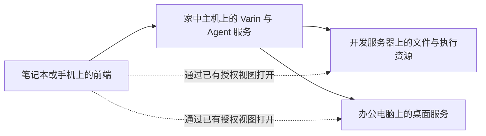

# Varin 总助手：持续交流、工作概览与设备空间

状态：2026-11-05 讨论形成的设计方案，待实施。本文以 main `fe8a3ab97` 的现有能力为起点；第 2 节区分已有实现与本轮变化，后续章节描述目标行为，不作为已经交付的功能说明。

本文接续[长期总助手](bot-assistant.md)、[Bot 界面](bot-ui.md)和[聊天正文与交互内容](conversation-content-and-interaction.md)。本轮调整聊天的组织方式、持续工作入口、消息发送默认、电脑与文件空间，以及连接流程。既有身份、记忆、任务复用、交互内容和形象设计继续沿用。当前运行合同见 [Bot](../bot.md)、[协作](../collaboration.md)、[资源](../resources.md)、[工作台](../workbench.md)及[交互内容](../interactive-content.md)。

## 1. 产品判断

Varin 是与用户长期合作的总助手。它通过交流理解情况，直接处理事情，组织其他 Agent 的工作，并把结果接回正在进行的对话。用户可以随时查看实际过程、打开成果、介入执行，再回到同一段交流。

直接工作是正常能力。读取刚收到的材料、修改一段文字、查询进展、调整安排等小事，可以就地完成，省去交办和重新建立背景的成本。复杂问题也可以由 Varin 本身深入讨论。独立探索、制作、验证或已有执行者负责的事情，则可交给相应 Agent 持续推进。

如何分工由模型结合当前需要判断。交接成本、已有背景、独立工作上下文和保持交流可用性都可能影响选择；产品不据工具调用次数或固定耗时强制派发，也不预设总助手必须使用中等模型或低思考等级。模型与思考配置继续尊重用户选择。

聊天应支持这样的连续过程：用户交代一件事，Varin 就眼前的问题交流并开始处理；工作继续进行时，用户补充要求、问另一件小事或查看执行现场；有值得沟通的结果时，再接回相应话题。一次执行结束、一个 Agent 回报和面向用户的一次答复各有自己的含义。

本轮确定的方向：

| 方面 | 设计决定 |
| --- | --- |
| 交流 | 保留开放正文、图像、表格、选择、可编辑结果与 HTML；按内容组织，不统一套成聊天气泡 |
| 进展 | 系统呈现真实动作和状态，Varin 自行表达发现、判断与需要讨论的内容 |
| 工作概览 | 现有 Bot 侧栏以正在跟进的事情为主体，聊天保留相关工作和成果入口 |
| 新消息 | Varin 默认立即补充到当前交流，与普通 Agent 的发送偏好独立配置 |
| 执行现场 | 电脑与文件可在 Varin 内直接打开；完整执行记录继续使用原工作台 |
| 分开部署 | 前端、Agent 服务、文件与执行资源、桌面可以分别位于不同设备；界面清楚显示实际来源 |
| 连接 | 添加资源设备、切换 Varin 服务、配对访问客户端使用不同的操作入口与说明 |
| 连续性 | 复用原任务、事项、文件与作品身份；记忆延续理解，实时进度读取原工作 |

## 2. 已有基础与本轮缺口

以下是设计起点，不据文档中的历史“已实施”标记推断功能完整性。

| 当前基础 | 本轮需要改变或补齐 |
| --- | --- |
| `BotWorkspaceShell` 通过 `ThreadConversation(surface="bot")` 显示消息；有 Bot 形象、会话导航与右侧面板 | 在共享组件之上建立总助手的交流与持续工作衔接，不只换首屏或增加工具卡 |
| Bot 面板已有概览、动态、记忆、日程；概览展示待处理、运行工作摘要、最近回报等 | 让当前工作的具体内容更容易扫读，并联动其成果、电脑、文件和原执行现场 |
| 消息通过既有 enqueue 路径投递，当前 UI 共用 `followUpBehavior` | 新增 Varin 独立默认；明示受理和接收情况，区分补充交流与后续排队 |
| 聊天支持正文交互、HTML、原生引用，工具有各自的用途组件 | 围绕实际交流选择表现方式，降低普通过程和原始回执的存在感 |
| `ComputerDesktopPane` 已有画面流、VNC 适配、人工接管及交回；`ComputerWorkSurface` 可在工作台中打开 | 在 Varin 提供直接入口，展示真实桌面、操作者和所属工作，保留当前聊天 |
| `FilesView`、`SidebarFilesTree`、`FilesExplorer` 提供当前工作区的浏览、编辑及部分文件管理操作 | 提供显式选择资源来源的独立文件界面；补齐上传、移动等实际缺失的 GUI 与 owner 接线 |
| 工作连接页已区分 Agent 与资源，其他页面提供 Host 切换、配对、SSH 和桌面配置 | 整理连接目的与入口，减少页面跳转，按能力展示连接结果 |

已有文件树基于当前工作台的 workspace/root，不是可以独立选择任意资源 owner 的文件管理器。具体文件操作能否在远端来源成立，仍要沿对应 API 与 owner 补齐，不能只加一个设备下拉框就宣称完成。

已有 Computer 链路是本轮复用的基础。设备配置存在、服务可达、桌面可观察与可以输入是不同事实，入口分别展示实际状态。

## 3. 交流、事情与执行的关系

用户交谈的内容不必都变成一项任务。一个问题可以直接得到回答；一个简短操作可以直接产生结果；需要持续推进的事情才需要稳定的跟进入口。

| 对象 | 在体验中的作用 | 状态来源 |
| --- | --- | --- |
| Bot 会话 | 承载交流、用户选择与原始消息 | 原 Thread、branch 和消息记录 |
| 正在跟进的事情 | 联系多次交办、讨论与成果 | 已有 matter 及其关联的原工作；尚未建立 matter 时沿原工作引用展示 |
| 执行者与执行记录 | 提供实际工作过程、调用、问题和回报 | 原 Agent 或外部 Harness 身份及其执行 owner |
| 文件与作品 | 可以查看、修改、引用和带走的成果 | 原文件来源、文档或作品及其修订 |
| 电脑与文件空间 | 用户与 Agent 共同使用的环境 | 真实设备、desktop、资源连接与执行视图 |

已有 matter 可以聚合相关工作；没有 matter 的任务仍然可见，不要求模型先登记事项才能开始。Varin 直接处理且仍在持续的工作，也应显示在概览中。简短已完成操作不必额外留下一个长期事项。

界面依据原关联聚合，不按相似标题、同名 Agent 或文字关键词自动合并任务。一次 Run 结束不自动意味着事情完成；同一 Agent 再次接到工作也不必新造一个无关联的展示对象。

历史正文保留当时的陈述与交付版本。工作入口可以展示当前状态和新成果，并提供回看旧版本的路径；更新实时状态不改写过去已经说过的话。

## 4. 聊天的组织与节奏

### 4.1 正文围绕正在交流的内容

保留已有阅读排版。简短确认可以只有一句话；分析可有段落、比较和依据；选择放在对应问题旁边；文件、图片和交互作品在有关正文处呈现。用户要求的简洁答复、完整报告或指定格式优先。

短操作可以直接给结果并保留一条可展开活动记录，无须每次增加“开始执行”和“执行完成”的仪式性消息。需要持续工作时，正文可以说明安排，并附原工作的轻量入口。模型不必每回合使用相同版式。

沿用三种聊天展示模式及用户已有选择。Varin 默认强调交流与相关结果；需要过程细节的用户仍可展开或切换展示方式。普通 Agent 保留自己的阅读与执行习惯，共用有益的排版和交互基础。

### 4.2 真实状态与自然进展

系统能够确认的事实进入状态呈现，例如正在读取的文件、当前调用、等待的执行者、已送回的回报。对工作的理解由 Varin 在正文表达，例如发现了计费口径差异、决定调整方案或希望用户作出取舍。

状态行展示当前能确认的动作；没有公开的具体动作时，可以显示思考或准备状态。公开思考沿现有用户偏好展示。系统不从文件名、工具名或耗时编造“已完成分析”“正在比较方案”等语义判断，也不生成虚假的百分比。

进展表达不要求每个工具调用都产生一段说明。有意义的发现可以成为正文，重复的执行细节留在过程记录里。子任务回报进入原协作记录，Varin 再决定哪些内容需要接回当前交流；原始回报仍能打开查看。

### 4.3 当前交流与后台工作同时可见

当前回复附近显示 Varin 此刻的动作；长期进行的工作保留在侧栏。等待执行者返回时，状态应明确等待对象，不把整段时间都表现成 Varin 正在思考。

工作结果到达、Varin 已处理回报、Varin 向用户公开回复分别呈现。模型暂未读取回报时，界面可以如实标明结果已返回，不把原始回报伪装成 Varin 已经理解的答复。

正在处理另一话题时，普通后台事件更新原工作状态。重要结果可以通过相关工作入口和 Varin 后续回复进入交流；不让每个 Agent 完成事件都弹出通知或自动滚动聊天。

## 5. 工作概览与入口布局

在现有 Bot 侧栏中保留形象和状态，把主要内容空间留给需要用户处理的事项与正在跟进的工作。记忆、动态和日程仍有原入口，不必全部挤进默认概览。

示意排布中的内容来自实际工作和环境：

```text
Varin                                      当前状态

正在跟进                                    查看全部

发布页面
正在调整移动端布局                    成果  查看工作

整理汇报材料
有一个问题需要你决定                         查看问题

电脑   办公电脑 · 正在使用
文件   网站项目 · 开发服务器
```

每项工作首先呈现名称、当前实际状态和相关入口。执行者头像辅助识别；多层 Agent 分工在展开后查看，不能占据概览主体。需要用户回答或授权时，在对应工作处说明原因并打开原请求。

原问题或权限可以在 Varin 的工作详情中呈现并提交到原 owner，深看执行背景时再进入工作台。使用同一请求身份和处理结果，避免在总助手里另造一份互不关联的问答或授权。

默认强调当前会话的相关工作，同时提供“全部工作”范围以查看该 Bot 其他会话发起或明确跟进的事项。跨会话条目显示来源，返回原会话继续交流；全局数量明确其范围，不能把所有工作都写成当前会话派发。

成果已返回但仍待讨论的事情继续可见。完成后进入最近成果和历史，不长期占住进行中列表。完成与未读是不同状态，查看结果不会替模型宣布整件事情完成。

点击工作名称先打开简明详情与当前成果；进入完整执行过程时使用原工作台，保留返回点。直接打开电脑、文件或成果时，聊天可以留在旁边。窄窗口使用可返回的独立页面，保留草稿、阅读位置和已选对象。

概览可随面板高度收纳，但始终提供完整列表入口；屏幕布局不限制可以同时存在的工作数量。状态变化原位更新，不因每条新事件让整列重新排序、跳动或重播入场。

## 6. 默认插队与消息交接

### 6.1 独立设置与适用身份

设置分别表达“与 Varin 交谈时”和“普通 Agent 执行任务时”的发送行为。Varin 未配置时采用立即补充；普通 Agent 保留既有默认与用户选择。新增偏好沿原设置存储与设置工具读取、修改，不另建一套本机专用配置。

适用规则依据该 Thread 是否为 Bot 的直接会话。即使在工作台打开同一 Bot 会话，也使用 Varin 的发送偏好；派发出去的普通 Agent 不因为属于某个 Bot 就改用 Varin 偏好。Shell 只影响呈现。

输入框不恢复每次发送前的模式选择器。用户可以明确选择把某条内容排在之后，既有排队消息仍能立即发送。已经受理的消息保持原投递语义，修改默认只影响之后的发送。

### 6.2 插队的含义

立即补充沿已有当前执行的输入边界投递，让 Varin 尽快把新消息纳入后续理解；正在执行的操作仍有自己的完成或停止过程。插队本身不等同于取消当前模型请求、终止命令或中断文件写入。

已经进入某次模型请求的输入保持固定。新消息等待可接收边界时，界面说明已受理且待接收；收到实际接收事实后再更新状态。不能把请求提交成功直接显示成“Varin 已经理解”。

有独立后台工作时，Bot 当前会话继续受理新交流。若 Bot 自己正占用当前执行回合，新消息仍沿真实边界进入，不创建第二个同时改写同一上下文的 Bot loop。改善及时性要处理实际等待与输入边界，不能只改按钮文案。

Varin 正在等待子任务结果或可取消的观察时，新用户消息应能沿既有唤醒机制结束这一次等待，让已知进展与新消息进入下一次推理。停止等待不停止被观察的任务、进程或日程；事件随后仍沿原入口送达。实际调用仍在执行或模型请求尚未结束时，按对应 owner 的可接收边界处理，并如实显示待接收状态。

### 6.3 发给谁、影响什么

普通输入默认发给当前 Varin 会话。Varin 根据内容决定回答、调整当前工作、向已有 Agent 补充或开展新工作。用户明确引用某项工作、文件或电脑时，随消息携带其真实引用，帮助消除指向歧义。

工作详情中的“给执行者发消息”等明确操作直接使用原收件人。前端不根据关键词自行向多个任务广播，也不把用户的每条新话机械当成最近任务的修改要求。

“停止当前回应”和“停止这项工作”分别指向原执行对象。停止请求、已停止与尚待确认的反馈沿现有状态表达；取消某一工作不连带取消其他工作。用户直接介入原工作台后的重要变化，沿已有反馈路径回到 Varin。

## 7. 电脑作为可以进入的工作环境

### 7.1 入口与打开方式

Bot 侧栏提供常用电脑入口；工作详情提供该工作实际使用的电脑入口。名称由用户命名和设备登记信息组成，可以使用“办公电脑”等友好名称，详情始终保留真实设备与 desktop。

多个桌面可以选择和固定。当前工作明确绑定桌面时优先提供对应入口；用户已打开另一台桌面进行查看时，后台切换目标只更新相关工作入口，不突然替换眼前的画面。

打开后复用现有 `ComputerDesktopPane` 与桌面服务。桌面可在聊天旁边查看，也可放大；画面适配窗口，必要时允许缩放和查看原尺寸。使用已有实际画面传输方式，不能用装饰性的“虚拟电脑画面”代替运行中的桌面。

### 7.2 控制权与工作关联

视图清楚显示设备、当前操作者及关联工作。执行者是子 Agent 时显示其真实身份，不能统一标成 Varin 正在操作。

人工接管沿现有控制权交接，交接未完成时呈现处理中，完成后才允许输入。交回后执行者沿原机制重新确认现场再继续。接管桌面只改变相应桌面的输入控制，文件、检索和其他设备上的工作保持各自生命周期。

关闭视图结束观察，不停止后台任务。断开画面与任务停止分别表达；保留最后画面时明确它是最后已知画面。连接或驱动不可用时给出对应原因和恢复入口，不能用一个总的“设备离线”覆盖仍然可用的文件能力。

## 8. 独立文件管理界面

### 8.1 空间选择与来源

文件界面可以从侧栏、工作详情、成果引用和全局文件入口打开，不要求用户先建立项目或进入 IDE。它以显式资源来源和根位置为上下文，可包含设备盘符、目录、项目及独立工作区。

位置列表提供常用来源和目录；主体提供面包屑、目录列表与预览。标题持续显示设备或资源连接及路径，例如“开发服务器 · /srv/website”。文件查看、预览和编辑沿实际来源读取，不能临时借用全局当前工作区。

从任务打开时，默认进入任务实际使用的文件视图。独立工作区明确标注其归属，项目原目录仍可另外打开；不能因底层路径相似把两者混为一处。文件界面遵守原设备账户与授权，不额外要求项目登记或添加一套文件白名单。

### 8.2 文件操作与交谈

提供目录浏览、搜索、预览、上传、下载、新建文件或目录、重命名、移动、复制和删除。支持的预览沿用已有文件、图片、文档等查看器；需要编辑时打开原编辑器。无法预览的格式仍有原文件与下载入口。

上传显示目的地，下载明确来自哪里；操作进度与错误属于实际传输或文件事务。跨来源复制使用已有资源传输机制；请求移动时，以目标写入成功的回执继续源删除，部分完成如实显示，不把半完成的移动包装成成功。

选中文件可以引用到当前聊天，或交给指定工作。界面携带真实资源引用，文件交接链路负责版本、读取位置和必要的传输；用户与派发者不需要先手动判断收件人能否访问同一路径。文件已经在同一来源时沿用原读取能力，避免无意义地下载到前端再上传。

编辑与保存复用 Documents、Files、Workspace 等既有 owner 和恢复机制。上传下载的授权来自原目标，不能把前端能访问的 URL 自动当成 Agent 可访问的文件来源。

## 9. 设备连接体验

### 9.1 三种不同目的

| 用户操作 | 应当发生的变化 |
| --- | --- |
| 添加设备 | 让当前 Varin 可发现并使用这台设备实际提供的资源能力 |
| 切换 Varin 服务 | 打开另一处服务及其会话目录，按现有连接切换保存草稿与视图 |
| 让其他设备连接我 | 为手机或其他前端建立访问当前服务的配对 |

这三种操作分别命名。日常资源入口不要求理解 Host、Catalog 或 relay。服务切换仍有清楚入口；配对页面说明连接方向，不把“允许另一客户端访问”表现成“当前 Agent 已能操作另一台机器”。

### 9.2 添加设备的过程

从“添加设备”开始，按实际支持方式提供连接地址或 SSH 等入口；已有配对能力在其适用的连接方向使用。用户选择方式后再展开相关配置，已有凭据和连接能够复用。

连接后展示识别到的设备与能力，例如文件、执行环境、桌面。每项能力显示自己的可用状态。用户可以命名、选择常用入口，再完成接入；接入成功本身不迁移已有任务，也不默默改写所有新任务的默认资源。

需要进一步部署或启动服务时，说明缺少的实际能力与对应操作。详细地址、SSH 转发、身份验证和诊断仍然可看，但不占用日常入口的主层级。

### 9.3 谁能到达谁

检查在真正使用资源的一端执行。前端访问当前服务成功，只能说明这段链路可用；Agent 服务能否访问文件或桌面，需要沿实际资源路径检查。

连接错误直接指出有关的一段，例如“Varin 服务无法连接开发服务器”“桌面服务未启动，文件访问正常”。已登记但暂时失联的设备保留其入口与状态，恢复后继续原身份。

当前资源连接沿 Agent Host 的 HTTP owner 管理，SSH 与 localhost 地址也归该 Host。客户端 relay 登录不自动提供资源路由。向导应复用已有可成立的 HTTP(S)、SSH 转发与托管连接；若需要新增资源中继支持，应在原连接服务补齐真实通路，再声明能力可用。

## 10. 分开部署的统一呈现

以下是需要成立的典型布局，各节点可以同机，也可以分别部署：



虚线表示用户打开有关界面的体验关系，不要求浏览器直接访问目标服务；实际传输仍走原鉴权与路由。

界面允许分别打开“文件 · 开发服务器”和“电脑 · 办公电脑”，工作详情关联其实际使用的资源。它们打开时保持当前 Varin 会话、输入草稿和其他视图。设备提供多种能力时可以聚合呈现；只有确切身份关系才能据此聚合，不按相同显示名称推断同一设备。

查看另一空间不会改变正在执行任务的来源。新工作可以按本次选择使用其他资源；已有工作继续绑定已受理的来源与环境，实际迁移沿原有能力完成。

## 11. 上下文、记忆与提示词

沿用总助手的开放职责提示：帮助用户理解和处理事情，可以直接工作，也可以与其他 Agent 合作，按实际需要组织工作与交流。本文中的界面栏目、场景和验收点不改写成模型每轮必须执行的步骤。

平台从已有调用、工作关系、文件和设备身份生成状态与原生入口。模型需要表达判断或设计交互内容时使用现有能力，不为每个状态行、图标、进度入口重新写展示文案，也不新增一次必经的呈现决策模型调用。

当前对话与有关增量继续沿原输入、上下文整理和记忆机制处理。用户点选的工作、文件、电脑与作品版本作为实际引用进入消息；不把所有设备目录、全部工作快照和每个界面点击反复注入上下文。

相关的持续工作和历史可以按原引用读取。用户在工作台的直接介入、回报与已确认的变更沿现有 Bot 反馈路径到达；记忆保存需要延续的理解，实时任务状态仍读取原工作。

## 12. 布局、动效与性能

桌面端允许聊天与电脑、文件、工作详情并排；侧栏是概览和入口，放大后的工作视图有明确返回位置。移动端和窄窗口切换到可返回的单独页面，保留原会话草稿与阅读锚点。

复用已有形象、线性图标、排版和主题。形象表达真实注意力与状态，不能以持续忙碌动画替代缺失的状态。正文、当前动作、工作摘要和技术诊断各有层级，结果按内容采用自己的布局。

展开、收起和工作视图切换沿现有可打断动效。内容更新优先保持原节点与阅读位置，用户正在查看的对象不被自动替换；正在阅读旧消息时，新进展更新入口而不强制滚到底部。

电脑画面只在实际查看时订阅，关闭或隐藏按原视图生命周期释放观察资源；执行寿命保持独立。文件浏览分页或增量载入，预览按需读取。概览复用事件和已有事实投影，避免每条消息重新扫描所有文件、拉取所有聊天或打开全部桌面。

布局中的摘要长度、预览高度和可见行数服务排版，可展开和续读；不转换成执行配额、任务数上限、消息上限或新的权限门槛。

## 13. 实现归属与完整交付顺序

| 范围 | 主要入口与职责 |
| --- | --- |
| 总助手外壳与面板 | [BotWorkspaceShell](../../packages/ui/src/workbenches/bot/BotWorkspaceShell.tsx)、[BotOverviewPane](../../packages/ui/src/workbenches/bot/BotOverviewPane.tsx)、[useBotFacts](../../packages/ui/src/workbenches/bot/useBotFacts.ts)：组合当前交流、工作与环境入口 |
| 消息默认与状态 | [ThreadConversation](../../packages/ui/src/components/thread/ThreadConversation.tsx)、[messageQueueStore](../../packages/ui/src/stores/messageQueueStore.ts) 和原设置持久化：按真实会话身份解析默认，沿原投递与接收事实呈现 |
| 内容与原生引用 | [交互内容](../interactive-content.md)及共享 conversation 组件：继续使用原消息、作品和动作身份 |
| 桌面查看 | [ComputerWorkSurface](../../packages/ui/src/components/sections/computers/ComputerWorkSurface.tsx)、[ComputerDesktopView](../../packages/ui/src/components/sections/computers/ComputerDesktopView.tsx)及 [ComputerService](../../packages/web/application-host/lib/computer/DOCUMENTATION.md)：复用观察、接管和路由 |
| 独立文件空间 | [FilesView](../../packages/ui/src/components/views/FilesView.tsx)、[SidebarFilesTree](../../packages/ui/src/components/layout/SidebarFilesTree.tsx)、[FilesExplorer](../../packages/ui/src/components/workbench/FilesExplorer.tsx)和原文件/文档 API：使视图绑定显式来源，补齐缺失操作 |
| 连接入口 | [WorkConnectionsPage](../../packages/ui/src/components/sections/connections/WorkConnectionsPage.tsx)、[RemoteInstancesPage](../../packages/ui/src/components/sections/remote-instances/RemoteInstancesPage.tsx)、[DesktopHostSwitcher](../../packages/ui/src/components/desktop/DesktopHostSwitcher.tsx)：按连接目的重组，继续使用原 owner |
| 任务与资源事实 | 原 Catalog、Bot 服务、文件资源和桌面服务：补充实际缺失的查询或动作能力，不在 UI 另存任务状态库 |

实施先确定持续工作的原引用、实际 Bot 会话判定及独立资源视图上下文，再接通消息默认与概览；随后把电脑、文件入口接入同一会话，并贯通设备连接流程。最后统一窄窗口、状态反馈和动效。这是依赖顺序，完整交付范围包括以上所有链路。

需要在实现时核实的接口细节：独立远端文件上下文如何接入现有 API 工厂，上传/移动等操作缺在哪一层，以及 Bot 输入的接收事实如何在现有队列 UI 中准确呈现。选择依据是当前 owner 的能力和实际数据，不先堆一套通用连接配置或新调度层。

## 14. 体验验收场景

验证围绕本轮变化选择，使用已有行为测试和可控的真实 owner 场景。无需为文档阶段启动完整部署环境；跨设备交付时按实际支持的平台与通路补足证据。

1. Varin 直接读取材料并回答，用户无需看到一次完整的“任务启动—结束”流程；原活动和文件仍可查看。
2. 持续工作已派发时，用户问另一件小事，Varin 可在当前会话接住交流；后台工作保持原身份。
3. Varin 自己正在执行时收到补充，界面准确显示受理和接收；等待子任务时能因新消息恢复交流，被等待任务继续运行，显式后续排队仍成立。
4. 普通 Agent 的发送偏好保持原选择；在工作台打开 Bot 会话或查看 Bot 派发的子任务，都按真实会话角色使用设置。
5. 同一件事再次交办已有执行者，工作入口和成果关联连续；一次执行结束不会自动把事情标完成。
6. 多个会话同时有工作，概览范围与回报归属清楚；用户能回到发起交流的位置。
7. 用户从 Varin 打开电脑、接管后交回，控制权与实际操作者一致；关闭视图后后台工作继续。
8. 前端、Agent、文件和电脑分别位于不同设备时，可以分别打开正确来源，当前聊天与草稿保持。
9. 无桌面的服务器可独立浏览、上传下载和编辑文件；电脑暂不可用时仍能展示可用的文件能力。
10. 从独立工作区任务打开文件，读取和修改的是该任务视图；打开项目原目录时有明确区别。
11. 文件可直接引用或交办给已有任务；版本和传输由原交接链路处理，重复点击或重试不会重复交办已受理内容。
12. 添加资源设备、切换服务和配对新前端分别完成各自目的；连接诊断由实际需要访问资源的一端提供。
13. 用户查看历史或在工作区操作时，新进展不抢焦点、不替换当前对象；切回聊天能保留阅读位置和草稿。
14. 亮暗主题、窄窗口和移动端都能识别来源、状态和操作对象，展开/收起及切换动画可被新操作打断。

完成实现后，把已成立的行为整理到 Bot、工作台、资源与相关源码旁文档中；本稿保留仍有解释价值的产品取舍，并更新实际完成状态。
