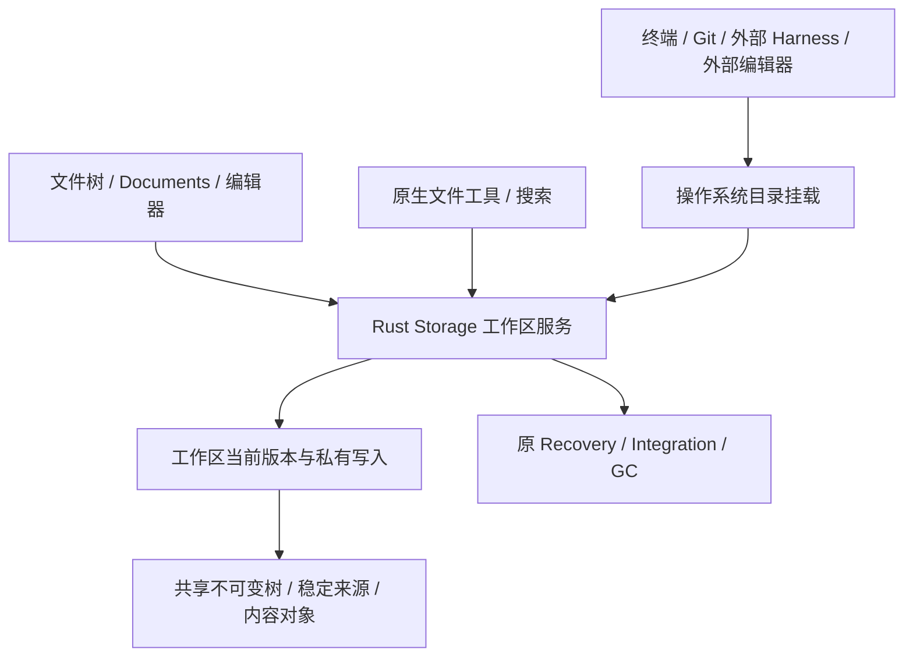

# 主与子 Agent 的版本化工作区设计

状态：实施中，已接入共用 Storage 树、原子分叉与逐路径命名空间事务；工作区挂载、私有打开文件、主目录接入与平台后端尚未交付。日期：2026-10-26。设计源码基线：`3da1bd863`；故障证据来自 0.9.33 发布版。

已接入生产路径的基础改造：分批上传时构建未发布候选树、批内共享祖先更新、候选根的 GC 保护、来源发布取消传递与临时正文 owner 分批释放。最终发布继续核验原 grant、内容 owner 与创建身份；同一资源线程仍处理每批元数据操作。这些变更减轻现有整目录准备链的集中工作，首次来源捕获和命令物化成本仍在，不能据此将 D1 或本设计标为全部完成。

命名空间层已复用同一树实现逐路径条件更新、目录子树版本校验、原子重命名与原请求固定的 `branch.fork`。
Host 的固定来源派发／续接已经使用原生分叉；父分支继续写入或释放后，被 pin／子分支持有的版本仍独立存活。
精确正文读取沿实际树核验，GC 回收中间提示索引后仍能读取存活文件。这些事务不创建物理执行副本；
普通进程当前仍走既有物化路径，尚未切换成挂载，也未建立活动句柄与 dirty 文件的版本切分。

配套 D4 已接通显式 `saveState` 的持久化确认：跳过界面防抖，按顺序等待原 `ui.view` 写入后才向页面确认；
关闭视图时在前序写入之后提交最后状态，保存失败回传。控件自动保存继续合并；尚未提交的内存状态不属于持久回执。

平台范围：Windows、macOS、Linux 从首轮共同设计和验证；故障发生在 Windows 不决定平台优先级。平台可以使用不同文件接口和 CoW 原语，工作区版本、隔离、恢复与交付语义保持一致。

本文综合隔离派发体检、共享基线与 CoW/VFS 调研，以及主工作区同样虚拟化的讨论。已确定的产品语义、推荐技术路线、待验证的平台实现分别标明；示意类型不是已经存在的协议。

当前实现见[资源](../resources.md)、[运行时](../runtime.md)、[协作](../collaboration.md)与[外部 Agent](../external-agents.md)。本方案替代[上一轮隔离设计](retrieval-isolation-and-tool-reliability.md)中首次全量捕获、首次写入物化的长期路线；旧文仍记录当时已实现的机制，不能把本文目标视为已交付。

## 1. 目标与决定

让主 Agent、子 Agent、文件工具、终端、IDE 和外部 Harness 使用同一套版本化文件工作状态。需要隔离时，从当前工作状态分叉；未变化内容共享，每个工作区只保留自己的变化和必要元数据。命令仍为普通进程，通过操作系统可识别的目录访问文件。

固定的是派发时的版本，不是主工作区。派发后主 Agent 继续读写，子 Agent 从相同起点独立推进：

```text
                         R10：派发时固定版本
                         /               \
主工作区：          R11 → R12           S1 → S2：子工作区
                         \               /
                           按三方状态整合
```

| 议题 | 设计决定 |
| --- | --- |
| 主／子工作区 | 使用同一引擎；主工作区也可版本化，不只给子任务套一层虚拟目录 |
| 默认派发 | 继续 `shared`；显式 `isolated_write` 创建独立可写工作状态，不修改 Agent 角色默认 |
| 命令与外部 Harness | 使用普通程序和真实挂载路径，不要求替换成 VFS 专用工具 |
| 内容权威 | Rust Storage 保留树、正文、版本、租约、恢复、整合与回收职责 |
| 对话权威 | 原生执行与外部产品记录仍归 Catalog，外部 Harness 保留自己的执行循环 |
| Git | 支持原生 Git 工作方式；Git 不是所有项目、文件版本或合并的必要前提 |
| 平台 | Windows、macOS、Linux 均为核心目标；首轮确定三端文件访问、版本切分和部署路线，不将任何一端留到架构完成后补适配 |
| 创建成本 | 已管理工作区分叉不全树枚举、不全量哈希、不复制整库；首次接入成本单独表达 |
| 写入成本 | 修改一个文件不触发全工作区物化；数据复制粒度独立设计和度量 |
| 文件可见性 | 主工作区的修改在同一项目视图立即可见，不要求每次导出后才能编辑或运行 |
| 路径切换 | 不自动搬移、覆盖或替换用户原项目路径；启用受管视图时明确实际执行目录 |
| 回收 | 按引用、挂载、打开句柄、进程和成果寿命回收，不能以会话结束代替资源停止 |

本轮不增加 VM／进程内存分叉、网络状态复制、自动依赖安装、强制工作流或 Varin 对外 CLI／Skills／MCP 能力桥。版本化工作区属于文件隔离；工作区外的资源访问继续由原权限与进程机制负责。

## 2. 现状、故障与证据

### 2.1 0.9.33 体检

两次 `dispatch(workMode="isolated_write")` 停留在 `preparing_child`，用户观察到应用整体卡住并通过重启恢复。同任务 `shared` 可完成。该证据把问题集中到隔离准备，尚未给出具体等待栈、锁或资源耗尽原因。

实际来源 `D:\project\opencr` 本身不是 Git 仓库，包含多个项目和工作目录。当前隔离不是 `git worktree add`：物理来源经 inventory、内容捕获、核验和工作状态发布，之后按需物化。普通目录枚举不应用 Git ignore，跳过 `.git`、`.varin`，但没有专门略过 `node_modules`、`.worktrees`。在多项目父目录下，任务只需写一行也可能先捕获大量无关字节。

当前 main 的外部 Harness 接入复用这条捕获／物化链，相关抽取未解决其成本结构。非 Git 根目录并非非法来源；在父目录运行 `git worktree list` 失败也不能说明下面每个项目的 Git 登记无效。

### 2.2 已有基础及缺口

| 现有能力 | 继续复用 | 本次需要改变 |
| --- | --- | --- |
| Storage 内容对象、不可变树、branch root | 节点共享、根引用和版本身份 | 接入懒加载的稳定来源，补齐活跃可写状态 |
| 基线 pin、同代捕获合并、正文复用 | 引用保护和有效身份判断 | 不再让每次派发从物理整目录捕获开始 |
| 固定来源读取、搜索、结构提取 | 精确版本读取 | 首次写入直接更新私有状态，不展开整棵目录 |
| 物化 journal、平台克隆／复制 | 旧路径、明确导出、必要后端的生命周期经验 | 挂载成为普通进程访问同一状态的入口 |
| Documents／Registry | 文档修订、未保存草稿、编辑协调 | 物理路径与虚拟资源身份统一，避免两套文件视图 |
| Recovery／Integration | before/after、三方合并、条件应用、undo | 消费同一工作区版本与实际文件变化 |
| guardian／进程资源 | 进程树、真实停止和输出回执 | 进程绑定准确 workspace 与 mount generation |

现有 [state_tree.rs](../../kernel/crates/varin-kernel/src/storage/state_tree.rs) 已按内容标识保存树节点，`root_apply` 按批共享祖先与未变化节点；[branches.rs](../../kernel/crates/varin-kernel/src/storage/branches.rs) 保存根与修订，[branch_namespace.rs](../../kernel/crates/varin-kernel/src/storage/branch_namespace.rs) 提供逐路径事务与子树移动。它们不等于完整的操作系统文件系统实现。

主要成本入口是 [source-preparation.ts](../../packages/web/application-host/lib/harness/working-state/source-preparation.ts)、[child-source-store.ts](../../packages/web/application-host/lib/kernel/child-source-store.ts)、[source.rs](../../kernel/crates/varin-kernel/src/compute/source.rs) 与 [materialization.rs](../../kernel/crates/varin-kernel/src/storage/materialization.rs)。Windows 的 [file_resources.rs](../../kernel/crates/varin-kernel/src/storage/file_resources.rs) 当前未实现 clone，走校验复制。

## 3. 四种身份与统一访问

区分项目、工作区、版本和挂载，不能再用一个物理目录字符串代替全部身份。

- **Project**：用户导航与配置归属，不因创建子任务变成另一个项目。
- **Workspace**：持续可写的文件状态。主工作区、隔离子工作区结构相同；Shared 多个执行者绑定同一 Workspace。
- **Revision**：该工作区一个已经固定的文件版本，可被子工作区、成果或恢复点保留。
- **Mount**：某 Host 上把 Workspace 暴露为普通路径的连接。断开挂载不删除 Workspace，重挂不是重建任务。



工具直达 Storage 与程序通过挂载访问，必须有同一个线性化边界、文件身份、缓存失效和修改事实。原生工具不能修改一棵树而挂载层继续返回自己缓存的旧内容；挂载也不能把文件写进一套未被 Storage 接纳的平行数据库。

Source 继续包含资源 owner、权限范围和路径映射。新增工作区绑定放入现有有判别字段的 Source 合同，不将 workspace ID 塞进假物理路径或伪造 Run。私有 wire 实施时由 schema 生成，字段名称在落地时确定。

## 4. 主工作区接入与原项目路径

### 4.1 推荐接入方式

首版选择非破坏性的独立挂载路径：用户明确启用受管工作区后，以当前选定的项目内容建立稳定来源，登记主 Workspace，并显示实际工作目录。Varin 的文件树、编辑器、终端、原生 Agent、外部 Harness 和“在外部编辑器打开”统一使用该目录。

主工作区是此后正常编辑的当前状态，不是只能在任务末尾导出的预览。保存、运行、Git 操作直接发生于它。原始目录作为接入来源／可选发布目标保留，不做隐藏的双向同步；启用时清楚说明用户应在哪个路径继续工作。源位置变化影响 Git 对象依赖或外部链接时，必须先解除相关引用再允许清理。

保持原路径透明接管可以作为后续接入方式，但需处理占用句柄、原目录交接、挂载恢复及卸载后的可访问性。首版不通过自动 rename 原目录、创建联接或安装拦截驱动来冒充透明接入。

既有会话继续绑定原来源，不在运行中静默改 cwd。切换在明确的来源交接边界发生；已有终端、外部 Harness 和打开句柄必须停止或保留原绑定，不能把同一路径换成另一份数据后继续冒用原身份。

### 4.2 外部编辑器与原始目录变化

外部编辑器打开挂载路径时，与主 Agent 共享同一 Workspace。仍在原始目录上的编辑属于另一份来源变化，使用明确的导入／整合操作处理版本冲突，不通过 watcher 事后覆盖主工作区。

外部程序使用绝对路径、symlink/junction 或配置中的原始 cwd，可能越过挂载范围。打开编辑器、传递文件链接、启动 workspace MCP 和执行命令时使用实际执行路径；范围外路径仍沿原权限处理，不重写任意命令文本。平台路径别名进入同一资源身份校验。

### 4.3 saved-files 与草稿

默认分叉当前已保存的工作区状态；未保存草稿仍归 Registry。显式选择 surface-drafts 时，按当前来源合同生成固定草稿覆盖，保留 Surface 身份与原编码／换行。分叉不能悄悄保存用户草稿，来自别的项目或窗口的缓冲不能混入。

## 5. 稳定来源与首次准备成本

### 5.1 稳定性的来源

| 来源 | 取得固定起点的方式 | 仍需支付的成本 |
| --- | --- | --- |
| 已管理 Workspace | 选择已确认 revision，保留根与数据引用 | 切分待提交写入、少量分支元数据 |
| 已有固定 WorkingState | 直接保留原 root | 缺失对象读取及必要校验 |
| Git commit | 固定 tree/blob 身份并保留可达引用，按需获取工作文件 | Git 元数据、filters/LFS 转换、缺失对象获取 |
| Git 当前脏工作区 | 固定上述版本，捕获准确的已保存修改、新增及所需附加文件 | 实际不同内容、暂存状态和外部写入协调 |
| 支持固定快照的文件系统 | 使用实际不可变快照作为来源 | 建立快照、平台准入、后续按需读取 |
| 普通可变目录，无快照 | 明确接入窗口内稳定化为受管来源 | 首次枚举与必要正文捕获；不能承诺即时完成 |

Git 对象引用要能抵抗其原仓库 GC；仅记录 OID 不足以持有内容。可以在自有对象存储中保留所需对象，或使用实际可维护的仓库引用／对象 owner 合同。引用涉及用户原 Git 时，不自动删除其分支、历史或共享对象。

未读文件能懒加载，前提是它的来源身份可重读到同一内容。`绝对路径 + mtime + size`、Git HEAD 未变化和普通 watcher 事件都不构成不可变正文。不能让未来的读取从已经变化的原目录补齐旧版本。

### 5.2 普通目录接入

普通目录没有快照，也存在不受 Varin 控制的外部写入时，无法同时满足“立刻创建、完全不读取、取得全目录同一时刻旧内容”。设计应公开实际接入方式，不把混合时点捕获命名为原子快照。

推荐在接入时选择已静止的来源或平台快照，完成一次稳定化；发生无法解释的并发改写则保留前一有效状态，指出受影响范围，不无限自动重试。之后主 Agent 与外部编辑器进入受管主工作区，后续分叉不再回头捕获原目录。

来源范围沿用户选择和 `sourcePath`，不默认把整个多项目父目录当作源码仓库，也不自动缩成某个猜测的子目录。可说明实际选定范围与准备阶段，用户无需为了普通派发手动填一堆性能参数。

首次接入与每次派发分开计量。提前后台复制只是移动成本发生时间，不计作消除成本；停止接入时保留原项目、实际已确认记录及可回收临时引用。

### 5.3 来源组合

基线可包含 Git 树、未提交覆盖、稳定依赖和明确附加范围，组合结果固定优先顺序与映射。现有单来源 subtree 映射继续适用；不借此开放任意多 Host 多 parent 自动合并。

内部共享内容路径不能通过目录枚举泄露成项目文件。Varin 自己的 Storage、挂载管理目录和 journal 不放进被其反复捕获的来源；判断依据为受管身份，不仅靠常见目录名称。

## 6. 分叉、并发写入与版本边界

### 6.1 正常分叉

1. Catalog 固定原 dispatch、选定 Workspace、workMode、权限与 sourcePath。
2. Storage 接纳原幂等请求，为当前工作状态建立可识别的版本边界。
3. 分叉引用该边界的不可变根，创建独立 head；父工作区进入后续写入代继续运行。
4. 需要目录的执行获取属于该 Workspace 的挂载；无需真实路径的文件工具可以直接开始。
5. mount readiness 与来源引用均确认后启动子进程／外部 Harness，回执保留真实身份。

固定 root 的发布只处理短元数据，不在锁内扫描树、哈希文件或等待用户输入。分叉不等待整个父 Run 完成，不冻结主模型执行。

### 6.2 活跃写入不能靠根指针掩盖

实际程序可能持有打开的文件、缓存写入和可写内存映射。仅 clone 一个树根，而让其中内容仍指向父进程会原地修改的普通文件，不是固定版本。

写入引擎需要区分稳定内容版本与可写 generation。建立边界时，协调此前已接纳的写入和 OS 缓存，在有限发布段选择一致的根；后续写入进入新的 CoW generation，父侧已有句柄继续指向父 Workspace 的同一文件身份，子侧绑定独立版本。边界前后的顺序由实际文件服务建立，不能依据工具消息时间猜测。

基线有可变 staging backing 时，必须先转为不会被后续原地写入改变的版本：可用原生 extent clone，或由受管页／extent 写入层保留旧数据。仅 dirty 文件需要处理；不得退回整库复制。若首期后端只能冻结完整 dirty 文件，应如实报告这项成本，并作为后续粒度优化对象。

文件 flush、缓存失效和 mmap 写回的协调是后端准入要求。尚不能固定某类活动映射时，返回可定位的快照障碍并让主工作区继续工作，不以无限等待句柄关闭来实现“准备中”。不默认停止全部主进程；需要应用级一致点的任务可在正常阶段边界取版本。

### 6.3 文件一致性与应用一致性

一次工作区版本保证文件服务定义的边界。数据库事务、跨文件生成器、运行中的服务状态未必恰好落在应用完整状态。需要它们时使用应用自身 checkpoint／一致操作边界，不能把目录版本称为进程、内存和数据库状态的完整复制。

Shared 执行者明确共享同一个可写状态，仍可能发生正常并发编辑；`readVersion` 和条件写入保护实际文件，不能把 Shared 包装成隔离。多个主会话可以绑定同一主 Workspace，不按会话重复导入项目。

## 7. 文件内容与命名空间

### 7.1 数据模型示意

```text
Workspace
  id / resourceOwner / projectBinding
  baseRevision / headRevision / namespaceGeneration
  sourceMapping / backendBinding / lifecycle

Revision
  rootRef / stableSourceRefs / fileContentRefs
  namespaceBoundary / durabilityReceipt

Mount
  id / workspaceId / hostId / generation
  actualPath / backend / capabilities / state

FileVersion
  fileIdentity / metadata / contentRef / revision
  contentRef = immutableBlob | stableSourceRange | immutableExtentMap
```

以上映射进既有 Storage 记录和引用图，不新建 TS 持久工作区库。稳定来源引用需有实际读取与保留合同；`stableSourceRange` 不是任意 live 路径。生产 schema 保持已知格式严格校验，不自动迁移或覆盖旧内部存储。

### 7.2 读写与复制粒度

目录和文件元数据按路径需求加载并共享；同一来源版本的相同读取合并，失败不缓存成不存在。二进制、Unicode、空文件和稀疏区间沿真实字节／文件语义处理。

目标内容模型允许共享旧范围、保存新范围及长度变化，避免每次追加或小改动都重写完整大文件。首期可复用现有整文件对象与平台 CoW，但必须明确粒度；不能为了“一切都是 hash blob”而每次 write 对整文件同步哈希。具体 extent／chunk 大小依据后端与负载确定，本文不猜统一常量。

同一个活跃文件可在短写入事务中更新 working generation；稳定 revision 在 checkpoint／fork／发布边界形成。工具的原子替换通过完整候选与条件发布完成；普通程序分多次写入时保留原程序可观察的中间状态，不伪造文件级原子性。

### 7.3 必须实现的行为

| 行为 | 语义 |
| --- | --- |
| 目录枚举 | 合并基线与当前命名空间，支持分页、明确缺失和目录修订 |
| 删除／重建目录 | 删除标记遮住基线；重建目录不让旧后代重新出现 |
| rename／替换保存 | 命名空间事务与打开句柄语义正确，不靠事后扫描推断 |
| hardlink | 同一 Workspace 内共享文件身份；分叉后写入不改另一 Workspace |
| symlink／junction | 保留实际链接语义，解析结果参与范围准入，不能借别名绕开来源 |
| open／unlink／truncate | 遵守对应 OS 的句柄、共享模式与删除语义，不统一成 POSIX 假实现 |
| append／并发写 | 沿文件身份排序与锁语义处理，不以任意最后响应覆盖所有内容 |
| metadata | 保留平台需要的 mode、ACL、大小写规则、时间、可执行位及受支持扩展属性 |
| watch | 发布实际变化与失效，断连／溢出有明确状态，不拿事件计数代替内容版本 |
| mmap／文件锁 | 后端需证明普通程序的缓存、写回、锁与快照边界兼容 |

不要把每个 fork 实现成越来越深的“父 delta 查不到再查祖父”链。优先利用持久化树的结构共享和可定位内容引用；压平针对实际读放大按现有资源调度执行，不预设固定链深上限。

## 8. 命令、外部 Harness 与所有消费者

### 8.1 命令仍为普通进程

Shell、Python、Node、编译器、测试和 Git 继续由原 ProcessManager／guardian 启动。可执行程序一般复用 Host 安装，不为每个 Workspace 复制。`cwd` 指向当前挂载，环境中的 workspace 路径由实际执行来源提供。

一次进程启动固定 workspace、mount generation、实际 cwd 与权限。mount 不可用时不切换解释器、原目录或另一份副本重新执行。进程输出、退出和输出收尾保持既有独立语义。

工作区内的读取来自合成视图，写入进入私有状态；工作区外路径、全局缓存、网络和设备仍是原真实资源。需要加入工作区的额外目录使用明确来源映射，不重写任意 shell 命令或承诺整个操作系统隔离。

### 8.2 统一消费者清单

| 消费者 | 接入要求 |
| --- | --- |
| file_read/write/edit/list/search、Tree-sitter | 同一 Source 与 readVersion，更新后失效挂载缓存 |
| Documents／文件树／编辑器 | 使用 Workspace 资源身份，保留 Registry 脏缓冲与保存冲突 |
| pipe／PTY／script | 获取同一挂载及进程寿命引用；脚本里的原生 fs 不能另走原目录 |
| Codex／Claude Code／Pi／ACP | 使用实际 cwd 和原会话，暂停／恢复仍绑定原 Workspace |
| workspace MCP／扩展工具 | 依赖本地目录时获取同一挂载；已有运行实例不能仅改参数复用到另一工作区 |
| Office／文档／下载／科研执行 | 临时路径和结果写入沿来源 owner，不只改编程工具 |
| IDE／LSP／DAP（实际启用时） | 文件监控、工作根、打开编辑器与调试路径一致；不重新向 Agent 披露已移除的 LSP 能力 |
| 文件链接／打开方式／另存为 | 打开当前实际内容；导出才生成独立文件，不能把内部对象文件当用户文件暴露 |

浏览器页或移动端连接远程 Host 时，挂载发生在资源 Host，不要求客户端也安装文件系统组件。跨 Host 继续传原 Source 引用与命令回执，不把本机 mount path 发给另一机器当执行路径。

### 8.3 调用归属

挂载可以准确观察文件效果，但进程身份不总能精确对应某个工具调用。guardian 派生进程可关联其运行；用户外部编辑器或共享后台服务记录真实来源，无法归属时明确 unknown/external。不得为了填满 UI，把所有挂载写入算到当前最后一次工具调用。

## 9. 跨平台文件访问与 CoW 后端

### 9.1 共同语义与两层能力

Windows、macOS、Linux 同时参与合同制定、原型和验收。现有 Windows 故障是回归场景，不能据此让共用接口只描述 WinFsp，再让其他平台模仿 Windows。

分开设计两类能力：**文件访问后端**负责把 Workspace 呈现给普通程序并接纳实际操作；**数据／快照后端**负责稳定版本、内容共享和写时复制。APFS clone、Linux reflink 等可以减少文件数据复制，但不单独提供所有命令共享的虚拟命名空间。二者可以组合，不强制所有平台使用同一种挂载库或相同数据布局。

共用合同包含普通路径访问、文件身份、缓存一致性、版本切分、持久化、可取消挂载、实际卸载与恢复事实。平台返回具体能力与依赖；不能因调用了 clone 或 mount 就声明整个 Workspace 已稳定可写。

| 平台 | 文件访问路线 | 数据与固定版本路线 | 首轮必须查明 |
| --- | --- | --- | --- |
| Windows | WinFsp 类完整用户态文件接口为首选验证；ProjFS 为按合同评估的候选 | Storage 增量内容；支持的卷可利用原生克隆 | 普通 NTFS、缓存／mmap、共享句柄与删除、安装／退出 |
| macOS | 评估原生 FSKit 扩展；macFUSE 按其 FSKit／kernel 后端分别评估 | APFS clone 用于稳定文件版本和可写 backing，Storage 保留逻辑根与引用 | 现有最低系统版本、APFS 大小写模式、缓存失效、开发工具与扩展部署 |
| Linux | FUSE 为直接服务受管树的主要验证路线；OverlayFS 用于满足固定 lower／upper 边界的组合 | Storage 增量内容；实际支持的 reflink／快照可加速 backing | 普通桌面与无桌面 Host、缓存写回、挂载权限、实际文件系统能力 |

明确物理导出／旧复制路径继续是可辨识的独立能力，不作为某个平台的隐性“兼容实现”。不支持 CoW 的卷要记录真实情况；用户选择后端之后也不能悄悄改变已受理操作的隔离或耐久语义。

### 9.2 macOS：APFS 与系统文件接口共同设计

**APFS 数据层。** 利用同卷克隆保留共享数据块，父／子后续写入分别分配变化内容，适合稳定文件版本与私有 backing。克隆目标的命名空间、版本发布和引用仍由 Storage 管理。目录克隆的实际元数据成本、dirty 文件切分和并发写入需要核对，不能把单文件快速 clone 当作任意活动目录的瞬时一致快照。首次导入、跨卷、非 APFS 外置盘和网络来源分别处理，不以“运行在 Mac”判断 clone 一定成功。[Apple APFS 说明](https://developer.apple.com/documentation/foundation/about-apple-file-system)。

**原生 FSKit 访问层。** 将其作为系统支持范围内的重要候选，评估与 Rust 文件服务连接的 app extension，覆盖目录、打开／关闭、读写、同步和需要的元数据操作。Apple 的 passthrough 示例可以帮助确定扩展装配，但其直接访问源目录的行为不能直接用于私有分支。[FSKit](https://developer.apple.com/documentation/fskit/)、[官方示例](https://developer.apple.com/documentation/fskit/building-a-passthrough-file-system)。

**系统版本不可混用。** 当前 [Electron 配置](../../packages/electron/package.json) 声明 macOS 最低 13.0；所查 macFUSE 文档将 FSKit 后端入口标为 macOS 15.4+，Apple 当前 passthrough 示例又标注 macOS 26+。框架可用、某个资源类型可用和示例可运行不是同一条件。按实际调用的 API 标注版本，不自动提高 Varin 整体最低系统版本，也不从最新示例反推所有旧系统都可接入。

**macFUSE 候选。** 分别评估 FSKit 和 kernel 两种后端，不只记录一个“已安装 macFUSE”。当前官方说明列出了 FSKit 后端通知 API、部分 mount 选项和性能差异；这些直接影响工具直写后的缓存更新、watch 与交互延迟。kernel 路线涉及系统扩展启用及 Apple Silicon 上的安全配置操作，不作为用户必须接受的默认前提。[后端说明](https://github.com/macfuse/macfuse/wiki/FUSE-Backends)、[安装说明](https://github.com/macfuse/macfuse/wiki/Getting-Started)。

**部署与日常使用。** 沿现有签名、公证与应用更新链路打包扩展／helper。核对文件系统 entitlement、扩展启用、用户目录访问、Host 与扩展的连接和卸载恢复；扩展仍是原 Storage 的执行者，不自己打开第二份可写数据库。Apple Silicon 和仍在发行范围内的 Intel 架构分别准备产物；现有 Intel 条件发行策略不在本设计中改变。

Mac 代表性行为包括 Finder／编辑器的替换保存、Git、Node／Python 与实际项目构建、文件监控、可执行位、ACL／扩展属性、大小写与 Unicode 名称、可写映射、睡眠唤醒和外置卷断开。应用关闭、扩展退出或系统重启后，已确认保存的版本继续可恢复；内存中的句柄和进程状态仍按原生命周期处理。

推荐目标是 Rust 工作区引擎＋APFS 数据共享＋可用的文件访问后端。旧系统后端与依赖选择在首轮原型中定下，不能将“先不支持旧 Mac”藏在实现里；若确实需要调整产品支持范围，另列清楚影响供用户决定。

### 9.3 Linux：FUSE、缓存与原生文件系统能力

FUSE 路线直接呈现受管树，目录、文件身份和变化继续由原 Storage 提供。内核页缓存、用户态共享对象缓存和持久文件版本分开管理；`write` 返回、dirty page 写回、fsync 和 snapshot 发布有明确顺序。

Linux FUSE 的 cached/write-through、writeback-cache 与 direct-io 行为不同，涉及 shared mmap、后台写回和数据可见性。不能仅为简化版本切分就全局关闭缓存或 mmap，也不能启用 writeback 后忽略尚在内核中的写入。依据实际内核能力选择并核对 snapshot fence；直接文件工具修改需完成相同缓存协议。[内核 FUSE I/O 文档](https://docs.kernel.org/filesystems/fuse/fuse-io.html)。

reflink／稳定文件系统快照用于数据层加速，依据源／目标卷和实际支持探测。OverlayFS 仅用于已固定 lower；父 Workspace 不能作为仍会变化的 lower 直接挂进去，upper 也必须有准确的封存与后续写入分离机制。[OverlayFS 文档](https://docs.kernel.org/filesystems/overlayfs.html)。

部署覆盖普通桌面与无桌面 Host，核对 FUSE 设备／挂载 helper、用户权限和实际容器环境。不能为了运行文件后端默认给容器 privileged 或提升整台 Host 权限。已有 Shared、远程文件访问与不需要本地 mount 的能力继续按原合同工作。

原型覆盖 inode／hardlink、rename-overwrite、open-unlink、可执行位、锁／mmap、watch、后台进程及 daemon 重启。测试正常发行环境中的 ext4 等普通文件系统，以及实际使用的 CoW 文件系统，不能只在具有快照能力的特制卷上验收。Linux 的行为不替代 macOS 或 Windows 验收。

### 9.4 Windows：完整写入路径与普通 NTFS

WinFsp 为 Windows 首选验证方向，核对 Rust 集成、OS 缓存／映射／锁、文件共享模式和删除时机。它提供文件系统接入点，Varin 仍需建立自己的版本与耐久协议。[设计资料](https://winfsp.dev/doc/WinFsp-Design/)。

ProjFS 保留候选：它会缓存读取内容，写入后成为 full file，通知有前置／后置之分。重点检查后续实际写入能否进入所需版本切分，以及多 Agent 扫描后的缓存重复占用；不把只读投影或首次懒加载当作完整 writable workspace。[缓存状态](https://learn.microsoft.com/en-us/windows/win32/projfs/cache-state)、[操作通知](https://learn.microsoft.com/en-us/windows/win32/projfs/file-system-operation-notifications)。

普通 NTFS 是代表性环境，具备克隆能力的其他卷可提供数据层优化。保留 PowerShell／Git Bash／CMD、路径别名、长路径、大小写规则、原生进程 Job 与文件占用回执。安装系统组件、升级和卸载沿现有安装器与用户授权，不能通过移除句柄保护来换取“清理成功”。

### 9.5 共用引擎与各平台缓存边界

普通程序通过 mount 写入时，工具直达 Storage 的读取要看到相同已可见状态；工具直接修改时，程序的目录项／属性／页缓存也必须更新。对缺少所需失效接口的后端，采用经同一 mount 入口提交写入等能保持一致的路径，或者明确能力未满足；不能绕过缓存更新后靠 watcher 最终追平。是否可用直达快路由属于后端能力，耐久权威仍然只有 Storage。

跨平台共用测试验证版本、隔离、冲突、持久化和回收；平台测试验证其原生名称、权限、句柄及缓存语义。不强行把所有系统变成大小写不敏感，不全局改写 Unicode 文件名，也不丢弃对目标工具有意义的 mode／扩展属性。跨 Host 导入出现名称碰撞或不支持的元数据时，明确涉及路径并保留原成果。

挂载回调和文件 I/O 在原生资源执行通道处理，不经 renderer、每文件 HTTP 或模型工具 JSON。若采用辅助进程／app extension，它是 Storage 的文件服务执行者，不另建 Catalog／Storage writer；大正文与阻塞 I/O 在短提交段之外，避免每个 syscall 争抢全局会话控制锁。

### 9.6 安装、能力和失败

平台后端的依赖、许可与分发方式在引入代码时核对，沿现有第三方声明和安装器处理。用户同意安装系统组件后才启用需要它的后端；文档提案本身不授权修改操作系统。缺少组件不禁用 Shared 或原有正常文件工作。

配置与诊断返回实际 backend、source stabilization、mount state、copy granularity 与失败原因；系统版本、卷能力和后端版本参与能力判定。用户无需理解每次文件读取的内部机制；显式隔离无法满足时给可操作状态，不静默降为 Shared。后端失败不能在同一已受理 operation 下切换成全量复制重新执行。

远程客户端按实际资源 Host 的平台选择后端。Windows 客户端连接 Mac Host 时使用 Mac 文件系统，反之亦然；移动客户端无需安装桌面文件系统组件。不能用协调端 `process.platform` 代替资源 owner 的实际能力。

## 10. Git 与工作文件

普通项目不需要 Git；Git 项目保留原生 status、add、commit、diff 和需要的分支操作。WorkingState 负责文件版本，Git 负责其 HEAD/index/refs 与 staging 语义，双方不互相冒充。

### 10.1 Git 管理状态私有化

主 Workspace 沿准确的仓库绑定使用 Git；隔离子 Workspace 有自己的 HEAD、index、锁和 rebase/merge 状态。可复用 linked-worktree 或私有管理目录＋对象引用的实现经验，但不能复制父 `.git` 指针后让两边修改同一管理状态。

Git 元数据默认放真实原生文件系统，工作目录通过准确 gitfile／配置与它关联；对象共享、分支 ref 修改和仓库维护由原生 Git 的实际语义管理。共享对象库并不意味着所有 refs 都是私有的，需要在目标支持的 Git 布局中明确操作范围。

派发前不自动 commit/stash 用户工作，不清空暂存区。继承来源的当前文件字节与 Git staged/unstaged 状态分别记录并复制必要元数据；若某后端无法保留 staging，不能对外宣称与原工作区完全相同。

### 10.2 从对象到工作文件

固定 Git blob 不一定是最终工作文件字节。clean/smudge、LFS、EOL、working-tree-encoding、submodule、稀疏配置和可执行位必须通过 Git 来源适配处理。未取得外部对象时显示真实读取失败，不返回 LFS pointer 冒充内容或从最新工作目录填补。

Git index 初建和首次 status 的路径检查成本单独测量；root fork 很轻不代表 Git 已就绪。不能每次分叉自动运行全仓 status＋读写探针再放行。挂载就绪核对实际身份与能力，真实 Git 兼容性由针对性验收承担。

工作区成果不要求全部先变成 Git commit。现有 Integration 对普通文件、二进制与非 Git 项目继续有效；用户需要 Git 工作流时才由 Git 完成相应提交和整合。

## 11. 依赖、缓存和大型文件

稳定依赖可作为共享来源，写入仍进入本 Workspace 的修改层。不能简单将 `.venv`、`node_modules` 设为只读后宣称普通包管理器兼容；它们可能生成缓存或修改安装结果。全局下载／编译缓存是否共享，依据工具自身并发合同与用户配置，不能仅按目录名猜。

本任务安装的新依赖、临时构建输出和工作数据库进入其私有状态。成果捕获与成果发布范围分开：保存真实变化不等于把所有缓存、依赖、Git 管理目录都合并回父工作区。沿原选定路径与 Integration 规则交付，不自动 add/commit ignored 内容。

源码、图片、Office、数据集等使用相同文件引擎。大文件局部写入以实际复制粒度计量；第一版可接受有依据的文件级 copy-up，但不能恢复为整个 Workspace 的 copy-up。内存不持有全部项目正文，读取与数据写入使用现有流式／分段执行能力。

缓存属于可丢弃派生数据；已确认修改、稳定版本、Git 外部对象依赖和恢复依据具有实际引用。总空间展示区分共享对象、私有新增、读取缓存、可释放和清理失败，不把 reflink 逻辑大小相加当真实占用，也不预设按 Agent 数分配硬配额。

## 12. 交付、恢复与回收

### 12.1 阶段成果与整合

子任务可在运行中发布固定阶段版本，之后继续工作；publish 与终止进程不是同一操作。发布使用第 6 节版本边界，不能把 mutable upper 直接交给接收方。

整合使用三个准确版本：共同基线 B、子成果 S、接收方当前 T。父任务已经从 R10 走到 R12 时，将 S 相对 R10 的变化整合到 R12，不覆盖成 S 的完整目录。不同文件可独立整合，同文件冲突保留双方，sourcePath 映射与 Windows 路径身份参与原核验。

`update`、`submit_code`、最终成果与恢复面板复用原 Integration。对目标已管理 Workspace 使用条件树更新并通知挂载／编辑器；对旧 LiveRoot 明确执行原物理事务。不得先改树再异步无条件覆盖磁盘另一份“主项目”。

### 12.2 持久性与恢复

可见写入、flush 完成和持久 checkpoint 分别表达。普通程序遵守目标 OS 的写入／fsync 合同；返回持久 snapshot 成功前，引用到的正文、树与 journal 必须完成相应落盘。稳定引用不能指向只存在内存或尚未确认写完的 backing file。

重启先恢复原 Storage journal、Workspace 与引用，再判断挂载／进程寿命。断开的 mount 可重连保存状态，但旧文件句柄、mmap 和进程内存不会自动复活；旧进程是否存活依据真实 owner 回执。无法继续的进程显式报错，不静默把原路径替换成空目录或重跑副作用命令。

挂载中的命令写入可扩大 Recovery 的文件覆盖范围；无法精确归属的写入如实记录。文件恢复针对被选择的路径，在当前 Workspace 生成新版本，保留其他后续变化和 redo；不能因为有全树快照就一键回滚所有并行工作。

### 12.3 生命周期和 GC

Workspace 生命周期、Mount 生命周期与 Operation 生命周期独立记录。挂载失败可不改变有效文件版本；Run 完成可仍有后台进程；成果已发布可仍有未发布新改动。

回收先保留需要的成果／恢复版本，撤回新执行准入，等待真实读写句柄和进程释放，确认卸载后删除 owned backing 与管理记录，再按引用图释放对象。取消意图、executor stop、卸载完成和已释放空间分别返回。

base roots、workspace heads、checkpoint、result、Recovery/Integration、Git 来源引用、打开内容句柄及未完成发布都进入现有可达集合。发布与 GC 通过短提交／保留引用协调；不按目录年龄清理，也不增加只增不减的第二份永久账本。清理回执完成后，其不再需要的记录同样进入回收。

## 13. 接口与模块映射

接口示意描述所需行为，不要求增加同名公共工具：

```text
adoptSource(source, captureMode, originalOperation) -> WorkspaceBinding
checkpoint(workspace, boundary, originalOperation) -> RevisionRef
fork(workspace, revision?, scope, originalOperation) -> WorkspaceBinding
acquireExecutionView(workspace, owner, requirements) -> MountLease
publish(workspace, selection, originalOperation) -> ResultRef
integrate(base, result, target, expectedState, originalOperation) -> Receipt
release(binding, originalOperation) -> CleanupObservation
```

所有修改沿已有幂等、授权、真实停止与结果回执合同。模型仍使用 `dispatch.workMode/sourcePath`、文件工具、process 工具和现有交换／恢复能力；不要求模型先 mount、checkpoint、seal、GC 才能完成任务。

| 模块 | 实施责任 |
| --- | --- |
| `storage/state_tree.rs`、`branches.rs`、对象与引用模块 | 版本树、稳定来源、增量正文、并发发布与耐久性 |
| `source_resources.rs`、Storage 文件／进程资源 | Workspace/Mount 准入、资源身份、挂载服务、句柄和进程引用 |
| `child-source-store.ts`、`child-source-capture.ts`、`source-preparation.ts` | 对已管理来源走 root fork；旧来源走明确接入，退出每次全量捕获 |
| `thread-collaboration.ts`、原生 dispatch/external child | 同一来源分叉、进度、取消、发布和回收 |
| Documents／application-client／Registry | 文件 API 与实际路径绑定、草稿、watch、冲突和编辑器导航 |
| process／script／MCP／extension／external-agents | 绑定实际执行视图，保持原工具与外部会话身份 |
| Recovery／Integration／materialized_views | 消费新旧来源的准确版本，确认回收，不重复维护成果 |
| Electron／打包／Host 能力发现 | 平台依赖检测、安装与故障呈现，不新增 Electron 文件后端 |

数据密集的文件系统请求不走 Catalog actor。挂载执行者需要直接高效调用 Rust 文件服务；若独立进程通信，复用原私有认证和内容通道思想，避免逐字节 JSON 和每个 write 全树提交。

## 14. 准备响应性与产品呈现

准备状态区分实际来源确认、首次稳定化、版本切分、挂载、后端连接和清理，不用循环动画掩盖未知等待。已知工作量显示已处理条目／字节；未知总量不伪造百分比。

控制请求、取消和观察不排在重 I/O 后面；主会话继续可用。大枚举、排序、正文核验、数据库扫描及挂载回调都检查是否占据 Host 事件循环、Storage 控制锁、Documents barrier 或进度回执通道。真正的取消传播到执行者，返回请求已受理后仍观察停止和清理事实。

UI 保留现有项目、工作概览、子 Agent 和协作设计，只在需要判断时显示：当前来源、是否隔离、实际目录、准备阶段、失败原因及可继续操作。诊断详情提供 backend 与快照能力；不让用户每次派发选择底层文件系统。

主工作区切换目录的说明属于一次明确接入流程。日常 Shared 和隔离派发沿已有授权推进，不追加每次确认、默认配额、统一超时或强制停止主任务。

## 15. 本轮体检的配套修复

| 问题 | 处理方向 | 验收依据 |
| --- | --- | --- |
| D1 隔离准备卡住应用 | 独立定位具体等待／资源争用并修复响应性；结构上替换全量准备路径 | 原故障来源可观察、可取消；其他会话可推进；已管理分叉不复制整库 |
| D2 tool_invoke 层级提示 | 明确目标参数直接放在 `tool_invoke.arguments`，附最小正确示例 | 不出现诱导嵌套的 `arguments.arguments` 文案，真实 schema 可调用 |
| D3 current:before | 明确表示本轮开始前，包含撤销新建；恢复点应能区分轮初和具体 before/after | 选择的范围与逐文件结果一致，undo 保留；不改变既有恢复含义 |
| D4 UI state 重启丢失 | 分开检查 live view 断连和保存状态持久化／重新绑定；现有 saveView 应追踪完整链 | 重启后保存状态可恢复，旧 live 句柄仍如实断开 |
| D5 退出与输出未收尾 | 保持现有区分，不为表面一致提早标完成 | 最后输出不丢，继续读游标正确 |
| D6 编码 | 先验证报告提出的实际反例与现有 encoding 覆盖 | 只对复现的失败修改，不凭推测新增解码策略 |

本提案不声称已经修复上述问题。配套修复可以独立交付，不等待整个 VFS 重构；也不能以改报错或 Shared 可用代替隔离能力验收。

## 16. 实施顺序与退出条件

### A. 固定故障与合同

定位 D1 当次准备停在哪个实际阶段，补足必要事实，修复控制／取消受阻。盘点各消费者的来源与物理路径需求，落实 Workspace、Revision、Mount 的身份和原 owner 映射。处理可独立确认的工具契约缺陷。

完成条件：来源准备不会拖住整个应用；新旧来源行为能明确区分，错误和取消不丢失原清理责任。

### B. 三端共同验证完整读写路径

在 Windows 普通 NTFS、macOS APFS 和 Linux 代表性文件系统上，用同一 Rust Storage 原型连接主／子两个可写视图。三端分别验证第 9 节推荐后端、缓存协议和实际安装路径；结果共同决定共用接口。实现可按可用开发环境推进，但不能先冻结一端专用合同再把其他平台放入后续兼容层。

共同场景为普通命令、编辑器替换保存、文件锁／mmap、父持续写入时的版本切分、退出和重启；平台追加各自名称、权限、挂载和睡眠／断连场景。macOS 同时核对当前最低系统版本与新 FSKit API 的可用范围，Linux 覆盖无桌面 Host，Windows 保留这次原故障回归。

完成条件：三端主工作区在子任务运行期间持续写入，子版本稳定；两种访问入口读写一致；挂载断开／恢复不会丢失已经确认保存的内容。缺少某端实机证据时记录未验证并继续对应工作，不能宣称跨平台核心已经验收。

### C. 稳定来源和私有修改层

扩展原 Storage 树和内容引用，补齐直接工作状态修改、稳定来源懒读、dirty 文件版本切分与引用图。优先贯通已有固定来源与已管理主工作区，再实现 Git 当前状态和普通目录接入。首次导入成本可观察，可中止，后续分叉不重新扫描来源。

完成条件：小修改不触发全目录物化；父子未变数据共享；当前 dirty 状态、删除、重命名和重复分叉正确；不能只通过内存 API 验证而跳过真实挂载。

### D. 所有消费者、Git 与整合

接入文件工具、Documents、终端、script、Office、workspace MCP、扩展和外部 Harness。补齐 Git 私有管理状态、原路径导航和实际 cwd。Integration/Recovery 直接使用版本化状态，旧 LiveRoot 发布保留原事务。

完成条件：真实任务可以从派发、运行、补充消息、阶段交换到结束，父任务同时推进；用户看到当前主工作区修改；Git／非 Git 项目都能交付和恢复。

### E. 三端持久化、回收与发行接线

完成三端进程／句柄／mount／成果引用回收和实际重启恢复，打通各平台依赖、签名／公证、安装、更新与卸载。延续 B 阶段的平台接入完成整体交付，不把 Linux/macOS 接入推迟到本阶段才开始。重新核对原测试与文档，淘汰已退役复制路径假设，明确保留的导出能力。

完成条件：资源释放后实际回收生效，活跃引用不被误删；平台能力和失败真实；没有隐藏全量复制回退。依赖安装、打包和发布使用各平台现有流程。

阶段用于组织实现，不意味着先把只读原型当完整版本发布。用户可以在未启用受管视图时继续现有 Shared 工作。阶段性交付按实际验证情况说明平台能力，整体完成以三端共同合同及各自系统行为均验收为准。

## 17. 验收与成本口径

复用现有 owner 的测试，只补能证明新增关键行为的场景。先覆盖发生问题的普通父目录、一个真实 Git 项目，以及少量能区分版本／文件语义的样例，再按发现的问题扩大；不建设常驻评测系统。

共用场景在三端采用等价数据和操作，系统特有行为单独验证。macOS 纳入当前发行的 Apple Silicon 与条件支持的 Intel，具体 OS 版本覆盖实际后端 API 边界；Linux 包含普通无特权 Host，Windows 使用普通 NTFS。CI 编译通过与真实挂载／普通工具验收分别记录，不能拿 mock 后端代替某一平台。

| 必须证明 | 场景与观察 |
| --- | --- |
| 主任务不停止 | 子任务运行时主 Agent 改同名与不同文件，子读取固定起点和自己的修改 |
| 文件工具与程序同源 | 工具写后 Python 读；命令替换后编辑器／搜索看到同版本 |
| Shared 语义 | 两执行者使用同一主 Workspace，条件编辑冲突仍有效 |
| 低成本分叉 | 分开记录首次接入、固定 revision、创建私有状态、挂载、首次有效操作 |
| 真实存储收益 | 记录新增对象／私有数据／读取缓存／物理写入与实际分配，不叠加逻辑目录大小 |
| 持续写入与 snapshot | 打开的文件、原子替换、后台进程及可写映射不破坏已发布版本 |
| Git 与 dirty 来源 | 未暂存、暂存、新增、删除、filters 和实际支持的子模块／LFS 路径分别核对 |
| 大文件与小文件 | 大文件局部写入的放大、多个程序的小文件读取与首次搜索／构建延迟 |
| 结果整合 | 父继续修改后，B/S/T 合并保留双方；冲突、undo 与 sourcePath 映射正确 |
| 取消／重启／卸载 | 原执行停止、已确认修改保留、重复请求不重做副作用、回收失败可继续处理 |
| 多任务资源复用 | 同来源并行任务共享基线，某一取消不释放其他引用，完成后无多份完整副本残留 |
| macOS 系统集成 | APFS clone 的实际共享、FSKit／macFUSE 的能力与 OS 版本、Finder／编辑器保存、扩展启停和睡眠唤醒 |
| Linux 系统集成 | FUSE 缓存写回、普通用户挂载／无桌面 Host、权限／锁／open-unlink、daemon 重启 |
| Windows 系统集成 | NTFS 路径与共享句柄、映射写入、后端安装／退出、原准备挂起场景 |
| 资源 Host 选择 | 不同平台客户端连接同一 Host 时访问同一 Workspace，不借用客户端的路径或后端 |

计量至少区分 `首次接入`、`分叉返回`、`目录可用`、`首次 status/search/build`、`成果发布` 和 `资源实际释放`。不能用预热后的分叉对比旧方案冷启动，也不能把所有成本推到第一次命令后再声称启动完成。

不承诺任意普通目录的零准备，不预设固定毫秒数、并行数、空间倍数或通过阈值。平台能力和真实代表性负载给出结果后再确定产品默认，避免把演示效果当作部署结论。

## 18. 需要在实现中定下的事项

| 尚未定下 | 当前推荐 | 依据／改选条件 |
| --- | --- | --- |
| Windows 后端 | 优先验证 WinFsp 类完整写接口 | 安装、许可、mmap、吞吐与版本边界；ProjFS 只有满足同一合同才承接对应场景 |
| macOS 后端 | APFS 作为数据共享路径，FSKit 与 macFUSE 分后端评估文件访问 | 最低 macOS 13、具体 API 可用版本、缓存失效、部署与实际开发工具；不默认要求用户降低系统安全设置 |
| Linux 后端 | FUSE 直接呈现受管树，实际原生 CoW 能力加速数据层 | 缓存写回与 snapshot fence、普通用户部署、实际文件系统；OverlayFS 必须具有固定 lower／upper 边界 |
| 三端接口收敛 | 共用语义、平台原生操作与数据能力分层 | 三端首轮原型共同决定接口，不能以单端成功冻结平台特有假设 |
| 主目录路径接入 | 首版明确独立挂载路径，统一所有消费者 | 原路径透明接管需额外文件系统与占用交接证据，不自动实施 |
| 普通目录首次稳定化 | 已有快照优先，否则明确一次接入捕获 | 来源无稳定版本且持续外改时保留为 LiveRoot，不能谎报固定隔离已就绪 |
| 内容写入粒度 | 持久树＋可共享内容版本，允许 extent 引用 | 现有整文件对象可过渡；大文件放大与后端真实能力决定下一步 |
| Git 管理布局 | 使用原生 Git，隔离管理状态，复用稳定对象 | linked-worktree 或私有 admin 依据平台挂载和 Git 兼容性选择 |
| OS 缓存与 snapshot fence | 文件服务建立实际写入代边界 | mmap／缓存写回证据决定支持范围；不能用工具结束事件代替 |

这些是实施取舍，不新增用户每次操作的必答问题。涉及改变用户项目位置、安装系统组件或采用新持久格式时，在具体可评审结果上遵守原授权与资产规则。

## 19. 资料与复用边界

输入材料：用户提供的 `harness-fix-brief-20261026.md`（0.9.33 实测）与 `Agent_Workspace_CoW_VFS_Research_2026-10-26.md`（构想、开源调研、路线建议）。材料原件保留于用户本地；本文提取与 Varin 决策相关内容，不把外部报告的推荐、基准或限制自动当产品要求。

重点参考如下，项目实现结论限定到所指源码，尚未在 Varin 环境运行其完整后端：

- [SandFS workspace](https://github.com/lydakis/sandfs/blob/a352d82194b929a68399df8d625d72c1d14c1fba/crates/sandfs-core/src/workspace.rs)：共享持久化映射、未读基线内容引用与共享缓存。
- [simgit CoW](https://github.com/abendrothj/simgit/blob/bcb419bf0d4bfd71c82cf8913e2fa3c0848f572f/sg/src/commands/worktree/cow.rs)：稳定基线引用、平台克隆；所读路径不提供 Windows clone。
- [oh-my-pi 任务工作区](https://github.com/can1357/oh-my-pi/blob/13abc1a2b37847e626a3df99f1a2c05e0d577262/packages/coding-agent/src/task/worktree.ts)：报告所述 Git 管理状态与交付闭环参考。
- [Factory VFS 分支](https://github.com/Factory-AI/vfs/blob/4852148cecde9c5413b51e4184eac55015bfe766/crates/vfs-cli/src/cmd/branch.rs)、[artifacts](https://github.com/Factory-AI/vfs/blob/4852148cecde9c5413b51e4184eac55015bfe766/crates/vfs-cli/src/cmd/artifacts.rs)：报告所述发布、引用和 GC；不照搬分叉时复制整份数据库。
- [AgentFS overlay](https://github.com/tursodatabase/agentfs/blob/0a014ebd4918615baff589ed17486e557e7c6a23/sdk/rust/src/filesystem/overlayfs.rs)、[git-lazy-mount Git 层](https://github.com/mohsen1/git-lazy-mount/blob/ecb969a95fdfe714b69e28d3df07292f238a52fd/crates/git-repo/src/lib.rs)：报告所述 copy-up／目录语义与 Git 接入参考。

采用具体第三方代码前按原许可证与 THIRD_PARTY_NOTICES 处理；不整合另一套任务、数据库或版本权威来重复现有 owner。实施完成后，将实际合同回写领域文档，保留未完成边界，避免设计与实现说明矛盾。
