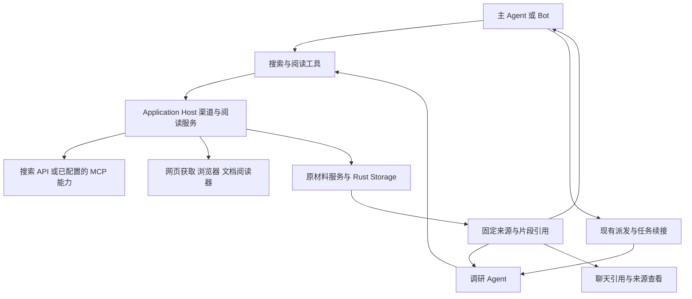

# 联网检索、网页阅读与来源引用设计

2026-11-04 整理。状态为设计提案，尚未实施。源码依据为 Varin `aafddf68c` 和 smartsearch `1969e4fa32a74d0d48b2c752afbadf496e71ef6e`。

本文承接联网检索讨论，确定产品行为、执行职责、材料衔接和交付顺序。现有实现说明见[检索](../retrieval.md)、[协作](../collaboration.md)、[架构](../architecture.md)和[Host harness](../../packages/web/application-host/lib/harness/DOCUMENTATION.md)。本文描述的目标行为应在实现完成后并入对应领域文档。

## 1. 目标与设计判断

联网能力应让 Agent 容易找到相关来源、读到回答问题所需的内容，并在追问和协作中继续利用这些材料。用户能够查看回答的依据、调整调查方向，并接着讨论。系统承担渠道适配、内容定位、来源保留和实际执行管理，模型依据问题和发现决定如何调查。

Varin 已有执行循环、调研 Agent、后台任务、浏览器、文档读取和材料存储。这次围绕这些基础完成联网能力的衔接。普通查询直接使用搜索与阅读工具，长程调查使用现有 Agent 协作与任务续接。辅助模型作为可选的渠道选择和材料选段能力参与。

目标适用于通用、编程、科研、办公和 Bot。具体任务能够使用的能力取决于实际 Host、连接配置和授权，与前端外壳及是否选中项目分别处理。

### 产品行为

| 使用情境 | 目标体验 |
| --- | --- |
| 查一个事实、参数或官网 | 搜索直接给出有用的来源与摘录，需要时继续阅读 |
| 阅读已知 URL | 直接读取，支持带问题选段、章节、表格、精确查找和全文续读 |
| 比较产品、调查争议或整理论文 | Agent 自主组织持续调查，用户可以补充要求、查看过程和停止 |
| 对已有回答追加条件 | 先利用相关对话和已取得材料，按需要补查或刷新 |
| 子 Agent 汇报 | 结论和引用的来源一起交付，接收者能直接查看依据 |
| 页面或渠道失败 | 已取得的有效内容继续可用，并说明具体失败及可采取的下一步 |

工具描述表达真实能力、输入含义和输出性质。调查顺序、笔记结构和结论组织由 Agent 决定。完整方案的落地质量，以真实任务中找到有效依据的成本、连续性和可核验性判断。

## 2. 已确认的现状与问题

### 2.1 默认搜索在实际工具准备中被过滤

设置页在没有显式渠道配置时展示默认搜索。`resolveConfiguredSearchProvider` 对同样的状态选择匿名 Exa MCP，并在失败时回退 Parallel MCP。但 `createWebRuntime.prepareConfiguration` 要求 `Boolean(settings.search)`，导致未配置渠道时不发布 `websearch`。相邻测试把这个结果固定成预期。

因此，默认搜索的服务实现存在，模型实际取得的工具集合仍可能缺少搜索入口。应统一设置解释、可用性准备、工具披露和实际执行的判断。缺省配置代表产品提供的默认搜索，明确关闭、无效配置和凭据缺失各有自己的含义。[配置解释](../../packages/web/application-host/lib/harness/harness-web-settings.ts)、[渠道解析](../../packages/web/application-host/lib/harness/web-search.ts)、[工具准备](../../packages/web/application-host/lib/kernel/web-runtime.ts)、[现有测试](../../packages/web/application-host/lib/kernel/web-runtime.test.ts)

### 2.2 查询目标与关键词的语义未贯通

`websearch` 接受 `query`、`queries` 和 `objective`。当前服务把每个输入都作为单独搜索项，`objective` 没有指导其他查询和内容选择。模型同时传目标与关键词时会额外搜索目标文本。

Provider 接口以单个 query 为中心，无法充分利用支持目标与多关键词联合输入的服务。当前整个结果只有一个顶层 `providerId`，并行查询分别发生回退时，也无法准确表达每项的来源。[搜索服务](../../packages/web/application-host/lib/harness/web-search.ts)、[协议](../../packages/protocol/src/harness-web.ts)

### 2.3 渠道能力和返回材料被过度简化

当前配置只有一个活动搜索渠道，支持 Brave、Exa、Tavily、Jina、SearXNG。Provider 能力声明主要覆盖分页。页面描述、正文摘录与不同服务返回的文本被归并为 `snippet`，作者、摘录范围等信息缺少统一表达。

域名筛选在部分渠道请求中没有传给上游，只对返回结果做过滤，可能显著减少有效命中。Jina 适配器也没有落实公共接口接收的 `recency` 条件。需要分别表达请求条件、实际应用方式及未满足项。[渠道实现](../../packages/web/application-host/lib/harness/web-search.ts)、[结果类型](../../packages/protocol/src/harness.ts)、[设置页](../../packages/ui/src/components/sections/harness/WebSettings.tsx)

### 2.4 网页阅读已有基础，内容选择与完整性仍有缺口

现有 `webfetch` 能提取 HTML 正文、保留快照，按行、章节、元素与关键词读取，也能交给 PDF 阅读器。默认 HTML 阅读返回整份提取后的 Markdown。关键词查找基于文本匹配，还没有按自然语言问题选择相关段落的机制。

下载大小控制与模型输出控制分属不同位置。现有 HTML 获取在截取输入后仍可能以普通成功正文返回，缺少明确的采集不完整状态。浏览器渲染依赖显式启用和 `render` 请求，阅读失败后没有衔接为统一的读取选择。[网页获取与选择](../../packages/web/application-host/lib/harness/web-fetch.ts)、[关键词投影](../../packages/protocol/src/web-page-text.ts)、[模型输出投影](../../packages/web/application-host/lib/kernel/web-runtime.ts)

### 2.5 来源展示、最终引用和协作交接尚未连通

搜索活动已经展示来源链接、日期与摘要，阅读活动能展示段落和范围。PDF 有 `varin-material://` 引用入口，材料具备内容 hash、固定快照、分享和回收机制。普通搜索结果没有统一可回读的来源引用，网页片段也没有贯通最终回答中的引用体验。

现有材料可显式分享给相关 Thread，附件也能沿派发、消息和报告交付。普通 `webfetch` 返回的 snapshot 字符串还没有形成同样顺畅的来源交接。接收方持有字符串与取得读取权是两个独立事实。[来源活动](../../packages/ui/src/components/conversation/ChatSourceTools.tsx)、[PDF 引用](../../packages/ui/src/lib/materials/pdfMaterialCitation.ts)、[材料分享](../../packages/web/application-host/lib/harness/material-collections.ts)、[文件交接](../collaboration.md#文件交接)

### 2.6 现有优势继续使用

`research_search` 已支持 OpenAlex 与 Semantic Scholar 的论文元数据、关系和分页。材料服务已支持固定来源、正文检索、文档视图和显式共享。网络出口已有代理、目标校验、重定向与取消管理。调研 Agent 已有开放式指令和持续执行能力。这些分别成为发现、阅读、来源管理与调查执行的原有入口。[学术发现](../../packages/web/application-host/lib/harness/research-search.ts)、[调研角色](../../packages/protocol/src/harness-presets.ts)、[网络出口](../../packages/web/application-host/lib/harness/egress.ts)

## 3. 对参考方案的取舍

### 3.1 从 smartsearch 吸收的设计

渠道按具体操作说明用途与能力，只让已配置、启用且适用的连接进入选择。搜索、抓取和联网模型回答各自保留来源性质。多个请求可并行执行，部分请求失败仍保留已有材料。用户能看到实际渠道、回退和停止原因。

这些设计适合进入 Varin 的 Host 适配器与观察结果。smartsearch 的 CLI、桌面配置和研究执行有独立产品职责，Varin 使用自己的设置、执行 owner 和任务生命周期承载对应能力。[渠道与执行源码](https://github.com/konbakuyomu/smartsearch/blob/1969e4fa32a74d0d48b2c752afbadf496e71ef6e/src/smart_search/jev_search.py)

smartsearch 的研究补搜包含固定词缀，继续条件依赖有限预览上的概率判断，可选二分过滤会多次判断材料。Varin 的 Agent 可以依据刚读到的具体内容形成新问题，决策模型主要帮助选择，相关性概率保留为模型判断，产品状态来自真实执行记录。[判断与过滤源码](https://github.com/konbakuyomu/smartsearch/blob/1969e4fa32a74d0d48b2c752afbadf496e71ef6e/src/smart_search/jev.py)

### 3.2 对产品调研报告的采用方式

用户提供的《联网搜索产品调研》强调连续追问、来源控制、按问题阅读和可核验依据。这些成为本方案的产品目标。报告建议的研究对象、约束、信息缺口和证据表，可由 Agent 按任务自由组织，产品支持保存与继续使用。

供应商优劣、中文效果、智能选路和过滤收益仍需真实任务比较。原报告属于本地调研输入，未随公共仓库复制；本文将影响设计的判断写明，并对接口事实引用官方资料。

## 4. 执行结构与状态归属

| 职责 | 归属 |
| --- | --- |
| 对话、调研任务、工具调用、等待、取消和报告交付 | 既有 Rust runtime、Catalog 和协作机制 |
| 渠道配置、凭据、能力适配、搜索合并和阅读选择 | Application Host 对应领域服务 |
| 网络目标、代理、重定向和原请求取消 | 原 egress owner |
| 浏览器登录态、页面操作和渲染 | 实际执行 Host 的 BrowserOwner |
| 原文对象、快照、读取关系、保留与回收 | 原材料服务和 Rust Storage |
| 辅助模型选择、推理请求和用量 | 原模型配置、用途推理和用量记录链路 |
| 来源卡、引用、设置和活动呈现 | application-client 合同与 UI |

远端 Host 使用自己的连接和执行能力，客户端显示相应状态。桌面提供的浏览器能力按实际 owner 可用性提供，切换界面不能借用另一个 Host 的登录态或权限。外部 Harness 经现有工具和协议接入时按其真实能力呈现。

## 5. 搜索语义与渠道组织

### 5.1 模型输入保持轻量

`websearch` 保留单查询和批量查询入口。单查询足以发起搜索。可选目标表达本次要查清什么，时间、域名与语言地区等条件在有意义时添加。

目标和关键词共同出现时，目标用于解释查询和选择相关摘录。只有目标时，支持目标输入的服务直接使用它，关键词式服务可以将这段文本作为查询。目标始终保留为目标，不额外生成一条重复搜索。既有 URL 阅读继续支持，并将其结果与发现结果按实际性质区分。

批量查询共享本次目标和公共条件，保持逐项身份、失败与结果归属。支持批量语义的适配器可以一次调用上游，其他适配器分别发起请求。合并后仍能解释一个来源由哪些查询命中、经过哪些渠道。[Parallel 的目标与关键词输入](https://docs.parallel.ai/search/search-quickstart)

Agent 可以直接指定一个已配置连接，也可以交给默认选择。连接标识和简介由能力目录按需提供，单次常规搜索只需提交问题。

### 5.2 连接、能力和选择策略分别保存

每个搜索连接拥有自己的稳定身份、名称、适配类型、端点、凭据引用、启用状态和可编辑简介。同一家服务可以存在多个连接，用户能够区分账号、代理和自托管实例。实际能力由适配器声明，用户说明作为选择参考。

能力描述覆盖真实支持的搜索输入、域名与时间控制、语言地区、结果分页、正文摘录及已知 URL 阅读。模型只看到完成本次任务需要的能力信息；设置页能够展示更完整的连接状态。

默认选择和备用连接单独设置。原单一渠道配置迁入连接列表后继续作为默认，旧凭据引用保留。无配置时使用产品提供的免密默认，明确关闭保持关闭，无效配置显示配置问题。

### 5.3 选择与回退

先按所需操作、明确条件、启用状态和用户选择得到适用连接。显式指定连接时直接使用该连接。自动选择时按用户配置的默认和备用顺序执行。

多个连接都适用且用户启用了智能选择时，可以由辅助模型挑选。只有一个适用连接或调用者已指定时直接执行。智能选择失效时，自动模式使用预先配置的默认路线并报告实际选择。

渠道失败只沿用户启用的备用路线继续，保留前一项的实际原因。成功但零命中是有效搜索结果，调用方可以决定换词或补查。固定渠道请求遇到失败则返回该连接的状态。用户也可以明确要求多个渠道互补搜索，结果逐项到达并合并。

429 等限流按上游提供的等待信息和现有重试机制处理。凭据错误、网络故障、协议错误和没有结果分别表达。取消需要传到原执行者，已经完成的其他查询继续保留。

### 5.4 筛选条件要产生真实效果

“优先某些来源”用于检索与排序，“只允许某些来源”要求最终结果符合范围。全局或项目网络策略继续由原权限 owner 执行，任务内的搜索偏好单独保存。

支持条件的渠道在请求时传给上游。域名过滤等可确定的条件同时在结果侧核验。通过搜索操作符或返回后过滤实现的适配器，应明确其实际方式。仅靠前几条全网结果过滤不能被当作完整的限定范围搜索，应优先使用能满足范围的渠道。

时间条件说明依据是发布日期、更新日期还是服务索引定义。日期未知保持未知。严格条件无法满足时返回具体缺失能力和可用选择，普通偏好则允许返回带说明的结果。语言地区同样区分倾向和硬过滤，保留技术术语、版本号与精确报错文本。[Brave 搜索参数](https://api-dashboard.search.brave.com/api-reference/web/search/get)

### 5.5 渠道覆盖与扩展

已有 Brave、Exa、Tavily、Jina、SearXNG 适配继续使用，完善其实际接口能力与输出。默认 Exa 和 Parallel 需按当期协议维护。Exa 的 keyless 和 Parallel 的匿名入口有免费使用边界，设置页显示其性质，独立凭据连接便于持续使用。[Exa MCP](https://exa.ai/docs/get-started/exa-mcp)、[Parallel Search MCP](https://docs.parallel.ai/integrations/mcp/search-mcp)

中文来源、软件文档和学术发现按真实任务扩展。`research_search` 保留论文身份和关系查询语义，与通用搜索共享来源呈现和阅读入口。文档类渠道可以暴露自己的库与版本选择能力，返回实际命中的版本信息。

现有 MCP 工具仍可被 Agent 直接使用。需要加入统一搜索选择的 MCP 能力，通过适配器明确输入、输出、凭据和来源性质。具有服务端联网能力的模型连接可作为可选渠道接入，其返回的生成答案和供应商引用分别保存。接口适配应确认实际启用了联网能力，模型名称和普通对话成功均不作为联网能力依据。

## 6. 结果组织与来源性质

### 6.1 返回适合继续工作的结果

模型默认获得查询完成情况、来源标题与 URL、相关内容、已知时间和继续读取的引用。渠道诊断、完整响应和技术细节通过详情查看，正文避免重复携带同一份材料。

每项结果保留实际渠道和查询归属。URL 的无关追踪参数可在有明确规则时归一化，影响语言、版本或页面内容的参数保留。合并重复结果时保留不同的有效摘录及渠道记录，引用不同观察的内容时仍指向各自观察。

引用转载与原始公告的关系可以由 Agent 发现并说明。URL 去重只说明重复命中，不自动推断来源独立性。

### 6.2 内容类型保持可辨认

| 实际获得的内容 | 模型与用户能够知道的事实 |
| --- | --- |
| 搜索标题和描述 | 搜索命中线索，可继续打开来源 |
| 供应商返回的页面摘录 | 服务返回了这些内容，保留原服务对摘录的说明 |
| 本次读取的原文片段 | 来自指定快照的具体范围，可扩展上下文 |
| 供应商生成摘要或联网模型答案 | 属于生成内容，附原供应商给出的来源 |
| 论文元数据或摘要 | 属于该论文记录，全文访问状态独立表达 |

供应商未说明内容性质时保留未知。原文片段和生成解释有独立表示。读取状态来自实际观察，相关性及结论可信程度属于模型判断。

### 6.3 输出范围与完整材料分别管理

展示数量、展示长度和工具输出预算约束当前返回页。完整来源及已保存的段落可按同一引用继续读取。摘要、精确引文、表格和代码保持结构，省略处有明确标记。

搜索服务自身有分页时返回真实续页，只有有限候选集的服务报告本次得到的范围。展示分页与供应商分页分别表达，继续展示已取得内容可以复用原结果。刷新查询代表新的观察，原引用继续指向原结果。

## 7. 带问题的网页与文档阅读

### 7.1 阅读入口

`webfetch` 接受 URL、已发现来源或固定快照，支持可选的阅读问题。`document_read` 保留文档来源、对象、结构与页面语义。两者共用材料身份和片段定位，来源可以沿阅读流程自然衔接。

输入只有 URL 时，短内容直接返回，长内容返回标题、结构和可继续读取的正文页。带问题时优先返回相关原文段落。明确指定章节、范围、表格或精确查找时按选择执行，完整读取也能通过分页完成。

调用方只提出问题即可获得可用结果。所选段落仍可展开前后文、查看所在章节或改变阅读范围。没有找到相关段落时说明查找范围，给出目录或后续入口。

### 7.2 段落选择

提取阶段保留标题层级、段落、列表、代码、表头和必要的表格关系。技术文档和讨论页面在正文提取不足时使用适合其结构的表示，关键条件与正文保持邻接关系。

基础选段结合查询词、精确实体、标题结构和原文位置。中文与中英混合内容使用适当的文本切分，技术符号和错误串保持可匹配。选出的片段携来源范围，后续投影保持原文。

阅读辅助默认由用户选择是否启用。长材料或跨语言匹配需要进一步理解时，可将结构和候选段落交给辅助模型选取、扩展。辅助模型返回已存在的段落定位，程序读取这些范围。解释性输出单独标注，保留被引用的原文。

对一次阅读已经足够的页面，直接返回结果。选段开销和节省的主模型输入一起进入效果比较，不设置固定逐页判断或反复过滤步骤。

### 7.3 获取与阅读路径

已知固定来源优先从原材料读取。新 URL 使用普通获取与正文解析，需要 JavaScript 且渲染已启用时可衔接实际 Host 的浏览器渲染。PDF 和 Office 路由到已有文档阅读器，页面图像与显式 OCR 使用现有能力。

需要登录、交互或视觉判断的任务可以继续使用 Browser Use。浏览器身份与公开网页获取分别管理，登录态跟随实际 BrowserOwner。页面导航或点击产生的内容作为新观察保留。

失败结果说明已经获得什么、缺少什么，以及可直接继续的入口。浏览器不可用时返回该 Host 的实际能力，外部获取服务只使用已配置且允许承担相应访问的连接。

### 7.4 采集完整性

下载字节、提取覆盖和展示范围分别记录。输入被截取、文档解析缺段、只取得局部页面与显示分页有不同含义，分别反馈。

输入限制沿实际网络和解析器的资源能力处理。流式字节计数使用真实字节，字符解码保留跨块边界。已有上限应注明作用及配置来源，不能把截断后的内容发布为完整原文。

HTML 的继续展示基于同一次已取得的快照。底层只取得部分网页时标记采集不完整，再获取会形成新的观察。原页面的限定条件缺失时，工具明确暴露这个事实，供 Agent 决定继续获取或改用其他来源。

## 8. 固定来源、引用与协作交接

### 8.1 需要固定的事实

来源记录至少能够关联到产生它的查询或读取操作、实际连接、来源地址和取得时间。页面的发布时间、更新时间、适用版本在有可靠数据时保存，未知字段保持缺失。

正文保留内容版本和表示类型，片段保留在该表示中的位置。供应商摘录按供应商返回内容保存，读取原页后另建对应观察。搜索时的摘录和后来访问的页面版本可以并存。

这些事实由材料 record、原文对象和原工具调用关联表达，沿已有 Rust Storage 写入与回收。原历史保留模型实际收到的内容，材料对象供再次阅读和分享使用。内容寻址可复用相同正文，避免重复保存完整供应商响应、全部原文和多份生成摘要。

### 8.2 引用入口

工具为可引用的来源或片段返回稳定引用和可直接用于正文的链接。模型选择引用，程序解析来源身份与实际位置。既有 `varin-material://` 入口扩展网页和文档片段定位，PDF 原引用继续按其原快照、页面与区域解析。搜索发现型来源使用同一来源解析服务返回对应的观察内容。

引用解析核验来源是否存在、调用方是否可读、定位是否属于原表示。用户点击后显示原材料与上下文。普通 HTTP(S) 链接仍正常打开，其页面内容可在用户或 Agent 阅读后形成材料记录。

模型虚构、损坏或已失去读取关系的引用显示明确状态，保留原文字和已知地址。系统只核验引用结构和真实材料归属，语义上是否支持结论通过原文及 Agent 判断呈现。

复制或导出回答时，已知公开来源可转换成标题与原始 URL，必要时带页面、章节和引用文字。需要保持精确快照时，由用户选择导出相应材料。仅本机可读的材料引用在分享时说明其可访问范围。

### 8.3 子任务报告和消息

调研结果中的引用应成为消息的 typed 来源关系，类似现有附件交接。原发送 owner 校验发送者的读取权、实际收件者和来源版本，然后随消息交付必要的保留关系。接收者能够直接使用原引用阅读，也能够继续向明确收件者转交。

模型负责选择要交付的来源和表达结论。材料捕获、可读性检查、跨 Host 传递及保留由原 owner 承担。引用解析只能连接发送者确实已获得的来源，任意正文中的 URL、snapshot 字符串或文件 hash 均不自动建立读取权。

最终报告沿 `child_report` 和普通报告交付保留来源，相关历史读取继续携带这些关系。接收者已经取得的引用在子任务结束或删除后保持可用。准备失败沿现有消息与附件合同处理，保留原幂等身份和实际提交状态。

### 8.4 连续对话、分支和长期资料

追问从现有对话、任务状态及相关来源继续。Agent 能列出或检索当前工作已取得的来源，查看原摘录，按需要重开页面。用户追加条件时更新当前调查理解，旧来源仍可用来比较差异。

压缩保留有效摘要中的来源关系及用户明确保留的材料，引用不会因为正文退出当前模型窗口而失效。分支按原历史与读取授权继承来源，恢复到某个分支时看到对应观察。

收藏资料沿现有材料集合与长期资产机制保存。Bot 知识中的结论带回原来源及时间，实时问题可刷新对应来源。采集时间只说明何时取得内容，知识里的事实能否继续使用由任务需要和实际变化决定。

## 9. 任务执行、辅助模型与上下文

### 9.1 日常联网与持续调查

主 Agent、Bot 和已派发任务都可以直接搜索阅读。需要持续探索时使用既有调研角色或自由派发，使用相同工具与来源体系。任务可以后台运行、接收新要求、等待或结束。

已有相关任务可直接续接，保留它的上下文、材料和先前发现。改变目标较大时，由派发者选择新任务并交付相关来源。对过时结论或新版本变化，执行者可以刷新指定来源，再解释差异。

任务过程由真实搜索、读取、助手消息和已交付结果呈现。停止时保留已经成功的工作；能交付已有回答时沿现有报告路径交付，实际执行停止与用户停止观察分别处理。

### 9.2 可选渠道选择辅助

选择岗位支持用户已有的决策模型或普通 LLM 连接，选择岗位自身的模型和思考配置独立保存。默认使用轻量的配置选择，用户启用智能选择后只在存在实际选择空间时调用。

输入由本次目标、关键词、明确条件、适用连接简介和必要的近期失败信息组成。当前工具请求已经完整表达问题时直接使用这些信息。确有指代需要时，补充邻近的相关对话，按现有请求预算处理，保留本次目标、条件和候选连接。

选择模型只返回可用连接的选择。运行 owner 核验结果并执行。判断失败使用用户配置的自动模式默认路线，保留原因。精确指定连接的请求沿指定连接执行。

### 9.3 可选阅读辅助

阅读岗位输入当前问题、材料身份、结构和必要候选段落，沿原模型用途请求记录用量。超出请求容纳范围时按文档结构分批或使用局部候选，让每个处理结果仍指向完整材料。

阅读辅助的输出用于选择和解释材料。继续阅读、改变问题或关闭辅助时，原材料仍可由确定的范围读取。相关性评分不改变来源读取状态，也不自动形成事实核验标志。

### 9.4 提示词原则

工具说明清楚表达搜索结果的性质、如何继续阅读、可选条件以及引用方法。调研 Agent 保持目前围绕问题追踪线索、综合依据和说明未解决问题的开放式指令。

不固定调查轮次、搜索次数、分类栏目或必须经过的模型链。用户明确给出的时限、成本或范围要求通过现有任务机制表达，供应商与协议的真实上限在适配器说明。简单查询可以直接回答，复杂工作可以持续探索。

## 10. 缓存、资源回收与失败处理

### 10.1 缓存以完整请求语义为依据

搜索缓存匹配连接及配置身份、查询目标和关键词、语言地区、时间与来源条件。阅读缓存还区分 URL、获取方式、身份与网络策略。包含登录态的材料保留原访问范围，明确刷新绕过旧观察。

相同材料的不同阅读问题共用正文，选段结果按问题与表示版本区分。并发相同请求可以共享原生产者，调用者各自获得合法的读取关系。取消其中一个观察者保留其他消费者的工作，最后一个消费者离开时由原 owner 停止生产。

缓存有效期根据内容语义和实际供应商能力选择，可用的更新时间与条件请求帮助刷新。到期内容需要实际清除，内存压力下可回收可重建缓存。当前已引用快照的寿命由读取关系决定，与短期响应缓存分别管理。

### 10.2 资源退出

| 资源 | 保留和释放依据 |
| --- | --- |
| 活跃网络与解析工作 | 原执行者完成或实际取消后释放 |
| 进程内响应缓存 | 到期、替换、资源压力或 Host 关闭时清理 |
| 会话与报告引用的来源 | 最后一个真实历史、收件者或工作引用释放后回收 |
| 用户收藏的资料 | 由相应持久集合和删除操作管理 |
| 辅助模型生成的可重建选段缓存 | 与问题、源版本和辅助配置关联，可独立清理 |

删除会话、分支或任务时沿原保留关系清理，存活接收者引用继续保护对应内容。下载与解析中断留下的临时文件由原操作回收，来源记录只有在实际提交后才作为可回读材料交付。持久材料读取按索引和已知引用定位，避免在每次查询时枚举全部历史。

### 10.3 失败对调用方有可用信息

区分未配置、能力不支持、鉴权失败、限流、网络失败、没有命中、页面访问失败、提取不完整和取消。一次批量工作保留各项状态，整体成功不能掩盖其中失败的查询。

错误给出可直接采用的下一步，例如换查询、继续原结果、查看章节、使用渲染、刷新或修正连接配置。重试遵循原执行身份及结果确定性，未知完成情况先恢复观察，避免另起一次可能计费的请求。

权限、网络出口和网页内容信任边界沿原 owner 实施。选择模型得到的是必要的任务信息与渠道描述，凭据留在连接 owner。第三方搜索收到本次查询和明确条件，网页内容保持来源材料的身份。

## 11. 聊天与设置体验

### 11.1 聊天中的搜索与阅读

沿现有三种聊天呈现模式组织工具活动。对话优先模式继续把连续操作收纳到动态活动行，展开后查看搜索词、来源和阅读片段。已有来源列表与文档阅读样式继续打磨。

运行中展示实际查询、阅读来源和最近动作。完成后可显示查询数量、来源数量和读取情况，数值分别对应真实含义。单个查询直接显示有意义的标题，详细渠道与失败信息按需展开。

来源列表以标题和相关摘录为主，域名、日期和内容类型作为次级信息。长标题、长 URL 和混合语言自动换行，长摘录默认收纳，用户展开后保留选择。颜色跟随当前主题与重点色，状态同时有文字说明。

### 11.2 正文引用与来源预览

正文引用保持紧凑，点击后展示原文片段、来源身份、时间含义和上下文入口。桌面可在现有内容区域打开轻量预览，移动端使用适配视口的详情。长原文在阅读区域中滚动，键盘、焦点与关闭行为沿现有组件合同。

可继续操作包括查看上下文、打开原网页、围绕来源追问、刷新来源、收藏和重新核对相关结论。刷新后原引用仍指向原观察，新内容可用于后续回答。引用来源访问失败时展示保留的观察及具体状态。

动效沿现有展开、收起和可打断机制执行。流式引用在信息到齐后原位更新，避免反复插入占位卡片导致正文滚动跳动。

### 11.3 设置组织

“网络检索与文档”页按搜索连接、网页与文档阅读、可选辅助、来源偏好组织。

搜索连接展示名称、类型、启用状态、默认或备用用途及实际能力。支持添加、编辑、测试和选择连接。测试结果标注本次检查的时间与动作，配置完整性和最近测试状态分别显示。免密默认给出服务说明和配置独立连接的入口。

阅读部分展示普通网页获取、当前 Host 的浏览器能力、外部读取连接及已有文档组件。辅助部分配置是否启用、模型、思考等级及适用操作。来源偏好提供优先和排除入口，明确当前作用范围。

一次任务中的“这次只看官方资料”留在任务上下文及当次调用中。用户表达长期偏好时沿现有设置或 Bot 记忆入口保存，并能查看与撤销。

## 12. 代码落点与升级

| 模块 | 实施责任 |
| --- | --- |
| `extension-builtins/src/web-tools.ts` | 更新搜索、阅读与来源引用的模型端合同及披露说明 |
| `protocol/src/harness-web.ts`、`harness.ts` 与设置类型 | 目标与查询、逐项来源、实际筛选、阅读范围和连接结构 |
| `web/application-host/lib/harness/web-search.ts` 及渠道模块 | 多连接解析、适配能力、合并、回退和搜索结果投影 |
| `harness/web-fetch.ts`、文档 reader | 问题选段、结构保留、完整性、获取路径和缓存清理 |
| `harness/web-materials.ts`、`material-collections.ts` | 固定来源、片段、集合、授权和保留关系 |
| `web/application-host/lib/kernel/web-runtime.ts` | 默认能力准备、原调用衔接和 typed 来源交付 |
| 原协作、附件、历史与 Rust owner | 消息和报告中的引用关系、跨任务读取、删除与恢复 |
| `application-client`、UI 来源组件与材料引用解析 | 来源查询合同、最终引用、预览、设置与实际活动呈现 |

新增搜索连接由原设置 owner 将已有单渠道配置归一化，保留端点、凭据引用、启用意图和作用范围。首次保存写当前结构。无配置与明确禁用保持区分，项目覆盖沿现有可信设置规则生效。

工具 schema 与语义变更通过既有版本化声明准备。已受理执行保留自己的配置与参数解释，恢复读取原记录，避免配置变化重放已完成的网络或模型工作。新请求使用当前合同。

旧聊天中的 URL、工具结果和快照继续正常显示。增强引用只基于已有可证明的来源关系，缺失元数据保持未知。需要持久结构变化时由原存储 owner 自动升级，用户正常启动即可使用新版。

## 13. 分阶段交付与验收

阶段用于安排实现与审查，整体完成标准覆盖全部目标体验。每阶段完成后将实际合同并入领域文档，本文保留尚未交付的部分和设计依据。

### 阶段一，修复入口并完成一次查询的来源链

修复默认 `websearch` 可用性，统一设置、准备和披露。落实目标与关键词语义、逐项渠道和筛选状态，保留来源内容性质。网页阅读提供结构、原文范围、完整性与续读入口，最终回答能够引用本次取得的来源。

验收重点是用户使用默认搜索完成普通问题，得到来源和相关内容，点击引用能回到当时取得的材料。使用显式连接、返回空结果、批量部分失败和新旧快照时保持准确。

### 阶段二，多连接与问题导向阅读

交付连接列表、默认和备用选择、实际能力适配及有意义的测试入口。完成中文与混合语言的基本选段、表格和代码结构保留，并接通已启用浏览器的读取路径。贯通取消、失败返回与缓存释放。

验收重点是限定来源真正参与检索，问题目标影响内容选择，长页面能直接取得相关段落并继续查看上下文。不同 Host 的实际能力在调用和界面中一致。

### 阶段三，调研续接与跨任务来源交付

让来源引用沿派发、消息、报告、历史和压缩保留。完成接收者读取关系、用户收藏及删除回收。现有调研 Agent 能在同一任务中接收追加要求并复用来源，用户能够检查依据和局部重查。

验收重点是主 Agent 收到子任务报告后直接读取证据，原任务结束后仍可读，刷新、分支与删除不会串用另一份内容或过早释放来源。

### 阶段四，可选智能选择与阅读辅助

提供决策模型和普通 LLM 的选择岗位，完善可选阅读选段与相应用量。选定连接和简单单路请求直接执行，辅助失败保持既有自动选择或确定性阅读可用。

以实际任务对比辅助开启前后的有效来源、延迟、主模型输入、辅助模型消耗和失败恢复成本。配置入口可交付，默认是否启用及适用条件依据实际收益确定。

### 验证范围

优先复用现有测试，在真实故障边界补少量稳定用例。入口可用性应验证最终准备出来的工具集合，避免只测试底层搜索函数。适配器用固定响应验证筛选、批量归属、回退和内容性质；原生材料链验证授权、重启、报告、分支与回收。UI 验证引用定位、来源状态和交互保持。

真实联网比较取用户遇到的问题，覆盖中文来源、精确报错、指定版本、近期变化、长页面、条件追加、来源冲突和无结果。固定来源回放用于判断代码变化，真实查询用于判断当前服务效果。记录首次有效结果和完整任务的等待、请求与 Token 消耗，以及结论能否回到支持它的原文。

## 14. 实施前保留的选择空间

整体能力和行为按本稿推进。新增中文渠道的优先顺序、实际供应商默认选择、阅读辅助触发条件，以及默认展示长度，需要结合真实请求表现确定。外部 API 的限额按正式文档接入，可配置默认与硬性约束分别表达。

这些取值不会改变来源身份、开放式 Agent 调查和现有 owner 分工。实施过程中发现接口能力或真实使用方式与预期有差异，应更新对应设计与实际合同。

### 外部参考

- smartsearch 的渠道组织、判断与执行基于上述固定源码提交，许可证为 MIT。复用其实现时保留对应授权与来源说明。
- Exa 搜索支持返回 highlights 等内容，适配时保留内容性质与来源信息。[Exa Search](https://exa.ai/docs/reference/search)
- Tavily 的深度、来源、日期等参数具有具体上游语义，按实际使用的接口能力映射。[Tavily Search](https://docs.tavily.com/documentation/api-reference/endpoint/search)
- 工具边界、返回内容和 Token 成本的取舍参考 Anthropic 的工具设计复盘。[Writing effective tools for agents](https://www.anthropic.com/research/writing-tools-for-agents)
